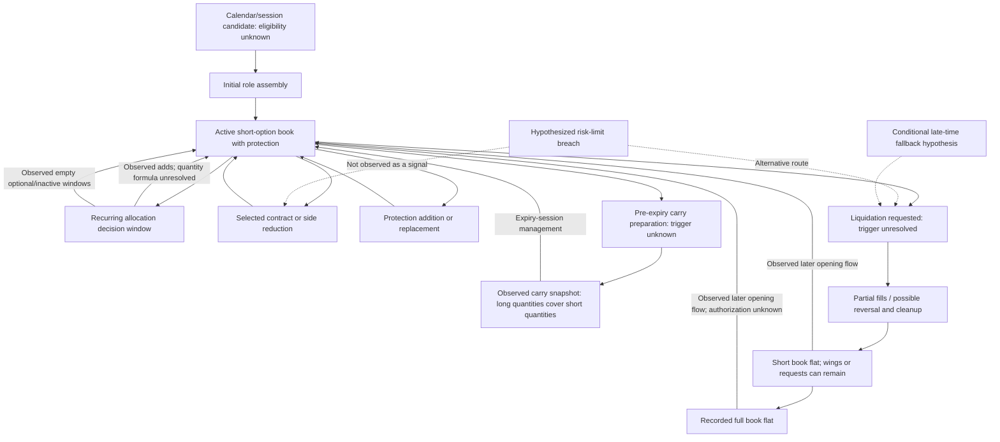

# Algo 8 — Allocation, Entry, Exit and Risk Playbook

Research date: **27 October 2026**. Execution times are observed log event seconds
in **IST**, not independently certified exchange matching times. This report
reconstructs recorded operations; it does not supply a replacement alpha model.

## 1. Executive summary and nine direct answers

1. **Initial units:** ordinary pre-expiry 09:17 books usually hold **195 units
   per role in NIFTY and 60 in SENSEX**. Those are three observed base quantities
   of 65/20, not independently verified exchange lot definitions. Exceptions and
   expiry-only flat starts have different size.
2. **Subsequent size:** variable counts of mainly single-base-unit short orders.
   Common pre-expiry per-role modal weights start **3,2,3,1,4,1,2**. Actual windows
   differ substantially; no exact capital/risk-budget sizing formula is recovered.
3. **Cadence:** 17 recurring pre-expiry windows are strongly established, but
   they are not all activity and not an every-15-minute full-book replacement.
   Late inventory openings occur too; some are corrective reversals. Overall
   management is a mixture of scheduled and other recorded flow.
4. **Market conditions:** observed openings and recurring additions occur across
   lagged directional/choppy, rising/falling and range categories. The full
   eligible/no-entry calendar is unknown, so unconditional market independence
   is not established.
5. **Variables that demonstrably matter:** clock and actual active-book state
   explain much observed timing. Side exposure, strikes and quantities change
   with the book. No unique market threshold is shown to generate the decisions.
6. **Middle reductions:** selected short contracts, CE/PE allocations and wings
   are closed separately. Some losing covers follow adverse moves; some bursts
   show close/overshoot/neutralize mechanics. Exact stop versus trail versus
   combined-controller causes remain unresolved.
7. **Final liquidation:** a strong conditional late concentration occurs around
   **15:14 after 3 August**. It is not a universal all-leg deadline. Shorts and
   wings can finish seconds apart, early exits/re-entry occur, and residuals exist.
8. **Risk limits:** all 31 recorded carry books end with long quantities at least
   matching shorts on each right. ₹2 crore, 4% carry and 1% expiry capital stops are supplied
   wording. ₹200,000 is the arithmetic 1% reference, not a verified trigger.
   Protective positions and measured risk changes are observable; true margin,
   NAV, scope, reset and order-cancellation limits are not.
9. **Exact versus inferred:** quantities, cashflows and atomic book transitions
   are exact within the received-record convention. Intent, original allocation
   IDs, eligibility, decision timestamps and precise controller thresholds are
   not uniquely identified.

### Evidence audit

An independent accounting implementation processed **41,421 fills**,
**39,874 parent orders**, **35 cycles** and
**65 observed cycle-sessions**: 32 pre-expiry and 33 expiry.
It retains the full before/after contract book at **21,882
atomic event seconds**. Multiple events/orders in one session are not independent
trials. Net all fills sharing a second before declaring a flat state.

It independently agrees with **24,860** cached
minute quantity snapshots and **25,565** marked
P&L snapshots, including missing marks. Maximum P&L difference is
**4.4e-11 rupees**. Reverse within-second
attribution can change realized versus unrealized P&L by up to
**₹822.07**, while net inventory
and cash remain unchanged.

Before-event preceding-quote equity is available in
**21,460/21,882**
seconds; full modeled Greeks in **20,539/21,882**.
Missing legs are not zeroed. All market quotes used for event marks precede the
fill minute; after-event marks freeze that same price state. They are stale-price
estimates, not executable NAV. Some order-label minutes precede those quotes,
so an execution-state context is not automatically a pre-decision trigger input.
Window-level market tests use conservative completed candles before the window.

The reconstruction assumes zero inventory before each contract's first received
fill. It cannot establish export completeness, unseen positions, margin or
settlement. The export is treated as the study book; its raw tags do not identify
verified allocation ownership or certify that a single controller generated
every row. Source [Info.txt](Info.txt), [strong register on its dedicated branch](https://github.com/SadamAnjaneyulu/Algo-8-Reverse-Engineer/blob/research/strong-findings/STRONG_FINDINGS.md),
[cover study](research/COVER_REENTRY_FINDINGS.md),
[controller study](research/DEEP_CONTROLLER_FINDINGS.md) and
[economic-candidate limitations](research/ALPHA_CANDIDATE_FINDINGS.md) were cross-checked.
The one-basket recipe in `alpha_highest_ranked_rulebook.json` is **not used as the
original strategy**: it omits the observed ladder and controller. This report
does not reproduce the earlier screenshot's March 2025–May 2026 backtest.

## 2. Initial-entry rulebook

**Paired entry:** 31/32 observed pre-expiry sessions first pair near 09:16, with
the nearest strike to the completed 09:15 close (NIFTY grid 50; SENSEX grid 100).
The initial shorts can comprise several parents, and wings have their own fills.
The four roles being present at 09:17 does not mean one atomic four-leg trade.
The first CE/PE short fills are in the same observed second on
**24/31 ordinary starts**, and within one second on
**31/31**. The first CE wing fill precedes its first CE short on **28/31**;
the first PE wing precedes its short on **30/31**. Each right's first wing and
short are within three seconds on all 31 ordinary starts. This describes first
fills, not completion of all hedge quantity or a proven margin-aware ordering rule.

**Important exception:** NIFTY 5 October first sells a **22450 CE, 65 units at
09:21:21**, buys **23150 CE, 65 at 09:21:24**, then first pairs **22600 CE/PE at
09:30:59**, 130 units each. Its 09:17 book is empty. Earlier references to a
09:30 “initial entry” describe the first pair, not the first exposure.

Ordinary 09:17 net-quantity distributions; excluded delayed-start session is
listed separately rather than allowed to create a zero-size standard:

| Index | Leg | Sessions | Minimum | Median | Maximum | Mode | Mode_sessions |
| --- | --- | --- | --- | --- | --- | --- | --- |
| NIFTY | CE_short | 14 | 195 | 195 | 325 | 195 | 13 |
| NIFTY | PE_short | 14 | 195 | 195 | 325 | 195 | 13 |
| NIFTY | CE_long | 14 | 195 | 195 | 325 | 195 | 13 |
| NIFTY | PE_long | 14 | 195 | 195 | 325 | 195 | 13 |
| SENSEX | CE_short | 17 | 40 | 60 | 60 | 60 | 16 |
| SENSEX | PE_short | 17 | 40 | 60 | 80 | 60 | 15 |
| SENSEX | CE_long | 17 | 40 | 60 | 60 | 60 | 16 |
| SENSEX | PE_long | 17 | 40 | 60 | 80 | 60 | 15 |

Initial seed wings and routine later hedges differ. NIFTY's first seed is near
±2000 (26/28 wings within 100); early SENSEX near ±4000 (21/22 within 200), later
observed SENSEX ±2000 (12/12 exact from 16 September). These are seed observations,
not exact every-order rules. A routine premium budget near 2.5% of each ATM leg
matches within one strike in about 92–95% of later pre-expiry observations, while
exact strike matching is only about half. Missing full-chain bid/ask quotes and
decision timing prevent uniquely recovering that selector.

Recorded flat-start expiry openings are a different size cohort:

| Index | Expiry | Net_book_at_0917 | Meaning |
| --- | --- | --- | --- |
| NIFTY | 2026-06-23 | 1,300/1,300/1,300/1,300 | Recorded flat-start expiry opening; missing prior history cannot be ruled out |
| NIFTY | 2026-08-11 | 650/650/650/650 | Recorded flat-start expiry opening; missing prior history cannot be ruled out |
| NIFTY | 2026-09-15 | 1,820/1,820/1,820/1,820 | Recorded flat-start expiry opening; missing prior history cannot be ruled out |

No capital/margin formula follows from those quantities. In particular, larger
expiry starts do not justify scaling the ordinary pre-expiry seed. See
[initial role timestamps](research/outputs/playbook_initial_role_times.csv) for
every role's first event, label, strike and gross versus net 09:17 quantities.

## 3. Market-condition dependence analysis

### Candidate sessions and missing negatives

For each of the 35 logged expiries, take the preceding **stored continuous-index
session** as a bounded candidate. This yields 32 with recorded pre-expiry shorts
and three without. It is not a certified exchange/strategy eligible universe:

| Index | Expiry | Preceding_stored_session | Status |
| --- | --- | --- | --- |
| NIFTY | 2026-06-23 | 2026-06-22 | outside_export_date_range |
| NIFTY | 2026-08-11 | 2026-08-10 | no_recorded_preexpiry_trade_eligibility_unknown |
| NIFTY | 2026-09-15 | 2026-09-11 | no_recorded_preexpiry_trade_eligibility_unknown |

The 22 June candidate is outside the trade export's date range. For September 15,
September 11 is the preceding stored session; the absence of a September 14 file
is not, by itself, a verified holiday. The other missing pre-expiry histories
cannot be confidently labeled filter rejections or flat positions. Consequently
32/35 is an appearance rate on stored-session candidates, not a verified entry
probability or proof that all eligible sessions were traded.

### Fixed lagged categories

No indicator combination search was run. Prior-15-minute return uses fixed
±0.10% direction bounds; close-path efficiency <=0.30 is choppy, >=0.70 directional;
range <=0.15%, 0.15–0.35%, >0.35% defines small/medium/large. Completed bars before
each window are used; unavailable opening-period history stays unavailable.
Opening comparisons use only the first completed candle, available gap and the
**previous** session's body/range classification. A session's future trend is
never used to explain its opening.

Opening stored-session candidates by lagged prior-session body/range state:

| Index | Lagged_prior_session | Stored_session_candidates | Recorded_entry_sessions | Recorded_rate | Unknown_no_trade |
| --- | --- | --- | --- | --- | --- |
| NIFTY | choppy | 7 | 6 | 85.7% | 1 |
| NIFTY | directional | 4 | 4 | 100.0% | 0 |
| NIFTY | mixed | 6 | 5 | 83.3% | 1 |
| NIFTY | unavailable | 1 | 0 | 0.0% | 1 |
| SENSEX | choppy | 4 | 4 | 100.0% | 0 |
| SENSEX | directional | 8 | 8 | 100.0% | 0 |
| SENSEX | mixed | 5 | 5 | 100.0% | 0 |

**Required market-state table:** recurring pre-expiry windows. Average quantity
is base units per short right; clock-centered quantity subtracts the June/July
per-clock baseline. “Observed sessions” is not a claim of full eligibility.

| Index | State | Observed_sessions | Windows | Active | Allocation_rate | Mean_added_units_per_right | Clock_centered_units |
| --- | --- | --- | --- | --- | --- | --- | --- |
| NIFTY | direction15: down | 9 | 21 | 21 | 100.0% | 2.12 | 0.31 |
| NIFTY | direction15: flat | 15 | 197 | 197 | 100.0% | 2.05 | 0.36 |
| NIFTY | direction15: unavailable | 15 | 15 | 15 | 100.0% | 2.63 | 0.63 |
| NIFTY | direction15: up | 11 | 22 | 22 | 100.0% | 1.86 | 0.36 |
| NIFTY | efficiency15: choppy | 15 | 166 | 166 | 100.0% | 2.01 | 0.27 |
| NIFTY | efficiency15: directional | 4 | 5 | 5 | 100.0% | 2.50 | 0.50 |
| NIFTY | efficiency15: mixed | 15 | 69 | 69 | 100.0% | 2.09 | 0.55 |
| NIFTY | efficiency15: unavailable | 15 | 15 | 15 | 100.0% | 2.63 | 0.63 |
| SENSEX | direction15: down | 15 | 38 | 38 | 100.0% | 2.61 | 0.87 |
| SENSEX | direction15: flat | 17 | 197 | 197 | 100.0% | 2.06 | 0.38 |
| SENSEX | direction15: unavailable | 17 | 17 | 17 | 100.0% | 2.15 | 0.15 |
| SENSEX | direction15: up | 16 | 37 | 37 | 100.0% | 2.22 | 0.54 |
| SENSEX | efficiency15: choppy | 17 | 173 | 173 | 100.0% | 2.01 | 0.30 |
| SENSEX | efficiency15: directional | 5 | 7 | 7 | 100.0% | 2.50 | 1.36 |
| SENSEX | efficiency15: mixed | 17 | 92 | 92 | 100.0% | 2.41 | 0.73 |
| SENSEX | efficiency15: unavailable | 17 | 17 | 17 | 100.0% | 2.15 | 0.15 |

All 544 recurring windows contain fresh short inventory; 541 contain all four
opening roles. Entry presence therefore cannot distinguish a direction/chop
gate inside this selected panel. It also does not prove there is no gate outside
the observed sessions. Some nonrecurring windows are empty. Full tables include
range, active-book-conditioned rates and the number of sessions per cell.

Within-session later quantity contrasts after subtracting clock baselines:

| Index | Contrast | Paired_later_sessions | Clock_centered_unit_difference | Session_interval |
| --- | --- | --- | --- | --- |
| NIFTY | up minus down | 3 | -0.18 | [-0.67, +0.25] |
| NIFTY | directional minus choppy | 4 | 0.10 | [-0.50, +0.70] |
| NIFTY | large minus small | 2 | -0.17 | too few sessions |
| SENSEX | up minus down | 6 | -0.50 | [-1.29, +0.33] |
| SENSEX | directional minus choppy | 3 | 1.00 | [-0.68, +2.00] |
| SENSEX | large minus small | 2 | -0.30 | too few sessions |

The paired-session support is small and intervals do not establish a consistent
quantity rule from these market categories. Direction can accompany a side's
loss and reduction without being the criterion that authorized a new allocation.
In the prior corrected later expiry study, active-book quarter windows contain
new shorts on 175/184, versus 0/89 inactive windows. That conditional baseline
is stronger than a recovered range gate, but it borrows actual prior inventory
and is not an autonomous controller.

## 4. Allocation schedule and quantity model

The 17 recurring windows are 09:30, 09:45, 10:00, 10:15, 10:30, 10:45, 11:00, 11:15, 11:30, 11:45, 12:00, 12:30, 13:30, 13:45, 14:00, 14:15, 14:30. Their bounds are T−2 seconds
through T+3 minutes, exclusive. Opening measurement uses 09:15–09:17. At least
some old long/short inventory survives every recurring window; net short size
increases in 530/544. The complete retained/four-role/growth/Greek conjunction
holds in 529/544, not a universal full-book close/reopen rule.

**Quantity distribution table:** modal base units by role (CEs/PEs/CEl/PEl if
different), and CE-short min/median/max across observed sessions. Multiply base
units by 65/20 for actual quantities. These are distributions, not orders to trade.
Every role's full min/median/max/all tied modes is in the linked CSV.

| Clock | NIFTY_modal_units | NIFTY_CE_min_med_max | SENSEX_modal_units | SENSEX_CE_min_med_max |
| --- | --- | --- | --- | --- |
| 09:16 | 3.0 | 0.0/3.0/5.0 | 3.0 | 2.0/3.0/3.0 |
| 09:30 | 2.0 | 2.0/2.0/8.0 | 2.0 | 1.0/2.0/6.0 |
| 09:45 | 3.0 | 3.0/3.0/4.0 | 3.0 | 3.0/3.0/5.0 |
| 10:00 | 1.0 | 1.0/1.0/1.0 | 1.0 | 1.0/1.0/6.0 |
| 10:15 | 4.0 | 3.0/4.0/12.0 | 4.0 | 3.0/4.0/10.0 |
| 10:30 | 1.0 | 1.0/1.0/4.0 | 1.0 | 1.0/1.0/7.0 |
| 10:45 | 2.0 | 2.0/2.0/3.0 | 2.0 | 2.0/2.0/3.0 |
| 11:00 | 2.0 | 1.0/2.0/3.0 | 2.0 | 1.0/2.0/5.0 |
| 11:15 | 2.0 | 2.0/2.0/3.0 | 2.0 | 2.0/2.0/7.0 |
| 11:30 | 1.0/2.0/1.0/2.0 | 1.0/2.0/5.0 | 1.0 | 1.0/2.0/5.0 |
| 11:45 | 3.0 | 2.0/3.0/5.0 | 3.0 | 2.0/3.0/5.0 |
| 12:00 | 1.0 | 1.0/1.0/3.0 | 1.0 | 1.0/1.0/4.0 |
| 12:15 | 0.0 | 0.0/0.0/4.0 | 0.0 | 0.0/0.0/5.0 |
| 12:30 | 2.0 | 2.0/2.0/6.0 | 2.0 | 2.0/2.0/10.0 |
| 12:45 | 0.0 | 0.0/0.0/10.0 | 0.0 | 0.0/0.0/0.0 |
| 13:00 | 0.0 | 0.0/0.0/7.0 | 0.0 | 0.0/0.0/5.0 |
| 13:15 | 1.0 | 0.0/1.0/3.0 | 1.0 | 0.0/1.0/4.0 |
| 13:30 | 1.0 | 1.0/2.0/3.0 | 1.0 | 1.0/1.0/5.0 |
| 13:45 | 1.0 | 1.0/1.0/2.0 | 1.0 | 1.0/1.0/23.0 |
| 14:00 | 1.0 | 1.0/1.0/3.0 | 1.0 | 1.0/1.0/7.0 |
| 14:15 | 1.0 | 1.0/1.0/12.0 | 1.0 | 1.0/1.0/5.0 |
| 14:30 | 1.0/2.0/1.0/2.0 | 1.0/2.0/3.0 | 1.0 | 1.0/2.0/4.0 |

**Order granularity and cadence:** pure new-short parents, not independent
allocations or signals. Nominal windows here include opening and all quarter
hours 09:30–14:30, so this definition differs from the 17-window subset.

| Index | Phase | New_short_parents | One_base_unit | Outside_nominal_windows | Late_after1433 |
| --- | --- | --- | --- | --- | --- |
| NIFTY | expiry | 4210 | 3361/4210 (79.8%) | 2060/4210 (48.9%) | 422 |
| NIFTY | preexpiry | 2032 | 2022/2032 (99.5%) | 781/2032 (38.4%) | 273 |
| SENSEX | expiry | 4786 | 4753/4786 (99.3%) | 2810/4786 (58.7%) | 765 |
| SENSEX | preexpiry | 2375 | 2375/2375 (100.0%) | 962/2375 (40.5%) | 365 |

All 41,421 incremental fills are whole multiples of the observed base unit.
Pre-expiry NIFTY has 2022/2032 single-base requested short parents; SENSEX has
2375/2375. Thus allocation size usually varies through the number of small
orders, not a continuously varying quantity in each request. A risk budget could
still determine that order count; integer granularity alone does not identify it.

Short CE/PE added quantities are equal in **443/544 windows (81.4%)**; all four
role additions are equal in only **433/544 (79.6%)**. Protection is frequent but
not always equal-sized or simultaneous. Fractional base units are not observed;
multiple roles/strikes and concurrent reductions can change net exposure.

Fixed small sizing comparisons, fit on June/July, checked in August and later
September/October (all already inspected history):

| Index | Phase | Model | Later_windows | Cycles | Exact_short_pair | Exact_four_roles |
| --- | --- | --- | --- | --- | --- | --- |
| NIFTY | expiry | clock_modes | 102 | 6 | 22.5% | 20.6% |
| NIFTY | expiry | replace_previous_covers | 102 | 6 | 32.4% | unavailable |
| NIFTY | expiry | restore_previous_after_quantity | 102 | 6 | 32.4% | unavailable |
| NIFTY | preexpiry | clock_modes | 119 | 7 | 55.5% | 53.8% |
| NIFTY | preexpiry | replace_previous_covers | 119 | 7 | 0.8% | unavailable |
| NIFTY | preexpiry | restore_previous_after_quantity | 119 | 7 | 0.8% | unavailable |
| SENSEX | expiry | clock_modes | 119 | 7 | 20.2% | 17.6% |
| SENSEX | expiry | replace_previous_covers | 119 | 7 | 32.8% | unavailable |
| SENSEX | expiry | restore_previous_after_quantity | 119 | 7 | 34.5% | unavailable |
| SENSEX | preexpiry | clock_modes | 119 | 7 | 51.3% | 49.6% |
| SENSEX | preexpiry | replace_previous_covers | 119 | 7 | 0.0% | unavailable |
| SENSEX | preexpiry | restore_previous_after_quantity | 119 | 7 | 0.0% | unavailable |

Replacement-only predicts the new short quantity equals intervening covers;
target restoration predicts the deficit to the previous post-window quantity.
Neither explains pre-expiry additions. Clock modes perform better but do not
recover exact per-date size. Expiry-window zeros can inflate size matching;
scores are limited to the same 17 slots, with coverage and cycles shown. The
old all-history template is not an exact size rule or a capital allocation model.

## 5. Position-by-position allocation examples

**Allocation table:** all quantities are units. Book columns are CEs/PEs/CEl/PEl.
After = before + opened − closed within the window. A flow is not assigned to
an invented original basket.

| Session | Phase | Window | Index | Leg | Before | Added | Removed | After | Current_book | Likely_trigger | Confidence |
| --- | --- | --- | --- | --- | --- | --- | --- | --- | --- | --- | --- |
| 2026-06-29 | preexpiry | 09:16 | NIFTY | CE_short | 0 | 195 | 0 | 195 | 195/195/195/195 | Opening/timer association; cause unobserved | High quantity; inferred trigger |
| 2026-06-29 | preexpiry | 09:16 | NIFTY | PE_short | 0 | 195 | 0 | 195 | 195/195/195/195 | Opening/timer association; cause unobserved | High quantity; inferred trigger |
| 2026-06-29 | preexpiry | 09:16 | NIFTY | CE_long | 0 | 195 | 0 | 195 | 195/195/195/195 | Opening/timer association; cause unobserved | High quantity; inferred trigger |
| 2026-06-29 | preexpiry | 09:16 | NIFTY | PE_long | 0 | 195 | 0 | 195 | 195/195/195/195 | Opening/timer association; cause unobserved | High quantity; inferred trigger |
| 2026-06-29 | preexpiry | 09:30 | NIFTY | CE_short | 390 | 260 | 0 | 650 | 650/325/650/325 | Opening/timer association; cause unobserved | High quantity; inferred trigger |
| 2026-06-29 | preexpiry | 09:30 | NIFTY | PE_short | 195 | 130 | 0 | 325 | 650/325/650/325 | Opening/timer association; cause unobserved | High quantity; inferred trigger |
| 2026-06-29 | preexpiry | 09:30 | NIFTY | CE_long | 390 | 260 | 0 | 650 | 650/325/650/325 | Opening/timer association; cause unobserved | High quantity; inferred trigger |
| 2026-06-29 | preexpiry | 09:30 | NIFTY | PE_long | 195 | 130 | 0 | 325 | 650/325/650/325 | Opening/timer association; cause unobserved | High quantity; inferred trigger |
| 2026-10-07 | preexpiry | 09:16 | SENSEX | CE_short | 0 | 60 | 0 | 60 | 60/60/60/60 | Opening/timer association; cause unobserved | High quantity; inferred trigger |
| 2026-10-07 | preexpiry | 09:16 | SENSEX | PE_short | 0 | 60 | 0 | 60 | 60/60/60/60 | Opening/timer association; cause unobserved | High quantity; inferred trigger |
| 2026-10-07 | preexpiry | 09:16 | SENSEX | CE_long | 0 | 60 | 0 | 60 | 60/60/60/60 | Opening/timer association; cause unobserved | High quantity; inferred trigger |
| 2026-10-07 | preexpiry | 09:16 | SENSEX | PE_long | 0 | 60 | 0 | 60 | 60/60/60/60 | Opening/timer association; cause unobserved | High quantity; inferred trigger |

The complete [fill ledger](research/outputs/playbook_fill_ledger.csv.gz) retains
strike, right, parent/source references, before/after contract quantities, opening
and closing components, cost and realized P&L. The
[atomic event book](research/outputs/playbook_event_book.csv.gz) contains full
before/after contract inventories, gross role quantities, net-call tail, frozen
payoff bound and available P&L/Greeks. Multiple activities can occur in one second.
Net CE/PE quantity means long units minus short units; it is not option Delta.

Allocation/decision time is unobserved. The parent “order label” is minute
resolution and may precede or even round after the event. It cannot substitute
for an order acknowledgement, trigger log or cancellation record. Inventory-
opening quantity is not automatically a newly intended strategy allocation.
One NIFTY long parent has a 10:30 candidate order label and first fill at
15:28:57 on 13 July. Its late execution cannot safely be attributed to a newly
observed 15:28 market trigger. The label itself remains an inferred timestamp.
Parent requested/total quantities repeat on child rows: sum incremental fills,
not repeated requested quantities. Parent lifecycle descriptors are retrospective
audit fields, not pre-decision predictive inputs.

## 6. Intraday exit and reduction rulebook

### Observable actions and an important execution distinction

Short covers, long sales, one-side completion, whole-short-book flat and full-book
flat are separately recorded. Cost/P&L is pooled by contract; FIFO/LIFO alternatives
do not recover unique original basket ownership. All displayed P&L is before costs.

**Exit table — NIFTY 13 July reductions at the original CE's exit times:**

| Time | Instrument | Action | Closed | Remaining_contract | Pooled_realized_PnL | Prior_cycle_mark | Candidate | Alternative | Confidence |
| --- | --- | --- | --- | --- | --- | --- | --- | --- | --- |
| 09:50:00 | 24000 CE | Cover short | 65 | 130 | ₹-3,240.25 | ₹-3,519.75 | Loss reduction / attached-wing disposal | Allocation stop, trail or concurrent controller; threshold unknown | High action; low unique trigger |
| 09:50:00 | 26000 CE | Sell protection | 65 | 130 | ₹-3.25 | ₹-3,519.75 | Loss reduction / attached-wing disposal | Allocation stop, trail or concurrent controller; threshold unknown | High action; low unique trigger |
| 09:53:00 | 24000 CE | Cover short | 65 | 65 | ₹-3,649.75 | ₹-5,528.25 | Loss reduction / attached-wing disposal | Allocation stop, trail or concurrent controller; threshold unknown | High action; low unique trigger |
| 09:53:00 | 26000 CE | Sell protection | 65 | 65 | ₹-6.50 | ₹-5,528.25 | Loss reduction / attached-wing disposal | Allocation stop, trail or concurrent controller; threshold unknown | High action; low unique trigger |
| 09:53:00 | 24050 CE | Cover short | 65 | 65 | ₹-2,754.92 | ₹-5,528.25 | Loss reduction / attached-wing disposal | Allocation stop, trail or concurrent controller; threshold unknown | High action; low unique trigger |
| 09:59:00 | 24000 CE | Cover short | 65 | 0 | ₹-4,280.25 | ₹-5,690.75 | Loss reduction / attached-wing disposal | Allocation stop, trail or concurrent controller; threshold unknown | High action; low unique trigger |
| 09:59:00 | 26000 CE | Sell protection | 65 | 0 | ₹-6.50 | ₹-5,690.75 | Loss reduction / attached-wing disposal | Allocation stop, trail or concurrent controller; threshold unknown | High action; low unique trigger |

These initial CE shorts close while the initial PE and its hedge survive.
The 24050 CE reduction in the same timestamp group concerns a later allocation.
At 09:59:01 the original 24000 CE is gone, but other CE shorts remain: **contract
closure is not the same as closing the entire CE side**.
Observed price losses and adverse spot moves are compatible with loss control;
they do not identify a percentage threshold or prove the move caused the order.

The raw sequence also exposes rapid same-contract reversals. Define the
descriptive motif: close to zero, reopen opposite within ten seconds, neutralize
within sixty. The conservative subset requires the old sign for >=60 seconds
and opposite size no larger than the just-closed quantity. This was specified
after inspecting the 6 August example, not validated as an original instruction.

| Index | Phase | Rapid_motifs | Conservative | Cycles | Flagged_short_parents | Flagged_long_parents |
| --- | --- | --- | --- | --- | --- | --- |
| NIFTY | preexpiry | 7 | 7 | 1 | 7 | 0 |
| NIFTY | expiry | 25 | 22 | 5 | 16 | 14 |
| SENSEX | preexpiry | 0 | 0 | 0 | 0 | 0 |
| SENSEX | expiry | 34 | 30 | 5 | 20 | 10 |

On SENSEX 6 August, for example, an 79800 CE long sale at 09:24:42 is followed
by new short inventory in that same contract at 09:24:43, then buyback at 09:24:48.
Some short-cover buys similarly create temporary longs that are sold seconds
later. This is compatible with overlapping liquidation/cleanup controllers or
duplicate/queued requests; deliberate rapid trading is not excluded. It is
**not evidence that every temporary opening is a planned alpha allocation**.

Conservatively tagged parents remain a small subset. Removing them from already-
frozen stop predictions without refitting does not solve exit reconstruction:

| Model | Population | Later_cases | Match_2min |
| --- | --- | --- | --- |
| global_program | all_inventory_openings | 4538 | 28.9% |
| global_program | excluding_conservative_reversals | 4526 | 28.9% |
| clock_only | all_inventory_openings | 4538 | 20.3% |
| clock_only | excluding_conservative_reversals | 4526 | 20.4% |

### Candidate trigger validation and negative examples

Earlier-selected named candidates on actual active-contract onset opportunities;
these are prior finite tests, not a new search. Exact-minute event precision/recall
and one-to-one ±2-minute precision/recall must not be interchanged:

| Index | Phase | Hypothesis | Earlier_selected_threshold | Signals | TP | FP | FN | Precision | Recall | Tolerance2_P_R |
| --- | --- | --- | --- | --- | --- | --- | --- | --- | --- | --- |
| NIFTY | preexpiry | premium_loss | a_loss_pct gt 40.0 | 73 | 14 | 59 | 84 | 19.2% | 14.3% | 28.8% / 21.4% |
| NIFTY | preexpiry | delta | a_contract_abs_delta gt 0.55 | 151 | 4 | 147 | 94 | 2.6% | 4.1% | 6.6% / 10.2% |
| NIFTY | preexpiry | movement | a_adverse_spot5_pct gt 0.1 | 223 | 16 | 207 | 82 | 7.2% | 16.3% | 10.8% / 24.5% |
| SENSEX | preexpiry | premium_loss | a_loss_pct gt 60.0 | 183 | 19 | 164 | 157 | 10.4% | 10.8% | 10.4% / 10.8% |
| SENSEX | preexpiry | delta | a_contract_abs_delta gt 0.55 | 235 | 6 | 229 | 170 | 2.6% | 3.4% | 6.8% / 9.1% |
| SENSEX | preexpiry | movement | a_adverse_spot5_pct gt 0.1 | 425 | 17 | 408 | 159 | 4.0% | 9.7% | 11.5% / 27.8% |
| NIFTY | expiry | premium_loss | a_loss_pct gt 25.0 | 109 | 11 | 98 | 288 | 10.1% | 3.7% | 19.3% / 7.0% |
| NIFTY | expiry | delta | a_contract_abs_delta gt 0.7 | 107 | 6 | 101 | 293 | 5.6% | 2.0% | 9.3% / 3.3% |
| NIFTY | expiry | movement | a_adverse_spot5_pct gt 0.1 | 139 | 20 | 119 | 279 | 14.4% | 6.7% | 14.4% / 6.7% |
| SENSEX | expiry | premium_loss | a_loss_pct gt 10.0 | 536 | 38 | 498 | 475 | 7.1% | 7.4% | 12.9% / 13.5% |
| SENSEX | expiry | delta | a_contract_abs_delta gt 0.55 | 345 | 19 | 326 | 494 | 5.5% | 3.7% | 13.3% / 9.0% |
| SENSEX | expiry | movement | a_adverse_spot5_pct gt 0.025 | 1392 | 28 | 1364 | 485 | 2.0% | 5.5% | 6.4% / 17.3% |

The many false signals and missed exits rule out presenting these parameters
as original instructions. First-cover timing on inferred parent lots is a
different task from contract-onset event detection; its approximate 29% result
cannot be read as a general 29% strategy accuracy. Continued fills, rapid
reversals, trailing references, allocated risk and latent order intents remain
alternatives. An entire-book condition can coexist with separate-side controls.

The matched cover study also does not identify an independent re-entry rule:
NIFTY later expiry same-side entry within five minutes is 76/97 versus 52/97 controls, with similar
opposite-side activity; SENSEX is 75/113 on both sides. Only four/five cycles are
represented, matching is imperfect and strict support is tiny.

## 7. Final liquidation rulebook

**When additions stop:** 14:30 ends the established recurring ladder, not a
verified ban on later requests or fills. All 32 pre-expiry sessions have some
later short-inventory opening. Some are corrective; late options activity and
larger overlays also occur. No deterministic stop time for *planned* new
allocations can be inferred from opening-role fills alone. Candidate labels and
last new-short events are retained in the underlying tables.

The recorded cycles have 33 resolved final short-book zero times, including one
pre-expiry closure and three expiry-only flat starts. The older 29-cycle timing
result is specifically the resolved **carry-book** subset. Wider expiry closures:

| Index | Period | Logged_cycles | Resolved_expiry_short_closures | Late_closures | Late_in_1514 |
| --- | --- | --- | --- | --- | --- |
| NIFTY | before_Aug3 | 6 | 6 | 4 | 0 |
| NIFTY | from_Aug3 | 12 | 10 | 6 | 5 |
| SENSEX | before_Aug3 | 6 | 5 | 4 | 0 |
| SENSEX | from_Aug3 | 11 | 11 | 6 | 5 |

Within the original carry subset after 3 August, **9/10 late (>=15:00) final
short closures are in 15:14**, not 90% of all exits. Across 29 resolved carry
closures, 27 are complete by 15:27:33. Pre-CAS late closes differ. Continuous cash
phases change on 3 August, while options continue to 15:40; the auction-risk rationale
is plausible context, not a proven algorithmic cause.

**Observed final-liquidation sequence — SENSEX 8 October:**

| Role | Final_zero_event | Meaning |
| --- | --- | --- |
| CE_short | 2026-10-08T15:14:40+05:30 | Same-second child ordering is unknown |
| PE_short | 2026-10-08T15:14:40+05:30 | Same-second child ordering is unknown |
| CE_long | 2026-10-08T15:14:42+05:30 | Same-second child ordering is unknown |
| PE_long | 2026-10-08T15:14:42+05:30 | Same-second child ordering is unknown |
| all roles | 2026-10-08T15:14:42+05:30 | Recorded full book flat |

The final shorts reach zero at 15:14:40; wings reach zero at 15:14:42. Roles sharing
an observed second cannot be ordered more finely from this export. Elsewhere
wings remain or a flat book subsequently reopens. There is no universally
verified hard flatten-all deadline.

No-expiry-fill cases must remain distinct:

| Index | Expiry | Status |
| --- | --- | --- |
| NIFTY | 2026-09-01 | No expiry-day fills; earlier flat |
| NIFTY | 2026-09-29 | No expiry-day fills; residual short book |

NIFTY's September 1 cycle is already fully flat on August 31 at 14:46:36; NIFTY
September 29 retains recorded shorts without expiry fills. SENSEX July 30 retains
20 PE short units. Across all 35 cycles, 11 retain some recorded contract quantity;
expired residuals are not automatically live holdings after expiry, nor are they
assigned invented trades or settlement cashflows.

## 8. Risk-management hierarchy

**Risk table:** observed extrema and model exposures are not configured limits.

| Level | Variable | Threshold | Action | Evidence | Exceptions | Confidence |
| --- | --- | --- | --- | --- | --- | --- |
| Order | Requested quantity | Mostly 65 NIFTY / 20 SENSEX base quantities | Multiple child orders build size | cadence/distributions | NIFTY expiry and late larger orders | High observation; not capital formula |
| Contract/side | Maximum short quantity / Delta | Observed peaks only; configured cap unknown | Separate covers / side reductions occur | full event books and peaks | State varies by date/strike; latent modules | High quantities, unresolved limit |
| Protection | Wing distance / cost | Seed geometry; routine ~2.5% premium proxy | Buy wings, sometimes replace inward | strong register and replacement pairs | Exact selector and trigger incomplete | High effect / approximate selector |
| Frozen basket | Terminal payoff bound | NIFTY 13 July 09:17: ₹354,802.50 | Bound holds only if the snapshot is unchanged | signed payoff calculation | Not margin, intraday stop or dynamic bound | Exact conditional arithmetic |
| Execution | Net call-tail quantity | Negative at some observed states in all 35 cycles | Later fills restore nonnegative call tail | atomic event book / tail intervals | Mostly seconds; outside positions may be absent | Exact within recorded-book convention |
| Carry | Stated 4% stop | Denominator/reference/scope unresolved | Could reduce side/basket; not recovered | Info.txt and limited prior tests | Cannot force all exits to this interpretation | High on wording, low on implementation |
| Expiry cycle | Stated 1% entire capital | ₹200,000 if ₹2 crore is the fixed base | Early liquidation is observed; exact cause unproven | Info.txt / fixed-scope checks | Scope/tick/reset/order latency alter marks | Stated arithmetic, controller unresolved |
| Portfolio | Margin / NAV / allocation across indices | ₹2 crore stated; actual margin/NAV absent | Cannot reconstruct reserve or funding constraints | No broker margin/position ledger | Residuals and omitted holdings/settlement | Unresolved |
| Final liquidation | Clock / active inventory | 15:14 concentration conditional on late closures | Close shorts; wings can lag or remain | atomic closure sequences | Early, late, partial and re-entry examples | High execution facts; moderate clock hypothesis |
| Carry snapshot | Long/short quantities per right | Long CE >= short CE and long PE >= short PE in 31/31 carry books | Observed end-book condition; explicit guard not identified | Independent session-end inventories | Transient intraday mismatches; quantities do not give margin or hedge ownership | High observed / inferred purpose |

Observed atomic-book quantity maxima (large late overlays can dominate them):

| Index | Role | Observed_maximum | Base_units | Cycle | Event | Meaning |
| --- | --- | --- | --- | --- | --- | --- |
| NIFTY | CE_long | 23660 | 364 | 2026-09-15 | 2026-09-15T12:27:52+05:30 | Observed maximum, not configured cap |
| NIFTY | CE_short | 18070 | 278 | 2026-10-19 | 2026-10-16T15:31:41+05:30 | Observed maximum, not configured cap |
| NIFTY | PE_long | 12220 | 188 | 2026-07-07 | 2026-07-07T12:31:57+05:30 | Observed maximum, not configured cap |
| NIFTY | PE_short | 11180 | 172 | 2026-07-07 | 2026-07-07T12:31:53+05:30 | Observed maximum, not configured cap |
| SENSEX | CE_long | 4040 | 202 | 2026-10-08 | 2026-10-08T14:05:17+05:30 | Observed maximum, not configured cap |
| SENSEX | CE_short | 4040 | 202 | 2026-10-08 | 2026-10-08T14:05:14+05:30 | Observed maximum, not configured cap |
| SENSEX | PE_long | 3780 | 189 | 2026-06-25 | 2026-06-25T12:12:24+05:30 | Observed maximum, not configured cap |
| SENSEX | PE_short | 3500 | 175 | 2026-06-25 | 2026-06-25T12:12:20+05:30 | Observed maximum, not configured cap |

Available prior-quote Delta, Vega, Gamma, theta and P&L extrema are exported in
`playbook_observed_risk_extrema.csv`, with valid-state/cycle counts. They are
model-dependent observations, not calibrated constraints or broker risk limits.

The 4%/1% wording comes only from Info.txt. It does not state an exact carry
denominator, allocation margin, mark scope, reference/reset, transaction costs,
order priority or post-stop re-entry policy. Simpler fixed ₹200,000 interpretations
and clock fallback, using the existing 12-cycle later comparison:

| Target | Scope | Rule | Later | Early_matches | False_early |
| --- | --- | --- | --- | --- | --- |
| material_95pct | fixed_time | time fallback | 6/12 | 0/6 | 0 |
| material_95pct | net_equity_pct_capital | −1% stated capital | 6/12 | 0/6 | 0 |
| material_95pct | short_book_equity_pct_capital | −1% stated capital | 7/12 | 1/6 | 0 |
| material_95pct | short_unrealized_pct_capital | −1% stated capital | 6/12 | 0/6 | 0 |
| material_95pct | gross_losing_open_pct_capital | −1% stated capital | 7/12 | 1/6 | 0 |
| material_95pct | net_equity_change_previous_close_pct_capital | −1% stated capital | 7/12 | 2/6 | 1 |
| material_95pct | short_book_equity_change_previous_close_pct_capital | −1% stated capital | 7/12 | 2/6 | 1 |
| first_short_flat | fixed_time | time fallback | 6/12 | 0/6 | 0 |
| first_short_flat | net_equity_pct_capital | −1% stated capital | 6/12 | 0/6 | 0 |
| first_short_flat | short_book_equity_pct_capital | −1% stated capital | 7/12 | 1/6 | 0 |
| first_short_flat | short_unrealized_pct_capital | −1% stated capital | 6/12 | 0/6 | 0 |
| first_short_flat | gross_losing_open_pct_capital | −1% stated capital | 7/12 | 1/6 | 0 |
| first_short_flat | net_equity_change_previous_close_pct_capital | −1% stated capital | 7/12 | 2/6 | 1 |
| first_short_flat | short_book_equity_change_previous_close_pct_capital | −1% stated capital | 7/12 | 2/6 | 1 |
| final_short_flat | fixed_time | time fallback | 6/12 | 0/6 | 0 |
| final_short_flat | net_equity_pct_capital | −1% stated capital | 6/12 | 0/6 | 0 |
| final_short_flat | short_book_equity_pct_capital | −1% stated capital | 7/12 | 1/6 | 0 |
| final_short_flat | short_unrealized_pct_capital | −1% stated capital | 6/12 | 0/6 | 0 |
| final_short_flat | gross_losing_open_pct_capital | −1% stated capital | 7/12 | 1/6 | 0 |
| final_short_flat | net_equity_change_previous_close_pct_capital | −1% stated capital | 6/12 | 1/6 | 1 |
| final_short_flat | short_book_equity_change_previous_close_pct_capital | −1% stated capital | 6/12 | 1/6 | 1 |

The 5% material-reduction label is an analysis convention, not a strategy stop.
Opening proxies and minute quotes cannot prove an intratick stop was absent.
These scope failures do not disprove every possible implementation of the
supplied rule; they prevent declaring a uniquely recovered implementation.

### Allocation/risk interaction

Recurring additions mostly increase theta **and** short Vega/Gamma, so adding
wings does not mean the total batch lowers risk. Ordinary opening/carry books
remain short Vega. Matched expiry wing replacements often move inward and
increase Gamma protection; large late long adjustments generally reduce absolute
Vega. These are distinct net effects, not independent evidence of their triggers.

**Carry snapshot constraint:** all **31/31**
last observed pre-expiry books that still hold shorts have long CE quantity at
least equal to short CE quantity **and** long PE quantity at least equal to short
PE quantity. The remaining pre-expiry session is flat. This is a strong observed
end-book property, consistent with preparation for overnight carry. It does not
prove an explicit guard, exact margin budget, unique hedge mapping or continuous
intraday matching. The finite frozen payoff bound is not an MTM stop.

There are **4,457 observed negative-net-call-tail intervals** across all 35
cycles in the recorded option book. Median completed interval is
**4 seconds**; **5** exceed 60 seconds.
The longest is **1346 seconds**, on 16 October 15:15:45–15:38:11,
associated with the observed larger call-ratio flow. The frozen recorded book
has no finite upside payoff bound during such an interval. This is not a claim
of unlimited realized losses or a measured margin breach: active stops,
subsequent execution and unobserved holdings differ from holding a frozen book
to an arbitrarily high settlement. It demonstrates why long wings somewhere in
the book do not prove continuously matched terminal protection.

## 9. Best-supported controller state machine

States below describe observed operational structure, not original source code.
The trigger requesting risk reduction, eligibility and quantity budget remain
explicitly unresolved. Processes can overlap rather than run serially.

| Transition | Preconditions | Trigger/action and quantity | Risk check / next state | Evidence / confidence |
| --- | --- | --- | --- | --- |
| Candidate→initial assembly | Logged expiry/session, no prior recorded exposure | Usually09:16, ATM pair and wings; modal195/60 per role | Original eligibility/capital check unknown; active book |31/32 timing; high action, inferred authorization |
| Active→scheduled adds | Recurring window; prior exposure usually remains | Several base-unit orders; selected new strikes near current ATM | Batch often increases short risk; active book |544windows,529joint; high structure |
| Active→other opening flow | Some outside-window executions | Could be allocation, replacement, late overlay or cleanup | Intent/risk budget unknown |Source-linked fills; mixed confidence on purpose |
| Active→partial reduction | Specific short inventory exists | Buy some contracts; sell some protection | Opposite allocations may survive |Exact quantities; stop/target trigger unresolved |
| Active→wing refresh | Existing long protection | Sell old/buy another strike; matched pairs inferred | Inward changes often add Gamma protection |High effect, uncertain unique association/trigger |
| Active→liquidating | Large reduction burst | Close many shorts/wings, often mixed processing | Whole-book cause not logged |Observed; risk/time alternatives |
| Liquidating→temporary reversal→neutralize | Prior same-contract exposure just closed | Opposite reopening and flattening within seconds | Candidate cleanup, not assumed new alpha allocation |Finite observed motifs; intent unresolved |
| Short-flat→full-flat | Remaining long options | Dispose wings or record residuals | No invented settlement |Exact recorded sequence where complete |
| Flat→active again | New recorded opening flow | Can be candidate-labeled after first flat | Permanent lock/cancellation not established |SENSEX6August example; high existence, unknown authorization |
| Risk breach→reduction/liquidation | Supplied rule candidate | Which scope/threshold/reference applies is unknown | Cannot assert a simulated breach as observed |Unresolved signal |

## 10. Representative event timelines

Book order is **CE short / PE short / CE long / PE long**, in units. Snapshots
include events **strictly before** the displayed time. The P&L mark belongs to
the last event's preceding quote, not necessarily a fresh quote at the snapshot.
These sessions were chosen to illustrate distinct known operations, not to
estimate a win rate or claim representative profitability.

### A. Ordinary pre-expiry ladder — NIFTY 29 June, expiry 30 June

| Snapshot_IST | Last_event | Book_CEs_PEs_CEl_PEl | Realized | Prior_quote_equity | Evidence |
| --- | --- | --- | --- | --- | --- |
| 09:17:00 | 09:16:08 | 195/195/195/195 | ₹0.00 | ₹-497.25 | 4761 |
| 09:33:00 | 09:32:27 | 650/325/650/325 | ₹0.00 | ₹-136.50 | 4777 |
| 09:48:00 | 09:47:10 | 780/455/780/455 | ₹-6,436.08 | ₹-9,382.75 | 4798;4799 |
| 10:18:00 | 10:17:00 | 1,105/780/1,105/780 | ₹-6,436.08 | ₹-3,285.75 | 4815;4816 |
| 12:33:00 | 12:32:34 | 3,445/650/3,445/650 | ₹-81,309.41 | ₹-5,645.25 | 4977 |
| 14:33:00 | 14:30:03 | 4,160/715/4,160/715 | ₹-98,550.69 | ₹7,904.00 | 5024;5025 |
| 15:30:00 | 15:28:02 | 4,940/1,495/9,750/1,495 | ₹-103,765.83 | ₹14,712.75 | 5077 |

The initial roles are established, quantities accumulate through later windows,
and the book is carried. “Typical” here refers to the ordinary opening/ladder
structure, not a claim that this day's every adjustment is modal.

### B. Substantial separate-side reductions — NIFTY 13 July, expiry 14 July

| Snapshot_IST | Last_event | Book_CEs_PEs_CEl_PEl | Realized | Prior_quote_equity | Evidence |
| --- | --- | --- | --- | --- | --- |
| 09:17:00 | 09:16:07 | 195/195/195/195 | ₹0.00 | ₹126.75 | 11552;11553 |
| 09:33:00 | 09:31:04 | 325/325/325/325 | ₹0.00 | ₹1,644.50 | 11558;11559 |
| 09:48:00 | 09:47:09 | 520/585/520/585 | ₹0.00 | ₹-1,391.00 | 11572;11573 |
| 09:50:01 | 09:50:00 | 390/650/390/650 | ₹-5,003.92 | ₹-3,627.00 | 11578;11579 |
| 09:53:01 | 09:53:00 | 260/650/325/650 | ₹-11,415.08 | ₹-5,590.00 | 11580;11581;11582 |
| 09:59:01 | 09:59:00 | 195/650/195/650 | ₹-15,705.08 | ₹-5,736.25 | 11584;11585 |
| 14:33:00 | 14:30:03 | 585/3,445/585/3,445 | ₹-101,156.07 | ₹22,308.00 | 11793;11794 |
| 15:30:00 | 15:29:00 | 1,040/3,510/1,040/6,760 | ₹-101,185.32 | ₹21,014.50 | 11819 |

Initial 24000 CE/PE shorts coexist with subsequent 24050 CE/PE shorts. The original
CE closes in 65-unit pieces at 09:50/09:53/09:59 with its 26000 CE protection; the
original PE/22000 PE wing persists. Several overlapping allocations are present;
these quantities do not identify a single basket-level stop.

### C. Liquidation, rapid reversals and later entry — SENSEX 6 August

| Snapshot_IST | Last_event | Book_CEs_PEs_CEl_PEl | Realized | Prior_quote_equity | Evidence |
| --- | --- | --- | --- | --- | --- |
| 09:24:40 | 09:24:39 | 120/460/540/600 | ₹-152,638.16 | ₹-139,290.00 | 21321;21322;21323;21324;21325;21326;21327;21328;21329;21330;21331;21332;21333;21334 |
| 09:24:41 | 09:24:40 | 0/0/300/480 | ₹-136,942.50 | ₹-141,377.00 | 21335;21336;21337;21338;21339;21340;21341;21342;21343;21344;21345 |
| 09:24:42 | 09:24:41 | 0/0/380/940 | ₹-136,942.50 | ₹-142,950.00 | 21346;21347;21348;21349;21350;21351;21352;21353;21354 |
| 09:24:44 | 09:24:43 | 440/280/80/460 | ₹-141,198.00 | ₹-142,657.00 | 21361;21362;21363;21364;21365;21366 |
| 09:24:49 | 09:24:48 | 0/0/80/140 | ₹-139,562.00 | ₹-140,561.00 | 21370;21371;21372;21373;21374;21375;21376;21377;21378;21379;21380;21381 |
| 09:24:52 | 09:24:51 | 0/0/0/0 | ₹-139,957.00 | ₹-139,957.00 | 21382;21383;21384;21385;21386 |
| 09:31:00 | 09:30:58 | 20/20/0/0 | ₹-139,957.00 | ₹-139,935.00 | 21387;21388 |
| 09:31:48 | 09:31:47 | 0/0/0/0 | ₹-140,081.00 | ₹-140,081.00 | 21389;21390 |

The short book first reaches zero at 09:24:40; opposite-direction reversals in
some just-closed contracts are neutralized by 09:24:48–51. At 09:30:58, recorded
new 78900 CE and 78700 PE shorts of 20 each appear with 09:30 labels, then are covered at
09:31:47. These are different-strike shorts and no matching fresh long protection
is recorded in that final restart. New authorization, uncancelled scheduler
dispatch and flattening-controller interaction remain competing explanations.

### D. Expiry late final liquidation — SENSEX 8 October

| Snapshot_IST | Last_event | Book_CEs_PEs_CEl_PEl | Realized | Prior_quote_equity | Evidence |
| --- | --- | --- | --- | --- | --- |
| 09:17:00 | 09:16:37 | 1,280/640/920/580 | ₹-147,160.41 | ₹-47,447.00 | 37433 |
| 10:00:00 | 09:59:04 | 1,760/500/1,760/500 | ₹-185,917.03 | ₹-16,539.00 | 37535;37536 |
| 14:30:00 | 14:29:32 | 3,520/400/3,520/400 | ₹-86,929.03 | ₹263,834.00 | 38207 |
| 15:14:00 | 15:13:26 | 2,080/260/2,080/260 | ₹181,693.56 | ₹350,321.00 | 38365 |
| 15:14:39 | 15:14:38 | 660/80/980/260 | ₹261,843.41 | ₹331,312.00 | 38417;38418;38419;38420;38421;38422;38423;38424;38425;38426;38427;38428;38429;38430;38431;38432 |
| 15:14:41 | 15:14:40 | 0/0/900/260 | ₹331,158.23 | ₹328,868.00 | 38433;38434;38435;38436;38437;38438;38439 |
| 15:14:43 | 15:14:42 | 0/0/0/0 | ₹328,620.00 | ₹328,620.00 | 38440;38441;38442;38443;38444;38445;38446;38447;38448 |

The final observed sequence ends shorts before the last wings by two seconds.
The index's later closing/settlement movement must not be used to explain an
earlier exit decision.

## 11. Validation results and counterexamples

- The full research suite passes **190 tests**, including 13 new independent-
  accounting, timestamp-boundary, missing-price and reversal-sequence checks.
- Independent arithmetic and cached checks are reported in section 1; all fill
  sources are retained. Full books and pooled cost reconcile at every event.
- Quantity modes fit June/July, validate August and check September/October.
  Prior research has already inspected these dates; this is chronological
  consistency checking, not an untouched independent test.
- Market comparisons use fixed thresholds, explicit missing history and paired
  session counts. Some cells have only two to six sessions. No future session
  outcome labels a pre-entry trend or chop state.
- Empty optional/inactive windows, three no-recorded-entry calendar candidates,
  missing marks and candidate trigger conditions without action remain visible.
- Delayed one-sided 5 October entry, pre-expiry 31 August closure, residual 29 September
  and 30 July books, post-flat 6 August flow and the late 15:36:54 closure are explicit
  counterexamples to overly simple operational rules.
- Rapid reversals are tagged descriptively; candidate intent is not forced into
  “allocation” or “error.” Removing the conservative subset barely changes the
  already-frozen exit score. No new indicator or threshold grid was run.
- There are no contemporaneous bid/ask quotes, original strategy intent tags,
  broker margin/NAV or complete pending/cancel records. P&L here is before
  fees/slippage, and the report does not make an economic-alpha claim.

## 12. Known, inferred and unresolved rule-confidence table

| Rule | Direct | Later_support | Counterexample | Confidence | Next |
| --- | --- | --- | --- | --- | --- |
| Ordinary first pair at 09:16 and nearest completed-close ATM | 31/32; delayed day first single CE at 09:21 | October ordinary matches; dates inspected | 5 October | High observed / input proxy not unique | Original decisions/order submissions |
| Recurring protected exposure build-up | 529/544 joint; 32 sessions | 231/238 later windows | 14 failures, one missing Greek fit | High structural; not alpha | Original module/allocation IDs |
| Fixed child unit, variable order count | N pre 2022/2032 request 65; S 2375/2375 request 20 | Whole-sample descriptive, no independent discovery test | Larger NIFTY orders; all multiples of base | High order quantity; budget unresolved | Dispatch intent/available margin |
| Full four-leg fixed size each timer | Only 433/544 recurring windows have equal four-role additions | Fixed template about half of later size vectors | 111 asymmetric windows | Rejected as universal | Separate planned, replacement and corrective orders |
| Market-range entry gate | Entries across fixed lagged categories | Very few paired state-comparison sessions | Large opening moves still enter | Not identified | Certified eligible/no-trade universe |
| Cover triggers same-side re-entry | N later 76/97 vs52/97 controls; S75/113 vs75/113 | Only four/five cycles; poor strict support | Opposite-side effects; rapid reversal motifs | Association / no universal rule | Batch/intent-aware controller traces |
| Universal premium/Greek/spot stop | Recorded reductions; fitted triggers weak | Frozen global first-reduction match ~29% | Many no-action conditions and missed covers | Unresolved | Allocation references and tick decision data |
| Hard 15:14 flatten-all rule | 9/10 late carry-book closures in minute | Same inspected sample | Early closures, 15:36:54 and residual wings | Likely late fallback, not universal | Exit requests, cancellations and settlement |

The narrowest defensible rulebook is **scheduled accumulation in small integer
order units, near-current-ATM short exposure with distinct protection routines,
selected reductions and a separate liquidation/processing phase**. The same
normalized timing/weight structure appears across indices, but size exceptions,
wing configuration, expiry-only starts and risk/re-entry behavior differ. A
common framework does not establish identical complete controllers.

## 13. Remaining evidence needed for exact rules and reproduction

To distinguish competing implementations, prioritize **original order intent,
allocation/module IDs, submit/ack/modify/cancel events and risk-reference logs**.
These would distinguish planned new allocations from over-closing, queued fills
and corrective actions. A certified eligible-session calendar and no-trade
records are needed to infer entry filters. Broker positions, historical margin,
funding and account NAV are needed for true capital constraints. Tick bid/ask and
decision timestamps would distinguish intrabar stops from trails and price
selection. Settlement records resolve residuals. Complete-chain/new untouched
data are relevant to economic validation, not a substitute for those controller
records. Do not infer missing values or request credentials merely to fill a table.

Reproduce with `reconstruct_operational_book.py`, `audit_operational_allocations.py`,
`audit_execution_reversals.py`, then `write_operational_playbook.py`, under
`research/`. Dependencies are in `research/requirements-deep-controller.txt`.
Independent input fingerprints and coverage are in
[book audit](research/outputs/playbook_book_audit.json). Full outputs include:

- [All fill-level changes](research/outputs/playbook_fill_ledger.csv.gz),
  [atomic full books](research/outputs/playbook_event_book.csv.gz),
  [cycle final roles](research/outputs/playbook_cycle_books.csv),
  [session end inventories](research/outputs/playbook_session_end_books.csv).
- [Allocation windows](research/outputs/playbook_allocation_windows.csv),
  [all role quantity distributions](research/outputs/playbook_quantity_distributions.csv),
  [chronological sizing checks](research/outputs/playbook_size_model_checks.csv),
  [cadence/order granularity](research/outputs/playbook_cadence_summary.csv).
- [Calendar candidates](research/outputs/playbook_calendar_candidates.csv),
  [opening market states](research/outputs/playbook_initial_market_states.csv),
  [window market states](research/outputs/playbook_market_state_windows.csv),
  [fixed state/size contrasts](research/outputs/playbook_market_size_contrasts.csv).
- [Rapid reversal motifs](research/outputs/playbook_rapid_reversal_motifs.csv),
  [candidate parent flags](research/outputs/playbook_reversal_parent_flags.csv),
  [call-tail intervals](research/outputs/playbook_negative_call_tail_intervals.csv),
  [observed quantity peaks](research/outputs/playbook_quantity_peaks.csv).

### Direct answers, revisited

1. **Initial size:** usually 195/60 per role at ordinary pre-expiry starts;
   exceptions, delayed assembly and expiry-only starts are separately measured.
2. **Added size:** variable numbers of mostly65/20-unit requests; the modal clock
   sequence is descriptive, and no exact sizing/capital formula is identified.
3. **Cadence:** strong recurring clock windows plus other allocation, adjustment
   and processing flow; no verified 50-minute rule or universal quarter reset.
4. **Different markets:** entries appear across lagged market categories; missing
   eligibility/no-trade labels prevent an unconditional claim.
5. **Variables altering decisions:** time and actual book state are strongly
   associated. No uniquely identified market or risk threshold is recovered.
6. **Intermediate exits:** selected shorts/wings and sometimes the entire book;
   exact loss/trail/profit/time/controller causes remain unresolved.
7. **Final sequence/deadline:** conditional 15:14 late concentration; shorts/wings
   can finish separately, early/re-entry/residual exceptions exist; no universal
   all-flat deadline is verified.
8. **Risk limits:** same-right long quantities cover shorts in all 31 carry books;
   supplied 4% carry / 1% capital stops and measured protection/exposures;
   scope/reset/action and broker capital/margin limits are not established.
9. **Exactness:** recorded arithmetic and transitions are recoverable; original
   signals, allocation ownership and risk instructions require additional evidence.
