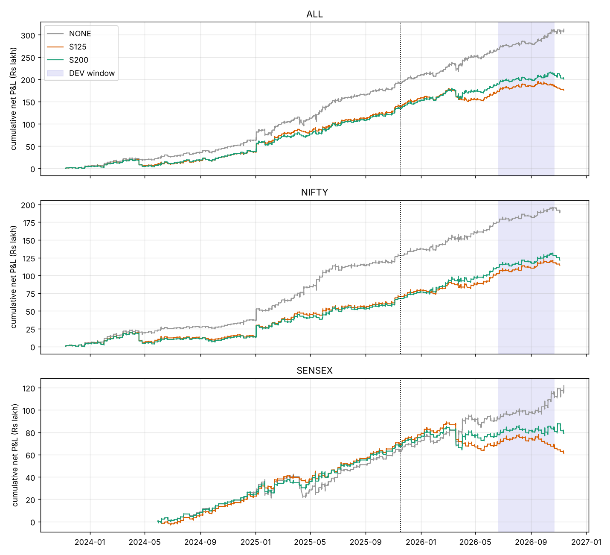
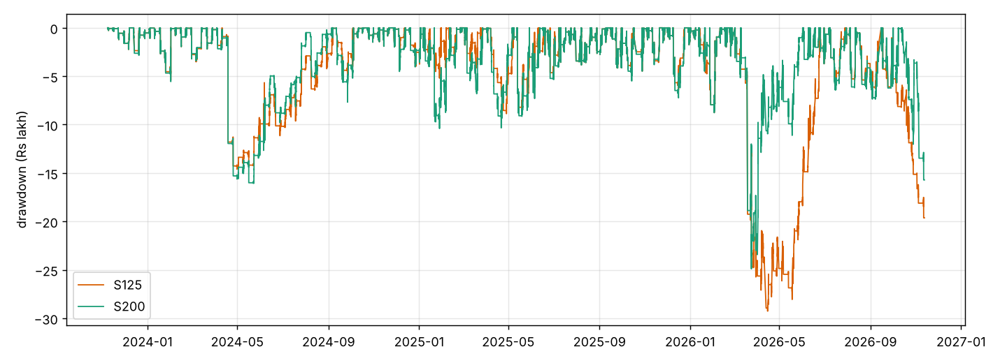

# 1. Summary

Algo 8 trades one weekly expiry cycle at a time on **NIFTY** and **SENSEX** options: it sells option premium through the day before expiry (**D-1**), carries a hedged book overnight, and keeps trading and buying back through expiry day (**D0**). A **cumulative hard stop of Rs 2,00,000** on the cycle's mark-to-market closes everything and ends trading for that cycle.

The complete algorithm is implemented in **C++17** (package `algo8_cpp`) and was run on the full three-year dataset: **275 weekly cycles** (NIFTY 154, SENSEX 121), expiries from 9 Nov 2023 to 12 Nov 2026.

| Metric (Rs 2 lakh hard stop) | ALL | NIFTY | SENSEX |
|---|---:|---:|---:|
| Cycles | 275 | 154 | 121 |
| **Net P&L (Rs lakh)** | **200.5** | **121.4** | **79.1** |
| **Win rate (cycles)** | **67.6%** | **65.6%** | **70.2%** |
| **Sharpe (weekly, √52)** | **2.33** | **2.06** | **1.64** |
| Sortino | 3.93 | 3.87 | 2.47 |
| **Max drawdown (Rs lakh)** | **−24.9** | **−16.1** | **−21.2** |
| Profit factor | 2.01 | 2.21 | 1.81 |
| Average P&L per cycle (Rs lakh) | 0.73 | 0.79 | 0.65 |
| Median cycle (Rs lakh) | 1.00 | 0.77 | 1.06 |
| Best / worst cycle (Rs lakh) | +15.7 / −13.5 | +15.7 / −10.9 | +10.0 / −13.5 |
| Cycles closed by the hard stop | 20.7% | 18.2% | 24.0% |
| Positive quarters | 11 of 13 | | |

All P&L figures are **net of slippage and all costs** (brokerage, exchange charges, SEBI fee, stamp duty, GST, STT). Sharpe, Sortino and drawdown use weekly cycle returns on a stated capital of Rs 2 crore (section 8).

The C++ implementation reproduces the Python reference engine exactly: **825 of 825 test runs identical** (275 cycles × 3 stop settings): same orders, same fills, same stop minutes, net P&L equal to within Rs 0.0005.

# 2. How a cycle works

```
 D-1 (day before expiry)                       D0 (expiry day)
 09:15 ─────────────────── 15:30 ═══ overnight ═══ 09:15 ─────────────────── 15:14 clearance
 D-1 engine: sells premium,                    D0 engine: continues from the carried
 stops, wings, overnight lump                  book: sells, buys back, hedges, clears
        │                                                 ▲
        └──── carried book (shorts with entry prices, wings, lump, cash) ───┘

 Cycle hard stop: D-1 + D0 mark-to-market ≤ −Rs 2,00,000  → close all, no more trading that cycle
```

* **D-1 engine** trades the whole D-1 session at one-second resolution.
* **Handoff:** every short lot carries its own entry price into D0; hedge wings and the overnight lump carry across as their own groups; cash from the fills carries across.
* **D0 engine** trades expiry day at one-minute resolution from the carried book.
* **Cycle hard stop** looks at the *cumulative* result of D-1 and D0 together. If it triggers on D-1, the cycle ends there and D0 is not traded.

Lot sizes are those of each session (NIFTY 50 / 25 / 75 / 65 units over the period; SENSEX 10 / 20). Orders are split at the exchange freeze quantity (27 lots NIFTY, 50 lots SENSEX).

# 3. D-1 engine — rules in the order they run each second

| # | Rule | Behaviour |
|---|---|---|
| 1 | **Cycle hard stop** | Every 5 seconds: if D-1 mark-to-market ≤ −Rs 2,00,000, close all shorts and hedges and stop trading. |
| 2 | **Opening wings** | At 09:16: buy 3 lots of far-OTM calls and 3 lots of far-OTM puts, about 40 strike steps beyond the ATM of the previous completed minute (SENSEX from 16 Sep 2026: 20 steps). |
| 3 | **Scheduled straddles** | 33 waves at fixed seconds after 09:16:00 (timetable in Appendix A). Each wave sells **1 lot call + 1 lot put at the ATM strike** of the previous completed minute's close. A wave more than 30 s late is skipped. Two timetable versions exist: V1 before 16 Sep 2026, V2 from 16 Sep 2026. |
| 4 | **Breakout straddles** | From 10:30 to 15:15: on the first break per side per 30-minute candle of the high/low of the previous two completed clock-aligned candles, sell a straddle one strike beyond the ATM in the break direction (1 to 3 pairs by break depth, 0.4 pairs per depth step) plus favourable-side extras (0.81 × depth + 1.28, up to 7). |
| 5 | **Solo ladder** | After the first hour: when spot moves 0.2 strike steps beyond a reference (reset at each scheduled or breakout sale) and prints a fresh 60-minute extreme, sell **1 lot** — calls on a fall, puts on a rise. |
| 6 | **Per-lot stops** | Each short lot is bought back when the running high of its option in the current minute reaches **1.6 × its own entry price**. A lot cannot be stopped in the minute it was sold. Lots are closed cheapest-entry first. |
| 7 | **Wing controller** | About 4 seconds after body orders: buy exactly the gap between short and long lots on each right, at the OTM strike whose premium is nearest **2.5% of the ATM premium**; when shorts fall, sell the excess wings, outermost first. |
| 8 | **Overnight lump** | At a fixed late-session minute (15:11 up to 5 Aug 2026; 15:23 for 6–19 Aug 2026; 15:30 after): on the side with more short lots, buy **0.827 × (NIFTY) / 0.503 × (SENSEX)** that many lots about **2.2 one-day sigmas** out of the money (sigma from the ATM straddle). |

**Order handling.** Every order passes the risk guard (valid limit price, **at most 400 short lots per right**, **at most 40 orders per minute**; one decision split into several freeze-size orders counts once). Orders are marketable limit orders with a 15% price buffer; fills come at the traded price of the second.

# 4. D0 engine — rules in the order they run each minute

| # | Rule | Behaviour |
|---|---|---|
| 1 | **Cycle hard stop** | Each minute: if the cumulative D-1 + D0 mark-to-market ≤ −Rs 2,00,000, close all shorts and the carried longs and stop trading. |
| 2 | **15:14 clearance** | At minute 359 (15:14) all remaining shorts are bought back. |
| 3 | **Body buy-backs** | A short lot is bought back when the minute's **high ≥ 1.4 × its entry price** (stop, filled at the touch) or the minute's **low ≤ 0.1 × entry** (take-profit, filled at the touch). |
| 4 | **Timetable waves** | 225 fitted waves (second-of-day, lots), a pair (call + put) per wave, separate sets for NIFTY and SENSEX and for timetable versions V1/V2. Sells at the previous minute's close. |
| 5 | **Breakout pairs** | Breakout pairs on the same two-candle trigger as D-1, active from minute 75 to 360 (10:30 – 15:15). |
| 6 | **Solo ladder** | Step 0.05 strike steps, 60-minute fresh-extreme gate; lots = steps crossed, capped at **10 lots**. |
| 7 | **Counter-sells** | For each lot bought back on one right, sell **0.25 lots** on the other right. |
| 8 | **Opening wings** | 20 lots (split call/put) at 17 strike steps out at the open. |
| 9 | **Hedge controller** | Keeps long wings equal to short lots at the OTM strike nearest 2.5% of the ATM premium. |

**Risk guard (D0).** At most **306 short lots per right** and **90 sell decisions per minute**; orders beyond that are refused.

# 5. Fills, costs and accounting

| Item | Convention |
|---|---|
| D-1 fills | Price of the replayed second, rounded to the paisa. |
| D0 fills | Sells at the previous minute's close; rule buy-backs at the touch price; other orders at the minute close. |
| Slippage | max(Rs 0.10, 0.5% of price), against the trader on every order. |
| Brokerage | Rs 20 per order (an order = up to one freeze quantity). |
| Exchange charges | NIFTY 0.035%, SENSEX 0.0325% of turnover. |
| Other | SEBI 0.0001%, stamp 0.003% on buys, GST 18% on brokerage + exchange + SEBI, STT on sells (0.0625% / 0.10% / 0.15% by date). |
| Settlement | Every cycle ended flat in the test; no settlement trades were needed. |
| P&L | Cash flows of all fills, minute-level mark-to-market for the equity path, costs and slippage deducted. |

# 6. Results (Rs 2 lakh hard stop)

## 6.1 By instrument and period

*Splits: DEV = 22 Jun – 22 Oct 2026 (36 cycles); PRE = every cycle before DEV (234 cycles, 2023–Jun 2026); POST = from 23 Oct 2026 (5 cycles). IS / OOS = the earlier backtest boundary (IS to 17 Nov 2025, OOS from 18 Nov 2025). Sharpe confidence interval: 4-week block bootstrap.*

| Scope | Period | Cycles | Net (Rs lakh) | Win | Sharpe [95% CI] | Max DD (lakh) | PF | Worst cycle |
|---|---|---:|---:|---:|---:|---:|---:|---:|
| ALL | Full sample | 275 | 200.5 | 68% | 2.33 [1.3, 3.7] | −24.9 | 2.01 | −13.5 |
| ALL | PRE | 234 | 188.9 | 70% | 2.60 [1.4, 4.0] | −24.9 | 2.22 | −13.5 |
| ALL | DEV | 36 | 19.9 | 58% | 1.96 [0.3, 4.0] | −7.4 | 1.73 | −3.1 |
| ALL | In-sample (IS) | 175 | 134.9 | 69% | 2.55 | −16.1 | 2.23 | −10.9 |
| ALL | Out-of-sample (OOS) | 100 | 65.7 | 65% | 2.00 | −24.9 | 1.74 | −13.5 |
| NIFTY | Full sample | 154 | 121.4 | 66% | 2.06 [1.0, 3.3] | −16.1 | 2.21 | −10.9 |
| NIFTY | PRE | 134 | 111.2 | 67% | 2.17 [1.0, 3.5] | −16.1 | 2.35 | −10.9 |
| NIFTY | DEV | 18 | 16.9 | 61% | 2.57 [0.6, 5.3] | −5.5 | 2.50 | −2.6 |
| NIFTY | IS | 105 | 67.6 | 64% | 1.63 | −16.1 | 1.95 | −10.9 |
| NIFTY | OOS | 49 | 53.8 | 69% | 3.11 | −10.3 | 2.84 | −4.7 |
| SENSEX | Full sample | 121 | 79.1 | 70% | 1.64 [0.5, 3.1] | −21.2 | 1.81 | −13.5 |
| SENSEX | PRE | 100 | 77.8 | 74% | 1.97 [0.6, 3.8] | −21.2 | 2.06 | −13.5 |
| SENSEX | DEV | 18 | 3.0 | 56% | 0.51 [−1.5, 2.4] | −9.3 | 1.19 | −3.1 |
| SENSEX | IS | 70 | 67.3 | 77% | 2.98 | −10.5 | 2.75 | −6.9 |
| SENSEX | OOS | 51 | 11.8 | 61% | 0.48 | −21.2 | 1.20 | −13.5 |

The five cycles from 23 Oct 2026 (POST: NIFTY 2, SENSEX 3) are reported in the data files; five cycles are too few for ratio metrics. Their net is −8.3 lakh, with the hard stop closing four of them.

## 6.2 Distribution of cycle results (full sample)

| Statistic | ALL | NIFTY | SENSEX |
|---|---:|---:|---:|
| Average winning cycle (Rs lakh) | 2.14 | 2.20 | 2.08 |
| Average losing cycle (Rs lakh) | −2.22 | −1.89 | −2.71 |
| Expectancy per cycle (Rs lakh) | 0.73 | 0.79 | 0.65 |
| Average of worst 5% of cycles (Rs lakh) | −5.10 | −4.35 | −5.67 |
| Share of gross wins from the 5 best cycles | 11.9% | 18.4% | 19.6% |
| Longest drawdown (days) | 155 | 274 | 154 |
| Annualised volatility (on Rs 2 crore) | 14.1% | 9.9% | 10.4% |
| Average orders per cycle | 1,046 | 1,175 | 882 |
| Gross P&L before costs (Rs lakh) | 325.0 | 200.8 | 124.3 |
| Slippage (Rs lakh) | 49.1 | 32.2 | 16.9 |
| Costs and taxes (Rs lakh) | 75.4 | 47.1 | 28.2 |

## 6.3 By calendar year and quarter

| Index | Year | Cycles | Net (Rs lakh) | Win |
|---|---|---:|---:|---:|
| NIFTY | 2023 | 8 | 4.1 | 62% |
| NIFTY | 2024 | 51 | 9.3 | 67% |
| NIFTY | 2025 | 52 | 63.2 | 65% |
| NIFTY | 2026 | 43 | 44.8 | 65% |
| SENSEX | 2024 | 28 | 24.6 | 82% |
| SENSEX | 2025 | 48 | 50.6 | 75% |
| SENSEX | 2026 | 45 | 3.9 | 58% |

| Quarter | 23Q4 | 24Q1 | 24Q2 | 24Q3 | 24Q4 | 25Q1 | 25Q2 | 25Q3 | 25Q4 | 26Q1 | 26Q2 | 26Q3 | 26Q4 |
|---|---:|---:|---:|---:|---:|---:|---:|---:|---:|---:|---:|---:|---:|
| Net (Rs lakh), both indices | 4.1 | 15.1 | −8.5 | 8.5 | 18.7 | 39.2 | 17.9 | 24.3 | 32.4 | 6.8 | 36.6 | 10.3 | −5.0 |

## 6.4 Equity curve and drawdown





## 6.5 Behaviour of the hard stop

* The stop closed **20.7%** of cycles (57 of 275): NIFTY 18.2%, SENSEX 24.0%.
* The largest single-cycle loss with the Rs 2 lakh stop is Rs 13.5 lakh (SENSEX); the stop acts on the 5-second (D-1) and one-minute (D0) checks, so a gap through the level is realised at the next check.
* Side by side with other levels (same engines, same 275 cycles):

| Stop level | Net (lakh) | Win | Sharpe | Max DD (lakh) | PF | Stop rate |
|---|---:|---:|---:|---:|---:|---:|
| **Rs 2.0 lakh (selected)** | **200.5** | **68%** | **2.33** | **−24.9** | **2.01** | 21% |
| Rs 1.25 lakh | 175.7 | 63% | 2.28 | −29.3 | 1.98 | 31% |
| No cycle stop (reference) | 311.9 | 74% | 3.98 | −21.2 | 3.27 | 0% |

## 6.6 Sensitivity to execution assumptions (full sample, net Rs lakh)

| Scenario | ALL | NIFTY | SENSEX |
|---|---:|---:|---:|
| Base case (slippage max(Rs 0.10, 0.5%), standard costs) | 200.5 | 121.4 | 79.1 |
| Without the 5 best cycles | 153.1 | 80.7 | 44.4 |
| Slippage × 3 | 102.2 | 57.0 | 45.2 |
| Costs × 3 | 49.8 | 27.2 | 22.6 |
| Slippage × 3 and costs × 3 | −48.5 | −37.2 | −11.3 |
| Lot sizes of 2026 applied to all cycles | 240.1 | 132.9 | 107.3 |

The result is most sensitive to execution cost: roughly Rs 124 lakh of the Rs 325 lakh gross is paid away as slippage and costs in the base case.

# 7. Validation

## 7.1 Out-of-sample checks (set before the P&L was computed)

The strategy rules were reconstructed from the June–October 2026 observations (DEV). The other **234 cycles (2023 to June 2026) were not used to build or tune any rule**. Six pre-registered checks were applied to those cycles:

| Check | Result (Rs 2 lakh stop) |
|---|---|
| R1 PRE Sharpe > 0 and 95% block-bootstrap lower bound > 0 | **Pass** (Sharpe 2.60, lower bound 1.43) |
| R2 PRE net > 0 for NIFTY and SENSEX separately | **Pass** (111.2 and 77.8 lakh) |
| R3 ≥ 60% of PRE quarters positive | **Pass** (91% = 10 of 11) |
| R4 PRE net > 0 without its 5 best cycles | **Pass** (142.2 lakh) |
| R5 PRE net > 0 at 3× costs | **Pass** (59.2 lakh) |
| R6 net > 0 in the 5 cycles since the freeze | 5 cycles, −8.3 lakh (too few to conclude) |

The Sharpe ratio is **higher** in PRE (2.60) than in the development window (1.96), so the development window does not flatter the result. No parameter was tuned on P&L.

## 7.2 Match with the real trade export (32 development cycles, Jun–Oct 2026)

Real order-log cash flow over the 32 cycles: **Rs 18.9 lakh** (before brokerage and taxes).

| Simulated stop level | Simulated gross (lakh) | Ratio to real | Per-cycle correlation |
|---|---:|---:|---:|
| **Rs 2.0 lakh** | **19.8** | **1.04×** | **0.74** |
| Rs 1.25 lakh | 8.7 | 0.46× | 0.56 |
| No stop | 42.5 | 2.24× | 0.43 |

The Rs 2 lakh level is the closest of the three to the real system's observed result, in total and cycle by cycle.

## 7.3 Pipeline checks

* The data builder reproduces the research caches exactly on the 32 development cycles (32/32 D-1 and 32/32 D0 data sets identical).
* The D-1 replay reproduces the reference engine's 9,035 orders order-for-order on all 32 cycles.
* All 275 cycles hand off from D-1 to D0 without error and every cycle ends flat.
* Rule match with the real 2026 order log (same side and class within one minute): F1 0.74 for D-1 and 0.42 for D0.
* 7 automated output tests pass.

## 7.4 C++ against the Python reference

All 275 cycles were run at three stop settings (825 runs) in both implementations:

| Check | Result |
|---|---|
| Runs compared | 825 |
| Order counts, fill counts, D-1/D0 stop flags, stop minutes | **identical in all 825** |
| Largest difference in gross P&L | Rs 0.000000006 |
| Largest difference in net P&L | **Rs 0.0004** |
| Largest difference in minute-level equity path extremes | Rs 0.0004 |

Exactness comes from reproducing the reference's numerical conventions (floor division, banker's rounding, interpolation, two-decimal rounding, insertion-ordered containers, stable sorts) and from compiling with `-ffp-contract=off` and no fast-math.

# 8. Basis of the results

* **What was run.** The complete reconstructed algorithm — D-1 engine, carried book, D0 engine, hard stop — on the 275 cycles of the three-year dataset. Rules and constants are the ones fitted on the 2026 observations, applied unchanged across the whole period; timetable version V1 before 16 Sep 2026 and V2 from that date.
* **Capital.** Sharpe, Sortino and drawdown use a stated capital of Rs 2 crore; margin is not modelled. Rupee P&L, win rate and Sharpe do not depend on the denominator; percentage drawdown and annualised return do, and should be read as relative figures.
* **Fills.** One-minute-bar conventions (section 5), 0.5% slippage and the cost model of the earlier backtest. Order counts for D0 events are split at the freeze quantity.
* **Sample.** 275 weekly cycles over three years; the 5 cycles after the freeze are listed separately because they are too few for ratio statistics.
* **Strategy character.** A short-premium book earns a high win rate with occasional large losses; the worst cycle in the sample is Rs −13.5 lakh and the confidence intervals above describe sampling variation within the observed regime.

# 9. The C++ package

```
algo8_cpp/
  include/algo8/   util, session, d1_engine, d0_engine, backtest headers
  src/             d1_engine.cpp, d0_engine.cpp, backtest.cpp, main_backtest.cpp
  tools/           export_sessions.py, sweep_parity.py, dump_cycle.cpp/.py
  tests/           test_util.cpp, run_parity.sh, compare_ledgers.py
  data/            frozen_d0_waves.csv, sample/ (10 cycles + golden ledger)
  docs/            this document, figures, result tables
```

| Component | Role |
|---|---|
| `D1Engine` | Second-by-second D-1 replay with the full rule set and cycle stop. |
| `D0Engine` | Minute-level D0 engine from the carried book. |
| `run_cycle` | D-1 → carry → D0, accounting, costs, equity path. |
| `algo8_backtest` | Multi-threaded cycle runner and metrics (Sharpe, Sortino, drawdown, win rate, profit factor) by instrument and period. |

Build and run:

```bash
cmake -S . -B build && cmake --build build -j
ctest --test-dir build          # unit test + parity on the shipped sample
build/algo8_backtest --cycles data/sample/cycles.csv --data data/sample \
    --waves data/frozen_d0_waves.csv --stop 200000 --out out
```

Outputs: `out/ledger.csv` (one row per cycle: gross, slippage, costs, net, orders, stop flags, equity-path extremes) and `out/metrics.csv` (win rate, Sharpe, Sortino, max drawdown, profit factor … for ALL / NIFTY / SENSEX × full sample / PRE / DEV / POST / IS / OOS). Options: `--stop RUPEES` (0 disables the hard stop), `--cost-mult X`, `--slip-mult X`, `--threads N`.

# Appendix A — Parameters

**D-1 scheduled timetable (seconds after 09:16:00, 33 waves)**

* V1 (before 16 Sep 2026): 1, 2, 7, 900, 900, 1800, 1831, 1866, 2710, 3599, 3600, 3600, 3658, 4510, 5431, 5491, 6300, 6310, 7199, 7258, 8110, 9000, 9031, 9091, 9910, 11700, 11710, 14400, 15240, 16140, 17040, 17940, 18840
* V2 (from 16 Sep 2026): 1, 2, 8, 899, 900, 1800, 1831, 1866, 2710, 3599, 3600, 3658, 4501, 4510, 5431, 5491, 6310, 7199, 7258, 8102, 8110, 9031, 9091, 9910, 11702, 11710, 15302, 16140, 17040, 17940, 18840, 18902, 19740

**D-1 constants**

| Parameter | Value |
|---|---|
| Strike step | NIFTY 50, SENSEX 100 |
| Freeze quantity | NIFTY 27 lots, SENSEX 50 lots |
| Stop ratio (per-lot stop) | 1.6 × entry |
| Ladder step / gate | 0.2 strike steps / 60 minutes, strike window ±4 |
| Breakout window | minute 75 – 360 (10:30 – 15:15) |
| Breakout pairs | 0.4 per depth step, maximum 3; extras 0.81·depth + 1.28, maximum 7 |
| Wing premium | 2.5% of ATM premium, 4 s after body orders |
| Opening wings | 3 lots per right, 39.8 strike steps out (SENSEX V2: 20) |
| Overnight lump | ratio 0.827 NIFTY / 0.503 SENSEX, 2.2 sigma, minute 356 / 368 / 375 by date |
| Limit-price buffer | 15% |
| Risk guard | 400 short lots per right, 40 orders per minute |
| Cycle hard stop | Rs 2,00,000 cumulative; check every 5 s |

**D0 constants (frozen all-cycle fit)**

| Parameter | Value |
|---|---|
| Stop / take-profit | 1.4 × entry / 0.1 × entry |
| Ladder step / gate / lot cap | 0.05 strike steps / 60 minutes / 10 lots |
| Counter-sell ratio | 0.25 |
| Opening wings | 20 lots, 17 strike steps out |
| Hedge | 2.5% of ATM premium |
| Clearance | minute 359 (15:14) |
| Risk guard | 306 short lots per right, 90 sell decisions per minute |
| Cycle hard stop | Rs 2,00,000 cumulative; checked each minute |
| Waves | 225 (second-of-day, lots), file `data/frozen_d0_waves.csv` |

# Appendix B — Result files

| File | Content |
|---|---|
| `results/summary_table.csv` | All metrics for every stop level × scope × period |
| `results/cycle_ledger.csv` | One row per cycle and stop level |
| `results/by_year_S200.csv`, `by_quarter_S200.csv` | Calendar-year and quarter results (Rs 2 lakh stop) |
| `results/stress_concentration.csv` | Cost sensitivity, without-top-5, lot-size scaling |
| `results/stop_paired.csv` | Paired comparison of stop levels |
| `results/calibration_vs_real.json`, `real_vs_sim_dev.csv` | Comparison with the real trade export |
| `results/parity_sweep.json` | C++ vs Python result of the 825-run comparison |
