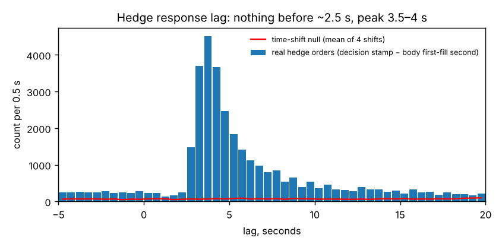
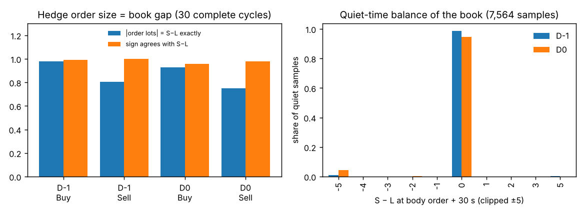
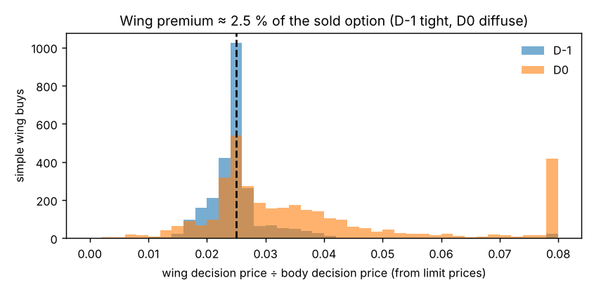
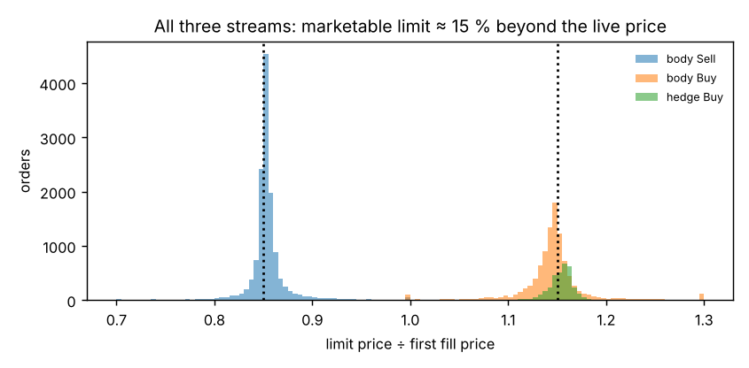

# Algo 8 — Body Module and Hedge Module: deep investigation

*In-sample, observational reconstruction of the original system from the 35 live cycles (35 cycles in the ledger, 41,421 fills, 39,874 orders). Not source code, not out-of-sample, no trading-rule claims. All numbers computed by `src/make_bh_report.py` from `src/bh_*.py` outputs. Plan: `BODY_HEDGE_INVESTIGATION_PLAN.md` (written before the analysis). Code status: **executed**; results **observed**; the analysis has had a self red-team pass only (no independent reviewer).*

## 1. Executive summary

1. **The Hedge module is a balance controller, not a per-fill mirror.** At the decision stamp of each hedge order, the order's signed lots equal the book gap **S − L** (short lots minus long lots of that right, all strikes, contract level) in **88.5 %** of 11,351 orders (30 complete-carry cycles); the sign agrees in 97.5 %; counting one decision (a *wave* of orders stamped within 0.05 s) as a unit, the **summed signed lots equal S − L in 93.7 %** of 10,715 waves (sign 97.9 %); a shuffled-gap null (each order/wave given the gap of a random other one of the same und/day/side) gives only 49.1 % / 50.8 % because most gaps are 1 lot, so the evidence is the ≈ 40-point excess, not the absolute level. At quiet times (30 s after a body order, no other body order) the book is balanced (S = L) in **98.7 % (D-1)** and **94.7 % (D0)** of 7,564 samples (cross-right null — S of one right vs L of the other — 3.4 %).
2. **Trigger and timing.** A hedge order is stamped 4.25 s (IQR 3.56–5.73) after the body fill second (DD-1's nearest-fill measure gave 3.7 s; the difference is the matching rule). For **isolated** body orders (no other body order on the right within ±20 s; 4,974 hedge orders in 2.5–10 s vs 148 expected by chance) nothing arrives before ≈ 2.5 s (81 vs 76 chance in −2…2.5 s) — consistent with a reaction to the executed position, with an irreducible delay. Per right (wrong-right null matches 29.1 % of body lots vs 66.9 % for the correct right).
3. **Hedge strike:** price-targeted at ≈ **2.5 % of the sold option's decision price** (exact strike 37.9 % vs 12.4 % same-slot null; ≈ 60.9 % within one strike), not a fixed offset (12.4 %) or %-of-spot (11.2 %). The exact selection rule is **not** identified.
4. **Pricing:** all three streams (body, hedge, stop) send **marketable limit orders ≈ 15 % beyond the live price** (body DAY, hedge IOC); fills occur near the live price. Limit prices therefore reveal each order's **decision-time reference price** (±≈ 1 %).
5. **Body structure:** per D-1 slot the short legs are a **same-strike straddle** (90.8 % of 448 slots) with sold strike ≈ nearest to the previous-minute spot (exact 52.0 % D-1 / 47.8 % D0). The "iron butterfly" is balanced right-by-right with far wings, not paired lot-by-lot.
6. **Modules overlap at contract level:** the numeric-tag stream also buys long wings (1,532 lots, 884 of them at 09:15–09:17), and the hedge module sometimes covers shorts or sells non-held contracts. Module role accounting and contract-level accounting differ (known from earlier work).
7. **Corrections to DD-1:** the "92.6 % of 12,490 bursts respond" figure counted any hedge order in a window and treated every body Buy as a buy-back; at lot level **66.9 %** of body lots and **83.2 %** of hedge lots match 1:1 within [1.5, 20] s, because the controller responds to the **net gap** S − L rather than to individual fills (roll-like net-zero changes are over-represented among unmatched lots: 55.9 % vs 35.3 % of matched).
8. **Exceptions:** of the 928 non-responding body bursts, **23.6 %** need no hedge (book already balanced), 23.3 % are answered after 10 s, 16.6 % sit in cycles whose carry-in is unknown, 13.3 % are in the 15:14 flatten; **15.4 % remain unexplained** (a further 5.9 % fall in a post-hoc D0-open class).

### Final summary table

| Question | Finding | Evidence level | Remaining uncertainty |
|---|---|---|---|
| Is the Body a four-leg Iron Butterfly? | Short **straddle at one strike** per D-1 slot (90.8 % of 448 slots), balanced right-by-right by **far-OTM long wings** (L = S in 98.7 % / 94.7 % of D-1 / D0 quiet samples). Wings are pooled per right, not paired to a specific short; strangle-like variants are rare. | STRONGLY SUPPORTED (shape); CONFIRMED (right-level balance) | Wing↔short pairing is not observable; seed wings in the body stream (09:15–09:17) need a rule |
| How are Body strikes selected? | Near the previous-minute spot: exact 52.0 % / 47.8 % (D-1 / D0), ±1 step 92.4 % / 87.1 %; shuffled-spot null ≈ 23.9 %. Synthetic-ATM (|C−P| min) is worse on D-1. | PARTIALLY SUPPORTED | About half of sold strikes are not the nearest; reference price/time is unresolved at 1-minute data |
| How are Body quantities determined? | Orders are 1-lot (92.1 %); per-slot lots are not premium-budgeted or book-state driven (DD-1 F3); CE = PE lots per slot in 79.9 % of slot-legs. | PARTIALLY SUPPORTED (form) / UNRESOLVED (driver) | What sets the ladder size per slot is unknown |
| What triggers a hedge? | A change in the contract-level gap S − L of a right: the hedge order is sent ≈ 4.25 s (IQR 3.56–5.73) after the body fill second, not earlier than ≈ 2.5 s for isolated body orders, per right. 55.9 % of unmatched body lots have an opposite body lot within ±20 s (roll-like, net-zero) vs 35.3 % of matched ones. | STRONGLY SUPPORTED | Placement-vs-execution and partial-fill reactions cannot be separated (body fills carry no sub-second stamp) |
| How is the Hedge strike selected? | Premium target ≈ 2.5 % of the sold option's price: nearest-price rule hits the exact strike in 37.9 % (shuffled-body null 11.4 %, same-slot null 12.4 %), ±1 step 60.9 %; 2.0 % and 3.0 % are far worse; fixed offsets/percent-of-spot fail. | PARTIALLY SUPPORTED | Exact rule (tick/price reference, tie-breaks) not identified; 62 % of simple orders miss the exact strike |
| How is Hedge quantity calculated? | Total lots of one decision (wave) = the gap S − L at its start: 93.7 % of 10,715 waves; per order 88.5 % of 11,351 (sequential accounting), sign right 97.5 %. | STRONGLY SUPPORTED | Release (sell) waves are less exact (D0: 88.8 %); 289 sign-wrong orders, 125 of them in one cycle (SENSEX 2026-06-25) — see §12 |
| How is Hedge price determined? | Marketable IOC limit: limit = live price × (1 ± ≈ 15 %); body DAY orders have the same cushion; fills occur at ≈ the live price (not at the limit). | CONFIRMED (cushion); NOT TESTABLE (bid/ask/mid) | Reference price source (LTP/mid) and exact cushion constant (14.5–15.6 % depending on stream/tick) |
| How are Hedge positions managed? | Held until the controller releases them as shorts shrink; releases prefer the cheapest/outermost long (40.2 % lowest-priced vs chance 20.0 %); lump (v_) hedge adds an intended overweight (L−S = lump lots in 95.0 % of cycle-rights); 78.3 % of cycle-rights end flat, rest carry longs. | PARTIALLY SUPPORTED | Release-selection rule unidentified; lot-level ownership is a convention |
| How do Body and Hedge interact? | The body changes S; the hedge restores L = S per right after a ≈ 3–5 s delay (single IOC order of size S−L). The body stream also buys wings (seed at 09:15–09:17, 884 lots) and the 15:14 flatten uses body orders on wing contracts, so modules overlap at contract level. | STRONGLY SUPPORTED (controller); PARTIALLY (overlaps) | Exceptions: see §12 (15.4 % of non-responses unexplained); parent/basket ids absent |

## 2. Current understanding of the Body Module

The numeric-tag stream (26,253 orders, 1-lot DAY limit orders in 92.1 % of cases) sells short options right by right, mostly as a same-strike straddle per D-1 slot, buys them back on D-1 (minute-clocked) and D0 (not clocked), and also buys long wings at the open. Evidence and open points in §4–5. This is a **reconstruction from behaviour**, not recovered code.

## 3. Current understanding of the Hedge Module

One IOC limit order per decision, one strike per order, sized to the gap between short and long lots of a right; stamped about 3–5 s after the body trade; strike chosen to cost ≈ 2.5 % of the sold option; released as shorts shrink (cheapest/outermost first, weakly); the overnight lump (`v_`) deliberately over-hedges the carry. See §6–9.

## 4. Body structure and strike-selection reconstruction

**Data audit.** Order-level columns not used in earlier phases (limit price, validity, status, remaining quantity) are now joined (`bh_common.py`): 

| module | orders | lots | lots_per_order_med | validity |
|---|---|---|---|---|
| h_ (hedge) | 12812 | 25627 | 1.0 | IOC |
| m_ (manual) | 7 | 32 | 3.0 | IOC |
| numeric tag (body stream) | 26253 | 31874 | 1.0 | DAY |
| s_ (stop) | 417 | 3678 | 6.0 | DAY/IOC |
| v_ (overnight lump) | 385 | 2441 | 2.0 | IOC |

**B1 — structure (D-1, first 3 minutes of each of the 17 slots, 09:16 + 15 k).** 448 slots in 32 cycles have both rights sold. Same strike for CE and PE in **90.8 %**; CE strike above PE 4.2 %, below 4.9 %. Equal lots CE = PE: 79.0 %. CE and PE first orders in the same second: 82.1 % (CE strictly first 15.4 %, PE first 2.5 %) ⇒ the two short legs are opened **practically simultaneously**, the wings follow ≈ 3–5 s later (§6): the structure is **built sequentially in two stages** with no basket id.

Contract-level roles of every order in the 30 complete-carry cycles (lots):

Body (numeric) stream:

| day | close_long | cover_short | open_long | open_short |
|---|---|---|---|---|
| D-1 | 116 | 1238 | 298 | 4368 |
| D0 | 2101 | 9656 | 981 | 8336 |

Hedge (`h_`) stream:

| day | close_long | cover_short | open_long | open_short |
|---|---|---|---|---|
| D-1 | 1119 | 1 | 4088 | 0 |
| D0 | 8130 | 467 | 7312 | 300 |

The body stream **buys long contracts** (1,532 lots; by day D-1 316, D0 1,216; 884 at 09:15–09:17 — the "seed wings" of the register), and the hedge stream has 468 lots of `cover_short` and 300 lots of `open_short`: **the module split is not a clean "body sells / hedge buys"**.

**B2 — strike selection** (all body `open_short` orders; reference = previous-minute spot close; null = nearest strike to the spot of a random minute of the same day):

| day | n | nearest_prev_spot_exact | within_1 | null_exact | synthetic_ATM_exact |
|---|---|---|---|---|---|
| D-1 | 4390 | 52.0 % | 92.4 % | 24.0 % | 36.6 % |
| D0 | 8539 | 47.8 % | 87.1 % | 23.8 % | 44.7 % |

Median distance of the sold strike from the previous-minute spot in strike steps (+ = ITM): D-1 CE +0.37 / PE -0.04; D0 CE +0.05 / PE -0.13 — ATM-centred and dynamic, not a fixed distance. About half of the sold strikes are **not** the nearest strike; neighbours (±1 step) cover 87–92 %. Earlier register STK-02 (50.3 % / 42.9 %) is consistent. **UNRESOLVED:** the exact reference (the minute data lag the decision; a time-of-decision spot is unavailable).

## 5. Body entry and position-management reconstruction

* **Orders.** 1-lot DAY **limit** orders; 92.1 % single lot, 6.8 % two-lot; fills per order: 1 in 97.9 %; a PartiallyFilled row occurs for 2.1 % of orders and all pieces fill in the same second except 1 order(s) (fills spanning up to 57 s); no unfilled DAY remainders are visible in the ledger.
* **Price style.** Limit ≈ live price ∓ 14.5–15 % (§8): effectively market orders. No cancel/modify/retry records exist in the ledger (not testable).
* **Ladder cadence.** Spacing between consecutive short-sale orders on one right: median 2 s, quartiles 0–18 s; 34.8 % in the same second.
* **Exits.** D-1 buy-backs fill in second :00 in 47.6 % of cases vs 10.4 % on D0 (DD-1 F2): minute-clocked on D-1, not on D0. Re-sell after buy-back within 60 s: 37 % of buy-back lots (DD-1 F4). Per-lot stop band 1.55–1.7 × entry, cycle stop ≈ −₹1.30…−1.44 L (existing register, not re-derived here). **No new exit rule is claimed in this milestone.**
* **Quantities.** Slot ladder sizes are not explained by premium or book state (DD-1 F3, REJECTED); CE = PE lots per slot in 79.9 %.

## 6. Hedge trigger and response analysis

**Method (independent of DD-1).** Order level: each body lot (first fill second) is matched 1:1, greedily in time order, to the earliest unmatched opposite-side hedge lot of the **same right** whose decision stamp lies in a window after it. Null: hedge times shifted by ±137/211/389/523 s; wrong-right null.

* Lag histogram (all body orders): peak bin [3.5, 4.0) s = 4,506 vs null ≈ 67. Lags 0–2 s average 190 per half-second vs null 67: this excess is **burst contamination** (a later order of a burst sees an earlier order's hedge). Test restricted to **isolated** body orders (no other body order on the right within ±20 s; 5,055 hedge orders in −2…10 s): in −2…2.5 s real 81 vs null 76; in 2.5…10 s real 4,974 vs null 148. **No early response.** Quartiles of matched lags (all matched): [2.89, 3.56, 4.25, 5.73, 10.84].
* Window sensitivity and nulls:

| window | body_lots | matched_share | wing_lots | wing_matched_share |
|---|---|---|---|---|
| [1.5,10] s | 31874 | 64.5 % | 25627 | 80.3 % |
| [1.5,20] s | 31874 | 66.9 % | 25627 | 83.2 % |
| [0,30] s | 31874 | 67.3 % | 25627 | 83.8 % |
| [1.5,60] s | 31874 | 67.2 % | 25627 | 83.6 % |
| [1.5,20] s, WRONG-RIGHT null | 31874 | 29.1 % | 25532 | 36.3 % |

* By group:

| group | lots | matched share |
|---|---|---|
| D-1 body Buy lots | 1640 | 71.9 % |
| D-1 body Sell lots | 4834 | 86.1 % |
| D0 body Buy lots | 12714 | 60.1 % |
| D0 body Sell lots | 12686 | 65.8 % |
| D-1 wing Buy lots | 4337 | 95.9 % |
| D-1 wing Sell lots | 1192 | 98.9 % |
| D0 wing Buy lots | 9855 | 84.7 % |
| D0 wing Sell lots | 10243 | 74.6 % |

* **Does every short fill trigger a hedge?** No — at lot level 66.9 % of body lots are matched. Of the unmatched lots, 55.9 % have an opposite-direction body lot within ±20 s (net-zero roll-like changes) against 35.3 % of matched lots; the other 44.1 % of unmatched lots are changes whose gap was already balanced/over-hedged or are exceptions (§12). PARTIALLY SUPPORTED. The right description is the **controller** of §7.
* **One body fill → how many hedge orders?** Matched hedge buy orders carry 1 body lot(s): 72.7 %, 2 body lot(s): 17.9 %, 3 body lot(s): 4.4 %, 4 body lot(s): 2.5 % of triggers (n = 8,379); a hedge order of N lots corresponds to an aggregated gap, not to N separate decisions. Several body fills are **aggregated** into one hedge order.
* **Hedge before body?** For isolated body orders there is no excess before 2.5 s (above); the all-order excess at negative lags is the burst effect. Unmatched hedge lots are 16.8 %; the orders that contain them equal S − L exactly in only 30.2 % (vs 88.5 % overall in complete cycles), i.e. they are driven by gap changes not caused by a recent body fill in the matched window (late responses, stop/flatten, lump salvage): **UNRESOLVED** in detail.
* **Placement vs execution; partial fills.** Body orders are DAY limit orders that fill within the same second as the log (cushion ≈ 15 %); no hedge stamp is earlier than ≈ 2.5 s after the fill second. A placement-triggered reaction with fixed delay cannot be excluded: **UNRESOLVED**. Body partial fills are all in one second: **NOT TESTABLE**.
* **Sub-second structure.** Fractional-second Rayleigh of hedge stamps is 0.029 (uniform ⇒ no sub-second poll phase); 32.8 % of consecutive hedge orders are < 10 ms apart (one decision emitting several orders, e.g. several strikes).

## 7. Hedge quantity (level control)

State at each hedge decision stamp: S = short lots, L = long lots of the right, from net contract positions over **all** modules (ownership-free); events strictly before the stamp (ties at identical event time can differ by a row: 3 of 400 spot-checked orders in the unit test).

| day | side | wing orders | sign agrees with S−L | signed lots = S−L exactly | median S−L before |
|---|---|---|---|---|---|
| D-1 | Buy | 2952 | 99.2 % | 97.7 % | 1.0 |
| D-1 | Sell | 567 | 99.8 % | 80.4 % | -1.0 |
| D0 | Buy | 4628 | 95.7 % | 93.0 % | 1.0 |
| D0 | Sell | 3204 | 98.0 % | 74.8 % | -2.0 |

**Wave level (one decision = orders on one right stamped within 0.05 s of each other; snapshot strictly before the first stamp):** 10,715 waves, 96.0 % are single orders; **Σ signed lots = S − L in 93.7 %**, sign right 97.9 %.

| day | side | waves | Σ signed lots = S−L at wave start | sign agrees |
|---|---|---|---|---|
| D-1 | Buy | 2946 | 97.9 % | 99.2 % |
| D-1 | Sell | 477 | 95.4 % | 100.0 % |
| D0 | Buy | 4596 | 93.6 % | 96.3 % |
| D0 | Sell | 2696 | 88.8 % | 98.6 % |

**Snapshot timing.** Order lots equal the book gap taken δ seconds before the stamp (strict snapshot, per order):

| snapshot taken this many s before the stamp | order lots = S−L (strict snapshot) |
|---|---|
| 0 | 85.1 % |
| 1 | 86.8 % |
| 2 | 87.0 % |
| 3 | 76.5 % |
| 4 | 36.8 % |
| 5 | 16.0 % |
| 6 | 9.3 % |
| 8 | 5.4 % |

The gap is read at the stamp or up to ≈ 2 s before it (85–87 %), and the match collapses beyond 3 s: the sizing uses a book view that is at most ~2–3 s old, even though the *trigger* lag is 3–5 s after the body fill second. Body fill times are floored to whole seconds, so 0–2 s cannot be separated.

* Per order, sequential accounting (a wave's earlier orders are already booked): exact catch-up (`signed lots = S − L`) **88.5 %**, sign right 97.5 %, |gap| reduced 97.4 %; balance restored (gap after = 0) 88.5 %.
* **Chance baseline.** Giving each order/wave the gap of a random other order of the same und/day/side: per order 49.1 % (97.5th pct 49.6 %), per wave 50.8 % (51.4 %); by group the per-order null is D-1 buy 66.1 %, D-1 sell 35.4 %, D0 buy 53.3 %, D0 sell 29.6 %. The real exactness is far above these but the nulls are high because most gaps are small.
* Quiet-time balance (cross-right null 3.4 %):

| day | quiet samples | S − L = 0 | median S (lots) |
|---|---|---|---|
| D-1 | 2871 | 98.7 % | 23.0 |
| D0 | 4693 | 94.7 % | 81.0 |

Hedge/lump-only long lots (`h_`+`v_` netted separately) equal S in only 25.0 % / 9.6 % of the samples: balance exists at **contract level over all modules**, not within the hedge module alone.
* **Overnight:** at the end of D-1, L − S equals the net lump (`v_`) lots in **95.0 %** of 60 cycle-rights (corr 0.99): the D-1 book is exactly balanced **plus** an intended lump overweight, which D0 salvages.
* **Mismatches** (6.3 % of waves; 11.5 % of orders) are concentrated in D0 releases (sell waves 88.8 % exact) and in multi-order waves (exact for 4+-order waves: 50.0 %); at D0 the book is also moved by body, stop and flatten orders within the same seconds, so a one-snapshot rule cannot be tested more finely with second-resolution body fills. See §12.
* Partial fills of hedge orders: 372 fill rows have status PartiallyFilled but 289 orders are multi-fill within one second; only **3 of 12,812 hedge orders** end with unfilled quantity (47 lots of 25,674). IOC zero-fill orders would be invisible in the ledger (not testable).

## 8. Hedge strike selection and pricing

**Pre-registered rules** (plan §3 H2): P20/P25/P30 (nearest chain price to k × body decision price; k = 2.0/2.5/3.0 %), P25o (open-minute price), FIX (modal offset in steps, leave-one-cycle-out), PCT (median % of spot, leave-one-cycle-out). Sample: **6,079 simple wing buys** (one trigger body lot, one wing lot) in 33 cycles. Body decision price = limit ÷ 0.85 (sell) recovered from the limit; chain price = minute close at j−1 (no bid/ask).

| rule | n | exact (95 % cluster-bootstrap CI) | ≤1 step | shuffled-null exact | Holm-adj. p vs null |
|---|---|---|---|---|---|
| P20 | 6079 | 7.8 % (6.3 %–9.8 %) | 30.2 % | 9.8 % | 1.000 |
| P25 | 6079 | 37.9 % (31.7 %–44.9 %) | 60.9 % | 11.4 % | 0.004 |
| P30 | 6079 | 10.8 % (8.3 %–13.6 %) | 42.1 % | 10.9 % | 1.000 |
| P25o | 6079 | 37.8 % (30.8 %–44.6 %) | 61.1 % | 12.5 % | 0.004 |
| FIX | 6079 | 12.4 % (10.2 %–15.0 %) | 32.9 % | – | – |
| PCT | 6079 | 11.2 % (9.0 %–13.5 %) | 31.5 % | – | – |

Exploratory variants (chosen **after** seeing that 2.5 % is a sharp optimum; not part of the pre-registered family): 

| rule | exact | within_1 |
|---|---|---|
| P25 | 37.9 % | 60.9 % |
| FLOOR | 33.2 % | 60.2 % |
| CEIL | 19.3 % | 57.8 % |
| NEAREST_LOG | 37.5 % | 60.9 % |

Tighter nulls: shuffling the body price **within the same und/day/30-min slot** gives 12.4 % exact (real 37.9 %); a fixed absolute wing price per slot (leave-one-cycle-out) gives 19.4 %. Variance decomposition: slot effects alone explain most of log(wing price) (the price level falls through the day), so the body-price information is a **within-slot** effect of moderate size, visible in the hit rates, not in R².

Wing decision price ÷ body decision price (from limit prices), by und/day (quartiles): 

| und | day | q25 | median | q75 |
|---|---|---|---|---|
| NIFTY | D-1 | 0.0231 | 0.0247 | 0.026 |
| NIFTY | D0 | 0.0241 | 0.0289 | 0.0369 |
| SENSEX | D-1 | 0.0231 | 0.0246 | 0.0258 |
| SENSEX | D0 | 0.0247 | 0.0339 | 0.0518 |

Median offset of the wing strike from the sold strike (steps OTM): {0: {'NIFTY': 14.0, 'SENSEX': 19.0}, 1: {'NIFTY': 6.0, 'SENSEX': 11.0}}. Offsets differ strongly by und/day, which a fixed-distance rule cannot produce; the premium target adapts automatically.

**Pricing.** Limit cushion = (limit ÷ first-fill price − 1) for Buys, (1 − limit ÷ fill) for Sells, fills ≥ ₹10 (tick-insensitive):

| module | side | day | n | cushion_median | q25 | q75 | validity |
|---|---|---|---|---|---|---|---|
| h_ | Sell | D-1 | 39 | 0.1587 | 0.1404 | 0.1719 | IOC |
| num | Buy | D-1 | 1339 | 0.1453 | 0.1392 | 0.1503 | DAY |
| num | Buy | D0 | 7418 | 0.1466 | 0.1359 | 0.1555 | DAY |
| num | Sell | D-1 | 4404 | 0.1479 | 0.1453 | 0.1502 | DAY |
| num | Sell | D0 | 8593 | 0.1475 | 0.1413 | 0.1524 | DAY |
| s_ | Buy | D0 | 127 | 0.1561 | 0.1412 | 0.1675 | DAY/IOC |
| s_ | Sell | D0 | 38 | 0.1583 | 0.1452 | 0.1638 | DAY/IOC |

Hedge buys/sells with fills of ₹2–10 show a median cushion of 15.5 % / 15.4 % (tick and fill-at-ask effects). Fills occur at the live price, not at the limit: first-fill ÷ (limit-derived reference) for hedges has median 0.999. **Interpretation:** an order-type convention (a 15 % protective band that makes the limit order behave as a market order). Whether the reference is LTP or mid is **NOT TESTABLE** (no bid/ask). Wing decision price depends only weakly on the body price in the cross-section (log-log slope: NIFTY D-1: 0.19; NIFTY D0: 0.08; SENSEX D-1: 0.20; SENSEX D0: 0.18), because most of the price variation is across time within the cycle. Limit prices of wings never reveal a "maximum acceptable price" (cushion constant ≈ 15 %).

## 9. Hedge lifecycle

Contract-level, ownership-free. (Lot-level pairing of a wing to a specific body lot is a reconstruction convention and is **not** used.)

* **Held until released by the controller** as S falls; D0 sells exact in about three quarters of cases (§7).
* **Which long is released** (sell orders with ≥ 2 long strikes held; n = 4,167 / 3,877): outermost 39.5 % (chance 19.8 %); innermost 3.7 %; oldest 24.0 %; **lowest-priced 40.2 %** (chance 20.0 %), highest-priced 3.1 %. A preference for the cheapest/outermost wings, **not** a deterministic rule: PARTIALLY SUPPORTED.
* **After the body exits.** At cycle end (60 complete-carry cycle-rights): flat 78.3 %; residual **longs** 21.7 % (wings carried to settlement), residual shorts 1.7 %.
* **Overnight lump** (`v_`) heavier side, 15:06–15:38 D-1; carried; salvaged on D0 (register SIZ-04).
* **Adds as spot moves / replaces strikes:** every body short sale at a new strike creates a new gap, hence a new wing order at a premium-targeted strike — the "adjustment" is part of the same controller. **Independent stop/profit rules for hedges:** none detected (the `s_` module liquidates body and wings together in stop cycles). **Reuse of existing hedge inventory:** when L ≥ S already (e.g. after over-hedging), body sells produce no hedge (§12 'balanced').

## 10. Body–Hedge interaction timeline

Typical D-1 sequence (case `normal`, §11): body sells CE and PE legs within the same second at the nearest strike → the book gap S − L becomes +1 per right → ≈ 3–5 s later a 1-lot IOC hedge buy at the strike costing ≈ 2.5 % of the sold option → fills at the live price → gap 0. D0: body buy-backs and re-sales alternate; net-zero changes produce no hedge order; net changes are answered by one order for the whole gap; the 15:14 flatten and stop liquidations bypass the controller (body/stop orders close wings as well).

Stage table (what can be timestamped): decision (body: unknown; hedge: µs stamp) → order (body: minute; hedge: stamp) → fill (second) → hedge stamp (µs) → hedge fill (second) → next adjustment.

## 11. Representative case studies

Cases are chosen by **pre-registered rules** (first instance in cycle order) and shown in full in `outputs/bh_i1_cases.md`; columns S/L/gap are the contract-level lots of the right **after** each event.

### normal
**Rule:** D-1 body short sale, one wing lot 2.5-6 s later, balance restored.  **Cycle:** NIFTY expiry 2026-06-30, right CE, D-1

| time(IST) | module | side | strike | lots | limit | fill | S_after | L_after | gap |
|---|---|---|---|---|---|---|---|---|---|
| 09:24:21.000 | BODY | Sell | 24050 | 1 | 94.45 | 110.8 | 4 | 3 | 1 |
| 09:24:24.196 | HEDGE | Buy | 24700 | 1 | 2.3 | 2.0 | 4 | 4 | 0 |

### body_partial
**Rule:** body order filled in several partial fills (>= 2 lots).  **Cycle:** NIFTY expiry 2026-09-01, right PE, D-1

| time(IST) | module | side | strike | lots | limit | fill | S_after | L_after | gap |
|---|---|---|---|---|---|---|---|---|---|
| 14:46:21.821 | HEDGE | Buy | 23250 | 6 | 1.55 | 1.35 | 45 | 41 | 4 |
| 14:46:25.053 | s_ | Buy | 24050 | 23 | 43.35 | 36.95 | 22 | 41 | -19 |
| 14:46:25.053 | s_ | Buy | 24000 | 12 | 30.2 | 25.95 | 10 | 41 | -31 |
| 14:46:25.053 | s_ | Buy | 24100 | 2 | 61.2 | 52.3 | 8 | 41 | -33 |
| 14:46:25.053 | s_ | Buy | 23950 | 1 | 20.8 | 17.95 | 7 | 41 | -34 |
| 14:46:25.053 | s_ | Buy | 24150 | 7 | 85.05 | 72.31 | 0 | 41 | -41 |
| 14:46:25.054 | s_ | Sell | 23050 | 2 | 0.8 | 0.95 | 0 | 39 | -39 |
| 14:46:25.054 | s_ | Sell | 23100 | 1 | 0.85 | 1.0 | 0 | 38 | -38 |
| 14:46:25.054 | s_ | Sell | 23400 | 2 | 1.4 | 1.65 | 0 | 36 | -36 |
| 14:46:25.054 | s_ | Sell | 23300 | 1 | 1.15 | 1.3 | 0 | 35 | -35 |
| 14:46:25.054 | s_ | Sell | 23200 | 10 | 0.9 | 1.0 | 0 | 25 | -25 |
| 14:46:25.054 | s_ | Sell | 23450 | 5 | 1.55 | 1.75 | 0 | 20 | -20 |
| 14:46:25.054 | s_ | Sell | 23350 | 1 | 1.25 | 1.45 | 0 | 19 | -19 |

*(truncated; full timeline in outputs)*

### body_partial_no_stop
**Rule:** same rule, first instance not within 120 s of a stop-module order.  **Cycle:** NIFTY expiry 2026-10-19, right CE, D-1

| time(IST) | module | side | strike | lots | limit | fill | S_after | L_after | gap |
|---|---|---|---|---|---|---|---|---|---|
| 15:15:03.000 | BODY | Buy | 24000 | 54 | 2.0 | 1.25 | 35 | 89 | -54 |
| 15:15:12.000 | BODY | Sell | 24500 | 54 | 0.3 | 0.35 | 89 | 89 | 0 |

### delayed_hedge
**Rule:** wing decision more than 10 s after the body fill.  **Cycle:** NIFTY expiry 2026-06-23, right PE, D0

| time(IST) | module | side | strike | lots | limit | fill | S_after | L_after | gap |
|---|---|---|---|---|---|---|---|---|---|
| 09:46:00.000 | BODY | Buy | 24150 | 2 | 72.45 | 63.25 | 50 | 52 | -2 |
| 09:46:00.000 | BODY | Buy | 24100 | 2 | 40.1 | 34.95 | 48 | 52 | -4 |
| 09:46:01.000 | BODY | Sell | 24100 | 2 | 29.4 | 34.4 | 50 | 52 | -2 |
| 09:46:06.000 | BODY | Sell | 24100 | 2 | 29.25 | 34.27 | 52 | 52 | 0 |
| 09:46:08.141 | HEDGE | Sell | 23650 | 2 | 0.8 | 0.9 | 52 | 50 | 2 |
| 09:46:20.997 | HEDGE | Buy | 23500 | 2 | 1.0 | 0.85 | 52 | 52 | 0 |
| 09:46:32.000 | BODY | Sell | 24100 | 2 | 27.9 | 32.75 | 54 | 52 | 2 |
| 09:46:36.870 | HEDGE | Buy | 23450 | 2 | 0.9 | 0.8 | 54 | 54 | 0 |

### quantity_differs
**Rule:** wing signed lots differ from S-L at decision (sign right).  **Cycle:** NIFTY expiry 2026-06-30, right PE, D0

| time(IST) | module | side | strike | lots | limit | fill | S_after | L_after | gap |
|---|---|---|---|---|---|---|---|---|---|
| 09:25:01.000 | BODY | Buy | 23950 | 1 | 103.65 | 91.1 | 7 | 23 | -16 |
| 09:25:02.000 | BODY | Buy | 23950 | 1 | 105.3 | 92.25 | 6 | 23 | -17 |
| 09:25:06.889 | HEDGE | Sell | 23250 | 2 | 0.7 | 0.85 | 6 | 21 | -15 |
| 09:25:06.889 | HEDGE | Sell | 23300 | 2 | 0.8 | 0.95 | 6 | 19 | -13 |
| 09:25:06.889 | HEDGE | Sell | 23350 | 12 | 0.9 | 1.0 | 6 | 7 | -1 |
| 09:25:06.889 | HEDGE | Sell | 23400 | 1 | 1.0 | 1.2 | 6 | 6 | 0 |

### missing_hedge
**Rule:** non-responding body burst, book stays imbalanced (unexplained class).  **Cycle:** NIFTY expiry 2026-06-30, right CE, D0

| time(IST) | module | side | strike | lots | limit | fill | S_after | L_after | gap |
|---|---|---|---|---|---|---|---|---|---|
| 09:19:14.000 | BODY | Buy | 23900 | 1 | 103.35 | 90.1 | 66 | 150 | -84 |

### existing_inventory
**Rule:** burst containing a new short sale answered by no hedge because L >= S already.  **Cycle:** NIFTY expiry 2026-07-28, right PE, D0

| time(IST) | module | side | strike | lots | limit | fill | S_after | L_after | gap |
|---|---|---|---|---|---|---|---|---|---|
| 15:10:48.000 | BODY | Buy | 24000 | 1 | 42.8 | 37.2 | 42 | 43 | -1 |
| 15:10:48.000 | BODY | Buy | 24000 | 1 | 42.8 | 37.2 | 41 | 43 | -2 |
| 15:10:48.000 | BODY | Buy | 24000 | 1 | 42.8 | 37.25 | 40 | 43 | -3 |
| 15:10:52.571 | HEDGE | Sell | 23700 | 3 | 0.05 | 0.05 | 40 | 40 | 0 |
| 15:11:06.000 | BODY | Sell | 23900 | 1 | 0.15 | 0.15 | 41 | 40 | 1 |
| 15:11:06.000 | BODY | Sell | 23900 | 1 | 0.15 | 0.15 | 42 | 40 | 2 |
| 15:11:13.000 | BODY | Buy | 24000 | 1 | 45.6 | 39.95 | 41 | 40 | 1 |
| 15:11:13.000 | BODY | Buy | 24000 | 1 | 45.6 | 39.95 | 40 | 40 | 0 |
| 15:11:17.000 | BODY | Buy | 23950 | 1 | 0.7 | 0.6 | 39 | 40 | -1 |
| 15:11:17.000 | BODY | Buy | 24000 | 1 | 45.2 | 39.5 | 38 | 40 | -2 |
| 15:11:17.000 | BODY | Buy | 24050 | 1 | 102.85 | 89.8 | 37 | 40 | -3 |
| 15:11:24.999 | HEDGE | Sell | 23700 | 3 | 0.05 | 0.05 | 37 | 37 | 0 |

*(truncated; full timeline in outputs)*

### body_exits_hedge_stays
**Rule:** quiet-time over-hedge: shorts gone, longs remain.  **Cycle:** NIFTY expiry 2026-06-30, right CE, D0

| time(IST) | module | side | strike | lots | limit | fill | S_after | L_after | gap |
|---|---|---|---|---|---|---|---|---|---|
| 09:19:14.000 | BODY | Buy | 23900 | 1 | 103.35 | 90.1 | 66 | 150 | -84 |

### hedge_exits_first
**Rule:** wing SELL while S >= L (no excess longs).  **Cycle:** NIFTY expiry 2026-07-07, right CE, D0

| time(IST) | module | side | strike | lots | limit | fill | S_after | L_after | gap |
|---|---|---|---|---|---|---|---|---|---|
| 09:16:15.000 | BODY | Buy | 24650 | 1 | 3.0 | 2.65 | 49 | 50 | -1 |
| 09:16:15.000 | BODY | Sell | 24450 | 1 | 38.7 | 45.7 | 50 | 50 | 0 |
| 09:16:19.000 | BODY | Sell | 24450 | 1 | 38.7 | 47.6 | 51 | 50 | 1 |
| 09:16:19.000 | BODY | Sell | 24450 | 1 | 38.7 | 49.4 | 52 | 50 | 2 |
| 09:16:20.000 | BODY | Buy | 24650 | 1 | 3.0 | 3.0 | 52 | 51 | 1 |
| 09:16:23.333 | HEDGE | Buy | 24800 | 1 | 1.2 | 1.05 | 52 | 52 | 0 |
| 09:16:24.000 | BODY | Sell | 24450 | 1 | 39.85 | 45.0 | 53 | 52 | 1 |
| 09:16:24.000 | BODY | Buy | 24650 | 1 | 3.2 | 2.8 | 53 | 53 | 0 |
| 09:16:24.000 | BODY | Buy | 24650 | 1 | 3.2 | 2.8 | 53 | 54 | -1 |
| 09:16:27.374 | HEDGE | Sell | 24950 | 1 | 0.6 | 0.65 | 53 | 53 | 0 |
| 09:16:32.000 | BODY | Buy | 24650 | 1 | 3.2 | 2.8 | 53 | 54 | -1 |
| 09:16:34.000 | BODY | Sell | 24450 | 1 | 39.85 | 44.1 | 54 | 54 | 0 |
| 09:16:34.000 | BODY | Buy | 24650 | 1 | 3.2 | 2.85 | 54 | 55 | -1 |

*(truncated; full timeline in outputs)*

**What each case shows (read from the tables above; interpretations are inferences):**
* `normal` — one body short sale makes S − L = +1; one hedge buy of 1 lot follows 3.2 s later at a far-OTM strike (price ₹2.0 vs the sold option ₹110.8 = 1.8 %); gap 0.
* `body_partial` — the first instance of a multi-lot multi-fill body order sits inside a **stop-module liquidation** (s_ orders close shorts and wings within the same second), then the body re-sells in bulk; not typical hedge behaviour.
* `body_partial_no_stop` — 54-lot body orders on far-OTM contracts at 15:15 on D-1: a buy of 54 lots then a sale of 54 lots 9 s later, leaving S = L; the purpose is not established.
* `delayed_hedge` — four body orders (rolls) move S by +2 net within 6 s; the hedge sells 2 lots at +8.1 s (answering the earlier −4 gap) and buys 2 lots at +21.0 s: the hedge works from a book view that lags rolls.
* `quantity_differs` — two body buy-backs create a −17 gap; one decision emits four sell orders (2, 2, 12, 1 lots) on one stamp, partially restoring then exactly restoring balance: the first orders are not 'exact' individually but the wave is.
* `missing_hedge` / `body_exits_hedge_stays` — one body buy-back at 09:19:14 on D0 leaves L = 150 vs S = 66 (large over-hedge carried from the open); no hedge sell follows within 60 s; unexplained class.
* `existing_inventory` — near the D0 close body sells 2 lots (S 40 → 42) and buys back 2 lots 7 s later: net zero within the book view, **no hedge**; later buy-backs reduce S and the hedge sells 3 lots at 15:11:25 to restore L = S.
* `hedge_exits_first` — D0 open, hedge buys/sells alternate with body buy-backs of the far wing 24650 (body stream trades wing contracts); first instance of a hedge sell with S ≥ L before it.

## 12. Missing-hedge and quantity-mismatch analysis

**928 body bursts without a wing response within 10 s** (DD-1 definition, bursts = orders ≤ 3 s apart), classified by ordered rules (balanced → late response → carry-in unknown → flatten → near stop → D0-open window [post-hoc] → other) using the contract-level book at burst end + 10 s:

| class | D-1 | D0 | total | share of 928 |
|---|---|---|---|---|
| balanced | 7 | 212 | 219 | 23.6 % |
| late_response | 68 | 148 | 216 | 23.3 % |
| carry_in_unknown | 2 | 152 | 154 | 16.6 % |
| flatten | 0 | 123 | 123 | 13.3 % |
| near_stop | 0 | 18 | 18 | 1.9 % |
| d0_open_window | 0 | 55 | 55 | 5.9 % |
| other_imbalanced | 11 | 132 | 143 | 15.4 % |

By right: CE 448, PE 480. **23.6 % need no hedge; 84.6 % are explained; 143 bursts (15.4 %) remain unexplained**, mostly over-hedged books (L > S: 88.8 %) on D0, not concentrated in stop cycles.

**Quiet-time imbalances** (286 of 7,564 quiet samples = 3.8 %) by the same classes:

| class | quiet imbalances |
|---|---|
| late_response | 56 |
| flatten | 44 |
| near_stop | 1 |
| d0_open_window | 15 |
| other_imbalanced | 170 |

**Quantity-mismatch classes** (hedge orders whose signed lots ≠ S − L): sign right but size different 1,021, sign wrong 289 (of 11,351). Sign-wrong orders by day/side: {(0, 'Buy'): 25, (0, 'Sell'): 1, (1, 'Buy'): 198, (1, 'Sell'): 65}; **125 of them are in one cycle (SENSEX 2026-06-25)**, where the hedge kept buying 1-lot orders while L exceeded S by 13 lots for ~3 hours on D0; 25 cycles have any. That cycle looks like a persistent state mismatch (the hedge's view of S differs from the contract-level S — **UNRESOLVED**); excluding it, sign-wrong orders are 164 of 11226.

## 13. Evidence and confidence table

| Finding | Evidence level | n / scope | Detail / caveat |
|---|---|---|---|
| Hedge decision (wave) total lots = S − L (per right, contract level) | STRONGLY SUPPORTED | 10,715 waves / 11,351 orders, 30 cycles, in-sample | wave-exact 93.7 %; per-order 88.5 %; sign right 97.5 %; integer equality (chance negligible) but the S/L definition (contract level, all modules) is one of several possible |
| Quiet-time balance S = L | CONFIRMED | 7,564 samples, 30 cycles | 98.7 % D-1, 94.7 % D0 |
| Hedge lag ≈ 4.3 s (median, lot matching), not earlier than ≈ 2.5 s for isolated orders | CONFIRMED (timing) | 21,330 matched lots; 4,974 isolated-order responses | sub-second body timing unknown; reaction to placement not separable |
| Wing price target ≈ 2.5 % of sold option | STRONGLY SUPPORTED (target) / PARTIALLY (strike) | 6,079 simple orders, 33 cycles | exact 37.9 % vs null 11.4 % (same-slot 12.4 %); k = 2.0/3.0 % rejected |
| Fixed offset / %-of-spot wing rule | REJECTED | 6,079 | exact 12.4 % / 11.2 % |
| Marketable limit with ≈ 15 % cushion (all streams) | CONFIRMED | 39,874 orders | median cushion 14.5–15.9 % by stream/day for fills ≥ ₹10 |
| Body shorts: same-strike straddle per D-1 slot | STRONGLY SUPPORTED | 448 slots, 32 cycles | 90.8 % |
| Body strike = nearest to previous-minute spot | PARTIALLY SUPPORTED | 12,929 sells | exact 52.0 % / 47.8 % vs null 23.9 % |
| Overnight lump = intended overweight | STRONGLY SUPPORTED | 60 cycle-rights | 95.0 % |
| Release preference: cheapest/outermost | PARTIALLY SUPPORTED | 3,877 sells | 40.2 % lowest-priced vs 20.0 % chance; no deterministic rule |
| Stop/profit rule on hedges | NOT DETECTED / UNRESOLVED | – | would need parent/trigger records |
| IOC zero-fill hedge attempts | NOT TESTABLE | – | unfilled orders are absent from the ledger |
| Bid/ask/mid reference of limit prices | NOT TESTABLE | – | no quote data |

### 13b. Self red-team notes (no independent reviewer was run)

1. *Is "order = S − L" trivial?* No, but the null is high (≈ 50 %) because gaps are mostly 1 lot; the claim rests on the ≈ 40-point excess and on the quiet-time balance (cross-right null 3.4 %).
2. *Contract-level S and L are one definition among several.* Module-role accounting does not reproduce the balance (hedge/lump-only longs equal S in 25.0 % / 9.6 %); a different original definition (e.g. per-strike pairing) is not testable without parent ids.
3. *Decision prices from limits.* Reference = limit ÷ (1 ± 0.15); the 0.15 constant is estimated from the same ledger, so strike-rule hit rates inherit ≈ ±1 % price noise plus minute-close noise (no tick data); the 2.5 % optimum is sharp (2.0 / 3.0 % fail) but the exact rule is not identified.
4. *Post-hoc choices* (flagged in text): FLOOR/CEIL/NEAREST_LOG variants, the D0-open class in §12, and the second partial-fill case.
5. *Windows* (3 s burst, 10 s response, 20 s match, 30 s quiet, 0.05 s wave) are analysis choices; the matched-share sensitivity table shows the lot-level result moves by ≈ 3 points across 10–60 s windows.
6. *Selection of cases* follows fixed rules but several rules pick atypical windows (stop liquidation, D0-open); they illustrate mechanics, not frequencies.
7. *One persistent anomaly* (SENSEX 2026-06-25) contributes 125 of 289 sign-wrong orders; it is reported, not removed from headline rates.

## 14. Unresolved questions

1. Exact wing strike rule (62.1 % of simple orders miss the nearest-to-2.5 % strike with minute-close prices).
2. What sets the body ladder size per slot, and what ends a ladder.
3. Body strike reference (≈ 50 % exact vs previous-minute spot).
4. Release selection (cheapest/outermost preference only).
5. The unexplained non-response bursts (15.4 %) and quiet-time imbalances (3.8 %; mostly D0 over-hedged books), and the cycle with a persistent hedge/book mismatch (SENSEX 2026-06-25).
6. Whether the hedge reacts to placement or execution of body orders.
7. The exact S − L definition used by the original system (contract-level over all modules reproduces it; module-role accounting does not).
8. Why D0 sell-side (release) waves are less exact than buys, and what the release-selection rule is.

## 15. Data limitations

No bid/ask/depth; option data are minute open/close/volume (no high/low); body orders have no sub-second stamps; no parent/basket ids; cancelled or zero-fill orders are absent; lot ownership is a convention; five cycles have unknown carry-in (excluded from balance claims, flagged `carry_in_unknown`); the 35 cycles are in-sample and heavily inspected (not a holdout); the window parameters (3 s burst, 10 s response, 20 s match, 30 s quiet) are analysis choices; k = 0.15 used to recover decision prices is the modal cushion, not a recovered constant. The numeric order-id counter was tested as a hidden-order detector and rejected (global counter).

## 16. Final reconstruction of the two modules

**Body module (observed behaviour):** per slot, sell a same-strike CE+PE straddle (1-lot DAY limit orders at ≈ live price ∓ 15 %) at a strike near the previous-minute spot, as a ladder of single-lot orders a few seconds apart; buy back and re-sell on D-1 (minute-clocked) and D0 (continuous); seed long wings at the D0 open; flatten at 15:14 (post cut-over); the cycle stop and per-lot stop belong to separate modules.

**Hedge module (observed behaviour):** per right, whenever the book gap S − L changes, wait ≈ 3–5 s and send one IOC marketable limit order for the whole gap at the strike whose price is ≈ 2.5 % of the sold option (Buy when S > L, Sell when L > S), so that L = S at quiet times; the overnight `v_` lump adds an intended overweight; releases favour cheap/outermost wings.

**Coordination:** the hedge is event-driven off the executed body position with an irreducible ≈ 2.5 s latency; there is no evidence of independent stop or profit-taking logic on the hedge; the modules overlap at contract level (body wing buys, flatten orders on wing contracts, hedge covers).

*Reconstructed behaviour is not the original source logic.*
