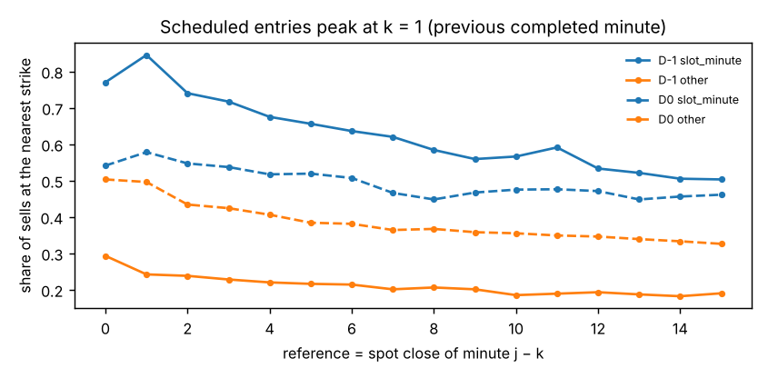
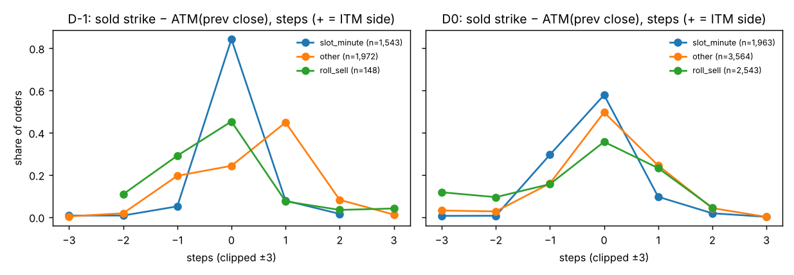
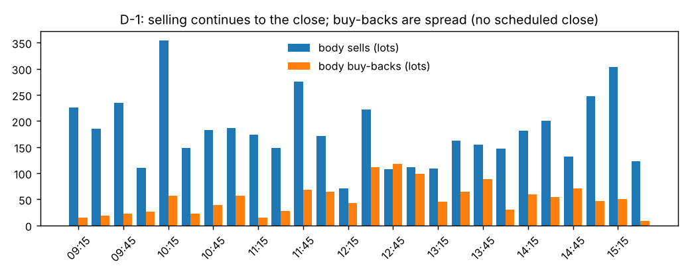
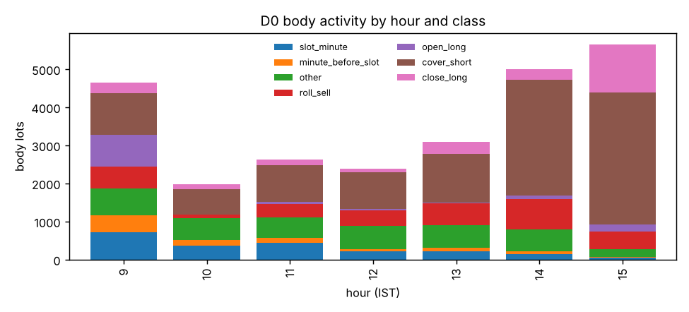
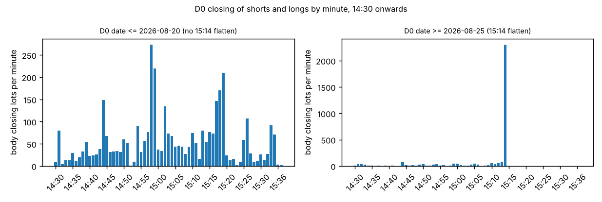

# Algo 8 — Body Module lifecycle, reconstructed separately for D-1 and D0

*In-sample, observational (35 live cycles; not a holdout). Tags: **Observed** = read directly from orders/fills/market data; **Inferred** = best-fitting rule; **Unresolved** = not determinable from the data. No optimisation of any return metric. Plan: `BODY_LIFECYCLE_PLAN.md`. Event tables: `outputs/bl_events_d1.csv` (9,915 rows), `outputs/bl_events_d0.csv` (29,959 rows). Code: `src/bl_*.py`; every number below is computed by `src/make_bl_report.py` from their outputs. Body = numeric-tag order stream.*

## 1. Executive summary — two separate lifecycle models

**D-1 (position building and carry).**
1. *Observed.* 35.9 % of D-1 sold lots are sold in the scheduled **slot minutes** (09:16 + 15 k); in those orders the sold strike is the nearest strike to the **previous completed minute's spot close** in 84.3 % (±1 step 97.1 %); the orders in the first two seconds of a slot hit it in 92 %–97 %. The reference is previous-minute, not current-minute: when the two nearest strikes differ, the order follows the previous close in 61.9 % vs the current close in 22.1 % (n = 289).
2. *Observed.* Another 42.7 % of D-1 sold lots (`other`) are **not** ATM-targeted, and a further 18.2 % (the minute before a slot) match ATM only 59 % of the time: only 24.2 % of `other` sells hit the ATM strike, at **any** reference lag 0–25 min (best 29.3 %). The best simple regularity is repeating the previous sale's strike on the same right (54.1 %). *Unresolved:* the rule and trigger for these sells.
3. *Observed.* Quantity is almost always **one lot per order** (99.5 %) and mostly **accumulates at the same strike** (86.8 % of slot-minute sells are at an already-short strike); the strike **migrates with ATM across slots** (corr of strike change with ATM change 0.84; strike moved with ATM in 74.9 % of ATM changes). Per-slot lots follow a modal ladder in 74.0 % (CE) / 74.4 % (PE) of slot-rights; CE = PE in 79.5 %. *Unresolved:* what sets the ladder.
4. *Observed.* There is **no scheduled stop of selling or closing on D-1**: the last body sale is at a median 15:25 (IQR 15:19–15:29); 81.2 % of cycles sell after 15:15. Buy-backs are spread through the day (top 8 minutes hold only 16.9 % of D-1 cover lots). About **68.2 % of D-1 sold lots are carried overnight**: median 102 short lots and 157 long lots per cycle, no cycle carries zero shorts.

**D0 (management and liquidation).**
5. *Observed.* The book opens D0 with median 102 short lots in 11 contracts and 157 long lots; 44.7 % of carried shorts are ITM at the D0 open (gap vs D-1 close median -0.27 steps).
6. *Observed.* D0 sells are **inventory-driven rather than ATM-driven**: 46.8 % of D0 sold lots are at strikes carried from D-1, 44.3 % at strikes already short from earlier on D0, only 8.9 % at new strikes; overall ATM-hit 45.5 % (NIFTY 57.5 %, SENSEX 35.1 %; scheduled slot minutes 57.8 %).
7. *Observed.* D0 buy-backs are not clocked per second (:00 share 10 %, DD-1) but cluster at the minutes just before a slot (:14/:29/:44/:59 hold 12.4 % of covers vs 6.7 % by chance) while sells cluster at the slot minutes (29.2 %). Only 29.6 % of buy-back lots are followed by a sale on the same right within 60 s (shifted-time null 21.1 %, range 15.2 %–25.9 %). Buy-back hazard is highest for near-ATM, ITM, later-in-the-day contracts (AUC table §4C); no rule is identified.
8. *Observed — end of session.* The data show a **break between D0 2026-08-13 and 2026-08-25** (per-cycle table in §4D). In all 9 measurable cycles with D0 ≥ 2026-08-25 between 43 % and 87 % of the body's closing lots after 14:30 occur in the single minute 15:14, and **100.0 % of open shorts / 99.6 % of open longs (at 15:13) are closed in 15:14–15:15** (residual: 0 short lots, 4 long lots). In the 12 measurable cycles with D0 ≤ 2026-08-13 the 15:14 minute holds at most 5.1 % of closing lots: closing is spread in bursts (14:58–14:59, 15:15–15:19), shorts are closed by the end (≈ 100 %), 35.5 % of longs remain. (The reported cut-over date 2026-08-03 from earlier phases does **not** match: cycles with D0 08-04…08-13 do not flatten. D0 08-18 and 08-20 cycles have no body closing after 14:30, so the break lies in (08-13, 08-25].)

*Inferred models are stated in §7 (D-1) and §8 (D0); the combined flow is in §10 and is only a concatenation of the two.*

## 2. ATM reference reconstruction (both days)

Body orders have no sub-second decision stamp, so the ATM reference at the decision time is **bracketed**, not assumed. The references: previous-minute spot close (R1, available to the algorithm), current-minute close (R2, look-ahead end of the bracket), parity-implied spot K + C − P from the CE and PE limit-derived prices of a same-strike straddle sold within 2 s (R3), and synthetic ATM (earlier study).

| reference | n | within_half_step | within_1_step | median_offset |
|---|---|---|---|---|
| parity-implied | 3203 | 58.4 % | 82.9 % | -0.153 |
| previous-minute close | 3203 | 72.7 % | 83.7 % | -0.06 |
| current-minute close | 3203 | 68.0 % | 86.5 % | -0.057 |

* **R3 (parity-implied) is a noisy reference** (same-strike straddle strike within half a step in 58.4 % vs 72.7 % for the previous close) and is not used for decisions; it is reported as a cross-check only.
* **Reference-lag scan.** Hit rate of 'sold strike = nearest strike to the spot close of minute j − k':

Scheduled D-1 entries peak at k = 1 (84.5 % vs 77.0 % at k = 0 and 74.0 % at k = 2): **Observed:** the algorithm uses the **previous completed minute**. `other` sells have no peak and low levels at every lag.
* **Seconds from the slot start (D-1, slots 0–16).** The hit rate is ≈ 97 % in the first seconds of the slot and decays through the 3-minute window to ≈ 20 % after two minutes:

| rb | n | exact_prev |
|---|---|---|
| (-31, -1] | 269 | 75.5 % |
| (-1, 0] | 306 | 96.7 % |
| (0, 1] | 135 | 97.0 % |
| (1, 2] | 131 | 92.4 % |
| (2, 3] | 16 | 75.0 % |
| (3, 5] | 2 | 100.0 % |
| (5, 10] | 429 | 89.3 % |
| (10, 20] | 49 | 67.3 % |
| (20, 30] | 71 | 73.2 % |
| (30, 60] | 322 | 78.3 % |
| (60, 90] | 137 | 70.8 % |
| (90, 120] | 164 | 55.5 % |
| (120, 150] | 45 | 20.0 % |
| (150, 181] | 64 | 20.3 % |
| (181, 211] | 38 | 15.8 % |

* **Are exceptions systematic?** For slot-minute sells at distance u from the strike midpoint (u = |spot − nearest strike| ÷ step) the hit rate is (0.0, 0.1] 93.1 %, (0.1, 0.2] 87.4 %, (0.2, 0.3] 89.8 %, (0.3, 0.4] 89.4 %, (0.4, 0.5] 66.9 %: misses concentrate where the spot is within 0.1 step of a strike boundary. 69.2 % of one-step misses (n = 198) lie on the side toward the previous close (binomial p = 6.9e-08). **Inferred:** the 8–16 % of slot-minute exceptions are mostly a **timing difference** (the live spot at the order differs slightly from the previous close), not a different strike rule; the remainder (≈ 31 % of one-step misses and the 2+-step misses) is **Unresolved**.

## 3. D-1 study — position building and overnight carry

### 3A. Strike selection

Offsets (sold strike − ATM(previous close), in steps; + = ITM side) by order class (definitions: `slot_minute` = minute 09:16 + 15 k; `minute_before_slot` = the minute before; `roll_sell` = a body buy-back on the same right ≤ 60 s earlier; `other` = all remaining):

| class | orders | lots | exact_prev | exact_cur | ±1 step | share_lots |
|---|---|---|---|---|---|---|
| minute_before_slot | 745 | 851 | 59.1 % | 62.0 % | 94.5 % | 18.2 % |
| other | 1972 | 1994 | 24.2 % | 29.3 % | 88.3 % | 42.7 % |
| roll_sell | 148 | 148 | 45.3 % | 45.9 % | 81.8 % | 3.2 % |
| slot_minute | 1543 | 1678 | 84.3 % | 76.8 % | 97.1 % | 35.9 % |

* **Does it always sell exact ATM?** No. Scheduled slot-minute sells: 84.3 % exact, 97.1 % within ±1; all other D-1 sells 24.2 % exact (88.3 % ±1).
* **Call vs Put.** Scheduled: CE 82.7 %, PE 85.8 %; by index NIFTY 85.3 %, SENSEX 83.4 %. Offsets of `other` sells (ITM-side steps, share of orders; + = ITM) by right:

| ITM-side steps | CE | PE |
|---|---|---|
| -3 | 0.3 % | 0.4 % |
| -2 | 1.4 % | 2.3 % |
| -1 | 7.4 % | 36.6 % |
| +0 | 20.0 % | 30.2 % |
| +1 | 59.7 % | 24.0 % |
| +2 | 10.6 % | 4.6 % |
| +3 | 0.6 % | 2.0 % |

Share of `other` sells below / above the ATM strike: CE 71 % / 9 %, PE 39 % / 30 %: both rights sit mostly on **lower** strikes than the ATM (a common downward shift; its cause, e.g. strikes carried from earlier lower-spot minutes or a directional cycle sample, was **not tested**).
* **Spot, futures or other reference?** Spot closes reproduce the scheduled entries (previous minute); futures data are unavailable (**Not testable**; a rough carry estimate for one day at an assumed 6–7 % rate is ≈ 4 NIFTY points, below the half-step resolution).
* **Does the strike change when the market moves?** Across consecutive slots the modal strike moves with the ATM: 681 slot pairs, corr(ΔK, ΔATM) = 0.84; unchanged ATM ⇒ unchanged strike in 85.6 % (n = 382); changed ATM ⇒ same-size move in 74.9 % (n = 299).
* **Non-scheduled (`other`) sells.** Candidate regularities tested (strike must equal the candidate; D-1):

| cls | n | repeat previous sale | largest short | wtd-mean short | last cover (≤300 s) | ATM(prev) | new strike |
|---|---|---|---|---|---|---|---|
| minute_before_slot | 745 | 0.469 | 0.296 | 0.318 | 0.0 | 0.591 | 0.105 |
| other | 1972 | 0.541 | 0.216 | 0.166 | 0.056 | 0.243 | 0.111 |
| roll_sell | 148 | 0.426 | 0.142 | 0.162 | 0.138 | 0.453 | 0.209 |
| slot_minute | 1543 | 0.616 | 0.461 | 0.438 | 0.156 | 0.843 | 0.132 |
| ALL | 4408 | 0.551 | 0.31 | 0.284 | 0.113 | 0.519 | 0.12 |

Repeating the previous sale's strike is the best simple description of `other` (54.1 %), the `other` ATM hit rate falls through the day (9h 45 %, 10h 37 %, 11h 36 %, 12h 12 %, 13h 22 %, 14h 20 %, 15h 9 %). **Unresolved.**

### 3B. Quantity

* **One lot per order:** 99.5 % of scheduled orders; the quantity per slot comes from the **number of orders** (a ladder), a few seconds apart (median spacing of consecutive short-sale orders on one right: 2 s, Body/Hedge study).
* **Pattern 1 (accumulate) vs Pattern 2 (migrate):** both occur at different scales. Within the day 86.8 % of scheduled sells go to an already-short strike (59 % in slot 0, 77–98 % later) — **accumulation**; across slots the strike follows the ATM — **migration**. A typical position (cycle × right × strike) has median 8 sell orders and 8 lots; a cycle-right holds a median of 7 short strikes on D-1 (IQR 5–8).
* **Fixed slots or formula?** Modal ladder (lots per right per slot, scheduled orders; slots 0–16):

| slot | modal_ce NIFTY | modal_ce SENSEX | modal_pe NIFTY | modal_pe SENSEX |
|---|---|---|---|---|
| 0 | 3 | 3 | 3 | 3 |
| 1 | 2 | 2 | 2 | 2 |
| 2 | 1 | 2 | 2 | 2 |
| 3 | 1 | 1 | 1 | 1 |
| 4 | 1 | 3 | 1 | 3 |
| 5 | 1 | 1 | 1 | 1 |
| 6 | 1 | 1 | 1 | 1 |
| 7 | 1 | 2 | 2 | 2 |
| 8 | 1 | 1 | 1 | 1 |
| 9 | 1 | 1 | 1 | 1 |
| 10 | 1 | 2 | 1 | 2 |
| 11 | 1 | 1 | 1 | 1 |
| 12 | 0 | 5 | 0 | 0 |
| 13 | 2 | 2 | 2 | 2 |
| 14 | 0 | 0 | 8 | 3 |
| 16 | 1 | 1 | 1 | 1 |

Slot-rights equal the modal ladder in 74.0 % (CE) / 74.4 % (PE); CE = PE in 79.5 %. Slots 12, 14, 15 have few scheduled entries (their modal ladders are unstable or 0). **Observed:** a stable slot ladder with noise; **Unresolved:** its driver (premium budget and book-state rules were rejected in DD-1).

### 3C. Position lifecycle

Contract-level (ownership-free) positions: **456** short strike-positions (cycle × right × strike) in 32 cycles with a D-1 log; **358** (78.5 %) are still short at the end of D-1 and 98 are closed on D-1; 219 carried positions were **partially** reduced during D-1. Lots sold per position: median 8 (IQR 4–14); peak short median 7; hold time of positions closed on D-1 (first short → flat): median 87 min (IQR 20–184).

**Individual lots (FIFO convention; the lot engine's other conventions change timing, not totals).** 4,725 body short lots entered on D-1: 30.5 % closed on D-1 (reason: BODY_BUYBACK 91.9 %, STOP_MODULE 8.1 %), 69.5 % carried to D0 and closed there (BODY_BUYBACK 74.4 %, STOP_MODULE 13.3 %, SETTLEMENT 12.3 %). FIFO hold time of D-1 closes: median 93 min. *Lot ownership is a convention (Unresolved by design).* The strike-position table is `outputs/bl_d1_C_positions.csv`.

### 3D. D-1 ending logic

* **Does the Body stop selling at a fixed time?** No. Last body sale per cycle: quantiles (min/10 %/25 %/50 %/75 %/90 %/max) 14:46, 15:08, 15:19, 15:25, 15:29, 15:32, 15:35; 96.9 % of cycles sell at or after 15:00 and 81.2 % after 15:15. Heaviest sale minutes: 09:16 (189 lots), 10:16 (167 lots), 12:31 (138 lots), 15:15 (121 lots), 09:46 (116 lots) (09:16, 10:16… are slot minutes). Orders are stamped up to 15:35 (after the 15:30 close) in the ledger.
* **Scheduled closes?** No single minute carries a close: the busiest buy-back minutes (12:47 45, 14:55 30, 14:54 29, 13:41 27, 15:05 26…) hold at most 3.4 % of D-1 cover lots each (eight busiest together 16.9 %); buy-backs are heavier from 12:30 but show no clock structure at minute level.
* **Wing seed at the open.** The body stream also *buys* far-OTM wings on D-1: 316 lots, 186 of them at 09:15–09:17, a median 40 steps from the ATM (see the excerpt below).
* **What is carried?** 358 short contracts / 3238 lots and 432 long contracts / 4749 lots over 31 cycles; carried shorts sit a median 1.6 steps from the D-1 close spot (42.5 % ITM), at a median closing price of ₹129. Carry is simply the part of the sold inventory not bought back during D-1; whether it differs systematically from the bought-back part (distance, price ratio) was **not tested** here.
* **Deliberate overnight hedge:** the `v_` lump buys (15:06–15:38) over-hedge the carried shorts (Body/Hedge study).

### 3E. D-1 event table (excerpt)

Full tables: `outputs/bl_events_d1.csv` (all modules, all cycles). Excerpts are the first cycle with a known carry-in (NIFTY, expiry 2026-06-30), chosen by that rule only; ATM = nearest strike to the previous completed minute's spot close; `strike position` = contract net lots after the event; `S / L` = short / long lots of that right.

**09:15–09:18 (opening slot):**

| time | module | class | option | ATM(prev close) | selected | offset (steps) | action | qty | strike position | S / L of right |
|---|---|---|---|---|---|---|---|---|---|---|
| 09:16:00.000 | Body | open_long | CE | 24100 | 26100 | 40.0 | Buy | 1 | 1 | 0 / 1 |
| 09:16:00.000 | Body | open_long | PE | 24100 | 22100 | -40.0 | Buy | 1 | 1 | 0 / 1 |
| 09:16:01.000 | Body | open_long | CE | 24100 | 26000 | 38.0 | Buy | 1 | 1 | 0 / 2 |
| 09:16:01.000 | Body | open_long | PE | 24100 | 22100 | -40.0 | Buy | 1 | 2 | 0 / 2 |
| 09:16:01.000 | Body | slot_minute | CE | 24100 | 24100 | 0.0 | Sell | 1 | -1 | 1 / 2 |
| 09:16:01.000 | Body | slot_minute | PE | 24100 | 24100 | 0.0 | Sell | 1 | -1 | 1 / 2 |
| 09:16:02.000 | Body | slot_minute | CE | 24100 | 24100 | 0.0 | Sell | 1 | -2 | 2 / 2 |
| 09:16:02.000 | Body | slot_minute | PE | 24100 | 24100 | 0.0 | Sell | 1 | -2 | 2 / 2 |
| 09:16:06.000 | Body | open_long | CE | 24100 | 26050 | 39.0 | Buy | 1 | 1 | 2 / 3 |
| 09:16:06.000 | Body | open_long | PE | 24100 | 22100 | -40.0 | Buy | 1 | 3 | 2 / 3 |
| 09:16:07.000 | Body | slot_minute | CE | 24100 | 24100 | 0.0 | Sell | 1 | -3 | 3 / 3 |
| 09:16:08.000 | Body | slot_minute | PE | 24100 | 24100 | 0.0 | Sell | 1 | -3 | 3 / 3 |

**Last half hour (15:05–15:36):**

| time | module | class | option | ATM(prev close) | selected | offset (steps) | action | qty | strike position | S / L of right |
|---|---|---|---|---|---|---|---|---|---|---|
| 15:05:00.000 | Body | cover_short | CE | 23950 | 23900 | -1.0 | Buy | 1 | -19 | 76 / 77 |
| 15:05:00.000 | Body | cover_short | PE | 23950 | 24000 | 1.0 | Buy | 1 | -3 | 25 / 26 |
| 15:05:00.000 | Body | cover_short | PE | 23950 | 24000 | 1.0 | Buy | 1 | -2 | 24 / 26 |
| 15:05:00.000 | Body | cover_short | PE | 23950 | 24050 | 2.0 | Buy | 1 | -6 | 23 / 26 |
| 15:05:03.746 | Hedge | hedge | PE | 23950 | 23200 | -15.0 | Sell | 3 | 0 | 23 / 23 |
| 15:05:03.752 | Hedge | hedge | CE | 23950 | 24750 | 16.0 | Sell | 1 | 9 | 76 / 76 |
| 15:10:38.977 | Lump | lump | CE | 23950 | 24400 | 9.0 | Buy | 15 | 15 | 76 / 91 |
| 15:10:38.977 | Lump | lump | CE | 23950 | 24400 | 9.0 | Buy | 27 | 42 | 76 / 118 |
| 15:10:38.977 | Lump | lump | CE | 23950 | 24400 | 9.0 | Buy | 27 | 69 | 76 / 145 |
| 15:28:02.565 | Lump | lump | CE | 24000 | 24400 | 8.0 | Buy | 5 | 74 | 76 / 150 |

### 3F. D-1 unexplained-behaviour register

| # | Behaviour | Observed | Status |
|---|---|---|---|
| D1-U1 | `other` sells (42.7 % of lots) | strike not ATM at any lag (≤ 29.3 %); repeats previous strike 54.1 %; ATM hit decays through the day | **Unresolved** (rule and trigger) |
| D1-U2 | minute-before-slot sells (18.2 %) | ATM hit 59.1 % (±1 94.5 %) | **Unresolved** (second clock; strike partly ATM) |
| D1-U3 | slot ladder | modal ladder reproduced in 74.0 % / 74.4 %; driver unknown | **Unresolved** |
| D1-U4 | slot-minute exceptions | 15.7 % not ATM; mostly boundary timing (Inferred) | partly **Inferred**, ≈ 31 % of 1-step misses **Unresolved** |
| D1-U5 | what is bought back on D-1 | spread through the day; no schedule | **Unresolved** (earlier per-lot stop band is a tendency only) |
| D1-U6 | carry = 68.2 % of sold lots | no closing time; composition of the carried part vs the bought-back part not tested | **Unresolved** (why exactly these lots) |

## 4. D0 study — position management and liquidation (independent of D-1)

### 4A. Opening inventory

* Carry-in is known for **30 of 35 cycles** (3 cycles lack the D-1 log, 2 lack the D0 log).
* Opening book (cycles with a D-1 log, 31 cycles): median **102 short lots** (IQR 88–114) in 11 contracts and **157 long lots** (IQR 116–180); table `outputs/bl_d0_A_opening_inventory.csv`, strike list `bl_d1_D_overnight_inventory.csv`.
* Gap of the D0 open vs the D-1 close: quantiles (10/25/50/75/90 %) -3.44, -1.48, -0.27, 1.15, 2.70 steps. Carried shorts at the D0 open: 44.7 % ITM; |distance from spot| quantiles (25/50/75/90 %) 1.0, 2.1, 3.6, 5.7 steps.
* **Opening positions not explained by recorded trades.** D0 body Buys with no recorded short (contract net ≥ 0 before): 981 lots in 30 known-carry cycles (seed wings, mostly at 09:15–09:17) and 235 lots in the 3 cycles with unknown carry-in (≈ 78 per cycle vs 33 per known cycle): the excess is **Inferred** to be the footprint of unrecorded carried shorts (3 cycles only; exact amounts **Unresolved**; those cycles are excluded from inventory claims).

### 4B. Strike selection on D0

| class | orders | lots | exact_prev | exact_cur | ±1 step | share_lots |
|---|---|---|---|---|---|---|
| minute_before_slot | 885 | 966 | 32.9 % | 45.2 % | 54.4 % | 9.5 % |
| other | 3564 | 3797 | 49.6 % | 50.3 % | 90.0 % | 37.3 % |
| roll_sell | 2543 | 3253 | 34.8 % | 35.0 % | 72.6 % | 31.9 % |
| slot_minute | 1963 | 2174 | 57.8 % | 54.1 % | 96.9 % | 21.3 % |

* **Exact ATM / ±1, ±2?** Scheduled slot-minute sells 57.8 % exact (96.9 % ±1) — **much lower than D-1 (84.3 %)**; all D0 sells 45.5 %; by hour: 9h 44 %, 10h 60 %, 11h 49 %, 12h 51 %, 13h 48 %, 14h 39 %, 15h 20 %; NIFTY 57.5 % vs SENSEX 35.1 %. Reference: when the two nearest strikes differ, orders follow the previous close in 45.7 % vs the current close 28.4 % (n = 422): previous-minute again for scheduled entries.
* **Previous day's strikes, new strikes, additional positions at existing strikes?** By lots: carried-from-D-1 strike **46.8 %**, existing D0 short strike **44.3 %**, new strike **8.9 %**; ATM hit rate by status: carried 51.6 %, existing 41.6 %, new 14.1 %. **Observed:** D0 selling is dominated by **adding to strikes that are already short**; the ATM matters only for a minority.
* **Call vs Put.** Scheduled D0 slot-minute sells at the ATM: CE 57.1 %, PE 58.6 %. Offsets of all D0 sells (ITM-side steps):

| ITM-side steps | CE | PE |
|---|---|---|
| -3 | 5.1 % | 5.2 % |
| -2 | 3.8 % | 4.5 % |
| -1 | 16.4 % | 21.3 % |
| +0 | 44.4 % | 51.8 % |
| +1 | 25.6 % | 14.7 % |
| +2 | 4.6 % | 2.4 % |
| +3 | 0.0 % | 0.1 % |

No separate CE/PE rule is identified.
* **Time structure.** ATM hit by minutes since the open: (-1, 5] 36 %, (5, 15] 38 %, (15, 30] 63 %, (30, 60] 53 %, (60, 120] 58 %, (120, 240] 49 %, (240, 400] 37 % — highest mid-morning, low at the open and the close.

### 4C. D0 position management

* **New entries, buy-backs, re-entries, long changes (lots, by hour × class, `outputs/bl_d0_C_hour_class.csv`):** sells in slot minutes/other/roll classes are spread over the day; buy-backs rise steeply from 14:00 and dominate 14:00–15:30; body **long** buys (`open_long`) are concentrated at the open and long sales (`close_long`) at the end (15:00–15:30).
* **Clock.** Sells cluster at the slot minutes (29.2 % vs 6.7 % chance, top minutes 16: 10.8 %, 31: 7.3 %, 1: 6.5 %, 15: 6.3 %); buy-backs cluster at 12.4 % in :14/:29/:44/:59 (top minutes 15: 5.7 %, 14: 4.6 %, 17: 3.3 %, 58: 3.2 %).
* **Re-entry after buy-back.** 29.6 % of 11,498 buy-back lots are followed by a sale on the same right within 60 s; shifted-time null 21.1 % (range 15.2 %–25.9 %). So only ≈ 8.5 % of buy-backs are excess re-entries — a **modest** roll component.
* **Strike changes after a buy-back** (3,049 pairs): same strike 14.5 %; new strike more ITM 35.3 %, more OTM 50.1 %; the old strike was ITM in 39.9 %; median |offset from spot| 1.45 → 1.00 steps; new strike closer to spot in 51.4 %. The strike change is strongly related to how far the old strike was from spot (corr 0.78), i.e. rolls move **toward** spot, yet the new strike is the nearest ATM strike in only 34.8 % of D0 roll sells.
* **Buy-back hazard.** Contract-minutes with an open body short on D0 (n = 164,643, 4,137 minutes with a buy-back; AUC 0.5 = no association). Single-driver AUC (buy-back minute vs not; cluster bootstrap over cycles, Holm over six pre-registered drivers):

| driver | AUC | CI | holm_p |
|---|---|---|---|
| ratio_avg | 0.56 | 0.533–0.600 | 0.015 |
| dist | 0.267 | 0.234–0.297 | 0.015 |
| itm_i | 0.6 | 0.561–0.641 | 0.015 |
| mins | 0.641 | 0.599–0.675 | 0.015 |
| d_price_5m | 0.571 | 0.536–0.625 | 0.015 |
| clk | 0.53 | 0.519–0.544 | 0.015 |

(`dist` = |strike − spot| in steps: AUC 0.27 ⇒ buy-backs favour contracts **near the money**; `mins` = minutes since open: later; `itm_i`: ITM; `ratio_avg` = price ÷ average entry; `d_price_5m` = 5-minute price change; `clk` = clock-B minute.) Hazard per contract-minute rises from 2.0 % at price ≤ entry to 5.3 % at 1.5–1.7× entry and falls from 5.2 % at ≤ 0.5 steps from spot to 0.3 % beyond 6 steps. These are marginal associations (larger contracts also trade more): **no exit rule is Inferred**; the per-lot stop band (1.55–1.7×) from earlier work is a tendency, not a rule.
* **Stop-related exits and final liquidation.** Stop-module orders (387 on D0) liquidate body and wings together in 12 cycles (existing cycle-stop work); §4D covers the end of session.

### 4D. D0 ending logic

* **Is there a scheduled 15:14 flatten?** **Observed:** yes, from the cycle with D0 2026-08-25 onward (9 measurable cycles, 15:14-minute share of body closing lots after 14:30 from 43 % up to 87 %; 2301 lots in that minute alone). Up to D0 2026-08-13 (12 measurable cycles) the share is at most 5.1 %; closing is spread (bursts at 14:58–14:59 and 15:15–15:19). The break is **Observed** between 2026-08-13 and 2026-08-25; its cause is **Unresolved**. Per-cycle table (cycles with body closing after 14:30):

| und | expiry | closing_lots_after_1430 | lots_in_1514_minute | share of closing lots in the 15:14 minute | d0 |
|---|---|---|---|---|---|
| NIFTY | 2026-06-23 | 432 | 0 | 0.0 % | 2026-06-23 |
| SENSEX | 2026-06-25 | 312 | 6 | 1.9 % | 2026-06-25 |
| SENSEX | 2026-07-02 | 348 | 7 | 2.0 % | 2026-07-02 |
| NIFTY | 2026-07-07 | 384 | 5 | 1.3 % | 2026-07-07 |
| SENSEX | 2026-07-09 | 278 | 4 | 1.4 % | 2026-07-09 |
| NIFTY | 2026-07-21 | 279 | 9 | 3.2 % | 2026-07-21 |
| SENSEX | 2026-07-23 | 254 | 0 | 0.0 % | 2026-07-23 |
| NIFTY | 2026-07-28 | 341 | 9 | 2.6 % | 2026-07-28 |
| SENSEX | 2026-07-30 | 327 | 3 | 0.9 % | 2026-07-30 |
| NIFTY | 2026-08-04 | 195 | 10 | 5.1 % | 2026-08-04 |
| NIFTY | 2026-08-11 | 221 | 0 | 0.0 % | 2026-08-11 |
| SENSEX | 2026-08-13 | 235 | 1 | 0.4 % | 2026-08-13 |
| NIFTY | 2026-08-25 | 408 | 242 | 59.3 % | 2026-08-25 |
| SENSEX | 2026-08-27 | 401 | 347 | 86.5 % | 2026-08-27 |
| NIFTY | 2026-09-08 | 510 | 446 | 87.5 % | 2026-09-08 |
| NIFTY | 2026-09-15 | 444 | 300 | 67.6 % | 2026-09-15 |
| SENSEX | 2026-09-17 | 293 | 213 | 72.7 % | 2026-09-17 |
| SENSEX | 2026-10-01 | 317 | 219 | 69.1 % | 2026-10-01 |
| NIFTY | 2026-10-06 | 348 | 254 | 73.0 % | 2026-10-06 |
| SENSEX | 2026-10-08 | 296 | 200 | 67.6 % | 2026-10-08 |
| SENSEX | 2026-10-22 | 186 | 80 | 43.0 % | 2026-10-22 |

* **What does it close?** Shares of what is open at 15:13 (contract lots, cycles with known carry-in):

| period | side | open_1513 | closed_1514_1515 | closed_after_1516 | residual_end | share_closed_1514_1515 | share_residual |
|---|---|---|---|---|---|---|---|
| D0 ≤ 2026-08-20 (no flatten) | long | 904 | 107 | 476 | 321 | 11.8 % | 35.5 % |
| D0 ≤ 2026-08-20 (no flatten) | short | 839 | 113 | 725 | 1 | 13.5 % | 0.1 % |
| D0 ≥ 2026-08-25 (flatten) | long | 1052 | 1048 | 0 | 4 | 99.6 % | 0.4 % |
| D0 ≥ 2026-08-25 (flatten) | short | 1040 | 1040 | 0 | 0 | 100.0 % | 0.0 % |

  Post-break: 100.0 % of shorts and 99.6 % of longs are closed in 15:14–15:15 by body orders (2485 lots in that window over all cycles, vs 273 by hedge orders and 0 by the stop module); residual shorts are zero in both periods except 1 lot; residual **longs**: 50 contracts / 353 lots overall (4 lots after the break), last price ≈ ₹0.05, median 5.8 steps OTM (worthless wings left to expire).
* **Different rules for shorts and longs?** At 15:14–15:15 both are closed by the same body orders (the 15:14 flatten includes body sells of wing contracts, i.e. cross-role); afterwards only longs remain. Before the cut-over longs are closed far less (35.5 % remain).
* **Positions that cannot be closed through recorded fills.** The only residuals are far-OTM long wings at ≈ ₹0.05 (settle at the exchange settlement value; **U12** bounded). Cycles whose D0 ends early (cycle stop) have their last order as early as 09:15 (D0 last-order quantiles 09:15, 11:01, 15:14, 15:21, 15:38).

### 4E. D0 event table (excerpt)

Same cycle (NIFTY, expiry 2026-06-30). ATM = nearest strike to the previous completed minute's spot close.

**D0 open (09:15–09:16:10):**

| time | module | class | option | ATM(prev close) | selected | offset (steps) | action | qty | strike position | S / L of right |
|---|---|---|---|---|---|---|---|---|---|---|
| 09:15:16.000 | Body | cover_short | PE | <NA> | 23950 | nan | Buy | 1 | -9 | 22 / 23 |
| 09:15:16.000 | Body | cover_short | CE | <NA> | 23950 | nan | Buy | 1 | -26 | 75 / 150 |
| 09:15:26.000 | Body | cover_short | CE | <NA> | 24100 | nan | Buy | 1 | -9 | 74 / 150 |
| 09:15:26.000 | Body | cover_short | PE | <NA> | 24050 | nan | Buy | 1 | -5 | 21 / 23 |
| 09:15:26.000 | Body | cover_short | CE | <NA> | 23950 | nan | Buy | 1 | -25 | 73 / 150 |
| 09:15:26.000 | Body | cover_short | CE | <NA> | 23950 | nan | Buy | 1 | -24 | 72 / 150 |
| 09:15:26.000 | Body | cover_short | CE | <NA> | 23950 | nan | Buy | 1 | -23 | 71 / 150 |
| 09:15:26.000 | Body | cover_short | CE | <NA> | 23950 | nan | Buy | 1 | -22 | 70 / 150 |
| 09:15:26.000 | Body | cover_short | CE | <NA> | 24050 | nan | Buy | 1 | -13 | 69 / 150 |
| 09:15:26.000 | Body | cover_short | PE | <NA> | 23950 | nan | Buy | 1 | -8 | 20 / 23 |
| 09:15:26.000 | Body | cover_short | PE | <NA> | 23950 | nan | Buy | 1 | -7 | 19 / 23 |
| 09:15:26.000 | Body | cover_short | PE | <NA> | 23950 | nan | Buy | 1 | -6 | 18 / 23 |
| 09:15:28.000 | Body | cover_short | PE | <NA> | 23950 | nan | Buy | 1 | -5 | 17 / 23 |
| 09:15:33.000 | Body | cover_short | PE | <NA> | 24050 | nan | Buy | 1 | -4 | 16 / 23 |
| 09:15:33.000 | Body | cover_short | CE | <NA> | 24050 | nan | Buy | 1 | -12 | 68 / 150 |
| 09:16:03.000 | Body | cover_short | CE | 24000 | 24100 | 2.0 | Buy | 1 | -8 | 67 / 150 |

**The end of the session (15:12:30–15:16):**

| time | module | class | option | ATM(prev close) | selected | offset (steps) | action | qty | strike position | S / L of right |
|---|---|---|---|---|---|---|---|---|---|---|

### 4F. D0 unexplained-behaviour register

| # | Behaviour | Observed | Status |
|---|---|---|---|
| D0-U1 | D0 sell strikes | 91.1 % of lots at already-short strikes; ATM hit 45.5 % overall, SENSEX 35.1 % | **Unresolved** (inventory-driven selection rule) |
| D0-U2 | buy-back trigger | near-ATM/ITM/later contracts favoured (AUCs); no threshold rule found; roll excess only ≈ 8.5 % | **Unresolved** |
| D0-U3 | unrecorded opening positions | footprint in 3 cycles; 3 D-1 and 2 D0 logs missing | **Unresolved** (data) |
| D0-U4 | pre-cutover closing | bursts at 14:58–14:59, 15:15–15:19; 35.5 % of longs left | **Unresolved** (schedule) |
| D0-U5 | start of the 15:14 flatten | no flatten up to D0 2026-08-13, flatten from D0 2026-08-25 (D0 08-18, 08-20 undetermined) | **Observed** break; date and cause **Unresolved** |
| D0-U6 | residual long wings after the flatten | 0.4 % of longs, price ≈ ₹0.05 | **Inferred** left to expire (worthless); intent **Unresolved** |
| D0-U7 | seed long wings at the open | 981 lots of body long buys mostly 09:15–09:17 | **Observed**; strike rule **Unresolved** (earlier register HDG-01) |

## 5. Deliverables

| Deliverable | D-1 | D0 |
|---|---|---|
| ATM reference reconstruction | §2 (R1–R3 bracket, lag scan, boundary test) | §4B (previous-minute again; boundary) |
| Strike-selection distribution | §3A figure + table | §4B table |
| Call vs Put selection | §3A (CE/PE hit, drift) | §4B |
| Quantity-selection logic | §3B ladder | §4C (1-lot orders; inventory-driven) |
| Same-strike accumulation | §3B (86.8 % already short) | §4B (91 % at already-short strikes) |
| Strike migration | §3A (ATM-following across slots) | §4C (roll strike changes) |
| Individual lot lifecycle | §3C (FIFO lots, strike-positions) | §4C (roll pairs; hazard) + `lot_lifecycle` outputs |
| Buyback and re-entry analysis | §3D (spread; no schedule) | §4C (29.6 % vs null 21.1 %; hazard AUCs) |
| Carry-forward analysis | §3C–3D (≈ 68 % carried) | §4A (opening inventory) + §4D (residuals) |
| End-of-session rules | §3D (no close; sells to ≈ 15:35) | §4D (15:14 flatten from the D0 2026-08-25 cycle) |
| Unexplained behaviour register | §3F | §4F |

## 6. Observed / Inferred / Unresolved ledger

| | Observed | Inferred | Unresolved |
|---|---|---|---|
| **D-1** | slot-minute sells at previous-close ATM (84.3 %); 1-lot orders; accumulation at the same strike; strike follows ATM across slots; no closing time; 68.2 % carried | slot exceptions = reference timing noise (69 % of 1-step misses lean toward spot); a 15-minute entry clock with a slot ladder | `other` sells' rule; ladder driver; what is bought back; which lots are carried |
| **D0** | opening book ≈ 102 short / 157 long lots; sells 91.1 % at already-short strikes; buy-backs cluster before slot minutes and near the money; 15:14 flatten from the D0 2026-08-25 cycle | continuous inventory-driven management; ≈ 100 % of open shorts and longs closed at 15:14 after the break; residual longs are worthless wings left to expire | D0 sell-strike rule; buy-back trigger; unrecorded carry-in; pre-cutover schedule; cause of the cut-over |

## 7. D-1 lifecycle model (Inferred, behavioural)

1. From 09:16, every 15 minutes (slot minutes 09:16 + 15 k): sell 1-lot orders on each right at the strike nearest to the **previous completed minute's spot**, repeating the order a few seconds apart to build a per-slot ladder (typical 1–3 lots per right; stable across cycles); the strike changes with the ATM between slots, quantity accumulates at the same strike within slots.
2. At other times, continue selling 1-lot orders on already-short strikes (not ATM-targeted; rule unknown); the hedge module adds wings per right to balance S and L.
3. Buy back individual lots through the day without a clock or a time limit; keep selling until the close.
4. Carry ≈ two-thirds of sold lots overnight (median ≈ 100 short lots per cycle, with ≈ 150 long lots including the lump overweight).

## 8. D0 lifecycle model (Inferred, behavioural)

1. Open with the carried book; at the open buy long wings (seed) and start buying back near-ATM / ITM shorts.
2. Sell 1-lot orders mainly at strikes that are already short (carried or opened earlier on D0), with ATM targeting only in the minority of scheduled slot minutes; buy-backs cluster at :14/:29/:44/:59 and rise from 14:00; re-entry after a buy-back is a minor component.
3. From the D0 2026-08-25 cycle onward close essentially all shorts and longs in the 15:14 minute; before that (up to 2026-08-13) close shorts in bursts between ≈ 14:55 and 15:20.
4. Residual: worthless far-OTM longs left to expire.

## 9. Self red-team and limits

* No bid/ask; spot at minute ends; body fills at second resolution: the decision-time ATM is bracketed, so hit rates are **lower bounds** for any rule that uses a slightly different decision instant.
* Class definitions (slot minute, minute before slot, 60-s roll, `other`) are mine and partly post-hoc after seeing the time structure; each class is reported with its own rates and nothing is averaged across classes except where labelled `ALL`.
* Cycle counts differ by section (32 cycles with a D-1 log, 30 with known carry-in, 31 with overnight inventory); the pre/post-break split (12 vs 9 measurable cycles) is confounded with calendar time and expiry-structure changes.
* Hazard AUCs are marginal single-driver associations over 164,643 contract-minutes clustered in 33 cycles; they do not identify a rule.
* The 35 cycles are in-sample and heavily inspected; nothing here is validation. Reconstructed behaviour is not the original source logic.

## 10. Combined execution flow (concatenation of §7 and §8; to be validated before use)

D-1: 15-minute slot ladder at the previous-minute ATM + continuous accumulation at held strikes + per-lot buy-backs + hedge balancing + overnight lump → carry ≈ 68 % of sold lots. D0: manage the carried book (inventory-driven sells, near-ATM buy-backs, partial re-entry) → from the D0 2026-08-25 cycle flatten at 15:14, otherwise close in the last 30 minutes → leave only worthless wings.
