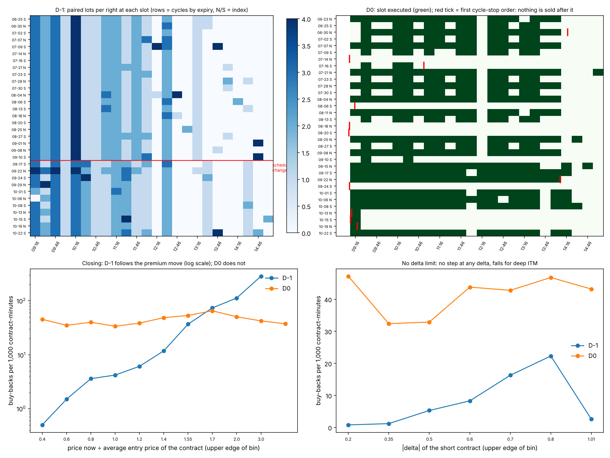

# How the paired (clock) sales and the closes work — D-1 first, D0 second

*In-sample, observational; plan `BODY_PAIRED_SELL_PLAN.md` written first. Slot = clock minute 09:16 + 15 k; a *paired sale* = CE and PE sold at the same strike within 3 s. State variables are those known before the slot (spot moves, book price ratios and ₹ MTM, net delta / gamma / vega from Black-Scholes with IV implied from each contract's minute close, ATM IV and straddle price and their changes, inventory, recent buy-backs, recent solo sales; 36 candidates). Scripts `src/bl_slot_*.py`, `bl_close_*.py`; figure `figures/bl_paired_schedule.png`.*

## 1. Answers

| Your question | Finding | Evidence |
|---|---|---|
| Is the 15-minute selling just the clock, or does each slot check conditions? | **A fixed time schedule with a fixed lot ladder.** On D-1 the 13 scheduled slots execute in 97 %–100 % of cycles (both indices) and the other slots essentially never; CE lots = PE lots in 99.3 % of slots; no state variable changes whether or how much is sold. | 99.8 % of scheduled slot-rights executed; (index × slot) explains R² ≈ 0.7; of 36 state variables **none** beats its permutation null (largest LOCO R² gain +0.0033) |
| Is there a limit of loss / strike move / premium move / delta that stops selling? | **Only the cycle stop.** After the first stop-module order of a D0 cycle **0 of 223** later slots sold anything (D-1: 1 cycle with a stop, 0 later sales). Absent a stop, slots executed in every observed state, including the top decile of net delta and of IV change. | stop gating below; limits of the sample in §6 |
| Why sell after positions were closed? | **Selling and closing are separate processes.** Lots sold in a slot do not depend on how much was bought back since the previous slot (rank correlation -0.04); only 3.2 % of D-1 sold lots are re-sales within 60 s of a buy-back. | slot table, §3 |
| What decides *which strike* a new sell uses — ATM, delta, other Greeks? | **ATM of the previous minute's spot**, not delta, forward, parity or hysteresis: exact hit 93.6 % on D-1 (95.2 % D0) for the first sale of each slot-right vs 66.0 % (call delta nearest 0.5), 65.9 % (delta-neutral straddle), 67.8 % (forward), 56.1 % (min |C−P|), 68.5 % (keep old strike within 1 step). The quantity is the ladder, not delta, premium or notional. | §4 |
| What triggers the closes? | **D-1: the premium move relative to entry** (price ÷ average entry), graded: 1–6 buy-backs per 1,000 contract-minutes up to 1.2×, 12 at 1.2–1.4×, 37 at 1.4–1.55×, 74 at 1.55–1.7×, 113 at 1.7–2.0×. Delta, ITM distance and time held add almost nothing beyond it. **D0 is different:** no dependence on premium or delta; closes follow the clock (late-day, flatten). | §5 |

## 2. The paired sales are a fixed schedule (D-1)

* **Execution by slot** (share of the 64 cycle-rights that sold a pair): 09:16: 97 %, 09:31: 100 %, 09:46: 100 %, 10:01: 100 %, 10:16: 100 %, 10:31: 100 %, 10:46: 100 %, 11:01: 100 %, 11:16: 100 %, 11:31: 100 %, 11:46: 100 %, 12:01: 100 %, 12:16: 6 %, 12:31: 100 %, 12:46: 6 %, 13:01: 3 %, 13:16: 69 %, 13:31: 41 %. Slots 09:16–12:01 and 12:31 fire every time; 12:16, 12:46 and 13:01 never; the late slots depend on the schedule version below. NIFTY 99.5 %, SENSEX 100.0 %.
* **The ladder is the same for NIFTY and SENSEX** (in lots, per right) and **identical for CE and PE**. Two versions of the table appear (A: expiries up to 2026-09-10, 21 cycles; B: from 2026-09-17, 11 cycles), changing between D-1 2026-09-09 and 2026-09-16:

| slot | ladder A (lots per right) | cycles equal | ladder B | cycles equal  |
|---|---|---|---|---|
| 09:16 | 3 | 100 % | 3 | 73 % |
| 09:31 | 2 | 100 % | 1 | 45 % |
| 09:46 | 3 | 100 % | 3 | 91 % |
| 10:01 | 1 | 100 % | 1 | 100 % |
| 10:16 | 4 | 100 % | 3 | 91 % |
| 10:31 | 1 | 100 % | 2 | 82 % |
| 10:46 | 1 | 100 % | 1 | 100 % |
| 11:01 | 2 | 90 % | 1 | 91 % |
| 11:16 | 2 | 100 % | 2 | 91 % |
| 11:31 | 1 | 90 % | 2 | 64 % |
| 11:46 | 2 | 100 % | 1 | 91 % |
| 12:01 | 1 | 81 % | 1 | 82 % |
| 12:31 | 2 | 76 % | 2 | 91 % |
| 13:16 | 1 | 100 % | 0 | 91 % |
| 13:31 | 0 | 90 % | 1 | 91 % |
| 14:31 | 0 | 90 % | 1 | 91 % |

Within a version, slot-rights with a non-zero ladder agree with the table in 96 % of cases (A) and 85 % (B): B is looser (a ladder still being adjusted, or more extra orders). Departures from the table are single extra or missing lots, not skips.
* **State does not matter.** Over 36 variables the best LOCO R² gain over (index × slot) is rv30 +0.0033; variables passing both the CI and the permutation null: none. Including net delta / gamma / vega (delta_need -0.0000, gamma -0.0003, vega -0.0009), ATM IV and its changes (atm_iv +0.0023, d_iv30 -0.0004, straddle +0.0025), the book's price ratio and ₹ MTM (book_ratio -0.0005, mtm_tot +0.0002), and buy-backs since the last slot (cov_own -0.0008).

## 3. The one condition: the cycle stop halts the schedule

D0: 11 cycles contain a stop-module order. Slots before the first stop executed 44 of 52; **after it 0 of 223** (see the red ticks in the figure: the green schedule ends exactly where the cycle stop begins). On D-1 1 cycle had a stop order (NIFTY 2026-09-01, 14:46): 0 of 2 later slots sold. The stop is the existing cycle-level loss limit (cumulative MTM about −₹1.30 to −1.44 lakh, scaled with lot size — earlier phases). **Observed:** a stopped cycle sells nothing more; **Unresolved:** whether a smaller loss, a delta level or a time rule also pauses a single slot (no such case in the sample).

**D0 schedule.** Same logic, different template. Slots executed in at least 90 % of the non-stopped D0 cycles: NIFTY before 2026-09-15: 09:16, 09:31, 09:46, 10:01, 10:16, 10:31, 10:46, 11:01, 11:16, 11:31, 11:46, 12:01, 12:31, 12:46, 13:01; NIFTY from 2026-09-15: 09:16, 09:31, 09:46, 10:01, 10:16, 10:31, 10:46, 11:01, 11:16, 11:31, 11:46, 12:01, 12:16, 12:31, 13:01, 13:16; SENSEX before 2026-09-15: 09:31, 10:31; SENSEX from 2026-09-15: 09:16, 09:31, 09:46, 10:01, 10:16, 10:31, 10:46, 11:01, 11:16, 11:31, 11:46, 12:16, 12:31, 12:46, 13:01, 13:16. The template changes at the 2026-09-15 cycle (both indices then sell at every slot).

## 4. New sales: why the strike is the ATM

Unit = first scheduled paired sale of each slot-right (n = 902 on D-1, 542 on D0); reference data = the previous completed minute.

| rule | D-1 exact | D-1 ±1 step | D0 exact |
|---|---|---|---|
| ATM | 93.6 % | 99.6 % | 95.2 % |
| HYST_0.5 | 93.6 % | 99.6 % | 95.2 % |
| HYST_0.75 | 78.8 % | 99.2 % | 84.3 % |
| HYST_1.0 | 68.5 % | 99.1 % | 77.1 % |
| FWD | 67.8 % | 99.8 % | 90.8 % |
| DELTA50 | 66.0 % | 99.8 % | 89.3 % |
| DELTA_NEUTRAL | 65.9 % | 99.8 % | 89.3 % |
| HYST_1.5 | 61.8 % | 98.3 % | 70.1 % |
| HYST_2.0 | 57.9 % | 94.5 % | 67.9 % |
| MINCP | 56.1 % | 98.9 % | 86.0 % |
| nan | 28.6 % | 64.9 % | 38.7 % |

The ATM of the previous minute's spot wins by a wide margin; delta-, forward- and parity-based strikes land within ±1 step (99.8 %) but not on the actual strike. Keeping the previous strike until the spot has moved more than 0.5–2 steps (hysteresis) is worse (h = 0.5 equals ATM by construction). **Inferred rule:** at each slot sell CE and PE at the strike nearest to the previous minute's spot close, in the ladder quantity. Greeks are not an input to the strike.

## 5. What triggers the closes (D-1) — premium move, not delta

Contract-minute panel: every minute with a net-short body contract (D-1: 100,615 rows, 750 buy-back minutes); price ÷ average entry uses the strike's average body entry (lot ownership within a strike is not observed).

| price ÷ entry | minutes | buy-backs | rate_per_1000 | lift |
|---|---|---|---|---|
| (0.0, 0.4] | 6131 | 3 | 0.5 | 0.07 |
| (0.4, 0.6] | 10335 | 16 | 1.5 | 0.21 |
| (0.6, 0.8] | 16481 | 60 | 3.6 | 0.49 |
| (0.8, 1.0] | 29864 | 126 | 4.2 | 0.57 |
| (1.0, 1.2] | 23348 | 142 | 6.1 | 0.82 |
| (1.2, 1.4] | 9214 | 109 | 11.8 | 1.59 |
| (1.4, 1.55] | 3249 | 120 | 36.9 | 4.95 |
| (1.55, 1.7] | 1366 | 101 | 73.9 | 9.92 |
| (1.7, 2.0] | 613 | 69 | 112.6 | 15.1 |
| (2.0, 3.0] | 14 | 4 | 285.7 | 38.33 |

* **Premium move:** AUC 0.77 (₹ loss per lot 0.76); the rate climbs steadily from 1× to 2× — a graded response, the earlier "≈ 1.55–1.7× entry" band is the middle of this climb, not a hard step (average entries mix lots with different entries).
* **Delta:** |delta| AUC 0.69, and the rate has **no step**: (0.0, 0.2]: 1, (0.2, 0.35]: 1, (0.35, 0.5]: 5, (0.5, 0.6]: 8, (0.6, 0.7]: 16, (0.7, 0.8]: 22, (0.8, 1.01]: 3 per 1,000 minutes — it falls for the deepest ITM contracts (delta > 0.8), so there is no delta limit. Adding delta to the premium move: AUC gain +0.0037 (null max +0.0005).
* **Strike move (ITM steps):** AUC 0.71; gain over the premium move +0.0021. **Adverse spot move since entry:** AUC 0.71, gain +0.0090 (small but above its null). Time held: AUC 0.49. All variables together in a flexible model add +0.030 AUC over the premium move alone.
* **D0:** AUC of price ÷ entry 0.49, |delta| 0.48, time of day 0.71, time held 0.68: D0 buy-backs follow the clock (late-day, 15:14 flatten after the August break), not a premium or delta limit.
* **Not a hard trigger:** even at 1.7–2.0× the per-minute rate is ≈ 11 %, so conditions other than the price multiple (and per-lot entries, minute checks) matter; **Unresolved**.

## 6. Limits

* The sample never put the book deep into loss at a D-1 slot (worst book MTM at an executed slot -0.10 % of ₹2 Cr; book price ratio ≤ 1.10), so "no loss limit on selling" is shown only inside that range; the cycle stop is the only gate observed.
* Greeks are Black-Scholes with IV implied from minute-close option prices (no dividends; r = 6.5 %); no VIX series.
* The 15-minute schedule was identified from 32 D-1 logs (and 33 D0); the version change is based on 11 later cycles.
* Closing analysis cannot separate lots within a strike (ownership unknown), and minute data hide intra-minute checks.
