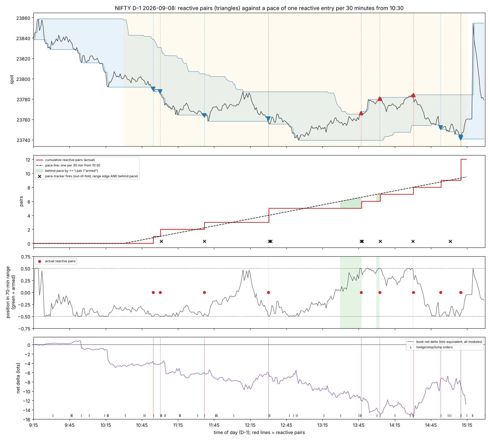
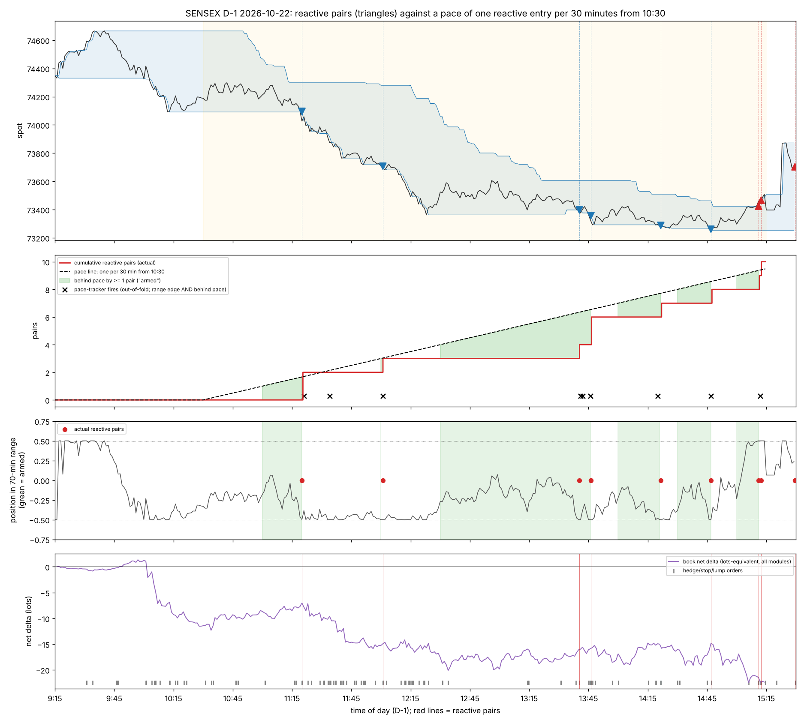

# Algo 8 — reactive pairs: is it linked to the state of the book? (and what *is* the second variable)

*Investigation only. In-sample (D-1 of 32 live cycles; 363 reactive pairs vs 10,890 random seconds, and 9,152 cycle-minutes). Plan written before the tests: `BODY_REACTIVE_BOOK_PLAN.md`; the **pace** variables, the pace machines and the regularity/age comparisons were added after the first results and are labelled post-hoc. Figures: `figures/bl_pc_example_NIFTY.png`, `figures/bl_pc_example_SENSEX.png`. This report **supersedes the "cooldown" description of `BODY_REACTIVE_TRACKER.md`**: a fixed silence period has no economic meaning and is replaced below by variables a practitioner would recognise. Nothing here shows what Algo 8's code does.*

## 0. Answers

| Question | Answer | Evidence level |
|---|---|---|
| **Is the reactive pair a delta hedge / re-centring of the book?** | **No.** One pair adds ≈ **0.21 lot** of delta (always in the direction of the move); the book's net delta is typically ±6.6 lots and drifts to −15 / −22 lots in the example cycles **without any reset at the pairs**. Pairs are placed with the book exposed against the move 57% of the time vs 46% for random seconds at the range edge; within the edge the book-delta variable separates pairs from non-pairs at AUC 0.58. | Observed |
| **Premium richness / vol spike, P&L, margin, distance to the book's strikes, other greeks?** | **None of them gates the pair.** Within the range-edge seconds every such variable has AUC between 0.41 and 0.58 (table in §1); adding all of them to the edge model changes the AUC by -0.006 (boosting) / +0.021 (logistic), CIs include 0. | Observed |
| **What does show up outside price?** | **How many pairs have already been done relative to the clock — a pace.** A cycle that is *behind* the usual cumulative number of pairs fires at the range edge far more often: within the edge, AUC **0.66** (minutes) / 0.73 (seconds) for the all-pairs deficit, against 0.54 for a deficit in *open short lots* (so it is a count of entries, not exposure or margin). Hazard is 0.15–0.42 across book-delta bins but rises from 0.15 to 1.15 events per control second from the most-ahead to the most-behind pace quintile (§2). | Observed (predictive; post-hoc) |
| **A machine with no timer?** | **Range edge AND behind a pace of one reactive entry per ~30 minutes from 10:30** reproduces the pair times better than the refractory machine: out-of-fold precision 56%, recall 57%, **F1 0.56** (±1 min; null 99th pct 0.12); with the current-minute close **same-minute F1 0.46** (was 0.14 / 0.33). Random half-splits 0.57 (0.52–0.61); fitted on one underlying/schedule version and frozen on the other 0.54–0.60. F1 is +0.058 above the refractory machine (95% CI +0.018 … +0.100). | Observed (description); mechanism **Inferred** |
| **Is it proved to be a pace/schedule?** | **No.** Pace adds only +0.064 AUC over "time since the last pair" inside the edge (CI +0.014 … +0.112); the cumulative count follows a straight pace only marginally (fires p = 0.04, pairs not more regular than random); there is **no catch-up signature** (gap after a long gap is not shorter: 21 vs 20 min). Pace and "time since the last pair" are close relatives in this data. | Observed; mechanism **Unresolved** |
| **What else was found?** | The **hedge module reacts to the pair, not the other way round**: 89.5% of reactive pairs are followed within 30 s by a long-wing purchase (random seconds 3.1%). The earlier "clustering with other orders" is mostly this consequence plus pairs placed together. | Observed |

## 1. Book-state variables (plan tests A, B)
Book = all orders of every module on D-1 up to the second (flat at the open); Greeks from σ√T of the ATM straddle (no smile); P&L in % of ₹ 2 crore. 29 variables × 2 forms. Top ten by strength **within the range-edge seconds** (236 pairs / 944 seconds):

| state variable | AUC vs random seconds (all) | AUC within the range-edge seconds | even cycles (all) | odd cycles (all) |
|---|---|---|---|---|
| P&L change, 5 min | 0.43 | 0.407 | 0.473 | 0.385 |
| same, per open short lot | 0.579 | 0.581 | 0.562 | 0.608 |
| book net delta signed against the move | 0.579 | 0.575 | 0.564 | 0.606 |
| book delta change, 5 min | 0.547 | 0.569 | 0.617 | 0.474 |
| book delta change, 15 min | 0.534 | 0.565 | 0.6 | 0.466 |
| book delta change, 30 min | 0.508 | 0.564 | 0.562 | 0.452 |
| σ√T change, 30 min | 0.536 | 0.438 | 0.513 | 0.56 |
| P&L change, 15 min | 0.449 | 0.439 | 0.469 | 0.426 |
| P&L change, 30 min | 0.467 | 0.454 | 0.482 | 0.45 |
| in-the-money short lots | 0.557 | 0.544 | 0.558 | 0.56 |

* **Delta re-centring is ruled out on size and on timing.** A pair adds ≈ 0.21 lot vs a book of |delta| ≈ 6.6 lots (median); after the pair the median |delta| is 6.6. 56% of pairs happen to reduce |delta| (about a coin flip, since the book is on the right side about half the time); the pair direction itself is always the move direction (100%). Book delta by quintile (within the edge) is flat or non-monotonic: events per control second 0.15, 0.42, 0.32, 0.39, 0.42.
* **Breach of the book's outer strikes, premium/vol jumps, P&L and in-the-money lots** do not gate the pair either (non-monotonic bins, AUC ≤ 0.58 within the edge). In-the-money short lots are non-monotonic (events per control second 0.21 → 0.46 → 0.28), not a gate.
* Block models (look-ahead breakout minutes, leave-one-cycle-out; edge-only AUC logistic 0.588, boosting 0.601):

| block added to the edge features | logistic gain (95% CI) | boosting gain (95% CI) | logistic AUC |
|---|---|---|---|
| edge + activity (order ages) | +0.087 (+0.055 … +0.120) | +0.084 (+0.037 … +0.132) | 0.675 |
| edge + book greeks/exposure | +0.032 (-0.005 … +0.064) | +0.023 (-0.015 … +0.069) | 0.62 |
| edge + premium/vol | +0.017 (-0.006 … +0.039) | -0.025 (-0.053 … +0.006) | 0.605 |
| edge + P&L | -0.013 (-0.031 … +0.004) | -0.011 (-0.037 … +0.014) | 0.575 |
| edge + pace deficit | +0.070 (+0.041 … +0.104) | +0.052 (+0.022 … +0.088) | 0.658 |
| edge + activity + pace | +0.101 (+0.070 … +0.139) | +0.081 (+0.037 … +0.132) | 0.689 |
| edge + book + premium + P&L (no pace, no activity) | +0.021 (-0.013 … +0.053) | -0.006 (-0.047 … +0.036) | 0.609 |
| everything | +0.085 (+0.034 … +0.141) | +0.108 (+0.056 … +0.164) | 0.673 |

## 2. The variable that does show up: pace (post-hoc)
Pace deficit = (mean cumulative number of pairs of the **other** 31 cycles at this time) − (this cycle's cumulative pairs). Inside the range-edge minutes:

| variable (look-ahead breakout minutes) | AUC | even cycles | odd cycles |
|---|---|---|---|
| reactive pairs so far | 0.419 | 0.379 | 0.452 |
| pace deficit, reactive pairs | 0.645 | 0.663 | 0.639 |
| pace deficit, all pairs | 0.662 | 0.651 | 0.675 |
| pace deficit, scheduled pairs | 0.549 | 0.532 | 0.565 |
| minutes since the last reactive pair | 0.688 | 0.669 | 0.708 |
| book delta against the move | 0.561 | 0.547 | 0.568 |
| in-the-money short lots | 0.555 | 0.52 | 0.586 |
| P&L | 0.488 | 0.486 | 0.492 |
| premium position in its range | 0.473 | 0.519 | 0.43 |

* **A count of entries, not exposure:** the deficit in *open short lots* or ₹ notional scores 0.54 within the edge (0.47 / 0.61 in the two cycle halves) whereas the deficit in pairs placed scores 0.71–0.73, so buy-backs and stops (which change open lots) are not what the tracker watches.
* **Pace vs time since the last pair** (inside the range-edge seconds, leave-one-cycle-out logistic):

| model | AUC | gain over "time since last pair" (95% CI) |
|---|---|---|
| time since the last reactive pair | 0.682 | +0.000 (+0.000 … +0.000) |
| pace deficit in reactive pairs | 0.704 | +0.022 (-0.039 … +0.088) |
| pace deficit in all pairs | 0.729 | +0.046 (-0.011 … +0.107) |
| time since last pair + pace deficit (reactive) | 0.721 | +0.039 (-0.017 … +0.094) |
| time since last pair + pace deficit (all pairs) | 0.746 | +0.064 (+0.014 … +0.112) |
| time since last pair + count so far + time of day | 0.731 | +0.048 (-0.008 … +0.102) |

  Pace is at best a modest improvement over the time-since-last-pair clock: they describe nearly the same thing. I cannot separate "paced entries" from "silence after an entry" with this data.
* **Regularity test** (distance of each cycle's cumulative count from a straight line 10:30–15:15, vs the same number of events at random times):

| group | cycles | KS distance observed | random placement mean (5th pct) | p (more regular than random) |
|---|---|---|---|---|
| reactive pairs (all) | 32 | 0.28 | 0.251 (0.229) | 0.983 |
| fires (pairs within 5 s merged) | 32 | 0.255 | 0.281 (0.256) | 0.04 |

  Fires are slightly more regular than random (p = 0.04); pairs (which include 2–3 pair-lots placed in the same second) are not. So the pace is a weak regularity, not a rigid schedule.
* **No catch-up:** consecutive fire gaps are uncorrelated beyond what shuffling gives (ρ = -0.05, shuffled mean -0.06); after a gap longer than 50 minutes the next gap is not shorter.

## 3. Forward-simulated pace machines (no timer, parameters chosen out-of-fold)
| machine | information | parameters chosen (N, D, θ) fold 1 / fold 2 | precision (±1 min) | recall (±1 min) | F1 (±1 min) | F1 same minute | null F1 99th pct | fires per cycle | fires variance/mean |
|---|---|---|---|---|---|---|---|---|---|
| M10 range edge AND behind a pace of one reactive entry per D min | completed bars | (70, 30, 1.0) / (70, 30, 1.0) | 0.561 | 0.568 | 0.564 | 0.198 | 0.12 | 8.406 | 0.053 |
| M10 range edge AND behind a pace of one reactive entry per D min | current-minute close | (70, 30, 1.0) / (90, 30, 1.0) | 0.578 | 0.56 | 0.569 | 0.458 | 0.122 | 8.062 | 0.12 |
| M11 range edge AND behind a pace for ALL pairs | completed bars | (70, 5, 2.0) / (70, 5, 1.0) | 0.264 | 0.696 | 0.383 | 0.166 | 0.124 | 21.906 | 1.368 |
| M11 range edge AND behind a pace for ALL pairs | current-minute close | (90, 5, 1.0) / (90, 5, 0.5) | 0.278 | 0.665 | 0.392 | 0.332 | 0.115 | 19.906 | 1.583 |
| M12 range edge AND behind the other cycles' mean reactive curve | completed bars | (90, 0, 0.25) / (70, 0, 0) | 0.426 | 0.541 | 0.477 | 0.152 | 0.119 | 10.562 | 0.14 |
| M12 range edge AND behind the other cycles' mean reactive curve | current-minute close | (90, 0, 0.25) / (90, 0, 0) | 0.44 | 0.534 | 0.482 | 0.367 | 0.115 | 10.094 | 0.194 |
| M13 range edge AND behind the other cycles' mean curve of all pairs | completed bars | (70, 0, 0) / (70, 0, 0) | 0.466 | 0.602 | 0.526 | 0.207 | 0.128 | 10.719 | 0.224 |
| M13 range edge AND behind the other cycles' mean curve of all pairs | current-minute close | (70, 0, 0) / (70, 0, 0) | 0.459 | 0.594 | 0.518 | 0.39 | 0.125 | 10.75 | 0.24 |

* **M10 is the best machine so far:** F1 0.56 (0.57 with the current-minute close); chosen parameters are stable (N = 70–90, D = 30 minutes, θ = 1 pair). 8.4 fires per cycle ≈ 285 min / 30 = 9.5 and ≈ the real 9.3 fires per cycle (clusters within 5 s) — but the machine is **too regular** (count variance/mean 0.05 vs 0.51 real).
* Against the refractory machine of the previous report:

| comparison | F1 pace | F1 refractory | difference in F1 (95% CI) | cycles where pace is better |
|---|---|---|---|---|
| M10 pace (completed bars) minus M1 refractory (completed bars) | 0.564 | 0.507 | +0.058 (+0.018 … +0.100) | 59% |
| M10 pace (current-minute close) minus M1 refractory (completed bars) | 0.569 | 0.507 | +0.062 (+0.020 … +0.108) | 56% |

* Frozen cross-validation of M10 (fit on one group, score on the other):

| fit on | scored on (frozen) | parameters (N, D, θ) | precision | recall | F1 |
|---|---|---|---|---|---|
| NIFTY | SENSEX | (70, 30, 1.0) | 0.514 | 0.564 | 0.538 |
| SENSEX | NIFTY | (90, 30, 1.0) | 0.641 | 0.564 | 0.6 |
| V1 | V2 | (70, 30, 1.0) | 0.576 | 0.564 | 0.57 |
| V2 | V1 | (90, 30, 1.0) | 0.565 | 0.558 | 0.561 |

* The same pace for **all** pairs (M11) fits poorly (F1 0.38–0.39): the reactive stream has its **own** pace, separate from the scheduled timetable. A nonparametric target (the other cycles' mean curve, no timer parameter at all, M13) reaches F1 0.52.

## 4. What the example plots show
Same two cycles as the tracker report (NIFTY 2026-09-08, SENSEX 2026-10-22; chosen by a rule fixed in advance).

* Row 2: the cumulative reactive pairs stay close to the "one per 30 minutes from 10:30" line; pace-tracker fires (crosses) fall at or just before real pairs in most cases. The three pairs at 15:09 push the count above the line (several pair-lots at one second).
* Row 3: the "armed" periods (behind pace) are where the pairs occur once the price touches the edge; the long stretches at the edge while **ahead** of pace have no pair.
* Row 4: **the book's net delta drifts steadily to −15 (NIFTY) and −22 lots (SENSEX) and is never reset at a reactive pair** — the pair is not managing delta.

## 5. Order flow around the pairs (H5)
| order within 3–30 s AFTER the pair | share of reactive pairs | share of random seconds | lift |
|---|---|---|---|
| s_ | close_long | CE | 1.7% | 0.0% | 16528925.6 |
| s_ | cover_short | PE | 1.7% | 0.0% | 16528925.6 |
| s_ | cover_short | CE | 1.7% | 0.0% | 16528925.6 |
| s_ | close_long | PE | 1.7% | 0.0% | 16528925.6 |

| order within 3–30 s BEFORE the pair | share of reactive pairs | share of random seconds | lift |
|---|---|---|---|
| num | cover_short | CE | 5.8% | 0.9% | 6.7 |
| h_ | close_long | CE | 5.2% | 0.8% | 6.4 |
| num | open_short | PE | 19.6% | 3.3% | 5.9 |
| num | open_short | CE | 21.5% | 3.6% | 5.9 |
| h_ | open_long | PE | 17.9% | 3.5% | 5.2 |

* The hedge module buys a long wing on **both legs within seconds after** nearly every reactive pair: hedge follows the pair (a pointer for the hedge-module study), it is not a trigger.
* Before a pair, other body sells (another pair placed in the previous 30 s), buy-backs and wing closes are over-represented (lift 5–7): pairs come in bursts and sometimes right after a close; this explains part of the earlier "clustering with other orders" but is a minority of pairs (5–22%).
* Time to or since the nearest scheduled wave has no effect (AUC 0.50 within the edge).

## 6. Evidence register
| Claim | Label | Basis |
|---|---|---|
| The reactive pair is not a delta re-centring (size 0.21 lot vs |delta| ≈ 7; book delta never reset) | **Observed** | §1, §4 |
| Premium richness, vol spike, P&L, margin proxy, breach of book strikes do not gate the pair | **Observed** | within-edge AUC 0.41–0.58, block gains include 0 |
| A count-of-entries pace deficit separates pairs from non-pairs at the range edge (AUC 0.71–0.73) | **Observed (predictive, post-hoc)** | §2 |
| Range edge AND behind a ~30-min pace reproduces the pair times (F1 0.56; 0.46 same-minute with current close) | **Observed (description)** | §3 |
| Pace beats the refractory machine | **Observed** | F1 +0.058 (CI +0.018 … +0.100) |
| The system follows a fixed entry schedule | **Not established** | regularity weak (fires p = 0.04), no catch-up, pace ≈ age |
| Hedge wings follow every reactive pair | **Observed** | 89.5% within 30 s |
| What fires the remaining pairs | **Unresolved** | best out-of-fold F1 ≈ 0.56 |

## 7. Limits and how this could be wrong
* **Greeks are approximate:** one σ√T from the ATM straddle for all strikes (no smile), lot unit per cycle, wings valued at the last price; the delta-size argument is robust (0.2 vs ≈ 7 lots) but the book delta level is not exact.
* **The pace target is the other cycles' mean (or a 30-minute line):** the true schedule, if any, is unknown; D = 30 hit the upper edge of the grid in no fold (grid 8–40).
* **Post-hoc:** the pace variables and machines were added after seeing that no book variable worked; leave-one-cycle-out, random splits and cross-instrument checks reduce but do not remove the selection risk (408 pace configurations; ≈ 3,250 configurations across the whole tracker line of studies).
* **Look-ahead variant** uses the current minute's close; ±1-minute tolerance is generous (random-shift null 99th pct ≈ 0.12).
* In-sample; D-1 only; close-based range; predictive not causal; no source code. Missing variables might be tick-level timing, true intraday high/low, or internal state.

## 8. Files
`src/bl_bk_build.py` (book state at every event/control second and cycle-minute) → `bl_bk_tests.py` (variables, mechanism) → `bl_bk_blocks.py` (block models incl. pace) → `bl_bk_flow.py` (order flow) → `bl_pc_sim.py` (pace machines) → `bl_pc_tests.py` (bootstrap, age vs pace, catch-up) → `bl_pc_reg.py` (regularity) → `bl_pc_example.py` (figures) → `make_bk_report.py`. Outputs `outputs/bl_bk_*`, `bl_pc_*`, `bl_summary_bk1…3.json`, `bl_summary_pc1…4.json`. Tests `tests/test_bl.py` (`test_bk_*`, `test_pc_*`).
