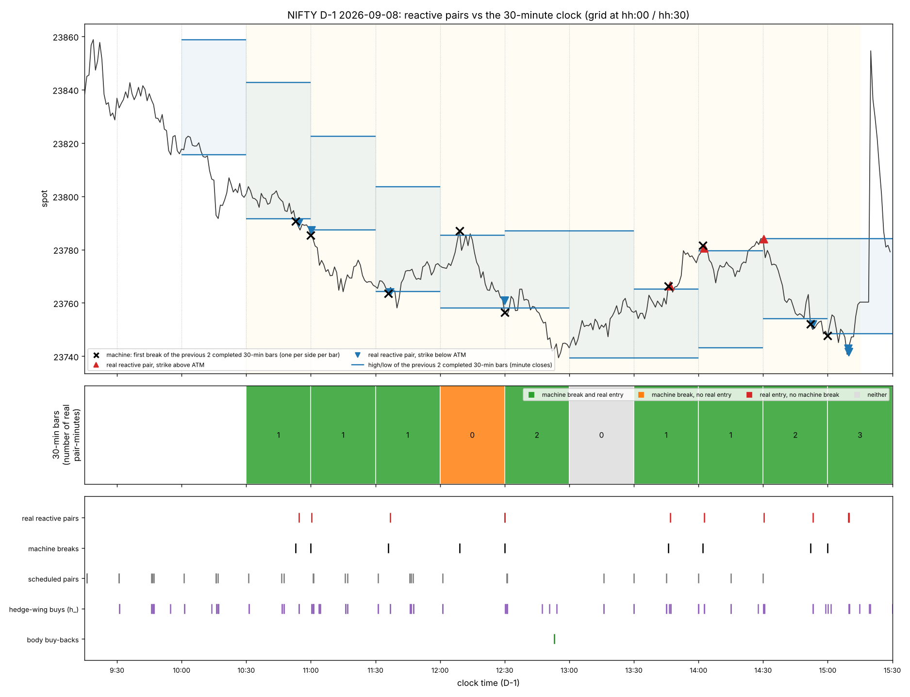
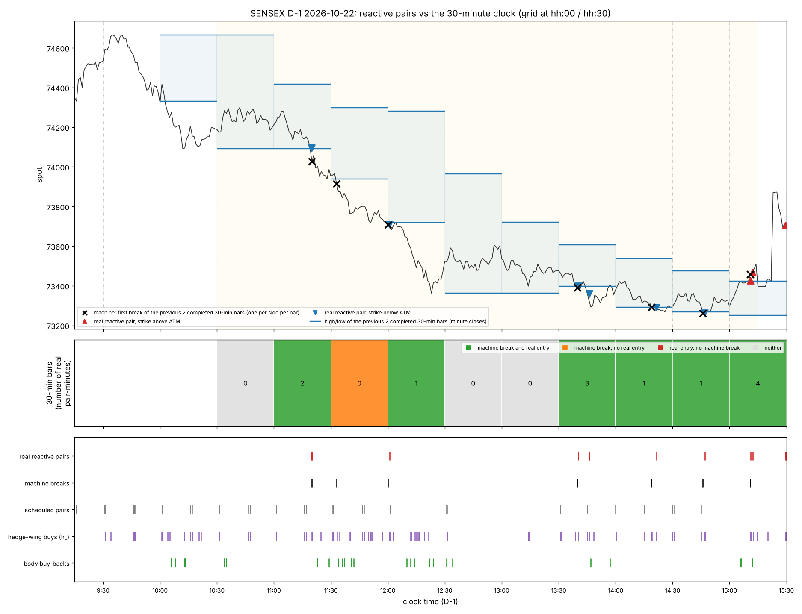

# Algo 8 — reactive pairs: the 30-minute clock (and what it does to the earlier explanations)

*Investigation only. In-sample (D-1 of 32 live cycles). **Exploratory:** the clock structure was found by inspecting the timing of the reactive fires; no plan was pre-registered for it. It is protected by out-of-fold parameter choice, clock-phase placebos and bar-level counting, not by pre-registration. Figures: `figures/bl_clk_example_NIFTY.png`, `figures/bl_clk_example_SENSEX.png`. This report **supersedes** the rolling-70-minute, cooldown and pace descriptions of `BODY_REACTIVE_TRACKER.md` / `BODY_REACTIVE_BOOK.md`: they were approximations of what is described here.*

## 0. Answers to your questions

| Question | Answer | Evidence level |
|---|---|---|
| **Were the reactive pairs and the scheduled pairs one combined process?** | **No — two clocks.** The scheduled pairs sit on a 15-minute grid at fixed seconds (hh:01:10, hh:16:00, hh:31:10, hh:46:31, ...). The reactive entries follow a **30-minute clock-aligned bar structure (hh:00 / hh:30)**. The "one reactive entry per ~30 minutes from 10:30" of the previous report was this 30-minute bar clock seen through a pace. A break of the channel gets an entry about as often whether the bar contains 0, 1, 2 or 3+ scheduled pairs (77% / 91% / 91% / 90%). | Observed |
| **Does a 70-minute rolling range make sense?** | **No, and it isn't needed.** The channel that fits best is **the high/low of the previous two completed 30-minute candles** (the current candle excluded), evaluated on the clock-aligned bars (hh:00–hh:30, hh:30–hh:00). That is 60 minutes, but built from bars, not a rolling window. Out-of-fold F1 0.64 (precision 71%, recall 58%) vs 0.60 for the best rolling window and 0.61 with the current partial bar included; the choice K = 2 is the same in both cycle halves. | Observed |
| **The rule** | **At most one reactive entry per side per 30-minute candle, at the first break of the previous two candles' high/low, the strike one step beyond ATM on the side of the break; from 10:30** (the first time two complete candles — 09:30–10:00 and 10:00–10:30 — exist). | Observed (description); mechanism **Inferred** |
| **Why did only 19 of 100 breakouts fire?** | Because the unit was wrong. Per 30-minute bar: the machine's first break coincides with a real entry in **195 of 221 bars (88%)**, and **195 of the 201 bars that have a real entry (97%)** have a machine break. A bar with no break has an entry only 6 times in 99 (6%). Odds ratio 116. The later breaks in the same candle are not new triggers. | Observed |
| **How exact is the timing?** | With the current-minute close the machine's break minute equals the real pair minute for **120 of 174 matched fires (69%)** and is one minute earlier for 29 (17%); same-minute F1 0.49 (was 0.14 with completed bars before). The clock alignment is exact: shifting the clock by −1, +5 or +15 minutes cuts F1 from 0.64 to 0.49, 0.49 and 0.43. | Observed |
| **The long wings: is there a link?** | **Yes — a deterministic follower, not a trigger.** 92% of the short legs sold in reactive pairs (and 90% of scheduled ones, 95% of the rest) are followed within 10 seconds (median ≈ 4 s) by a one-lot far-OTM wing buy of the same type from the hedge module; wing lots ≈ short lots per leg (CE 2645 short vs 2440 wings, PE 2026 vs 1896). The wing book does **not** decide which breaks get an entry: coverage (long/short lots) AUC 0.50. | Observed |
| **What is still unexplained?** | About 29% of the entry bars have more than one real entry (2 in 41, 3 in 17, 4 in 4 bars; 69 of 87 follow-ups are on the same side, strikes equal in 48 of 87); the rule for these is not found. 26 machine breaks have no entry. | Unresolved |

## 1. The clock signature
Reactive fires (pairs placed within 5 s merged; 282 fires 10:30–15:15) by clock minute of the hour: **23 at :00 and 20 at :30 against a median of 4 for the other minutes**; 27% of fires fall in the first three minutes of an hour or half hour (10% expected) but only 9% in the three minutes after :15/:45.

| minute of the hour | fires |
|---|---|
| 00 | 23 |
| 30 | 20 |
| other minutes (median) | 4 |

| period (s, from 09:15) | fires per bin | p vs uniform |
|---|---|---|
| 60 | 52 45 55 47 35 48 | 0.4081 |
| 120 | 32 45 44 65 57 39 | 0.0086 |
| 300 | 51 25 27 22 30 24 23 22 21 37 | 0.0010 |
| 420 | 34 27 24 31 29 25 29 32 27 24 | 0.9274 |
| 600 | 19 23 21 18 28 57 26 33 27 30 | 0.0000 |
| 900 | 64 39 27 27 22 23 24 15 16 25 | 0.0000 |
| 1800 | 26 20 18 13 14 77 34 27 26 27 | 0.0000 |

* Block length: a one-entry-per-block machine fits best with **30-minute blocks** (and the clock phase hh:00/hh:30); other block lengths and phases are worse:

| block length (min) | best in-sample F1 over phases and N |
|---|---|
| 10 | 0.56 |
| 15 | 0.593 |
| 20 | 0.541 |
| 25 | 0.527 |
| 30 | 0.611 |
| 40 | 0.503 |
| 45 | 0.512 |
| 60 | 0.505 |

| clock phase (min after hh:00) | F1 (rolling 70-min edge, one entry per 30-min block) |
|---|---|
| 0 | 0.604 |
| 1 | 0.611 |
| 2 | 0.529 |
| 3 | 0.512 |
| 5 | 0.484 |
| 10 | 0.455 |
| 15 | 0.453 |
| 20 | 0.452 |
| 25 | 0.52 |
| 29 | 0.602 |

* The 10:30 start is consistent with the rule needing two complete candles (09:30–10:00 and 10:00–10:30; the 09:15–09:30 first candle is partial); starting at 10:00 is worse (§4). The earlier "London open / volume" explanation is not needed.

## 2. What is the channel?
| channel definition (one entry per 30-min clock block) | N / K | F1 (±1 min) | precision | recall | fires |
|---|---|---|---|---|---|
| rolling window (minutes) | 40 | 0.469 | 0.451 | 0.489 | 288 |
| rolling window (minutes) | 50 | 0.509 | 0.507 | 0.511 | 268 |
| rolling window (minutes) | 60 | 0.544 | 0.562 | 0.526 | 249 |
| rolling window (minutes) | 70 | 0.604 | 0.649 | 0.564 | 231 |
| rolling window (minutes) | 80 | 0.595 | 0.665 | 0.538 | 215 |
| rolling window (minutes) | 90 | 0.579 | 0.667 | 0.511 | 204 |
| rolling window (minutes) | 105 | 0.552 | 0.678 | 0.466 | 183 |
| rolling window (minutes) | 120 | 0.529 | 0.665 | 0.44 | 176 |
| rolling window (minutes) | 150 | 0.505 | 0.677 | 0.402 | 158 |
| K completed 30-min bars + the current partial bar | 1 | 0.459 | 0.448 | 0.47 | 279 |
| K completed 30-min bars + the current partial bar | 2 | 0.614 | 0.673 | 0.564 | 223 |
| K completed 30-min bars + the current partial bar | 3 | 0.568 | 0.686 | 0.485 | 188 |
| K completed 30-min bars + the current partial bar | 4 | 0.526 | 0.689 | 0.425 | 164 |
| K completed 30-min bars + the current partial bar | 5 | 0.496 | 0.68 | 0.391 | 153 |
| K completed 30-min bars (current bar excluded) | 1 | 0.47 | 0.464 | 0.477 | 274 |
| K completed 30-min bars (current bar excluded) | 2 | 0.639 | 0.708 | 0.583 | 219 |
| K completed 30-min bars (current bar excluded) | 3 | 0.576 | 0.703 | 0.489 | 185 |
| K completed 30-min bars (current bar excluded) | 4 | 0.523 | 0.691 | 0.421 | 162 |
| K completed 30-min bars (current bar excluded) | 6 | 0.487 | 0.678 | 0.38 | 149 |

* **Previous two completed candles is the best** (F1 0.639); one candle is too tight, three too wide; including the current partial candle is slightly worse; the best rolling window (70 minutes) is an approximation of it. Out-of-fold (parameter chosen on the other cycle half): previous-two-bars 0.639, current-partial 0.613, rolling 0.604.
* Highs and lows are taken from **one-minute closes** (no intraday high/low in the data), so the machine's channel is a little narrower than the true candle range.

## 3. Bar-level agreement
| machine | bars | machine + real entry | real entry only | machine only | neither | precision (bars) | recall (bars) | odds ratio | phi |
|---|---|---|---|---|---|---|---|---|---|
| previous 2 completed 30-min bars, clock phase 0 (hh:00 / hh:30) | 320 | 195 | 6 | 26 | 93 | 0.88 | 0.97 | 116.25 | 0.79 |
| same, completed minute closes only | 320 | 194 | 7 | 25 | 94 | 0.89 | 0.97 | 104.21 | 0.79 |
| same but clock shifted by +5 min (placebo) | 352 | 179 | 10 | 68 | 95 | 0.72 | 0.95 | 25.01 | 0.58 |
| clock shifted by +15 min (placebo) | 352 | 184 | 4 | 70 | 94 | 0.72 | 0.98 | 61.77 | 0.61 |
| clock shifted by -1 min (placebo) | 320 | 197 | 5 | 48 | 70 | 0.8 | 0.98 | 57.46 | 0.65 |
| previous 1 bar | 320 | 197 | 4 | 78 | 41 | 0.72 | 0.98 | 25.89 | 0.45 |
| previous 3 bars | 320 | 168 | 33 | 19 | 100 | 0.9 | 0.84 | 26.79 | 0.66 |
| rolling 70-min range, one entry per side per 30-min block | 320 | 194 | 7 | 37 | 82 | 0.84 | 0.97 | 61.42 | 0.71 |

|  | 0 real pair-minutes | 1 real pair-minutes | 2 real pair-minutes | 3 real pair-minutes | 4 real pair-minutes |
|---|---|---|---|---|---|
| machine fires in the bar: 0 | 0 | 6 | 0 | 0 | 0 |
| machine fires in the bar: 1 | 26 | 142 | 32 | 8 | 1 |
| machine fires in the bar: 2 | 0 | 3 | 5 | 3 | 1 |

* In bars where the machine fires once (209 bars), the real system has one entry in 142 bars, none in 26, two or more in 41; the 6 bars with a real entry but no machine break are bars where the real system acted without a close-based break (most likely intrabar highs/lows that minute closes do not show).
* Clock shifts and wrong K reduce the agreement; the rolling-70 machine is close (odds ratio 61) but below the bar machine.

## 4. Refinements and timing
| variant | F1 (±1 min) | precision | recall | F1 same minute | fires |
|---|---|---|---|---|---|
| base: prev 2 bars, one entry per bar, completed bars, phase 0 | 0.639 | 0.708 | 0.583 | 0.14 | 219 |
| current-minute close (look-ahead proxy) | 0.632 | 0.697 | 0.579 | 0.493 | 221 |
| one entry per SIDE per bar | 0.654 | 0.707 | 0.609 | 0.154 | 229 |
| phase +1 min | 0.639 | 0.708 | 0.583 | 0.14 | 219 |
| phase -1 min | 0.493 | 0.514 | 0.474 | 0.11 | 245 |
| phase +5 min | 0.493 | 0.514 | 0.474 | 0.133 | 245 |
| phase +15 min | 0.428 | 0.439 | 0.417 | 0.131 | 253 |
| start 10:00 (minute 45) | 0.61 | 0.64 | 0.583 | 0.134 | 242 |
| start 11:00 (minute 105) | 0.612 | 0.717 | 0.534 | 0.134 | 198 |
| end 15:30 (minute 375 capped) | 0.628 | 0.68 | 0.583 | 0.138 | 228 |
| K = 3 bars | 0.576 | 0.703 | 0.489 | 0.12 | 185 |
| K = 2 bars + current partial | 0.614 | 0.673 | 0.564 | 0.192 | 223 |
| K = 1 bar | 0.47 | 0.464 | 0.477 | 0.107 | 274 |

* One entry **per side** per bar is slightly better than one per bar (0.654 vs 0.639); entry starts 10:00 or 11:00 are worse than 10:30; the last bar (15:00–15:30) is cut at 15:15 in the sample, which depresses its match rate.
* Side of the strike agrees with the side of the break in **99.4%** of 155 matched fires.
* Distribution of (real pair minute − machine break minute) within 3 minutes: -3: 4, -2: 3, -1: 5, 0: 120, 1: 29, 2: 8, 3: 5.

## 5. The example cycles
Same cycles as before (NIFTY 2026-09-08, SENSEX 2026-10-22). Rows: spot with the 30-minute grid, the previous-two-candles channel, machine breaks and real pairs; the bars coloured by agreement (number = real pair-minutes in the bar); event timeline with scheduled pairs and the hedge-wing buys that follow every sell.

* NIFTY: 8 of 10 bars agree, 1 machine-only, 0 real-only. SENSEX: 6 of 10, 1 machine-only, 0 real-only. The real entries sit exactly at the channel edge, one per side per candle, and the wing buys follow each entry a few seconds later.

NIFTY bars (10:30 onward):

| bar_start | machine_break | machine_break_time | real_pair_times | real_pair_minutes |
|---|---|---|---|---|
| 10:30 | 1 | 10:53:00 | 10:54:25 | 1 |
| 11:00 | 1 | 11:00:00 | 11:00:19 | 1 |
| 11:30 | 1 | 11:36:00 | 11:36:52 | 1 |
| 12:00 | 1 | 12:09:00 |  | 0 |
| 12:30 | 1 | 12:30:00 | 12:30:08 12:30:08 | 2 |
| 13:00 | 0 |  |  | 0 |
| 13:30 | 1 | 13:46:00 | 13:47:00 | 1 |
| 14:00 | 1 | 14:02:00 | 14:02:35 | 1 |
| 14:30 | 1 | 14:52:00 | 14:30:26 14:53:05 | 2 |
| 15:00 | 1 | 15:00:00 | 15:09:41 15:09:52 15:09:52 | 3 |

## 6. The wings
| sell class | sells (legs) | followed by a wing buy within 10 s | median delay (s) |
|---|---|---|---|
| other (solo / near a pair) | 1564 | 94.8% | 3.8 |
| reactive | 852 | 92.5% | 4.1 |
| scheduled | 1992 | 89.6% | 3.8 |

* The hedge module buys, about 4 s after **every** short-leg sell (scheduled, reactive or other), one far-out-of-the-money wing lot of the same type; wing prices are ₹1.4–8.4 (5th–95th percentile), so it is not a fixed ₹2 rule.
* Whether the wing book gates the entries (state at the machine breaks, entry vs no entry):

| state at the machine break | AUC (real entry vs none) | even cycles | odd cycles |
|---|---|---|---|
| short_lots | 0.472 | 0.462 | 0.49 |
| long_lots | 0.471 | 0.46 | 0.49 |
| cover | 0.497 | 0.477 | 0.512 |
| itm_short | 0.545 | 0.557 | 0.546 |
| delta | 0.474 | 0.496 | 0.441 |
| pnl_pct | 0.52 | 0.447 | 0.583 |
| hour | 0.427 | 0.421 | 0.426 |
| min_in_bar | 0.533 | 0.583 | 0.498 |

* The wing relationship is therefore **a consequence of selling**, identical for scheduled and reactive sells; it is not what separates entry bars from non-entry bars. The hedge module study is the right place to decode the wing strike rule.

## 7. Evidence register
| Claim | Label | Basis |
|---|---|---|
| Reactive entries follow the previous two completed 30-minute candles' range, one per side per candle, from 10:30 | **Observed (description)** | bar-level odds ratio 116; out-of-fold F1 0.64; precision 88% / recall 97% per bar |
| The clock is hh:00 / hh:30 (30-minute bars aligned to the hour) | **Observed** | phase placebos −1/+5/+15 min worse; minute-of-hour spike |
| Reactive and scheduled entries are separate clocks | **Observed** | entry probability unchanged by scheduled pairs in the bar |
| The previous rolling-70, cooldown and pace descriptions are proxies for the 30-minute bar clock | **Inferred** | they all give ≈ one entry per half hour; the bar machine beats them |
| Hedge wings follow every sell and do not gate entries | **Observed** | 90–95% within 10 s; coverage AUC 0.50 |
| Why extra entries occur in about 29% of entry bars | **Unresolved** | no rule found |
| What exactly the algorithm computes (true highs/lows, live price vs closes) | **Not testable** | minute closes only |

## 8. Limits and how this could be wrong
* **Exploratory discovery.** The 30-minute clock was found by looking at the data, not pre-registered; the reported fit is therefore optimistic. Protection: K and N chosen out-of-fold (K = 2 in both folds), clock-phase placebos (F1 0.64 at phase 0 vs 0.49–0.43 shifted), bar-level counts with a high base rate (63% of bars have an entry: the odds ratio, not the raw hit rate, is the evidence).
* **Close-based candles.** Highs/lows are of minute closes; the true candle range is wider, which probably explains some of the machine-only and real-only bars.
* **Extra entries** (about 29% of entry bars) and the 26 machine-only bars are not explained; the fit says nothing about quantity (1–3 lots) of each entry.
* In-sample; D-1 only; 32 cycles; predictive, not causal; no source code. Equivalent formulations (e.g. 60-minute bar built from two 30-minute bars, or a 30-minute bar timer plus a 1-minute breakout check) cannot be told apart.

## 9. Files
`src/bl_clk_sim.py` (clock-gate machines) → `bl_clk_scan.py` (block length and phase) → `bl_clk_chan.py` (channel definitions) → `bl_clk_refine.py` (refinements, timing) → `bl_clk_bars.py` (bar-level confusion, placebos) → `bl_clk_repeat.py` (clock phase table, repeats) → `bl_clk_wings.py` / `bl_clk_wingstate.py` (hedge wings) → `bl_clk_example.py` → `make_clk_report.py`. Outputs `outputs/bl_clk_*`, `bl_summary_clk1…9.json`. Tests `tests/test_bl.py` (`test_clk_*`).
