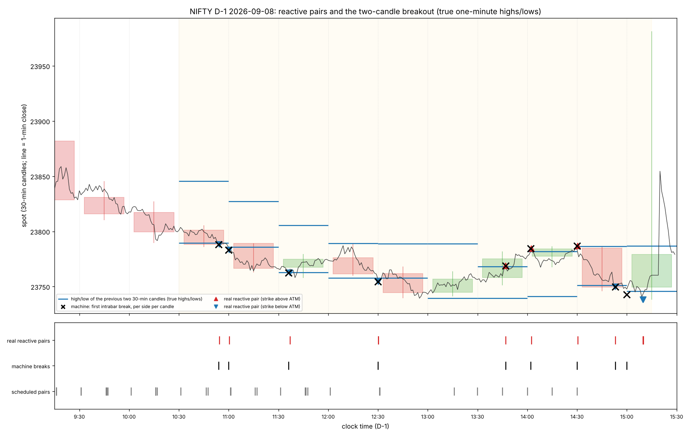
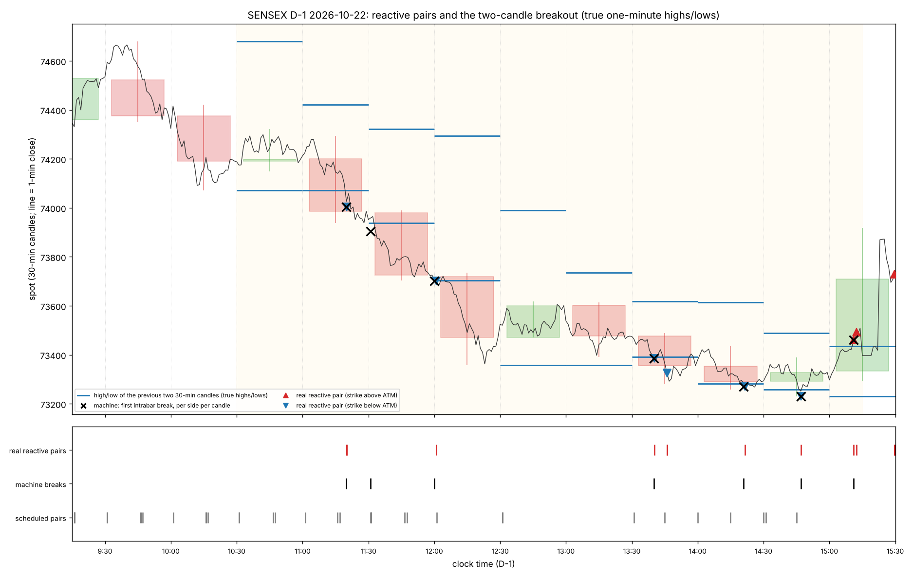
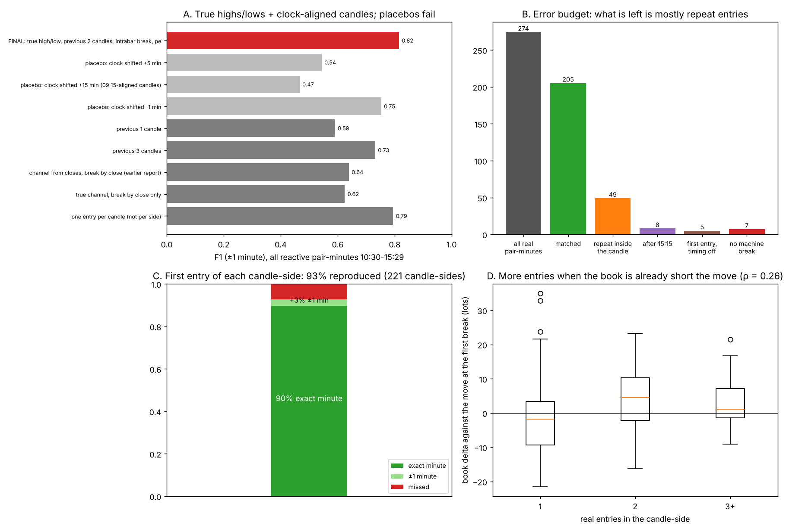

# Algo 8 — reactive pairs decoded: the two-candle breakout (true highs/lows), and what is left

*Investigation only. In-sample (D-1 of 32 live cycles; 274 reactive pair-minutes 10:30–15:29). Exploratory decoding after `BODY_REACTIVE_CLOCK.md`; steps after the first OHLC result are labelled post-hoc. Figures: `figures/bl_dq_example_NIFTY.png`, `figures/bl_dq_example_SENSEX.png`, `figures/bl_dq_summary.png`. Everything here describes behaviour; it does not show Algo 8's source code.*

## 0. Result

| | Number |
|---|---|
| **The rule** | **At each minute from 10:30 to 15:15: if the minute's high breaks above the highest high of the previous two completed clock-aligned 30-minute candles (hh:00–hh:30, hh:30–hh:00), or its low breaks below their lowest low, sell a CE+PE pair one strike beyond ATM on that side — once per side per candle.** No margin, no timer, no indicator. |
| **Accuracy on all reactive pair-minutes** | **F1 0.82: precision 90%, recall 75%**; exact-minute F1 0.79. Out-of-fold (end time and margin chosen on the other cycle half) 0.81; 60 random half-splits 0.81 (0.78–0.84). |
| **The first entry of each candle-side** | **205 of 221 reproduced (93%), 198 at the exact minute (90%)**. |
| **Per 30-minute candle** | a real entry in 93% of the candles where the machine fires; 98% of candles with a real entry have a machine break. |
| **Stable across** | NIFTY 0.83, SENSEX 0.80, schedule V1 0.82, V2 0.80, first/second half of cycles 0.84 / 0.79. |
| **What was missing before** | **True one-minute highs and lows.** The earlier work used one-minute closes only (F1 0.64); the full OHLC bars are in the same Breeze dataset. With them the channel is the real candle range and the break is seen inside the minute. |
| **What is left** | **Repeat entries inside a candle-side (49 of 274 pair-minutes)** — no price, volume, premium or portfolio rule reproduces them; their number rises when the book is already short the move (ρ ≈ 0.26). Plus 8 pairs after 15:15 and 17 machine breaks without an entry (about 11 of the first-break misses are in the 15:00 candle). |

## 1. What changed the result
| what changed (targets 10:30-15:15) | F1 | precision | recall | F1 same minute | bar precision | bar recall |
|---|---|---|---|---|---|---|
| closes channel, close break (previous report) | 0.649 | 0.695 | 0.609 | 0.497 | 0.882 | 0.97 |
| true high/low channel, close break | 0.635 | 0.74 | 0.556 | 0.549 | 0.933 | 0.9 |
| closes channel, intrabar high/low break | 0.574 | 0.581 | 0.568 | 0.434 | 0.831 | 1.0 |
| TRUE high/low channel + intrabar high/low break | 0.828 | 0.895 | 0.771 | 0.8 | 0.922 | 0.995 |
| true HL, K=1 | 0.598 | 0.565 | 0.635 | 0.545 | 0.752 | 0.995 |
| true HL, K=3 | 0.744 | 0.899 | 0.635 | 0.714 | 0.929 | 0.841 |
| true HL, one entry per bar (not per side) | 0.808 | 0.899 | 0.733 | 0.783 | 0.922 | 0.995 |

* Using the true candle high/low for the channel **and** the minute's high/low for the break lifts F1 from 0.65 to 0.83 at once; either change alone does not (0.57–0.64), because a close-based channel is narrower than the real one while a close-based break is late.
* Two candles is the right look-back (one 0.60, three 0.74); one entry per side per candle beats one per candle.

## 2. Final machine, variants and placebos (targets 10:30–15:29)
| machine | F1 (±1 min) | precision | recall | F1 same minute | bar precision | bar recall | fires |
|---|---|---|---|---|---|---|---|
| FINAL: true high/low, previous 2 candles, intrabar break, per side, 10:30-15:15 | 0.815 | 0.895 | 0.748 | 0.787 | 0.926 | 0.98 | 229 |
| placebo: clock shifted +5 min | 0.543 | 0.562 | 0.526 | 0.476 | 0.865 | 0.937 | 256 |
| placebo: clock shifted +15 min (09:15-aligned candles) | 0.466 | 0.513 | 0.427 | 0.394 | 0.868 | 0.8 | 228 |
| placebo: clock shifted -1 min | 0.752 | 0.822 | 0.693 | 0.669 | 0.911 | 0.849 | 231 |
| previous 1 candle | 0.59 | 0.565 | 0.617 | 0.538 | 0.763 | 0.99 | 299 |
| previous 3 candles | 0.732 | 0.899 | 0.617 | 0.701 | 0.929 | 0.824 | 188 |
| channel from closes, break by close (earlier report) | 0.639 | 0.695 | 0.591 | 0.489 | 0.887 | 0.956 | 233 |
| true channel, break by close only | 0.624 | 0.74 | 0.54 | 0.54 | 0.938 | 0.888 | 200 |
| one entry per candle (not per side) | 0.794 | 0.899 | 0.712 | 0.77 | 0.926 | 0.98 | 217 |

* Shifting the clock by −1, +5 or +15 minutes (the last = candles aligned to 09:15 like the exchange's) destroys the fit: the candles are **hh:00/hh:30-aligned**.
* **No margin:** requiring the break to exceed the channel by even 0.02 strike steps (1 NIFTY point) lowers F1 sharply — the system acts on any break of the level, so its price feed matches this data closely:

| minimum break margin (strike steps) | 14:45 | 15:00 | 15:05 | 15:10 | 15:15 | 15:20 | 15:25 | 15:29 |
|---|---|---|---|---|---|---|---|---|
| 0.0 | 0.806 | 0.816 | 0.81 | 0.812 | 0.815 | 0.793 | 0.79 | 0.788 |
| 0.02 | 0.754 | 0.762 | 0.757 | 0.759 | 0.762 | 0.743 | 0.74 | 0.741 |
| 0.04 | 0.686 | 0.702 | 0.699 | 0.701 | 0.704 | 0.685 | 0.683 | 0.684 |
| 0.06 | 0.611 | 0.626 | 0.623 | 0.629 | 0.625 | 0.608 | 0.606 | 0.608 |
| 0.1 | 0.484 | 0.501 | 0.5 | 0.502 | 0.502 | 0.488 | 0.486 | 0.488 |
| 0.2 | 0.315 | 0.339 | 0.337 | 0.34 | 0.349 | 0.337 | 0.336 | 0.339 |

* The entries effectively stop at about 15:15 (end times 15:00–15:15 are best; extending to 15:29 adds false fires).

## 3. Robustness
| subset | cycles | F1 | precision | recall | F1 same minute | bar precision | bar recall |
|---|---|---|---|---|---|---|---|
| all | 32 | 0.815 | 0.895 | 0.748 | 0.787 | 0.926 | 0.98 |
| NIFTY | 15 | 0.834 | 0.928 | 0.757 | 0.802 | 0.962 | 0.99 |
| SENSEX | 17 | 0.797 | 0.864 | 0.739 | 0.773 | 0.893 | 0.971 |
| V1 (to 2026-09-09) | 21 | 0.823 | 0.894 | 0.763 | 0.787 | 0.938 | 0.978 |
| V2 (from 2026-09-16) | 11 | 0.8 | 0.897 | 0.722 | 0.789 | 0.904 | 0.985 |
| first half of cycles | 16 | 0.837 | 0.931 | 0.761 | 0.806 | 0.964 | 0.991 |
| second half of cycles | 16 | 0.792 | 0.858 | 0.735 | 0.767 | 0.888 | 0.969 |

## 4. Error budget
| item | count |
|---|---|
| real reactive pair-minutes 10:30-15:29 | 274 |
| reproduced by the machine (±1 min) | 205 |
| repeat entries inside a candle-side | 49 |
| after 15:15 (machine stops at 15:15) | 8 |
| first entry of the candle-side, but more than 1 min from the break | 5 |
| no machine break in that candle-side | 7 |
| machine fires with no real entry in that candle-side | 17 |
| machine fires in the right candle-side but > 1 min off | 6 |

* Of the 17 machine breaks without an entry, 11 are in the 15:00–15:30 candle and 7 others are breaks by less than 0.1 strike step; neither a margin nor an earlier end time removes them without losing real entries.

## 5. The repeat entries (post-hoc search for the "other factor")
Repeat = a real entry after the first one in the same candle-side. Descriptively: 91% occur at a **new extreme of the running candle**, 93% while still beyond the channel, 78% on the same side, 56% at the same strike; median gap 4.3 min.
* **Price ladders and timers do not reproduce them** (105 configurations, out-of-fold):

| re-entry rule inside a candle | configs | parameters chosen (fold 1 / fold 2) | precision | recall | F1 (out-of-fold) | F1 random splits |
|---|---|---|---|---|---|---|
| none | 1 | (0, 0, 99, 'trigger') / (0, 0, 99, 'trigger') | 0.895 | 0.771 | 0.828 | 0.828 |
| ladder | 64 | (0.75, 0, 2, 'trigger') / (3.0, 0, 2, 'trigger') | 0.821 | 0.793 | 0.807 | 0.813 |
| gap | 28 | (0, 12, 2, 'trigger') / (0, 15, 2, 'trigger') | 0.717 | 0.79 | 0.751 | 0.762 |
| ladder_gap | 12 | (1.0, 8, 99, 'trigger') / (1.0, 8, 99, 'trigger') | 0.797 | 0.782 | 0.789 | 0.783 |

* **Single-variable gates** on the 698 eligible minutes (new candle extreme beyond the channel after a first entry; 44 real repeats):

| variable (repeat candidates) | AUC | even cycles | odd cycles |
|---|---|---|---|
| book delta against the break side | 0.671 | 0.646 | 0.68 |
| P&L change, 15 min | 0.342 | 0.398 | 0.318 |
| in-the-money short lots | 0.653 | 0.561 | 0.732 |
| channel width (steps) | 0.381 | 0.445 | 0.322 |
| minute high-low range (steps) | 0.607 | 0.612 | 0.603 |
| time of day | 0.583 | 0.468 | 0.682 |
| same, relative to its 30-min mean | 0.576 | 0.555 | 0.595 |
| open short lots | 0.566 | 0.457 | 0.677 |
| minute within the candle | 0.555 | 0.569 | 0.534 |
| MTM P&L | 0.445 | 0.438 | 0.466 |

| feature block (repeat candidates) | model | AUC (leave-one-cycle-out) |
|---|---|---|
| market | lr | 0.641 |
| market | gb | 0.716 |
| volume_premium | lr | 0.478 |
| volume_premium | gb | 0.537 |
| portfolio | lr | 0.644 |
| portfolio | gb | 0.637 |
| all | lr | 0.661 |
| all | gb | 0.706 |

| repeat gate (one feature, threshold out-of-fold) | F1 | precision | recall |
|---|---|---|---|
| base only | 0.817 | 0.899 | 0.748 |
| repeat when delta_vs_side >= threshold (out-of-fold) | 0.808 | 0.873 | 0.752 |
| repeat when itm_short >= threshold (out-of-fold) | 0.796 | 0.842 | 0.756 |
| repeat when pnl_chg15 <= threshold (out-of-fold) | 0.622 | 0.5 | 0.821 |
| repeat when minute_range >= threshold (out-of-fold) | 0.783 | 0.812 | 0.756 |
| repeat when short_lots >= threshold (out-of-fold) | 0.802 | 0.865 | 0.748 |
| repeat when vol_rel >= threshold (out-of-fold) | 0.806 | 0.872 | 0.748 |
| repeat when ext_beyond_channel >= threshold (out-of-fold) | 0.795 | 0.847 | 0.748 |
| repeat when min_since_last >= threshold (out-of-fold) | 0.792 | 0.84 | 0.748 |

* **What the number of entries is linked to:** at the first break, more entries follow when the book is already short the move, has more in-the-money short lots and the channel is narrow (19 variables tested; the top three survive a Bonferroni correction):

| state at the first break | Spearman with number of entries in the candle-side | p |
|---|---|---|
| book delta against the break side | 0.26 | 0.0002 |
| in-the-money short lots | 0.2559 | 0.0002 |
| channel width (steps) | -0.2199 | 0.0015 |
| open short lots | 0.1732 | 0.0128 |
| time of day | 0.1696 | 0.0148 |
| P&L change, 15 min | -0.1354 | 0.0523 |
| minute within the candle | -0.0996 | 0.1541 |
| 15-min move in the break direction | -0.0688 | 0.3256 |

  This fits your "portfolio" idea — the system adds more pairs into a move that is already hurting the book — but it is an association (ρ ≈ 0.25), not a rule; it does not tell *which* new extreme gets the extra pair.
* **Option volume** at the target strike (net of Algo 8's own fills), premium changes, MTM P&L and wing coverage do not separate repeats from non-repeats (AUC 0.45–0.58 in at least one half).

## 6. First breaks without an entry
| variable (first breaks: entry vs none) | AUC | even cycles | odd cycles |
|---|---|---|---|
| time of day | 0.249 | 0.069 | 0.307 |
| minute within the candle | 0.677 | 0.516 | 0.731 |
| open short lots | 0.33 | 0.223 | 0.378 |
| P&L change, 15 min | 0.375 | 0.404 | 0.372 |
| target pair premium | 0.412 | 0.464 | 0.4 |
| 15-min move in the break direction | 0.419 | 0.317 | 0.452 |
| book delta against the break side | 0.58 | 0.686 | 0.513 |
| minute high-low range (steps) | 0.421 | 0.505 | 0.386 |

* Few cases (23); the strongest differences are time (the last candle) and the minute within the candle; nothing portfolio-related is consistent across halves.

## 7. The examples

## 8. Evidence register
| Claim | Label | Basis |
|---|---|---|
| First reactive entry per side per 30-min candle = first intrabar break of the previous two candles' true high/low, from 10:30 to ~15:15 | **Observed (description)** | F1 0.82, first entries 93% (exact minute 90%); placebos and alternatives worse; stable in all subsets |
| Candles are aligned to hh:00/hh:30, no break margin | **Observed** | clock shifts and margins reduce F1 |
| Number of entries in a candle-side rises with book stress (delta against the move, ITM shorts) and narrow channels | **Observed (association, post-hoc)** | Spearman 0.22–0.26, Bonferroni-significant |
| Which extra extremes get a repeat entry | **Unresolved** | no rule beats the base machine out-of-fold |
| Option volume, premium, P&L, wings gate the entries | **Not supported** | AUC ≈ 0.5 or inconsistent across halves |
| The algorithm computes exactly this | **Not established** | behaviourally equivalent formulations (60-min bar, 30-min timer + 1-min check) |

## 9. Limits and how this could be wrong
* **Exploratory and in-sample.** The 30-minute clock and the OHLC upgrade were found by looking at this data; out-of-fold choices, random splits, subsets and placebos reduce but do not remove optimism. Parameters actually fitted: two candles, one entry per side, 10:30–15:15, no margin — small and stable.
* **±1-minute tolerance** for the headline F1; the exact-minute F1 is 0.79.
* **Feed differences:** a different spot source (or the algorithm using LTP ticks) could move some borderline breaks; the no-margin result suggests the feed is close.
* **Repeat entries and lot sizes** are not decoded; 1–3 lots per entry are not predicted.
* D-1 only; 32 cycles; no source code.

## 10. Files
`src/bl_ohlc.py` (true OHLC loader) → `bl_dq_ohlc.py` (machine with true highs/lows, error decomposition) → `bl_dq_repeat_desc.py` / `bl_dq_repeat_sim.py` (repeats) → `bl_dq_gates.py` (feature gates) → `bl_dq_tune.py` (margin, end time) → `bl_dq_repeat_gate.py` → `bl_dq_final.py` (final evaluation) → `bl_dq_count.py` → `bl_dq_fig.py` → `make_dq_report.py`. Outputs `outputs/bl_dq_*`, `bl_summary_dq1…8.json`. Tests `tests/test_bl.py` (`test_dq_*`).
