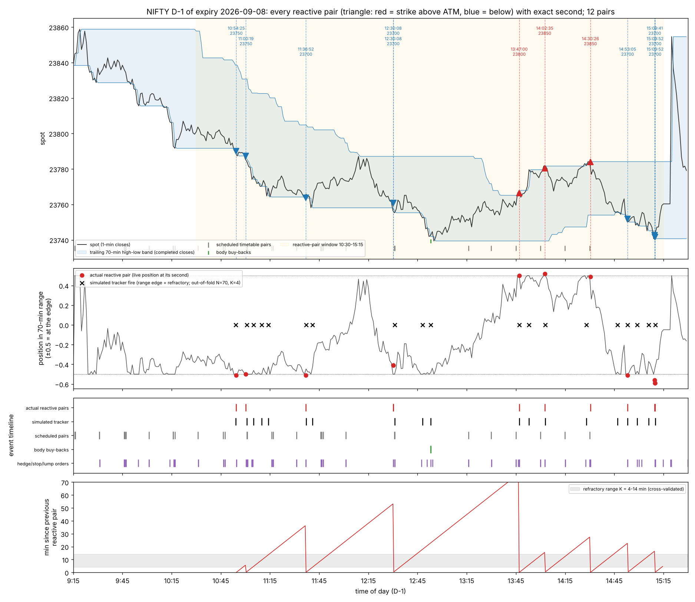
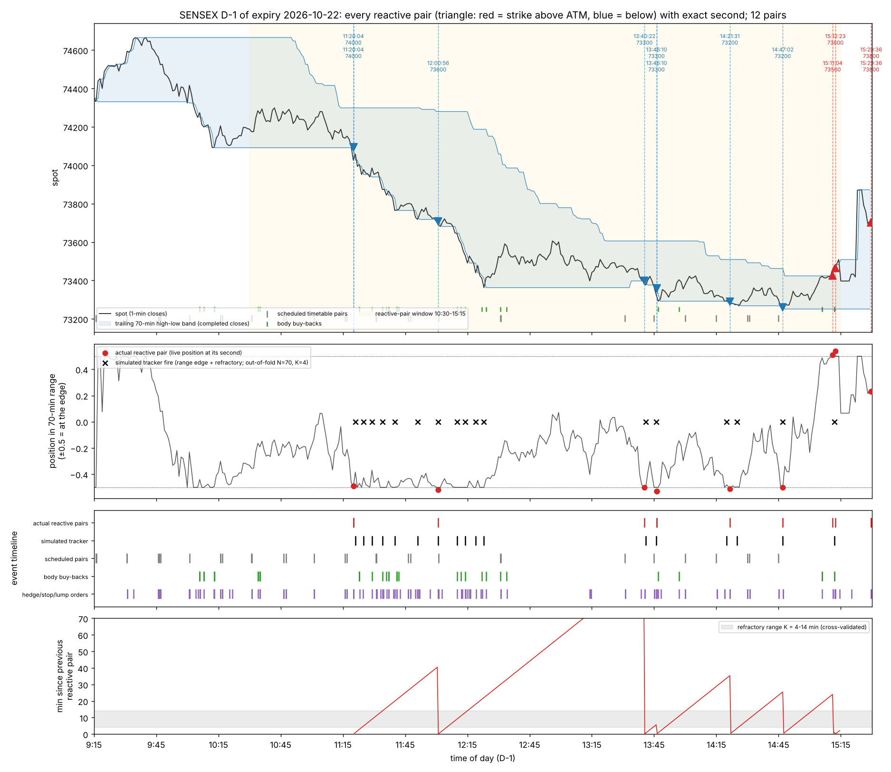

# Algo 8 — reactive pairs: is there a per-minute tracker?

*Investigation only. In-sample (D-1 of 32 live cycles, 266 reactive pair-minutes inside 10:30–15:15; not a holdout). Plan written before the tests: `BODY_REACTIVE_TRACKER_PLAN.md`. Steps after the first simulation (finer grids, edge-triggered/band-reset variants, capacity, side-specific spacing, residuals) are **post-hoc** and labelled. Figures: `figures/bl_trk_example_NIFTY.png`, `figures/bl_trk_example_SENSEX.png`, `figures/bl_trk_logic.png`. Everything describes a machine that reproduces the timing; **it does not show that Algo 8 contains this machine.***

## 0. Answers

| Question | Answer | Evidence level |
|---|---|---|
| Was "19 of 100 breakouts fire" the wrong yardstick? | **Yes.** It treated the condition as stateless. A tracker that keeps state and resets when it fires will ignore most condition-true minutes. The right test is to **simulate the tracker forward through each day and compare its fire times with the real pair times.** | Method |
| Is there a stateful per-minute tracker that reproduces the pairs? | **A simple one does, partially.** "Fire when the price is beyond its trailing ~70-minute range, then stay silent for ~4–14 minutes" matches the real pair minutes within ±1 minute with **precision 45%, recall 54%, F1 0.49** out-of-fold (random-timing null 99th percentile 0.14); the same range edge **without** state gives F1 0.34. Side of the strike agrees in 99% of matches. 100 random half-splits: F1 0.51 (95% 0.45–0.56). Fitted on NIFTY it scores F1 0.43 on SENSEX, fitted on SENSEX 0.55 on NIFTY; across schedule versions 0.54 / 0.51. | Observed (description); mechanism **Inferred** |
| Does it reproduce everything? | **No.** About half of the real pair-minutes have no tracker fire within ±1 minute and about half of the tracker's fires have no pair; to the same minute only F1 0.14 (completed bars) / 0.33 (current-minute close). | Observed |
| Is it a per-minute clock? | **Not a fixed-second one.** Reactive pairs are spread almost uniformly over the seconds of the minute (only 20.7% in the first 10 s vs 16.7% uniform, p = 0.003), whereas scheduled timetable pairs are timer-driven (51% in the first 10 s). So the check seems continuous or sub-minute, not once per minute at a fixed second. | Observed (seconds); frequency **Not testable** |
| Other tracker types? | **Do not fit as well.** Reference-move ("grid") trackers F1 0.25 and swing/zig-zag 0.22 fail; range edge + swing 0.42 (it also resets on each fire) is second best; restarting the band at each fire 0.36. | Observed |
| How many pairs per day? | **11.8 ± 2.3 per cycle (range 7–15) — more regular than random arrivals** (variance/mean 0.44 vs 1 for Poisson, p = 0.0027) and **unrelated to the day's number of breakouts** (Spearman 0.08, p = 0.68), to buy-back lots (Spearman +0.03) or to the number of scheduled pairs (-0.11). The market decides *when*, something else regularises *how many*. | Observed; cause **Unresolved** |

## 1. Time-aligned example cycles
Chosen by the rule fixed in the plan (≥ 8 reactive pairs, count closest to the median 12, earliest expiry on ties): **NIFTY 2026-09-08** and **SENSEX 2026-10-22** (12 pairs each). Each figure shows, over 09:15–15:30: the spot with its trailing 70-minute high–low band and every reactive pair at its exact second; the live position inside the range; an event timeline (actual pairs, simulated tracker, scheduled pairs, buy-backs, hedge/stop/lump orders); and minutes since the previous reactive pair.

| time | seconds from 09:15 | strike | live ATM | strike − ATM (steps) | live spot | position in 70-min range | min since previous reactive pair | tracker fire within ±1 min |
|---|---|---|---|---|---|---|---|---|
| 10:54:25 | 5965 | 23750 | 23800 | -1 | 23790.0 | -0.51 | nan | 1 |
| 11:00:19 | 6319 | 23750 | 23800 | -1 | 23787.3 | -0.5 | 5.9 | 1 |
| 11:36:52 | 8512 | 23700 | 23750 | -1 | 23763.8 | -0.51 | 36.5 | 1 |
| 12:30:08 | 11708 | 23700 | 23750 | -1 | 23760.7 | -0.41 | 53.3 | 1 |
| 12:30:08 | 11708 | 23700 | 23750 | -1 | 23760.7 | -0.41 | 0.0 | 1 |
| 13:47:00 | 16320 | 23800 | 23750 | 1 | 23766.4 | 0.5 | 76.9 | 1 |
| 14:02:35 | 17255 | 23850 | 23800 | 1 | 23780.4 | 0.52 | 15.6 | 1 |
| 14:30:26 | 18926 | 23850 | 23800 | 1 | 23784.0 | 0.49 | 27.9 | 0 |
| 14:53:05 | 20285 | 23700 | 23750 | -1 | 23751.9 | -0.51 | 22.6 | 1 |
| 15:09:41 | 21281 | 23700 | 23750 | -1 | 23742.7 | -0.56 | 16.6 | 1 |
| 15:09:52 | 21292 | 23700 | 23750 | -1 | 23741.5 | -0.59 | 0.2 | 1 |
| 15:09:52 | 21292 | 23700 | 23750 | -1 | 23741.5 | -0.59 | 0.0 | 1 |

| time | seconds from 09:15 | strike | live ATM | strike − ATM (steps) | live spot | position in 70-min range | min since previous reactive pair | tracker fire within ±1 min |
|---|---|---|---|---|---|---|---|---|
| 11:20:04 | 7504 | 74000 | 74100 | -1 | 74094.4 | -0.49 | nan | 1 |
| 11:20:04 | 7504 | 74000 | 74100 | -1 | 74094.4 | -0.49 | 0.0 | 1 |
| 12:00:56 | 9956 | 73600 | 73700 | -1 | 73708.3 | -0.52 | 40.9 | 1 |
| 13:40:22 | 15922 | 73300 | 73400 | -1 | 73398.1 | -0.5 | 99.4 | 1 |
| 13:46:10 | 16270 | 73300 | 73400 | -1 | 73358.4 | -0.53 | 5.8 | 1 |
| 13:46:10 | 16270 | 73300 | 73400 | -1 | 73358.4 | -0.53 | 0.0 | 1 |
| 14:21:31 | 18391 | 73200 | 73300 | -1 | 73289.3 | -0.51 | 35.4 | 1 |
| 14:47:02 | 19922 | 73200 | 73300 | -1 | 73260.6 | -0.5 | 25.5 | 1 |
| 15:11:04 | 21364 | 73500 | 73400 | 1 | 73424.9 | 0.51 | 24.0 | 1 |
| 15:12:23 | 21443 | 73600 | 73500 | 1 | 73465.8 | 0.54 | 1.3 | 1 |
| 15:29:36 | 22476 | 73800 | 73700 | 1 | 73704.0 | 0.23 | 17.2 | 0 |
| 15:29:36 | 22476 | 73800 | 73700 | 1 | 73704.0 | 0.23 | 0.0 | 0 |

What the examples show (observed in these two cycles; not a proof):
* **Every pair is placed with the live spot at the edge of its trailing 70-minute range** (position −0.41 … −0.59 or +0.49 … +0.54 in all but the last SENSEX pair at 15:29), the strike one step beyond ATM on the side of that edge.
* The spot spends long stretches at the edge with **no** pair (NIFTY roughly 11:05–11:35 and 12:40–13:30: the price hugs the lower edge and nothing is sold), which is the spacing the state machine models.
* Several pairs are placed at the **same second** (NIFTY 12:30:08, 15:09:52; SENSEX 11:20:04, 13:46:10, 15:29:36): one fire can place 2–3 pair-lots (69 of 297 fires have 2+ pairs; 377 pairs in 297 fires clustered within 5 s).
* The simulated tracker (parameters chosen on the other half of the cycles) matches 11 of 12 (NIFTY) and 10 of 12 (SENSEX) pairs within ±1 minute: **better than the average** (recall 54%), so these two are not typical of the failures; it also fires more often than the real system (19 and 17 fires).

## 2. Timing structure
| group | n | :00–09 | :10–19 | :20–29 | :30–39 | :40–49 | :50–59 | share in first 10 s (uniform = 16.7%) | p vs uniform |
|---|---|---|---|---|---|---|---|---|---|
| reactive pairs | 377 | 78 | 55 | 64 | 65 | 46 | 69 | 20.7% | 0.0030 |
| scheduled (timetable) pairs | 1061 | 541 | 142 | 0 | 161 | 0 | 217 | 51.0% | 0.0000 |

* Reactive pairs: only a mild excess in the first 10 s of the minute; scheduled pairs are strongly concentrated at fixed seconds (:00, :10, :31, :59). A once-a-minute tracker with fixed latency would look like the second row; reactive pairs do not.
* Per cycle: 11.78 reactive pairs, SD 2.27, counts 7–15 (cycles per count: 7: 1, 8: 3, 10: 6, 11: 5, 12: 2, 13: 7, 14: 4, 15: 4); variance/mean 0.44. Pair counts do not follow breakouts (Spearman with current-minute breakout minutes +0.08, with completed-bar breakout minutes +0.08).

## 3. Forward-simulated trackers (pre-registered grid, out-of-fold)
Each machine runs through each day from 10:30, keeps its own state and resets on its own fires. Parameters are chosen on one half of the cycles (alternating) and scored on the other, both ways; "±1 min" = a fire within one minute of a real pair-minute, one-to-one matching. Null: the same fire times shifted by a random offset in each cycle (1,000 draws).

| machine | information | configs | parameters chosen (fold 1 / fold 2) | precision (±1 min) | recall (±1 min) | F1 (±1 min) | null F1 99th pct | F1 same minute | side agreement of matches | fires per cycle | fires: variance/mean |
|---|---|---|---|---|---|---|---|---|---|---|---|
| M0 stateless range edge | completed bars (causal) | 4 | (90, 0) / (90, 0) | 0.22 | 0.726 | 0.337 | 0.117 | 0.142 | 0.996 | 27.5 | 3.03 |
| M0 stateless range edge | current-minute close (look-ahead proxy) | 4 | (90, 0) / (90, 0) | 0.233 | 0.767 | 0.357 | 0.114 | 0.312 | 0.997 | 27.4 | 3.03 |
| M1 range edge + refractory K | completed bars (causal) | 52 | (90, 5) / (90, 12) | 0.447 | 0.541 | 0.49 | 0.136 | 0.136 | 0.993 | 10.1 | 1.54 |
| M1 range edge + refractory K | current-minute close (look-ahead proxy) | 52 | (90, 5) / (90, 12) | 0.439 | 0.53 | 0.48 | 0.133 | 0.334 | 0.993 | 10.0 | 1.54 |
| M1 with refractory only for the same side | completed bars (causal) | 52 | (90, 5) / (90, 12) | 0.45 | 0.545 | 0.493 | 0.14 | 0.139 | 0.993 | 10.1 | 1.54 |
| M1 with refractory only for the same side | current-minute close (look-ahead proxy) | 52 | (90, 5) / (90, 12) | 0.442 | 0.534 | 0.484 | 0.133 | 0.334 | 0.993 | 10.0 | 1.54 |
| M2 reference-move (grid) tracker | completed bars (causal) | 9 | (0.5,) / (0.5,) | 0.193 | 0.372 | 0.254 | 0.131 | 0.074 | 1.0 | 16.1 | 9.22 |
| M2 reference-move (grid) tracker | current-minute close (look-ahead proxy) | 9 | (0.5,) / (1,) | 0.182 | 0.226 | 0.202 | 0.114 | 0.121 | 0.984 | 10.3 | 16.89 |
| M2 + reset at scheduled pairs | completed bars (causal) | 9 | (0.5,) / (0.5,) | 0.17 | 0.286 | 0.213 | 0.12 | 0.045 | 0.987 | 14.0 | 10.16 |
| M2 + reset at scheduled pairs | current-minute close (look-ahead proxy) | 9 | (0.5,) / (0.5,) | 0.15 | 0.241 | 0.185 | 0.124 | 0.118 | 0.985 | 13.3 | 11.2 |
| M3 swing (zig-zag) tracker | completed bars (causal) | 9 | (0.5,) / (1,) | 0.168 | 0.327 | 0.222 | 0.132 | 0.076 | 1.0 | 16.2 | 16.07 |
| M3 swing (zig-zag) tracker | current-minute close (look-ahead proxy) | 9 | (1,) / (1,) | 0.273 | 0.271 | 0.272 | 0.113 | 0.14 | 1.0 | 8.2 | 5.49 |
| M4 range edge + swing | completed bars (causal) | 9 | (0.5,) / (0.5,) | 0.374 | 0.485 | 0.422 | 0.128 | 0.111 | 0.992 | 10.8 | 2.28 |
| M4 range edge + swing | current-minute close (look-ahead proxy) | 9 | (0.5,) / (0.5,) | 0.363 | 0.47 | 0.41 | 0.131 | 0.302 | 0.992 | 10.8 | 2.27 |

* **Range edge + refractory (M1) is the only family that matches**: F1 0.49 vs null 99th percentile 0.14; precision and recall both ≥ 0.4 (the pre-registered success rule is met for the **±1-minute** definition).
* The stateless range edge **over-fires** (≈ 27 fires per cycle vs ≈ 8 pair-minutes): recall 73% but precision 22% — the state (spacing) is what converts the edge condition into pair times. Variance/mean of fires per cycle: M1 1.54 vs real pair-minutes 0.54.
* Reference-move, swing and range-edge-plus-swing trackers are clearly worse (M2 resets at scheduled pairs do not help).

## 4. Extension (post-hoc): finer grid, variants, validation
Finer grid N ∈ 20…150 and K ∈ 1…40 (990 configurations):

| machine | information | configs | parameters chosen (N, K) fold 1 / fold 2 | precision (±1 min) | recall (±1 min) | F1 (±1 min) | F1 same minute | F1 (±2 min) | in-sample best (N, K) | in-sample F1 |
|---|---|---|---|---|---|---|---|---|---|---|
| M1 level-triggered range edge + refractory | completed bars | 165 | (70, 4) / (70, 12) | 0.423 | 0.632 | 0.507 | 0.148 | 0.561 | (70, 12) | 0.534 |
| M1 level-triggered range edge + refractory | current-minute close | 165 | (90, 6) / (80, 12) | 0.431 | 0.504 | 0.464 | 0.333 | 0.516 | (80, 12) | 0.509 |
| M7 edge-triggered (re-arms when back inside) + refractory | completed bars | 165 | (70, 6) / (70, 14) | 0.461 | 0.549 | 0.501 | 0.158 | 0.546 | (70, 6) | 0.54 |
| M7 edge-triggered (re-arms when back inside) + refractory | current-minute close | 165 | (90, 6) / (80, 14) | 0.442 | 0.47 | 0.455 | 0.328 | 0.503 | (80, 6) | 0.501 |
| M5 band restarts at each fire | completed bars | 165 | (60, 30) / (70, 40) | 0.421 | 0.312 | 0.358 | 0.117 | 0.402 | (70, 30) | 0.413 |
| M5 band restarts at each fire | current-minute close | 165 | (70, 30) / (80, 25) | 0.376 | 0.32 | 0.346 | 0.224 | 0.378 | (120, 40) | 0.392 |

* **Level-triggered and edge-triggered perform alike**; restarting the band at every fire is clearly worse. The cross-validated optimum moves to **N ≈ 70–80 with K ≈ 4–14** when state is included (N = 40–70 on the seconds-level activation study): window and spacing are **not separately identifiable** — a longer window with a spacing fits as well as a shorter one.
* **100 random half-splits**: out-of-fold F1 0.51 (95% 0.45–0.56), precision 0.48, recall 0.56; chosen N = 70 in 52% and 80 in 48% of splits.
* **Frozen cross-validation** (parameters fitted on one group, scored on the other):

| parameters fitted on | scored on (frozen) | N | K | cycles | precision | recall | F1 | F1 with no spacing (K = 1) |
|---|---|---|---|---|---|---|---|---|
| NIFTY | SENSEX | 80 | 14 | 17 | 0.444 | 0.421 | 0.432 | 0.315 |
| SENSEX | NIFTY | 70 | 8 | 15 | 0.494 | 0.609 | 0.546 | 0.369 |
| V1 | V2 | 80 | 12 | 11 | 0.563 | 0.521 | 0.541 | 0.366 |
| V2 | V1 | 80 | 8 | 21 | 0.464 | 0.57 | 0.512 | 0.332 |

  The spacing adds +0.16 F1 on average over the same range edge without it.

## 5. Extension (post-hoc): capacity, growing spacing, side-specific spacing
| model | configs | parameters chosen (N, K, cap, κ) fold 1 / fold 2 | precision | recall | F1 | fires per cycle | variance/mean of fires | SD of fires |
|---|---|---|---|---|---|---|---|---|
| M1 (cap = none, kappa = 0) | 32 | (70, 4, 99, 0) / (70, 12, 99, 0) | 0.423 | 0.632 | 0.507 | 12.406 | 1.757 | 4.669 |
| M1 + cap | 320 | (80, 4, 12, 0) / (70, 12, 12, 0) | 0.443 | 0.541 | 0.487 | 10.156 | 0.471 | 2.187 |
| M1 + growing refractory | 128 | (70, 4, 99, 0.5) / (80, 10, 99, 0.5) | 0.49 | 0.571 | 0.528 | 9.688 | 0.949 | 3.031 |
| M1 + cap + growing refractory | 1280 | (80, 4, 12, 0) / (80, 10, 11, 0.5) | 0.444 | 0.511 | 0.476 | 9.562 | 0.728 | 2.639 |

* A **cap of ≈ 12 fires** reproduces the regular daily counts (variance/mean 0.47, real 0.54) but does not improve timing (F1 0.487 vs 0.507); a **spacing that grows by 0.5 minute per fire** lifts F1 slightly to 0.528 (random-split mean 0.52). Neither difference is decisive.
* Side-specific spacing does not help:

| model | configs | parameters chosen (N, K_same, K_opp) | precision | recall | F1 | F1 random splits (mean) | 2.5% | 97.5% |
|---|---|---|---|---|---|---|---|---|
| one refractory K for both sides (K_same = K_opp) | 28 | (70, 4, 4) / (70, 12, 12) | 0.423 | 0.632 | 0.507 | 0.513 | 0.468 | 0.554 |
| side-specific refractory (K_same, K_opp) | 288 | (70, 4, 1) / (70, 30, 12) | 0.427 | 0.568 | 0.487 | 0.509 | 0.458 | 0.552 |

## 6. Residuals (post-hoc): where the machine fails
Machine M1 frozen at N = 70, K = 12 (completed bars): 284 fires, 147 match a pair within ±1 minute (precision 52%); 156 of 266 pair-minutes have a fire within ±1 minute (recall 59%).

| actual pair minute | n | share with current-minute close beyond the prior 60 closes | median min since previous pair | mean pairs so far |
|---|---|---|---|---|
| no (missed) | 110 | 0.61 | 21.43 | 5.54 |
| yes | 156 | 0.92 | 28.08 | 4.36 |

* Missed pair-minutes are less often at a current-minute breakout (61% vs 92%): a part of the misses is intra-minute movement the minute-close data cannot show.
* Precision falls through the day and with the number of pairs already placed (fires by hour: 10:00 58%, 11:00 59%, 12:00 52%, 13:00 49%, 14:00 38%): late in the day the machine fires where the real system does not, consistent with a daily capacity or decaying appetite that the machine lacks.
* One feature (relative volume at the target strike) looked informative among fires (AUC 0.71) but is probably contaminated by the system's own fills (a pair at the previous minute raises that strike's volume) and is not used.

## 7. Evidence register
| Claim | Label | Basis |
|---|---|---|
| "Breakouts that fire" is the wrong yardstick; a stateful forward simulation is the right test | **Method** | stateless vs stateful F1 0.34 → 0.49 |
| A range-edge machine with a 4–14-minute spacing reproduces about half of the pair times (±1 min) out-of-fold, on both underlyings and both schedule versions | **Observed** | F1 0.51 (random splits), cross-instrument 0.43–0.55, null 99th pct 0.14 |
| The pairs come from a per-minute tracker with state | **Inferred** | simulation fit; alternative stateful mechanisms (timer, rate limit, budget) fit as well |
| The tracker checks at a fixed second of each minute | **Not supported** | seconds roughly uniform (p = 0.003, +24% in the first 10 s) |
| Exact window and spacing | **Not identifiable** | N 70–80 with K 4–14; N and K trade off |
| Reference-move, swing, band-restart trackers | **Rejected** | F1 0.25 / 0.22 / 0.36 |
| A daily capacity (≈ 12) | **Possible, not needed for timing** | regularises counts, no timing gain |
| What the remaining half of the pair times depend on | **Unresolved** | intra-minute movement, late-day behaviour, unknown state |
| Calculation frequency, tick-level crossing | **Not testable** | minute data only |

## 8. Limits and how this could be wrong
* **±1-minute tolerance** is generous at 266 pair-minutes in 286 minutes per cycle; the null (random shifts) controls for it (99th percentile 0.14), but the same-minute match is poor with completed bars (0.14); I cannot claim to reproduce the exact trigger second.
* **Search size:** 288 + 990 + 1280 + 288 configurations were evaluated in total across steps (the plan's "≈ 100" was an underestimate for the first step: 288). Parameters were always chosen out-of-fold and validated on random splits and across instruments, but the families after M1 were designed after seeing M1 (post-hoc) and no multiplicity correction is applied.
* **Descriptive, not causal:** equivalent mechanisms (timer, rate limit, budget, hysteresis) can produce the same spacing; the machine is a compact description.
* **Current-minute information:** the "current-minute close" variant is look-ahead; the completed-bar variant is causal.
* **Close-based range;** no spot high/low or ticks; D-1 only; in-sample; no source code. The two example cycles were chosen by a rule fixed in advance, but their tracker match (11/12, 10/12) is above average.

## 9. Files
`src/bl_trk_timing.py` (T1) → `bl_trk_sim.py` (T2 grid) → `bl_trk_sim2.py` (post-hoc extension) → `bl_trk_resid.py` → `bl_trk_cap.py` → `bl_trk_side.py` → `bl_trk_example.py` (figures + tables) → `bl_trk_fig.py` → `make_trk_report.py`; `bl_trk_fires.csv` from the fire clustering step. Outputs `outputs/bl_trk_*`, `bl_summary_trk1…7.json`. Tests `tests/test_bl.py` (`test_trk_*`).
