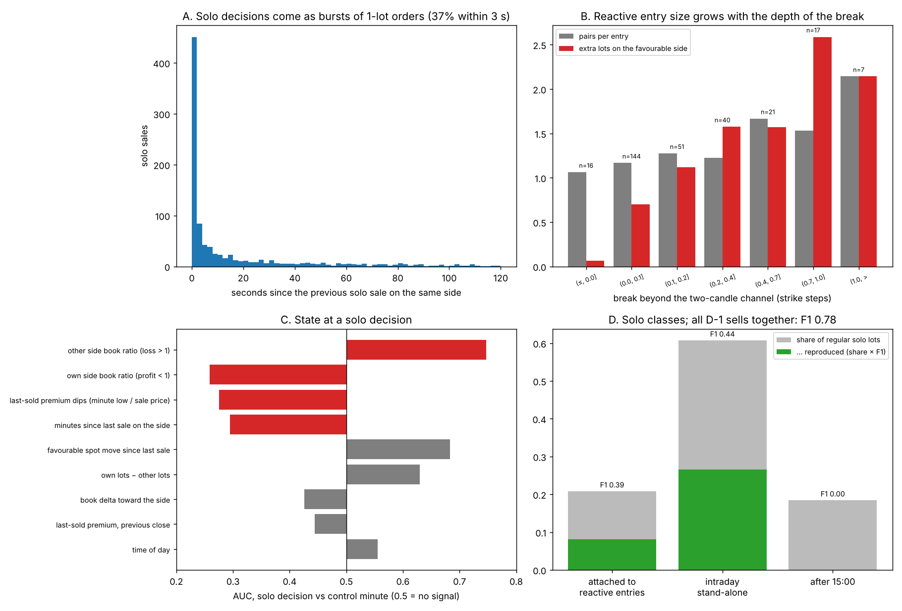

# Algo 8 — solo sells decoded (as far as the data allows), and reactive repeat / multi-lot entries

*Investigation; plan `BODY_SOLO_DECODE_PLAN.md`. In-sample, D-1 of 32 live cycles. Regular solo sells = body CE/PE `open_short` lots not in a scheduled or reactive pair and within 4 strikes of ATM: **1,508 lots, all 1-lot orders** (the 287 deep-OTM batch lots in 3 cycles are separate). Steps after the plan's blocks A–D are post-hoc and labelled. Figure: `figures/bl_sd_summary.png`.*

## 0. What was found

| | Finding | Evidence |
|---|---|---|
| **1. Solo decisions come in bursts** | 30% of solo decisions place 2–8 one-lot orders within 3 s (973 decisions for 1,508 lots). The quantity per decision varies. | Observed |
| **2. A fifth of "solo" lots belong to the reactive entries** | 21% of solo lots are placed within seconds of a reactive pair, **always on the favourable side**: CE on a downside break (165 of 168), PE on an upside break (150 of 152). A reactive entry is therefore often *unbalanced*: e.g. 1 pair + 2 extra calls on a fall. | Observed |
| **3. Reactive entry size grows with the depth of the break** | Pairs per entry and the extra favourable lots both rise with how far the minute broke through the two-candle channel (Spearman 0.42 for extras, 0.29 for pairs): from ≈ 3 lots in total for a hair-line break to ≈ 6 for a break of more than a strike step. A graded size, not a fixed ladder. | Observed (association) |
| **4. Intraday stand-alone solo sells (61%)** | Fire on **fresh favourable extremes** (CE at a new low, PE at a new high; 60-minute on true highs/lows works best) while the **own side is in profit and the other side losing** (book ratio AUC 0.26 / 0.75), typically **1–2 minutes after the previous sale on that side** with the last-sold premium dipping ≈ 6% inside the minute — a drip. The best rule (spot ladder of 0.2 strike steps from the previous sale, gated by a fresh 60-minute extreme) reaches decision-level F1 0.52 out-of-fold. | Observed (description); rule incomplete |
| **5. After 15:00 (18%) a different regime** | Not trend-following (only 53% on the side already heavier vs 76% intraday; median favourable move since the open 0.2 vs 1.5 steps), not buy-back replacement (0% within 2 min of a buy-back on that side), spikes in the 15:00, 15:23 and 15:29 minutes. | Observed; rule **Unresolved** |
| **6. Not portfolio balancing or delta hedging** | Premium-value balance between CE and PE shorts (AUC 0.43), lot balance (0.35: sells go to the side that is already *bigger*), book delta (AUC 0.43), a tilt target proportional to the day's move (tilt tracks the move, ρ ≈ 0.79, but it is the *result* of solo selling, not a target it chases). The "portfolio" link is the profit/loss of the two sides, not balance. | Observed (rejected) |
| **Combined accuracy** | All D-1 sells (scheduled + reactive with depth-sized entries + attached extras + stand-alone ladder; deep-OTM batches excluded): **F1 0.78** (precision 84%, recall 73%). Solo stream alone 0.47; reactive lots 0.69. | Observed (out-of-fold) |

**Bottom line: solo selling is understood (when, which side, why) but not decoded as a deterministic rule.** The best combined solo model reproduces about 42% of solo lots with about 52% precision; the after-15:00 sells (18%) are a separate, unexplained regime.

## 1. Timing structure (block A)
Gaps between consecutive solo sales on the same side: 70% of decisions are single lots; the rest come as bursts (2: 173, 3: 64, 4: 28, 5+: 30 decisions). The second of the minute and the half-hour clock show no structure comparable to the reactive pairs.

## 2. Spot-only machines (block D)
| machine (spot only) | candle (min) | candles | rolling N (min) | F1 | precision | recall | fires |
|---|---|---|---|---|---|---|---|
| roll |  |  | 60.0 | 0.488 | 0.417 | 0.59 | 1377 |
| ladder | 15.0 | 3.0 |  | 0.483 | 0.395 | 0.623 | 1535 |
| ladder | 30.0 | 2.0 |  | 0.472 | 0.442 | 0.506 | 1112 |
| roll |  |  | 45.0 | 0.47 | 0.372 | 0.637 | 1668 |
| ladder | 30.0 | 1.0 |  | 0.46 | 0.361 | 0.633 | 1707 |
| ladder | 60.0 | 1.0 |  | 0.458 | 0.469 | 0.448 | 929 |

* Clock-aligned candles and rolling windows, first break or every new extreme: at most F1 ≈ 0.49 at the decision level. Fresh extremes are necessary-looking but most of them get no solo sale.

## 3. State at a solo decision (block C)
| state | AUC | even cycles | odd cycles | median at solo decisions | median at control minutes |
|---|---|---|---|---|---|
| last-sold premium / its sale price (previous close) | 0.444 | 0.448 | 0.439 | 1.002 | 1.007 |
| last-sold premium dip inside the minute (low / sale price) | 0.275 | 0.271 | 0.276 | 0.943 | 0.987 |
| minutes since the last sale on that side | 0.295 | 0.299 | 0.292 | 1.717 | 6.699 |
| favourable spot move since that sale (steps) | 0.683 | 0.682 | 0.685 | 0.08 | -0.0 |
| own side book ratio (mark / entry) | 0.259 | 0.252 | 0.262 | 0.804 | 0.954 |
| other side book ratio | 0.747 | 0.756 | 0.74 | 1.162 | 0.952 |
| book delta toward the side | 0.426 | 0.465 | 0.404 | -1.762 | -0.022 |
| own lots − other lots | 0.63 | 0.619 | 0.635 | 8.0 | 0.0 |
| time of day | 0.555 | 0.565 | 0.548 | 12.909 | 12.38 |

## 4. Ladders (post-hoc)
* **Premium ladder** (sell again when the last-sold contract's minute low is δ below its sale price): best decision-level F1 0.50 (δ = 2%, with the fresh 60-minute extreme gate).
* **Spot ladder** (sell again every X strike steps beyond the spot at the previous sale, gated by a fresh 60-minute extreme): out-of-fold decision F1 0.52, lot F1 0.47.

## 5. Reactive repeat and multi-lot entries (block E)
| break beyond channel (steps) | reactive entries | pairs per entry | extra favourable lots | total lots |
|---|---|---|---|---|
| (-10.0, 0.0] | 16 | 1.06 | 0.06 | 2.38 |
| (0.0, 0.1] | 144 | 1.17 | 0.7 | 3.04 |
| (0.1, 0.2] | 51 | 1.27 | 1.12 | 3.71 |
| (0.2, 0.4] | 40 | 1.23 | 1.58 | 4.03 |
| (0.4, 0.7] | 21 | 1.67 | 1.57 | 4.9 |
| (0.7, 1.0] | 17 | 1.53 | 2.59 | 5.65 |
| (1.0, 10.0] | 7 | 2.14 | 2.14 | 6.43 |

| quantity | variable | Spearman | p |
|---|---|---|---|
| extra_fav | depth | 0.417 | 0.0 |
| extra_fav | min_in_candle | 0.324 | 0.0 |
| extra_fav | minute_range | 0.246 | 0.0 |
| extra_fav | short_lots | 0.21 | 0.0 |
| extra_fav | v2 | -0.21 | 0.0 |
| pairs | depth | 0.291 | 0.0 |
| pairs | minute_range | 0.281 | 0.0 |
| pairs | hour | 0.184 | 0.002 |
| pairs | short_lots | 0.156 | 0.007 |
| pairs | n_fires_before | 0.152 | 0.009 |

* Pairs and extras rise together (an entry with 2 pairs usually also has ≥ 2 extra favourable lots). Sizing the pairs by depth adds only a little to the reactive lot match (F1 0.68 → 0.69); the repeat entries inside a candle (≈ 18% of reactive pair-minutes) remain undecoded.

## 6. Combined model (out-of-fold)
| model (parameters out-of-fold) | stream | real lots | model lots | precision | recall | F1 |
|---|---|---|---|---|---|---|
| pairs only, 1 per fire; no solo | reactive | 754 | 458 | 0.9 | 0.546 | 0.68 |
| pairs only, 1 per fire; no solo | solo | 1508 | 0 | 0.0 | 0.0 | 0.0 |
| pairs only, 1 per fire; no solo | all | 4384 | 2570 | 0.986 | 0.578 | 0.729 |
| + pairs sized by break depth | reactive | 754 | 474 | 0.899 | 0.565 | 0.694 |
| + pairs sized by break depth | solo | 1508 | 0 | 0.0 | 0.0 | 0.0 |
| + pairs sized by break depth | all | 4384 | 2586 | 0.985 | 0.581 | 0.731 |
| + attached favourable extras by depth | reactive | 754 | 474 | 0.899 | 0.565 | 0.694 |
| + attached favourable extras by depth | solo | 1508 | 233 | 0.64 | 0.099 | 0.171 |
| + attached favourable extras by depth | all | 4384 | 2819 | 0.957 | 0.616 | 0.749 |
| + stand-alone solo ladder (fresh 60-min extreme, 0.2-step ladder) | reactive | 754 | 474 | 0.899 | 0.565 | 0.694 |
| + stand-alone solo ladder (fresh 60-min extreme, 0.2-step ladder) | solo | 1508 | 1214 | 0.522 | 0.42 | 0.466 |
| + stand-alone solo ladder (fresh 60-min extreme, 0.2-step ladder) | all | 4384 | 3800 | 0.844 | 0.731 | 0.784 |
| stand-alone solo ladder only (no attached extras) | reactive | 754 | 474 | 0.899 | 0.565 | 0.694 |
| stand-alone solo ladder only (no attached extras) | solo | 1508 | 981 | 0.56 | 0.364 | 0.441 |
| stand-alone solo ladder only (no attached extras) | all | 4384 | 3567 | 0.871 | 0.709 | 0.782 |

| solo class | lots | share | model component | model lots | precision | recall | F1 |
|---|---|---|---|---|---|---|---|
| attached to a reactive entry | 314 | 21% | extras sized by break depth | 231 | 0.459 | 0.338 | 0.389 |
| intraday stand-alone | 916 | 61% | spot ladder at fresh 60-min extremes | 896 | 0.442 | 0.432 | 0.437 |
| after 15:00 | 278 | 18% | none | 0 | 0.0 | 0.0 | 0.0 |

## 7. Evidence register
| Claim | Label |
|---|---|
| Solo decisions are bursts of 1-lot orders | Observed |
| ≈ 21% of solo lots are favourable-side extras of reactive entries | Observed |
| Reactive entry size (pairs + extras) grows with the depth of the break | Observed (association, ρ 0.3–0.4) |
| Intraday solo sells = drip at fresh favourable extremes while the own side profits and the other side loses | Observed (description); best rule F1 ≈ 0.5 |
| After-15:00 solo sells: different regime | Observed; **Unresolved** |
| Premium balance, lot balance, delta hedging, tilt target as the trigger | Not supported |
| A deterministic solo rule | **Not found** |

## 8. Limits
In-sample; D-1 only; minute bars (inside-minute order of events not observable; the break depth uses the minute's full high/low — mild look-ahead); ±1-minute lot matching; many candidate rules were tried (selection risk; parameters out-of-fold); the strike of solo sells follows the previous sale's premium only partly (37% exact).

## 9. Files
`src/bl_sd_build.py` (option OHLC cache, solo order table) → `bl_sd_scan.py` → `bl_sd_state.py` → `bl_sd_balance.py` → `bl_sd_ladder.py` → `bl_sd_tilt.py` → `bl_sd_spotladder.py` → `bl_sd_reactlots.py` → `bl_sd_combined.py` → `bl_sd_classes.py` → `bl_sd_late.py` → `bl_sd_fig.py` → `make_sd_report.py`. Outputs `outputs/bl_sd_*`, `bl_summary_sd1…9.json`. Tests `tests/test_bl.py` (`test_sd_*`).
