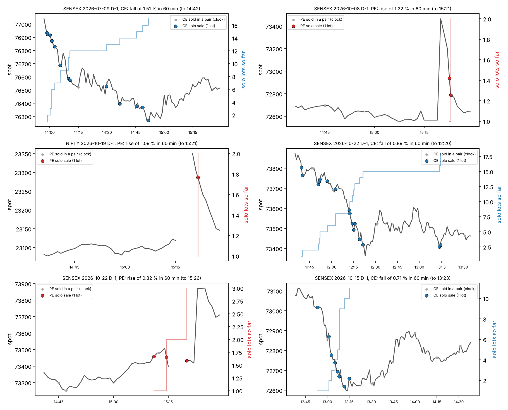

# Test of the hypothesis: solo CE / PE sells are triggered by a heavy market move or a loss of x %, and are injected slowly

*In-sample, observational. Panel: every minute of every cycle-right (17,092 minutes on D-1, 16,659 on D0), episode start = first solo (single-leg) sale on that right with none in the previous 5 minutes (329 on D-1, 552 on D0). All features use only data before the minute. 'Favourable move' = fall for a call, rise for a put, in % of spot. Scripts `src/bl_move_*.py`; figure `figures/bl_move_drip_examples.png`.*

## 1. Verdict

| Your hypothesis | Verdict (D-1) | Evidence |
|---|---|---|
| A solo **CE is added after a fall, a solo PE after a rise** | **Supported** | AUC of the 30-min favourable move 0.76 (CI 0.74–0.78); calls into falls 0.77, puts into rises 0.75; NIFTY 0.77, SENSEX 0.76; excluding the last 15 minutes 0.77 |
| It needs a **heavy move above some x %** | **Not as a threshold** | the rate jumps from 4.7 per 1,000 minutes (no favourable move) to ≈ 56.8–58.7 once the 30-minute move is only 0.1–0.35 %, then does **not** rise further; moves above 0.5 % are rare (80 minutes) |
| A **loss of x %** triggers the add | **Partly** | a losing *other* leg and a winning *own* leg each add to the effect (logistic, per SD, D-1: favourable move +0.32, own-leg book ratio -0.37, other-leg book ratio +0.29; all CIs exclude 0); the **combined** book P&L does not matter (AUC 0.49); no x % cut-off found |
| Sells are **injected slowly** during a heavy move | **Partly** | single 1-lot sales repeated through the move; more lots when the move is bigger (window-level Spearman 0.32 D-1), but the gaps get **shorter**, not longer, with bigger moves, and most short heavy spells get no solo sale at all |
| Same on **D0** | **Not supported** | AUC 0.56 (CI 0.51–0.61); logistic terms include 0; D0 solo selling is mostly inventory-driven |

## 2. How strong must the move be? (no heavy-move threshold)

D-1, episode-start rate by the favourable move over the last 30 minutes:

| bin | minutes | events | rate_per_1000 | lift |
|---|---|---|---|---|
| (-100.0, 0.0] | 9093 | 43 | 4.7 | 0.25 |
| (0.0, 0.1] | 5535 | 144 | 26.0 | 1.35 |
| (0.1, 0.2] | 1672 | 95 | 56.8 | 2.95 |
| (0.2, 0.35] | 562 | 33 | 58.7 | 3.05 |
| (0.35, 0.5] | 123 | 6 | 48.8 | 2.53 |
| (0.5, 0.75] | 50 | 2 | 40.0 | 2.08 |
| (0.75, 100.0] | 30 | 2 | 66.7 | 3.46 |

The relationship is a **step from "no favourable move" to "any favourable move"**, then flat — not a jump at some large x. Rules of the form "30-min favourable move ≥ θ" (D-1): θ = 0.1 %: flags 14.3 % of minutes, catches 42 % of starts, lift 2.9, θ = 0.2 %: flags 4.5 % of minutes, catches 13 % of starts, lift 2.9, θ = 0.5 %: flags 0.5 % of minutes, catches 1 % of starts, lift 2.6. Every θ catches only a minority of episodes, so no single move threshold is the trigger.

## 3. Loss of x %: own leg winning vs other leg losing

The two are confounded (a fall makes the call book profit and the put book lose), so the 2-D table separates them — D-1 rate per 1,000 minutes:

| favourable 30-min move | other leg <=0.9 (profit) | other 0.9-1.1 | other >1.1 (loss) |
|---|---|---|---|
| <=0 | 3.8 | 5.0 | 9.4 |
| 0-0.2 % | 16.1 | 26.4 | 53.2 |
| >0.2 % | 33.3 | 63.5 | 60.9 |

At the same favourable move (0–0.2 %), the rate roughly triples when the other leg is losing (> 10 %) versus profitable; with no favourable move even a losing other leg gives little. Leg asymmetry (other-leg price ratio minus own-leg price ratio) alone: AUC 0.72, episode rate 6.4 per 1,000 minutes at asymmetry ≤ −0.2 up to 62.9 above 0.6 (lift 3.3). Own-leg profit ≥ 20 % flags 22 % of minutes and catches 47 % of starts; other-leg loss ≥ 20 % flags 11 % and catches 34 %. **Inferred:** the algorithm reacts to the *imbalance between the two legs* produced by a directional move, not to the size of the overall loss; the spot move and the option-price ratios are too collinear to say which one it reads (**Unresolved**).

## 4. Slow injection (drip)

The six largest favourable 60-minute moves on D-1: in the **call-into-fall** panels (1, 4, 6) the single-lot call sales arrive one after another while the spot keeps falling (the step line is the running solo lot count, up to 15–17 lots). The three **put-into-rise** panels are dominated by jumps in the closing minutes and show only 2–3 solo sales, so they say little on their own; the statistical tests above cover both rights separately.

* Solo sales by the favourable 30-minute move at the moment of the sale (D-1): <=0: 117 sales, 2.93 lots/sale, median gap 48 s, 0-.1: 386 sales, 1.00 lots/sale, median gap 27 s, .1-.2: 396 sales, 1.04 lots/sale, median gap 20 s, >.2: 382 sales, 1.00 lots/sale, median gap 9 s. 91 % of the solo sales after the first 30 minutes occur with a favourable 30-minute move; with bigger moves the gap to the previous solo sale on the right gets **shorter** (48 → 9 s). Orders are 1 lot except in the unfavourable bucket (end-of-day bursts).
* Solo lots per 15-minute window by the favourable move inside the window (D-1): (-100.0, -0.2]: 0.00, (-0.2, -0.1]: 0.28, (-0.1, 0.0]: 0.35, (0.0, 0.1]: 0.93, (0.1, 0.2]: 2.11, (0.2, 0.35]: 2.53, (0.35, 100.0]: 10.88. More fall ⇒ more solo lots (rank correlation 0.32 over 1,536 windows).
* Heavy spells (30-min favourable move ≥ 0.2 % for consecutive minutes), D-1: 231 spells, median duration 2 min, **67 % of them received no solo sale**; averaged over all heavy spells (including those with none) that is about 13 solo lots per hour versus 3.3 per hour over the whole day. So a heavy move **raises** the chance and the number of solo sales but does not guarantee them.

## 5. What this means and what is still open

* **Supported:** on D-1 the solo legs are *adds on the side the market is moving away from* — calls while it falls, puts while it rises — fed in as repeated 1-lot orders, more of them in bigger moves.
* **Not supported:** a fixed "move ≥ x %" trigger or a "loss of x %" trigger; the dependence is graded and a single threshold catches only a minority of episodes.
* **Open (Unresolved):** the exact quantity that is compared (spot move vs the option price of the own leg vs the leg asymmetry), whether a per-lot or per-position level is used, what throttles the repeats, and why D0 does not show the same dependence.
* **Not tested:** a trigger in rupees of mark-to-market loss (lot sizes differ by index, so percentages were used).
