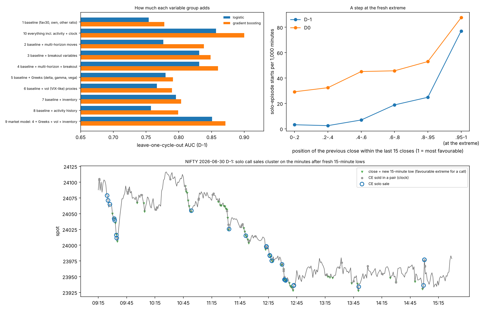

# Search for the variable behind solo (single-leg) sells

*In-sample, observational; plan `BODY_SOLO_VARIABLE_SEARCH_PLAN.md` written before fitting. Episode starts: 296 on D-1 (32 cycles), 477 on D0 (25 cycles with episodes) in non-slot minutes (slot minutes dropped: they only enter the panel when a solo sale happens, a design leak I found and removed). All numbers are leave-one-cycle-out (LOCO) out-of-sample AUCs unless stated. The breakout variable below was found **after** seeing flexible-model importances (exploratory); it is checked with a permutation null, both rights, both indices and chronological halves, but it is not a holdout test.*

## 1. Answer

**There is no single hidden variable, but one important missing ingredient was found: a *fresh favourable extreme* (breakout).** On D-1, a solo CE sale is far more likely in the minute after the spot's last close is the **lowest close of the last N minutes**, and a solo PE sale after a **highest** close, N from 5 to 60 minutes (strongest AUC gain for 5–30).

| D-1, LOCO AUC | logistic | gradient boosting |
|---|---|---|
| baseline: 30-min favourable move + own-leg and other-leg book price ratios | 0.754 | 0.778 |
| + multi-horizon spot moves (5/15/60 min) | 0.777 | 0.839 |
| **+ breakout variables** (new 5–60-minute extreme, position in the 15-min range) | **0.831** | **0.849** |
| + Greeks (net delta, gamma, vega) | 0.780 | 0.791 |
| + volatility proxies (ATM IV, its changes, straddle %; no VIX series in the repo) | 0.766 | 0.790 |
| + inventory (shorts / wings per right, share, distance to book) | 0.796 | 0.804 |
| + activity history (time since last sale, recent solo lots) | 0.758 | 0.799 |
| all market variables (spot + breakout + Greeks + vol + inventory) | 0.851 | 0.872 |
| everything incl. activity and clock | 0.857 | 0.900 |

Even the richest model leaves much unexplained (AUC 0.86–0.90, and only a few percent of minutes with a breakout carry a solo sale — §3), so the mechanism is **multi-variable and not fully identified**, as you suspected.

## 2. What was tested and how each candidate fared (D-1)

| Candidate | Family | Result | Verdict |
|---|---|---|---|
| spot move over 30 min, own-leg book ratio, other-leg book ratio | baseline | AUC 0.76 / 0.28 / 0.71 | Supported (previous test) |
| fresh favourable extreme over 15 minutes (bk15) | breakout | rate 77 vs 9 per 1,000 min; AUC gain over baseline +0.053 (+0.035..+0.070) | **Supported, strongest addition** |
| same over 5 / 30 / 60 minutes | breakout | gain +0.053 / +0.048 / +0.028; 90 min +0.011, day extreme +0.002 | Supported for 5–60 min; no sharp N |
| net delta of the whole book (delta to neutralise) | Greeks | alone AUC 0.47; gain over baseline +0.025 (+0.004..+0.043); GB-model gain +0.013 | **Not a trigger** (alone ≈ chance); small add-on |
| volatility proxies (ATM IV level, 15/30-min change, straddle % of spot) | vol | all-vol gain +0.013 (-0.005..+0.027); GB importance of atm_iv -0.0002 | Not supported (no VIX series available) |
| CE/PE tilt of the book vs the cumulative move | inventory | tilt tracks the day's move (Spearman 0.85) but tilt-gap alone AUC 0.54; gain +0.008 (CI includes 0) | Tilt is an outcome, not a trigger |
| distance of spot from the last paired (clock) strike | position | AUC 0.50; gain -0.000 | Rejected |
| inventory levels (shorts / wings per right) | position | best single gain +0.043, below the breakout variables; mechanism unclear | Weak / unclear |
| combined book P&L (% of ₹2 Cr) | pnl | AUC 0.52 | Rejected |
| time of day | clock | episode-start rate per 1,000 minutes by hour: 10h 17, 11h 14, 12h 14, 13h 15, 14h 17, 15h 45 | Mild (end-of-day bursts) |

## 3. The breakout effect in detail (D-1)

* **Rate when the previous close is the most favourable close of the last N minutes** (per 1,000 minutes, on vs off): N=5: 46 vs 7, N=10: 62 vs 9, N=15: 77 vs 9, N=30: 109 vs 11, N=60: 141 vs 12.
* **A step, not a slope:** the rate by the position of the previous close within the last 15 closes is 3.2, 2.5, 7.0, 18.8, 24.8, 77.0 (bins 0–.2, .2–.4, .4–.6, .6–.8, .8–.95, .95–1): it jumps only at the extreme itself.
* **Timing:** the start rate is 78 per 1,000 minutes in the minute right after a 15-minute extreme and 13 one minute later — the reaction is immediate.
* **Not just the baseline in disguise:** at any 30-minute move the extreme multiplies the rate (<=0: 10 vs 4, 0-.1: 84 vs 12, >.1: 128 vs 29 for fav30 ≤ 0 / 0–0.1 % / > 0.1 %).
* **Recall and strength:** bk5 flags 26 % of minutes and holds 70 % of episode starts, bk15 flags 12 % of minutes and holds 52 % of episode starts, bk30 flags 7 % of minutes and holds 43 % of episode starts, bk60 flags 4 % of minutes and holds 31 % of episode starts; yet only 9.4 % of 15-minute-breakout minutes (and 18.9 % of 60-minute-breakout minutes) contain a solo sale, versus 1.1 % otherwise.
* **Robustness:** calls (new lows) rate 76 vs 12; puts (new highs) 79 vs 7; NIFTY 78 vs 9; SENSEX 77 vs 10.
* **Chronological halves (D-1):** first half bk15 83 vs 10, second half 72 vs 9.
* **Range size:** within 15-minute-breakout minutes the rate by the 15-minute range (%) is (0.0, 0.05]: 33, (0.05, 0.1]: 72, (0.1, 0.15]: 96, (0.15, 0.25]: 112, (0.25, 5.0]: 41 per 1,000 minutes: a break out of a larger range counts more, but the largest-range bin is small and not monotone.

## 4. D0

The same variable is weak on D0 overall (bk15: rate 88 vs 39; gain +0.013). The D0 models are driven by activity history ('time since the last sale on the right': AUC 0.81 with activity vs 0.63 baseline), i.e. D0 solo selling is a continuous, self-sustaining process rather than a market-triggered one. In the second chronological half (D0 from 2026-08-13) the breakout effect is much stronger (bk15 122 vs 32) than in the first (59 vs 45) — a regime change around the same weeks as the 15:14-flatten break (**Inferred / not tested**).

## 5. Conclusion and what remains

* **Best-supported description (Inferred):** on D-1 the algorithm adds a single leg (call into a falling market, put into a rising one) when the previous close is a **fresh extreme in the favourable direction**, while the own-leg book is in profit and the other leg is losing. The sale is a 1-lot add; repeated new extremes give the 'drip'.
* **Not supported as drivers:** net delta (alone), implied-vol/VIX-like proxies, ₹ P&L of the whole book, CE/PE tilt gap, distance from the last straddle strike, inventory level.
* **Unresolved:** the exact lookback N (5–60 min all work; no sharp optimum); what else gates the sale (only 9 % of 15-minute-breakout minutes carry one); intra-minute extremes (only minute closes are available); why D0 differs; the real VIX/IV series was never available.
* **Status:** the breakout variable is an exploratory finding that survived out-of-cycle validation, permutation nulls and a chronological split; it is not an independent holdout. Reconstructed behaviour is not the original source logic.
