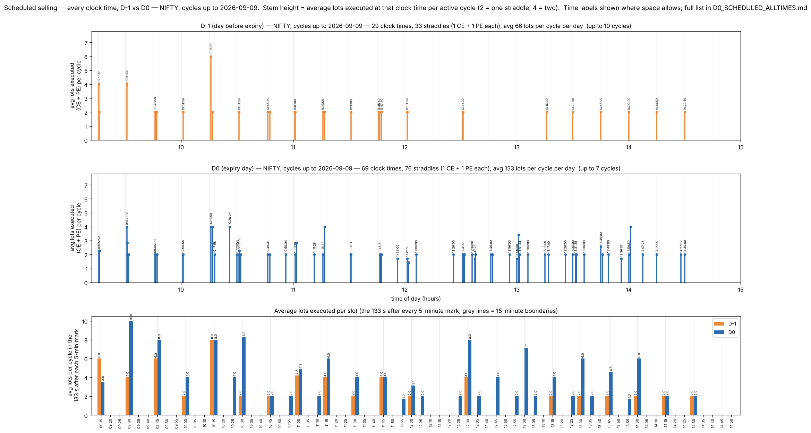
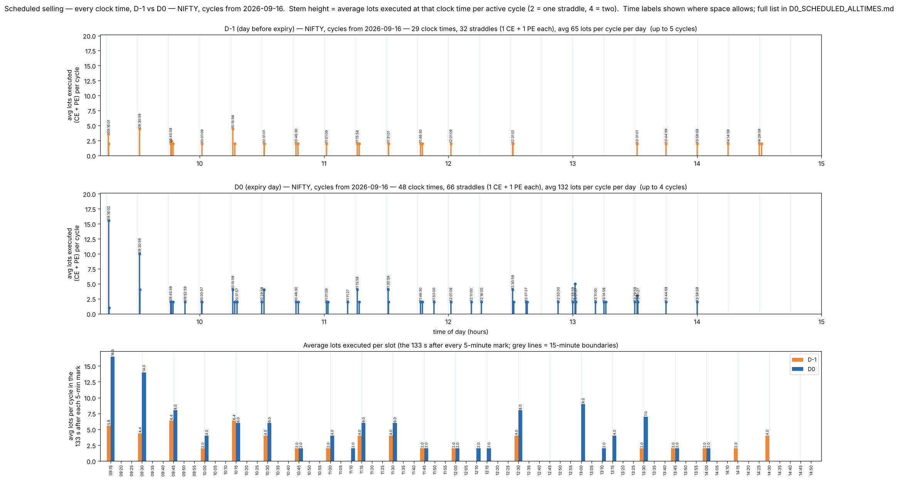
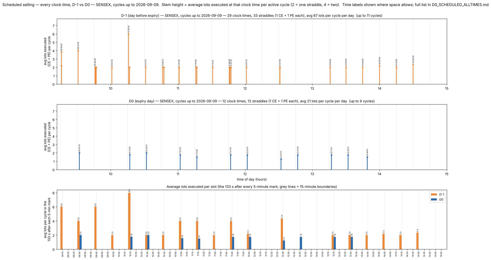
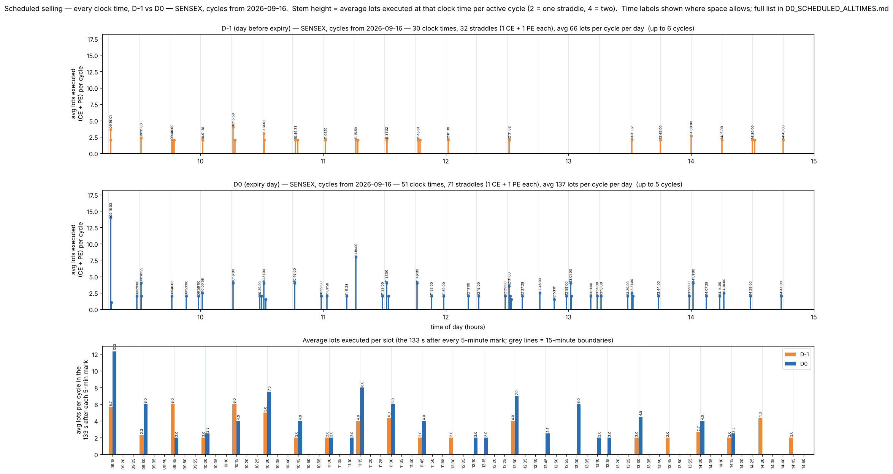

# Algo 8 — scheduled selling: every clock time on D-1 and D0, and the lots executed at each

*Figures: `figures/bl_d0q_alltimes_NIFTY_V1.png`, `..._NIFTY_V2.png`, `..._SENSEX_V1.png`, `..._SENSEX_V2.png` (one per group; D-1 on top, D0 in the middle, average lots per 5-minute slot at the bottom). Data: `outputs/bl_d0q_alltimes.csv` (every clock time), `bl_d0q_slots.csv` (every slot), `bl_d0q_daytotals.csv`. Descriptive, all cycles.*

## 0. How to read this
* **A group** is an underlying with a timetable version. The version is only a date split: V1 = cycles up to 2026-09-09, V2 = cycles from 2026-09-16.
* **A clock time** is a second of the day at which the system sells. At it, it sells one **straddle**: 1 CE lot + 1 PE lot at the same ATM strike.
* **A wave** is one straddle. Where two or more fire in the same second (within 3 s), they stack and the stem is taller.
* **Lots at a clock time** = the average lots executed per cycle that was still running at that time (2 = one straddle, 4 = two).
* **A slot** is the 133 s after a 5-minute mark. Its value is the average lots executed in it per cycle.

## 1. Answer: yes, they come in waves, mostly of one straddle
* **Most clock times are a single straddle, 2 lots.**
  * D-1 NIFTY V1: 26 of 29 clock times are one straddle, 2 are two and 1 is three.
  * D0 NIFTY V1: 62 of 69 are one straddle, 7 are two.
* **Bigger stacks are rare.** On D-1 the most is 3 straddles in one second. On D0 it is 2, except for the opening bursts at 09:16 of the V2 groups (up to 9 straddles), which come from few cycles.
* **A day in total** (average lots per cycle):

| group | day | clock times | straddles | lots if every one fires | avg lots per cycle per day | max avg lots at one clock time | 5-min slots used | avg lots per used slot |
|---|---|---|---|---|---|---|---|---|
| NIFTY V1 | D-1 | 29 | 33 | 66 | 66.00 | 6.00 | 19 | 3.27 |
| NIFTY V1 | D0 | 69 | 76 | 152 | 152.57 | 4.00 | 33 | 4.09 |
| NIFTY V2 | D-1 | 29 | 32 | 64 | 64.80 | 4.40 | 18 | 3.38 |
| NIFTY V2 | D0 | 48 | 66 | 132 | 132.50 | 15.50 | 22 | 5.30 |
| SENSEX V1 | D-1 | 29 | 33 | 66 | 66.55 | 6.00 | 19 | 3.32 |
| SENSEX V1 | D0 | 12 | 12 | 24 | 20.53 | 2.00 | 11 | 1.71 |
| SENSEX V2 | D-1 | 30 | 32 | 64 | 66.00 | 4.00 | 19 | 3.28 |
| SENSEX V2 | D0 | 51 | 71 | 142 | 137.00 | 14.00 | 22 | 4.31 |


* **D0 has about 2.3 times the lots of D-1** for NIFTY V1 (153 against 66), and about 2× for NIFTY V2 and SENSEX V2. SENSEX V1 is the exception: D0 has fewer (21).
* **Lots per slot.** A used 5-minute slot carries about 3.3 lots on D-1 and 4–5 on D0 (NIFTY V1: 4.1).

## NIFTY V1: NIFTY, cycles up to 2026-09-09


**D-1 clock times** (mm:ss within each 15-minute block, then average lots executed in brackets; 29 clock times):

```
09:15: 16:01 (4), 16:07 (2)
09:30: 31:00 (4)
09:45: 45:59 (2), 46:31 (2), 47:05 (2)
10:00: 01:09 (2)
10:15: 15:59 (6), 16:57 (2)
10:30: 31:09 (2)
10:45: 46:30 (2), 47:31 (2)
11:00: 01:00 (2), 01:10 (2)
11:15: 15:58 (2), 16:57 (2)
11:30: 31:09 (2)
11:45: 45:59 (2), 46:30 (2), 47:30 (2)
12:00: 01:09 (2)
12:30: 31:00 (2), 31:10 (2)
13:15: 16:00 (2), 29:59 (2)
13:45: 45:00 (2)
14:00: 00:00 (2), 14:59 (2)
14:15: 29:59 (2)
```

**D0 clock times** (mm:ss within each 15-minute block, then average lots executed in brackets; 69 clock times):

```
09:15: 15:59 (2.3), 16:18 (2.3)
09:30: 30:58 (4), 31:06 (2.9), 31:10 (2), 32:00 (2)
09:45: 46:00 (2), 46:06 (2), 46:31 (2), 47:06 (2)
10:00: 00:58 (2), 01:10 (2)
10:15: 15:59 (4), 16:58 (4), 17:58 (2), 26:04 (4), 29:58 (2)
10:30: 31:02 (2), 31:10 (2.3), 32:00 (2)
10:45: 46:31 (2), 47:31 (2), 56:04 (2)
11:00: 01:10 (2), 01:58 (2.9), 11:28 (2)
11:15: 15:58 (2), 16:59 (4)
11:30: 31:01 (2), 31:09 (2)
11:45: 46:31 (2), 47:00 (2), 47:31 (2), 56:04 (1.7)
12:00: 01:10 (1.7), 02:00 (1.4), 06:00 (2)
12:15: 26:00 (2)
12:30: 31:01 (2), 31:09 (2), 31:28 (2), 32:00 (2), 36:01 (2), 37:27 (1.7), 37:57 (2)
12:45: 46:00 (2), 47:01 (2), 56:00 (2)
13:00: 00:00 (1.7), 01:00 (3.4), 01:28 (2), 06:00 (2)
13:15: 15:00 (2), 17:00 (2), 26:00 (2)
13:30: 30:00 (2), 31:28 (2), 32:00 (2), 36:00 (2)
13:45: 45:00 (2.6), 46:00 (2), 49:00 (2), 56:01 (1.7), 59:59 (2)
14:00: 01:01 (4), 07:28 (2)
14:15: 15:00 (2), 27:57 (2)
14:30: 30:00 (2)
```

## NIFTY V2: NIFTY, cycles from 2026-09-16


**D-1 clock times** (mm:ss within each 15-minute block, then average lots executed in brackets; 29 clock times):

```
09:15: 16:01 (3.6), 16:07 (2)
09:30: 30:59 (4.4)
09:45: 45:59 (2), 46:30 (2.4), 47:05 (2)
10:00: 01:09 (2)
10:15: 15:58 (4.4), 16:57 (2)
10:30: 31:01 (2), 31:09 (2)
10:45: 46:30 (2), 47:30 (2)
11:00: 01:09 (2)
11:15: 15:58 (2), 16:57 (2)
11:30: 31:01 (2), 31:10 (2)
11:45: 46:30 (2), 47:30 (2)
12:00: 01:09 (2)
12:30: 31:01 (2), 31:09 (2)
13:30: 31:01 (2), 44:59 (2)
13:45: 59:59 (2)
14:00: 14:59 (2)
14:15: 29:59 (2)
14:30: 31:01 (2)
```

**D0 clock times** (mm:ss within each 15-minute block, then average lots executed in brackets; 48 clock times):

```
09:15: 16:02 (15.5), 16:19 (1)
09:30: 30:59 (10), 31:07 (4)
09:45: 45:59 (2), 46:05 (2), 46:30 (2), 47:06 (2), 52:59 (2)
10:00: 00:57 (2), 01:09 (2)
10:15: 15:59 (4), 16:58 (2), 17:57 (2), 29:58 (2)
10:30: 31:00 (4)
10:45: 46:30 (2), 47:30 (2)
11:00: 01:09 (2), 01:57 (2), 11:27 (2)
11:15: 15:59 (4), 16:57 (2)
11:30: 30:59 (4), 31:09 (2)
11:45: 46:30 (2), 47:30 (2), 53:00 (2)
12:00: 01:09 (2), 11:00 (2)
12:15: 16:00 (2)
12:30: 30:59 (4), 31:09 (2), 31:27 (2), 37:27 (2), 37:57 (2)
12:45: 53:00 (2), 59:59 (2)
13:00: 01:01 (5), 01:27 (2), 11:00 (2), 14:59 (2)
13:15: 16:00 (2), 29:59 (2)
13:30: 31:00 (3), 31:27 (2), 44:59 (2)
13:45: 59:59 (2)
```

## SENSEX V1: SENSEX, cycles up to 2026-09-09


**D-1 clock times** (mm:ss within each 15-minute block, then average lots executed in brackets; 29 clock times):

```
09:15: 16:02 (3.8), 16:07 (2.2)
09:30: 31:00 (4)
09:45: 46:00 (2), 46:31 (2), 47:06 (2)
10:00: 01:10 (2)
10:15: 16:00 (6), 16:58 (2)
10:30: 31:10 (2)
10:45: 46:31 (2), 47:31 (2)
11:00: 01:00 (2), 01:10 (2)
11:15: 15:59 (2), 16:58 (2)
11:30: 31:10 (2)
11:45: 46:00 (2), 46:31 (2), 47:31 (2)
12:00: 01:10 (2)
12:30: 31:00 (2), 31:10 (2)
13:15: 16:00 (2)
13:30: 30:00 (2)
13:45: 45:00 (2)
14:00: 00:00 (2.2)
14:15: 15:00 (2)
14:30: 30:00 (2.4)
```

**D0 clock times** (mm:ss within each 15-minute block, then average lots executed in brackets; 12 clock times):

```
09:30: 32:01 (2)
10:15: 17:00 (1.8)
10:30: 32:01 (2)
11:00: 02:01 (1.8)
11:15: 17:00 (1.5)
11:45: 47:01 (1.8)
12:00: 02:01 (1.8)
12:30: 32:01 (1.2)
12:45: 47:00 (1.8)
13:15: 17:01 (1.8)
13:30: 32:01 (1.8)
13:45: 49:01 (1.5)
```

## SENSEX V2: SENSEX, cycles from 2026-09-16


**D-1 clock times** (mm:ss within each 15-minute block, then average lots executed in brackets; 30 clock times):

```
09:15: 16:01 (3.7), 16:07 (2)
09:30: 31:00 (2.3)
09:45: 46:00 (2), 46:31 (2), 47:06 (2)
10:00: 01:10 (2)
10:15: 15:59 (4), 16:58 (2)
10:30: 31:02 (3), 31:10 (2)
10:45: 46:31 (2), 47:31 (2)
11:00: 01:10 (2)
11:15: 15:59 (2), 16:58 (2)
11:30: 31:02 (2), 31:10 (2.3)
11:45: 46:31 (2), 47:31 (2)
12:00: 01:10 (2)
12:30: 31:02 (2), 31:10 (2)
13:30: 31:02 (2)
13:45: 45:00 (2)
14:00: 00:00 (2.7)
14:15: 15:00 (2)
14:30: 30:00 (2), 31:02 (2)
14:45: 45:00 (2)
```

**D0 clock times** (mm:ss within each 15-minute block, then average lots executed in brackets; 51 clock times):

```
09:15: 16:03 (14), 16:31 (1), 29:00 (2)
09:30: 30:59 (4), 31:06 (2)
09:45: 46:06 (2), 53:00 (2), 59:00 (2)
10:00: 00:58 (2.5)
10:15: 16:00 (4), 29:00 (2), 29:58 (2)
10:30: 31:00 (4), 32:01 (1.5)
10:45: 46:00 (4), 59:00 (2)
11:00: 01:58 (2), 11:28 (2)
11:15: 16:00 (8), 29:00 (2)
11:30: 31:00 (4), 32:00 (2)
11:45: 46:00 (4), 53:00 (2), 59:00 (2)
12:00: 11:00 (2)
12:15: 16:00 (2), 29:00 (2)
12:30: 31:00 (3.5), 31:28 (2), 32:01 (1.5), 37:28 (2)
12:45: 46:00 (2.5), 53:01 (1.5), 59:00 (2)
13:00: 01:00 (4), 01:28 (2), 11:00 (2), 14:00 (2)
13:15: 16:00 (2), 29:00 (2)
13:30: 31:00 (2.5), 31:28 (2), 44:00 (2)
13:45: 59:00 (2)
14:00: 01:00 (4), 07:28 (2), 14:00 (2)
14:15: 16:00 (2.5), 29:00 (2)
14:30: 44:00 (2)
```

## Caveats
* **Wave lists are learned from the data.** A clock time is listed when at least half of the group's running cycles have a straddle at that second (±3 s).
* **NIFTY V2 and the SENSEX groups have few cycles** (NIFTY V2: 4, of which 2 usable on D0). Their D0 lists are less certain.
* **Averages count only cycles still running.** A cycle stopped by the cycle stop drops out from that time on.
* **The opening bursts at 09:16 on D0 (V2)** vary by cycle. They are shown as one tall stem.

## Run order
`bl_d0q_sched.py` → `bl_d0q_alltimes.py` → `make_d0qa_report.py`.
