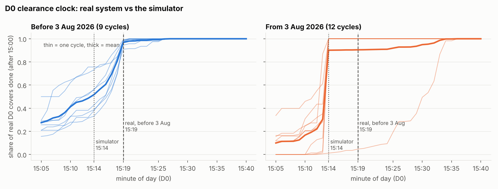
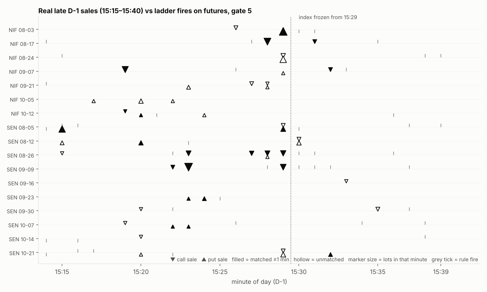
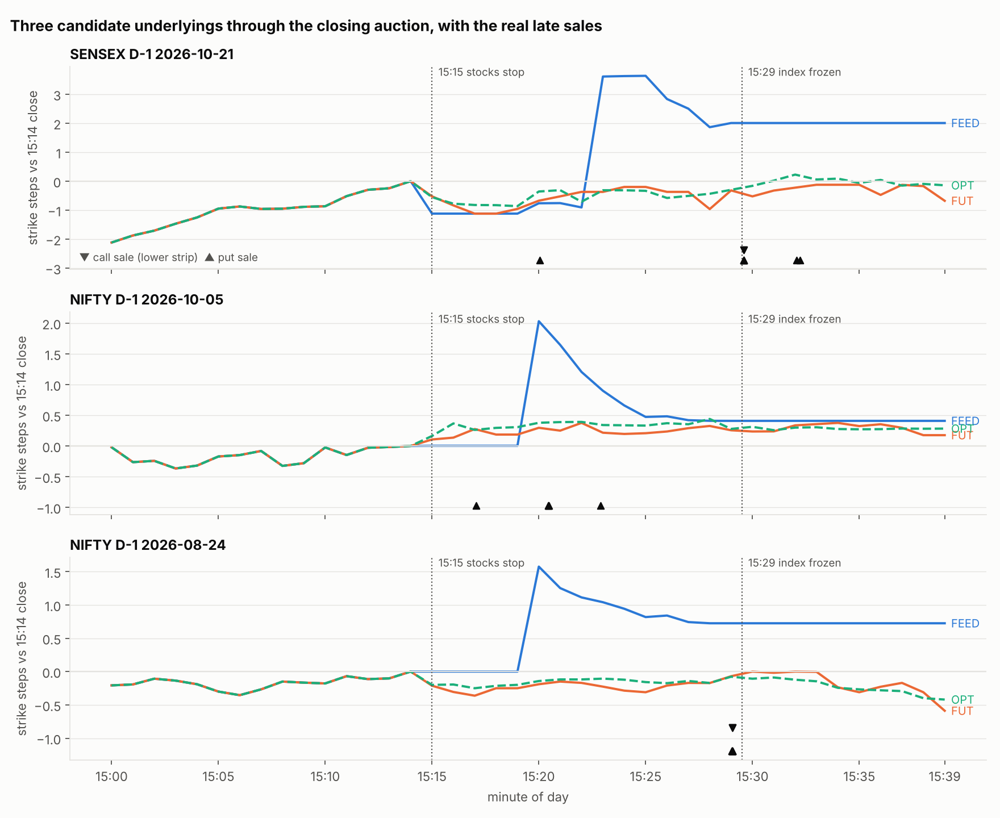
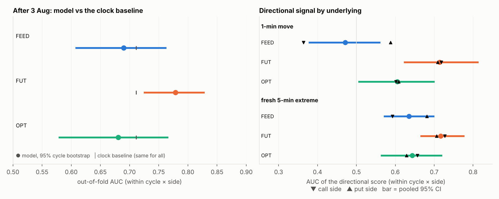
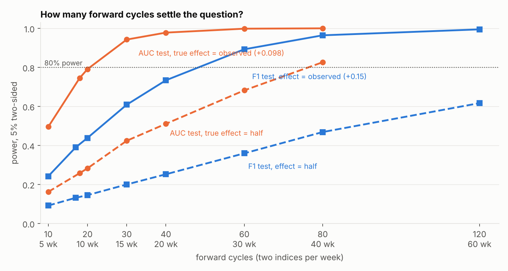

# Forward test: what is understood, what is frozen, what the evidence needs to look like

*Written 2026-11-24. Everything in sections 1–3 is retrospective description of the development cycles (Jun–Oct 2026). Sections 4–6 are the pre-registration: they are fixed now and may not be changed after forward data arrive.*
*Scripts: `src/bl_unmatched.py`, `bl_fwd_power.py`, `bl_fwd_freeze.py`, `bl_fwd_eval.py`, `make_fwd_figs.py`; recorder `d1_strategy/d1_algo/shadow.py` (tests `test_shadow.py`). Figures: `outputs/fwd/`.*

## Result first
| Question | Answer |
|---|---|
| Can the open items be fixed with the data we have? | **No. They can only be settled by a forward sample.** What could be done now was done: understand, quantify, freeze, instrument. |
| What can the forward test detect, and how long does it take? | The frozen primary test needs **about 30 cycles (≈15 weeks)** to detect the observed gain (+0.098 AUC) with 94% power, but only **42% power if the true gain is half of it**. |
| **New planning fact:** which regime will the forward cycles fall in? | **Nearly all in the new regime.** Only **3 D-1 sessions** (25 Nov, 30 Nov, 2 Dec) fall before the 7 Dec 2026 cutover. The clock table and the D0 clearance clock do **not** transfer to the new regime, so the real test needs a 10-cycle burn-in first (≈ late April 2027 for the first verdict). |
| Is the live-form rule the same as the one we tested? | **Yes, now.** The dry run found two bugs (see 5); after the fixes the live-form rule reproduces the batch ladder fire for fire on all 18 development cycles. |
| Correction | "About 58% of real late sales are unmatched" was the **event-level** figure. At **order level 34%** are unmatched (66% matched). See 1. |
| Paper trading | Shadow recording can start now at no risk. It does not change the **NO-GO** for live capital; the pre-paper battery gates still fail (see 6). |

## 1. What the late sales look like (figures)

**Anatomy of the real late D-1 sales (post-auction, 17 cycles with late sales, 16 Oct excluded; best candidate = ladder on futures, gate 5, teacher-forced reference):**
| | orders | share held strike | in a CE+PE pair, same minute | 1-lot |
|---|---|---|---|---|
| matched (±1 minute, same side) | 98 (66%) | 80% | 8% | 100% |
| **unmatched** | **50 (34%)** | 96% | **54%** | 100% |

* **All 148 late sales are single-lot.** One real "event" (minute × side) can hold many such orders, so the unit changes the answer: **event-level recall 0.46, order-level recall 0.66**. The earlier "58% unmatched" refers to events. Both are reported from now on, with the unit named.
* **Where the misses sit:** 5 of 21 orders in 15:15–15:19, 10 of 39 in 15:20–15:24, **27 of 74 in 15:25–15:29**, 8 of 14 after 15:30.
* **Roughly half the unmatched orders are pair bursts** (CE and PE sold within seconds): 6 events, three at 15:29, two at 15:28, one at 15:30. The ladder never produces a pair. The rest are scattered single sales with no common time.
* **The published index is not excluded for every event.** NIFTY 5 Oct sold puts at 15:20:27, exactly when the published index spiked; its put-side score is 0.59, its call-side 0.36. It is inconsistent, not irrelevant.
* **Strike agreement is weaker in the last 25 minutes** than in the broader 14:15–15:40 window reported in `LATE_D1_RULE.md`: exact 0.31 (premium-matched proposal) and 0.32 (last same-side strike); within one step 0.67 and 0.66. The earlier 0.54 does not carry over.
* **Size agreement:** 100% (always one lot).

## 2. Power: how much forward data is enough

| forward cycles | weeks | primary AUC test: SE | detectable at 80% power | power at the observed +0.098 | power at half (+0.049) |
|---|---|---|---|---|---|
| 18 | 9 | 0.037 | 0.105 | 75% | 26% |
| 30 | 15 | 0.028 | 0.078 | **94%** | **42%** |
| 40 | 20 | 0.025 | 0.069 | 98% | 51% |
| 60 | 30 | 0.020 | 0.056 | 100% | 68% |
| 80 | 40 | 0.017 | 0.047 | 100% | 83% |

* **The event-level F1 test is far weaker:** about 2.7 events per cycle, so 30 cycles give 61% power for its observed effect (+0.15) and 20% for half. **It is therefore secondary.** The primary test is the AUC test, which uses every (minute, side) row.
* **The observed effect is optimistic.** The candidate was selected on these cycles, so "half the observed effect" is the planning case, not the pessimistic one.

## 3. Calendar and regime (new)
* Expiries: NIFTY Tuesdays, SENSEX Thursdays; from 24 Nov the next D-1 sessions are SENSEX 25 Nov, NIFTY 30 Nov, SENSEX 2 Dec, then NIFTY 7 Dec, which already falls in the new regime. Holidays may shift this.
* **Regime A (3 Aug – 6 Dec 2026):** F&O stocks leave continuous trading at 15:15, the published index is not tradeable from 15:15, index options trade to 15:40.
* **Regime B (from 7 Dec 2026, per secondary sources):** auction 15:30–15:40, derivatives to 15:45, expiring contracts stop at 15:30 on expiry day. The sale window, the clock table, the published-index behaviour and the **D0 clearance clock all change or are unknown.** The `clear_era` regime has no B setting; it must be measured from the first B cycles, not assumed.
* **Consequence:** three regime-A cycles cannot test anything. The forward test is a **regime-B test with a burn-in**.

## 4. Pre-registration (fixed now)
**Frozen objects**
| object | value |
|---|---|
| rule (`LateRuleConfig`) | ladder on the near-month future, gate 5 minutes, step 0.2 strike steps, window 15:15–15:39, reference = close before the latest real sale on that side, 1 lot; **sha256 `ca1306cf…8e03`** |
| primary score | L2 logistic on `FUT_ext5` (+0.841), `FUT_mv1` (+0.132), clock (+0.640), intercept −3.502, standardised; fitted on 18 regime-A cycles, 48 events; **sha256 `7788f739…d69c`** (`outputs/fwd/frozen_model.json`) |
| clock baseline | regime A: frequency table of the development cycles (frozen). **Regime B: built from the burn-in cycles, then frozen before the test cycles start.** |
| D0 clearance | `clear_era` as adopted; regime B value measured in the burn-in |
| simulator defaults | unchanged |

**Recording** (the recorder `d1_algo/shadow.py` implements this; run from 09:15 to 15:45, every second)
1. before each real order: previous completed minute and running current minute, high/low/last, with timestamp, for the published index, the future and the option-implied index;
2. the portfolio immediately before each order: short and long lots per side, open strikes, imbalance, lighter side, net delta (Black-76);
3. every minute of the window, **with or without an order**, so negatives exist;
4. the frozen rule's own state and every fire, with the rule hash on every record;
5. every real order, including those the rule does not predict.

**Evaluation unit and metrics (all defined here, none added later)**
| tier | metric | unit |
|---|---|---|
| **Primary** | AUC(frozen score) − AUC(clock baseline), within (cycle, side) blocks, 95% cluster bootstrap over cycles | (minute, side) rows |
| Secondary | precision, recall, F1 of the frozen rule, ±0 and ±1 minute | events and orders, both named |
| Secondary | strike agreement (premium-matched and last-same-side proposals), size agreement | matched orders |
| Secondary | teacher-forced D0 P&L agreement and stop-flip count | cycles |
| Baselines | same-count random timing; the current simulator's ladder (published index, gate 60) | |

A good result on one tier does not substitute for a poor one on another: all are reported side by side.

**Sample and stopping**
* Regime B burn-in: the first 10 cycles build the clock table and measure D0 clearance and the index behaviour. They are excluded from the test.
* Test cycles: the next 30. First look at 30 cycles, second (only if inconclusive) at 60. **Pocock boundary, two-sided 2.94% at each look** (about 97.06% interval). No other look.
* Futility at the first look: if the point estimate of the primary difference is ≤ 0, stop and report "no gain over the clock".
* Regime A cycles (three before 7 Dec) are reported separately and never pooled with regime B.

**Decision rules**
* **Confirmed:** lower bound of the primary interval > 0 at a look. Then, and only then, the rule may enter the simulator, as a new version evaluated on a new hold-out.
* **Inconclusive:** interval includes 0 and the point estimate > 0 → second look at 60 cycles.
* **Not confirmed:** point estimate ≤ 0 at the first look, or the interval still includes 0 at the second.
* **Nothing may be changed during the sample:** rule, score, coefficients, window, gate, reference, metrics, regime split. Any change starts a new registered test with fresh cycles.

## 5. Software validation (what the 144 + 24 tests do and do not show)
* **Found by the dry run, fixed:** (1) the live-form rule updated its reference only after fires inside the window, while the batch function also does so earlier in the day; it now runs all day and reports only window fires. (2) A new minute's bar was seeded with the previous close, polluting the high and low whenever the open differed from it; a test with gaps now catches that (mutation-checked).
* **Result of the dry run:** the live-form rule is identical to the batch ladder in every one of the 18 development cycles; precision 0.4615 and recall 0.4583 reproduce `bl_trig_ladder.py` exactly. The harness reads recorder logs end to end.
* **This is software validation only.** It shows the instrument measures what the backtest measured. It is not evidence that the rule works.

## 6. Paper trading
* **Shadow recording (no orders, no capital) can start immediately.** It is the only way to answer the open question.
* **It does not lift the NO-GO.** The pre-paper battery (`PREPAPER_RESULT.md`) failed 3 of 8 gates (overfitting probability 0.60, noise floor missed by ₹0.1k, margin cap at 10.9%). Those are properties of the strategy's economics and are untouched by anything here. A paper account run as evidence of profitability stays gated by them.
* **Not fixable now:** the late-sale trigger; out-of-sample evidence for `clear_era` (no new pre-auction real cycles exist; 11 cycles is all there will be).
* **First milestone after paper trading starts:** the regime-B burn-in report (10 cycles: clearance clock, index behaviour, clock table), not a P&L number.
