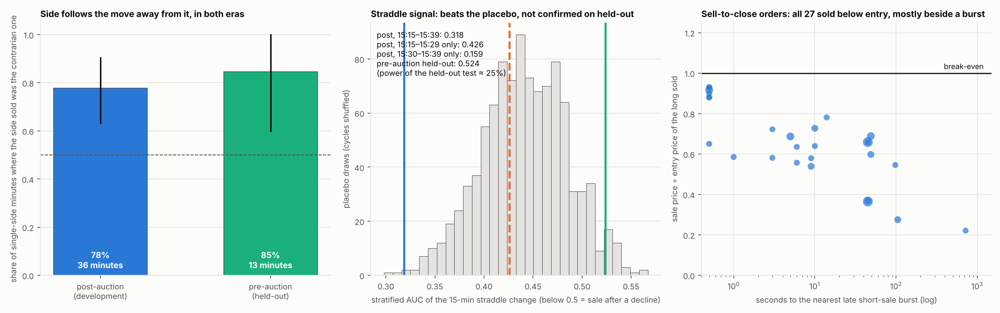

# Focused late-sale tests: side, straddle, pair window, profit booking

*Plan: [`LATE_SALE_FOCUSED_PLAN.md`](LATE_SALE_FOCUSED_PLAN.md), written before any test ran. One statistic per lead, no new indicator screen. Frozen rule, score and hashes untouched. Same development cycles as all earlier work, plus the pre-auction era as a small held-out set.*

## Result first
1. **Side is the one finding that replicates.** The side sold is the contrarian one (put after a rise, call after a fall) in **78%** of single-side minutes post-auction [63%, 90%] and **85%** in the held-out pre-auction cycles [60%, 100%]. Supported on both.
2. **The straddle lead got weaker, not stronger.** It beats a cross-cycle placebo (p = 0.002), but the held-out AUC is **0.524** (the pre-registered rule calls that "contradicted"; the test had only ~25% power, so it is mostly uninformative). A split I ran afterwards (descriptive) shows the effect sits in **7 sale minutes after 15:30** (AUC 0.16); across 15:15–15:29, where 41 sale minutes sit, the AUC is **0.43**.
3. **Late sales are not profit booking.** Profit level does not predict a sale (AUC 0.54, p = 0.50). Profit-taking buy-backs do not precede sales (24.3% vs 20.4% by chance, p = 0.34). The only sales that close a position, the **34 sell-to-close orders, were all sold below entry** (median 65% of the price paid): loss salvage of long hedges, not profit.
4. **New observation:** those sell-to-close orders happen **beside the short-sale bursts**: 24 of 27 (post-auction) within 60 s of a burst vs 20% by chance (p = 0.0005), in only 7 cycles.
5. **Straddle does not explain both timing and side**, by construction: it is the same for calls and puts. Timing and side look like two separate mechanisms.

## Test table (family of 9, BH 10%)
| ID | Question | Result | BH ≤ 10% | Meaningful (pre-set size rule) | Verdict |
|---|---|---|---|---|---|
| **F2a** | Futures direction picks the side (post) | 78% contrarian, 36 minutes, 16 cycles; 9 of 13 eligible cycles lean contrarian | yes (0.002) | yes (≥ 65%, CI above 50%) | **Supported** |
| **F2a-held-out** | Same, pre-auction (index) | 85%, 13 minutes, 6 cycles; 4 of 4 | yes (0.017) | yes | **Supported, replicates** |
| F2b (descriptive) | "Cheaper option" wording | the side with the larger ATM-premium fall: 81% post, 69% pre | not in family | | No better than futures direction; cannot separate the two |
| **F1** | Straddle decline predicts sales, held-out | AUC 0.524 vs null 0.502, p = 0.63; 3 of 7 cycles in the predicted direction | no | no | **Contradicted by my rule; power ≈ 25%, inconclusive in practice** |
| **F1p** | Straddle effect is just the clock? | 0.318 vs placebo mean 0.439 (5th percentile 0.368), p = 0.002 | yes (0.006) | yes | Not a pure time-of-window artefact; but the placebo itself sits at 0.44, so about half of the distance from 0.5 is generic time decay |
| **F3** | Side term adds to the timing model | ΔAUC −0.027 [−0.070, +0.017] | no | no | See "design limit" below |
| **PB2** | Sell-to-close orders sit beside short bursts | 24 of 27 vs 20% | yes (0.002) | yes (+0.69) | **Observed**, but 7 cycles carry it |
| PB3 | Sale more likely at a high profit % | AUC 0.539 vs 0.537, p = 0.50 | no | no | Not supported |
| PB4 | Sale more likely after a give-back from the P&L peak | AUC 0.620 vs 0.564, p = 0.084; 13 of 17 cycles | no (0.15) | borderline | Not supported; the sign says the sale comes when the book is **near** its peak, the opposite of a give-back trigger |
| PB5 | Any-side cover in the previous 10 min | 24.3% vs 20.4%, p = 0.34 | no | no | Not supported |

## Your hypotheses, one by one
**"Late sale is profit booking."** Tested in four forms; none holds.
* A sale cannot book a profit on a short position. The instruments that do are covers (buy-backs); they do not precede late sales (PB5, and the earlier same-side test gave 1 of 148).
* The sales that *do* close a position are the 34 `close_long` orders. **0 of 34 were sold above entry**; median exit ÷ entry 0.65 (range 0.22–0.93), and 74% of the post-auction ones are hedge-wing (`h_`) positions. That is **salvage of decayed hedges**, consistent with the earlier D0 decode of lump and wing salvage.
* Book profit level (PB3) and give-back from peak (PB4) do not predict a sale.
* **What PB2 adds:** the salvage sells and the new short sales occur together (89% within 60 s). Of the 27, the nearest burst is of the opposite type for 21 (13 are a long put beside a short call, 8 a long call beside a short put) and of the same type for 6 (long put beside a short put). So the late burst is better described as **one restructuring step that sells decayed longs and adds shorts**, not two independent rules. Why it fires then is unresolved. Sample: 7 cycles.

**"Straddle decline predicts the next sale."** Honest status: **weak and thinner than I said last time.**
* Beats the placebo (F1p) and is positive in all leave-one-out runs (earlier test).
* Not confirmed on held-out (F1), but that test could only detect it about 1 time in 4.
* Descriptive split: AUC 0.43 over 15:15–15:29 (41 sale minutes) vs 0.16 over 15:30–15:39 (7 sale minutes). The strongest signal rests on 7 events. The pre-auction session ended at 15:30, so the held-out set cannot contain that part.

**"Futures direction picks the side."** Supported and replicated. It is also indistinguishable from "the option that just got cheaper" (F2b).

**"The 15:28–15:30 pairs are a separate process."** Descriptive only (6 events).
* 6 of 18 post-auction cycles have a two-leg burst, all 15:28:17–15:30:00.
* Pre-auction held-out: 2 two-leg bursts among 18 (11%, similar to the 13% post): one at **15:28:44** (inside the window) and one at **15:25:42** (outside). So the held-out set neither confirms nor contradicts a closing-pair window: 1 of 2.
* At 15:27, pair and non-pair cycles look alike (sold-lot deficit, profit %, give-back, straddle change); no separating state variable. 6 vs 12 cycles is too few to say more.

## Design limits and one correction
* **F3's statistic cannot test the side.** The AUC is stratified within each (cycle, side) block, so it measures timing across minutes, not the choice between call and put in a given minute. Reading it correctly: futures direction does not help timing (−0.027), and clock + straddle helps timing (+0.043 [0.005, 0.073]). The two-part rule is not tested by F3; a joint event-level likelihood would be needed and should be pre-registered for the forward sample.
* **F1 power:** about 25% (sub-sampling 7 post-auction cycles; optimistic because the effect was selected).
* **PB2:** 27 orders, but 7 cycles and about 7 clusters.
* **No untouched future cycles are labelled:** order logs end 22 Oct 2026. Validation on future cycles needs the forward recorder.
* The 15:30–15:39 split and the pre-auction pair bursts are descriptive, not in the family.

## What I would do next (not run)
1. **Record, don't screen:** add to the forward recorder, per decision minute and side, the 15-minute straddle change, the strictly-before 5-minute price move, the sold-lot count per side, and every `close_long` order with the long's entry price.
2. **Pre-register two forward hypotheses only:** (a) side = contrarian (≥ 65%); (b) straddle decline raises the hazard, evaluated on 15:15–15:29 **and** 15:30–15:39 separately.
3. **Pre-register the restructuring hypothesis:** a sell-to-close of a long within 60 s of a short burst, with exit ÷ entry below 1.

## Files
`src/bl_trig3_state.py`, `bl_trig3_focused.py`, `make_focused_figs.py`; `tests/test_focused_hypotheses.py` (8 tests); outputs in `outputs/trig3/` (`state_after.csv`, `state_before.csv`, `focused.json`, `focused_extra.json`, `family.csv`, `close_long.csv`, `pair_cycles.csv`, `pre_bursts.json`, `focused.png`).
