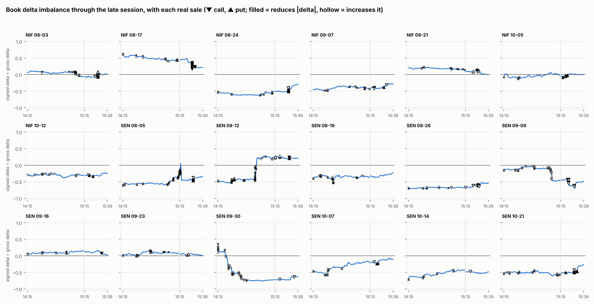
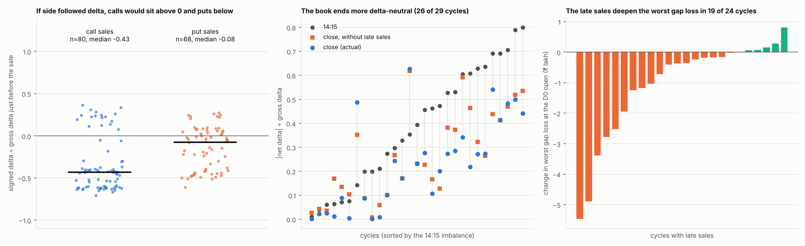

# Are the late D-1 sales risk control for the D0 opening? Results, cycle by cycle

*2026-11-24. Plan fixed before the first statistic: `LATE_SALE_RISK_PLAN.md`. **Exploratory**, development cycles only (30 complete cycles; NIFTY 16 Oct excluded from pooled statistics). The frozen rule is untouched. Scripts: `src/bl_risk_book.py`, `bl_risk_tests.py`, `bl_risk_attrib.py`, `bl_risk_table.py`, `make_risk_figs.py` → `outputs/risk/`. Nothing here is committed.*

## Result first
**Your hypothesis is not supported in the form tested: the late sales are not selected by the book's delta, gap exposure or VWAP, and they do not reduce the D0-opening risk. They add to it.** The D0-opening protection comes from something else in the same minutes: the **overnight lump**.

| Question | Answer | Evidence |
|---|---|---|
| Do late sales pick the side that reduces the book's net delta (H1)? | **No** | 40.5% of sales reduce |delta|; 42.1% expected if the side were chosen independently of the book; excess −0.016 [−0.047, 0.000], p = 0.49; positive in 2 of 15 cycles |
| …or the side that equalises the loss to a gap up and a gap down (H2)? | **No** | 36.5% vs 38.1% expected |
| …or the side that cuts the worst D0-gap loss more than the mirror sale (H3)? | **No** | 32.4% vs 33.2%; average change vs mirror −₹458 [−₹1,283, +₹399] |
| Do the sales reduce the worst D0-gap loss at all (H5)? | **No: they deepen it** | worst gap loss gets worse in **19 of 24** cycles (sign test p = 0.007); median −₹0.36 lakh |
| Do they leave the book more delta-neutral than without them (H5)? | **Weak, not significant** | |delta| smaller in 17 of 24 cycles, p = 0.064; |asymmetry| 14 of 24, p = 0.54 |
| Is the book more delta-neutral at the close than at 14:15 (H6)? | **Yes** | 26 of 29 cycles, p = 1.5e-5; median imbalance ratio 0.39 → 0.23; 7 cycles end within 5% of neutral, against 2 at 14:15 |
| **What does the balancing?** | **The overnight lump** | removing it raises |net delta| in **27 of 28** cycles (median ₹40.6k per 1%) and worsens the worst gap loss in **28 of 28** (median **₹8.5 lakh**) |
| Does VWAP drive the sales (H4)? | **No** | AUC 0.467 (null mean 0.482), p = 0.38 |
| Does the timing follow Greeks or gap level (H4)? | **No** | |delta| 0.53, short gamma 0.53, vega 0.50, theta 0.49, worst gap 0.57 (null mean 0.61, p = 0.88) |
| Is anything supported? | **One timing hint**: sales are more likely when the same side holds **fewer short lots** (AUC 0.652, p = 0.001, BH 0.007, same direction in 15 of 17 cycles) | but the *side* of each order does not follow it (H7, post hoc: 40.5% vs 41.4% expected) |

## 1. What was measured
* **Book:** every real D-1 order replayed into a position book (shorts, wings, lump). **Greeks and gap P&L:** Black-76 on previous-minute option prices with a parity forward; D0-open gap P&L by full revaluation at spot gaps of −3% to +3%, vols held; additive across legs, so each sale's state **before, after and after the mirror sale** is exact. Mechanics were checked first: a call sale lowers delta in 100% of cases and a put sale raises it; medians of 93 shorts against 94 longs at order time.
* **Order level (H1–H3):** the observed share of sales whose side improves a metric against the share expected if the side were drawn independently of the book at the cycle's own CE/PE mix, so a cycle that only sold calls gets no credit for it. Cycle-cluster bootstrap.
* **Timing (H4):** stratified AUC within (cycle, side) blocks over the 25 window minutes; a null that keeps every cycle's event count and every minute's frequency (curveball swaps, 1,000 draws).
* **Counting:** 15 primary tests (BH 10%): 11 hazard features + H1, H2, H3a, H3b. Post hoc and counted: H7 (short-lot count balancing), the removal analysis (6 groups × 2 metrics), the 14:15–15:14 repeat (16 tests) and the pre-auction repeat.

## 2. Order-level and timing results (post-auction, sales from 15:15, 148 orders, 17 cycles)
| test | observed | expected by chance | excess [95%] | p | BH |
|---|---|---|---|---|---|
| H1 delta-reducing side | 0.405 | 0.421 | −0.016 [−0.047, 0.000] | 0.49 | 0.74 |
| H2 asymmetry-reducing side | 0.365 | 0.381 | −0.017 [−0.049, 0.000] | 0.47 | 0.74 |
| H3a gap-improving side | 0.324 | 0.332 | −0.008 [−0.024, 0.000] | 0.16 | 0.44 |
| H3b average gap change vs mirror | −₹26,880 | −₹26,422 | −₹458 [−₹1,283, +₹399] | 0.32 | 0.68 |
| H7 (post hoc) fewer-shorts side | 0.405 | 0.414 | −0.008 [−0.025, 0.000] | 0.48 | 0.72 (16 tests) |

| hazard feature (oriented: larger = more pressure to sell this side) | AUC | null mean | p | BH | cycles in the same direction |
|---|---|---|---|---|---|
| **short-lot imbalance (other side minus same side)** | **0.652** | 0.553 | **0.001** | **0.007** | 15 / 17 |
| delta pressure (CE: +delta, PE: −delta) | 0.612 | 0.536 | 0.029 | 0.109 | 12 / 17 |
| gap-asymmetry pressure | 0.590 | 0.507 | 0.021 | 0.105 | 10 / 17 |
| uncovered same-side shorts | 0.593 | 0.576 | 0.17 | 0.44 | 12 / 17 |
| worst gap loss | 0.570 | 0.606 | 0.88 | 1.00 | 10 / 17 |
| \|delta\|, short gamma, vega, theta | 0.49–0.53 | 0.42–0.59 | ≥ 0.89 | 1.00 | 8–12 / 17 |
| VWAP deviation (trend-following) | 0.467 | 0.482 | 0.38 | 0.72 | 8 / 17 |
| cumulative short premium | 0.301 | 0.415 | 0.001 | 0.007 | 17 / 17 |

* **Cumulative premium is a clock in disguise.** It rises monotonically within a cycle, so its AUC only measures that the sales come early in the window. Under the pre-registered rule it "passes"; I do not count it as a risk finding.
* **Delta and asymmetry pressure miss the 10% BH line (0.109 and 0.105) and have AUC ≤ 0.61**, so under the rules they are not supported; they are the nearest to a signal.
* **The lot-count timing hint and the null order-level result fit together:** many late sales come as CE+PE pairs, so the first leg of a pair is placed when the counts are equal and cannot "reduce" the imbalance. Count balancing looks like a by-product of pair selling, not a rule that picks the side.
* **Secondary window 14:15–15:14 (post hoc, counted):** same picture (H1 excess +0.005, p = 0.71); the sales are on average ₹1,315 *worse* than the mirror sale for the worst gap loss (p = 0.025). Pre-auction (28 orders, 7 cycles): H1 0.75, excess +0.03; too small to read.

## 3. What does balance the book (removal analysis, post hoc, 29 cycles)
End-of-session book rebuilt **without** one group of orders placed after 14:15; positive = the group reduces |net delta| or the worst gap loss.
| group | cycles with it | reduces \|delta\| in | median effect on \|delta\| (₹ per 1%) | improves worst gap loss in | median effect on worst gap loss |
|---|---|---|---|---|---|
| **overnight lump (module v_)** | 28 | **27** (p ≈ 0) | **+40,569** | **28** | **+₹8.5 lakh** |
| late shorts (≥ 15:15) | 24 | 17 (p = 0.064) | +15,720 | 5 | −₹0.36 lakh |
| earlier shorts (14:15–15:14) | 29 | 15 (p = 1.0) | +3,990 | 0 | −₹2.8 lakh |
| wings (h_) | 29 | 16 (p = 0.71) | +444 | 27 | +₹0.28 lakh |
| stops / covers | 17 | 7 (p = 0.63) | −5,751 | 14 | +₹0.76 lakh |
| everything else | 9 | 4 | −44 | 8 | ≈ 0 |

* **The biggest single reducer of |delta| is the lump in 15 of 30 cycles**, the late shorts in 5, the earlier shorts in 5, stops in 4, wings in 1.
* Median |net delta| falls from ₹2.07 lakh per 1% (book before 14:15) to ₹1.42 lakh at the close.
* The ratio "|delta| ÷ gross delta" understates the late sales' effect on delta only because they also add gross delta; the absolute |delta| test above is the clean one.

## 4. Every cycle
Columns: *late sales reduce |delta|* and *improve worst gap* are the removal effects of the sales from 15:15 (negative = they make it worse). Verdict rule from the plan: at least 70% of the cycle's sales satisfy a flag **and** beat that cycle's own chance expectation by at least 0.25.
| cycle (D-1) | era | sales ≥15:15 (CE/PE) | delta ratio 14:15 → close | late sales **reduce** \|delta\| by (₹k per 1%) | late sales **improve** worst gap by (₹ lakh) | lump reduces \|delta\| by (₹k per 1%) | lump improves worst gap by (₹ lakh) | biggest delta reducer | verdict |
|---|---|---|---|---|---|---|---|---|---|
| SEN 06-24 | pre | 1 (0/1) | 0.64 → 0.27 | -6.9 | -0.41 | +43.5 | +9.71 | mid_shorts_1415-1514 | too few sales (<3) |
| NIF 06-29 | pre | 0 (0/0) | 0.69 → 0.41 |  |  | +53.9 | +12.39 | lump_v_ | no sales after 15:15 |
| SEN 07-01 | pre | 5 (4/1) | 0.07 → 0.09 | +30.3 | -0.16 | +18.2 | +4.40 | late_shorts_1515+ | unexplained by book or VWAP state |
| NIF 07-06 | pre | 0 (0/0) | 0.20 → 0.09 |  |  | +68.8 | +16.42 | lump_v_ | no sales after 15:15 |
| SEN 07-08 | pre | 3 (0/3) | 0.80 → 0.44 | +27.7 | +0.29 | +34.4 | +5.66 | lump_v_ | unexplained by book or VWAP state |
| NIF 07-13 | pre | 2 (2/0) | 0.63 → 0.27 | +19.6 | +0.16 | +42.0 | +6.84 | lump_v_ | too few sales (<3) |
| SEN 07-15 | pre | 1 (0/1) | 0.79 → 0.50 | +9.5 | +0.07 | +62.4 | +12.43 | lump_v_ | too few sales (<3) |
| NIF 07-20 | pre | 0 (0/0) | 0.33 → 0.17 |  |  | +39.1 | +9.76 | lump_v_ | no sales after 15:15 |
| SEN 07-22 | pre | 0 (0/0) | 0.27 → 0.10 |  |  | +46.7 | +9.40 | mid_shorts_1415-1514 | no sales after 15:15 |
| NIF 07-27 | pre | 8 (0/8) | 0.21 → 0.01 | +42.8 | -3.38 | +80.6 | +19.98 | covers_stops | unexplained by book or VWAP state |
| SEN 07-29 | pre | 8 (7/1) | 0.04 → 0.02 | +16.5 | -0.01 | -4.9 | +7.51 | mid_shorts_1415-1514 | unexplained by book or VWAP state |
| NIF 08-03 | post | 18 (2/16) | 0.06 → 0.01 | +164.0 | -1.17 | +15.4 | +11.57 | mid_shorts_1415-1514 | unexplained by book or VWAP state |
| SEN 08-05 | post | 14 (2/12) | 0.60 → 0.34 | +87.6 | -0.01 | +12.0 | +2.94 | late_shorts_1515+ | unexplained by book or VWAP state |
| SEN 08-12 | post | 10 (2/8) | 0.47 → 0.20 | -47.0 | -2.78 | +19.3 | +5.23 | covers_stops | unexplained by book or VWAP state |
| NIF 08-17 | post | 11 (11/0) | 0.61 → 0.22 | +128.2 | +0.81 | +46.0 | +15.56 | late_shorts_1515+ | unexplained by book or VWAP state |
| SEN 08-19 | post | 0 (0/0) | 0.39 → 0.23 |  |  | +33.5 | +7.58 | lump_v_ | no sales after 15:15 |
| NIF 08-24 | post | 11 (3/8) | 0.53 → 0.29 | +51.6 | -0.36 | +50.3 | +10.42 | late_shorts_1515+ | unexplained by book or VWAP state |
| SEN 08-26 | post | 18 (17/1) | 0.69 → 0.54 | -164.6 | -4.89 | +38.5 | +8.09 | lump_v_ | unexplained by book or VWAP state |
| NIF 09-07 | post | 10 (9/1) | 0.46 → 0.28 | -83.8 | -2.52 | +56.2 | +12.86 | lump_v_ | unexplained by book or VWAP state |
| SEN 09-09 | post | 22 (22/0) | 0.14 → 0.49 | -159.9 | -5.47 | +76.1 | +15.94 | lump_v_ | unexplained by book or VWAP state |
| SEN 09-16 | post | 1 (1/0) | 0.06 → 0.02 | +7.7 | +0.06 | +34.3 | +4.13 | lump_v_ | too few sales (<3) |
| NIF 09-21 | post | 6 (3/3) | 0.20 → 0.00 | +5.9 | -1.04 | +63.5 | +12.84 | lump_v_ | unexplained by book or VWAP state |
| SEN 09-23 | post | 3 (0/3) | 0.01 → 0.00 | +24.0 | -1.25 | +20.2 | +8.67 | mid_shorts_1415-1514 | unexplained by book or VWAP state |
| SEN 09-30 | post | 3 (3/0) | 0.35 → 0.63 | -10.6 | -0.72 | +28.6 | +7.09 | lump_v_ | unexplained by book or VWAP state |
| NIF 10-05 | post | 5 (0/5) | 0.08 → 0.00 | +38.7 | -1.95 | +8.1 | +2.56 | late_shorts_1515+ | unexplained by book or VWAP state |
| SEN 10-07 | post | 3 (1/2) | 0.46 → 0.11 | +14.9 | -0.17 | +0.0 | +0.00 | covers_stops | unexplained by book or VWAP state |
| NIF 10-12 | post | 3 (1/2) | 0.30 → 0.24 | +11.2 | -0.24 | +43.1 | +8.38 | lump_v_ | unexplained by book or VWAP state |
| SEN 10-14 | post | 1 (1/0) | 0.71 → 0.48 | -6.3 | -0.37 | +0.4 | +0.13 | wings_h_ | too few sales (<3) |
| NIF 10-16 | post | 14 (9/5) | 0.17 → 0.27 | -23.6 | -1.92 | +35.4 | +4.77 | lump_v_ | outlier (240-lot call ratio), excluded |
| SEN 10-21 | post | 9 (2/7) | 0.53 → 0.27 | +48.5 | -0.18 | +65.2 | +8.26 | covers_stops | unexplained by book or VWAP state |

* **No cycle meets the verdict rule** (19 with three or more late sales: all "unexplained by book or VWAP state"; 5 have fewer than three; 5 have none; 1 outlier).
* Cycles where the flag rate is 100% (for example NIF 08-17 and NIF 10-05) sold on **one side only**, so the flag equals the chance expectation; they cannot be told apart from "always sell calls".
* **The lump is the largest delta reducer in 15 cycles and improves the worst gap loss in all but one**; the late sales improve it in 5 of 24 and worsen it in 19.

## 5. Interpretation (adversarial)
* **Supported:** the book is balanced toward the close, and the instrument that does it is the lump (27 of 28 cycles for delta, 28 of 28 for the gap loss, a median of ₹8.5 lakh). That is genuine D0-opening risk control, and it is already in the engine.
* **Not supported:** that the late sales *are* risk control. Their side ignores delta, gap exposure and VWAP; they deepen the worst gap loss (19 of 24); their effect on |delta| is positive on average but not significant.
* **A coupling worth testing next:** the lump is sized from the heavier short side when it is placed, and 58% of late lots are sold *before* it. Late shorts on the heavy side therefore enlarge the lump; the system may sell for premium and let the lump insure it. That is a hypothesis, not a result: late premium and lump cost were unrelated across cycles earlier (Spearman 0.21, p = 0.39).
* **Still open:** what triggers the sales (premium collection, pair bursts, a count-balancing by-product, a margin or premium target).
* **Fit with earlier work:** the lighter-side timing hint matches the earlier "sell the lighter side" imbalance score (AUC 0.65 inverted); VWAP adds nothing, consistent with the earlier finding that only favourable futures moves associate with the sales.

## 6. Limits
* 148 sales in 17 post-auction cycles; only strong effects are detectable. The pre-auction sample (28 orders) is too small.
* The system's own risk model is unknown; Black-76 with parity forwards and held vols is an approximation, and exchange margin is not modelled.
* The gap scenarios are ±1/2/3% with sticky strike; a different shock set (vol up, skew) could change the gap-loss attribution.
* Fill times, not placement times.
* Exploratory: development cycles only; the forward recorder will log the book's state before every order, which is what a causal test needs. Nothing here changes the frozen rule or the pre-registration.
