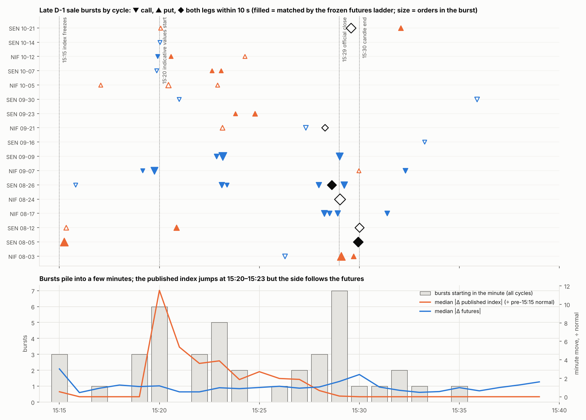
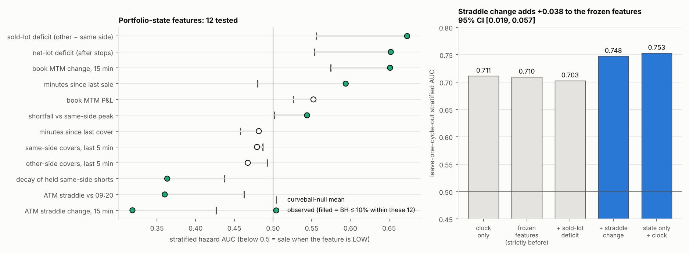

# What triggers the late D-1 sales? Five explanations tested

*Exploratory, development cycles only (17 post-auction cycles with late sales, 47 sale bursts, 148 orders; NIFTY 16 Oct excluded). Plan: [`LATE_SALE_TRIGGER_PLAN.md`](LATE_SALE_TRIGGER_PLAN.md) (pre-registered before any test, plus Addendum 1 written after the first look; the addendum tests are marked post-hoc). The frozen late-sale rule and score are untouched. Nothing here can confirm an edge; it narrows what the trigger can be.*

## Result first

**No single trigger was recovered.** The late sales are not a risk hedge, not a premium target, not tied to the overnight lump, and not a general paired call-and-put routine. What the data support is a **composite**:

| Piece | What the data say | Evidence |
|---|---|---|
| **Which side** | The side whose option has just become **cheaper** (put after a futures rise, call after a fall). Holds **strictly before** the minute: 78% (28 of 36 single-side minutes) vs 50% by chance | Observed, moderate (minutes are not independent, so the p-value is optimistic) |
| **When (minute level)** | Bursts bunch into a few clock minutes on **different days**: 35% start in 15:15, 15:20 or 15:29 (null 12%). 15:29 holds 7 of 47 bursts, 15:20 holds 6 | Observed (the three minutes were picked after I saw the histogram: post-hoc) |
| **When (second level)** | **No fixed-second timer**: given the same minute, second-level coincidence is at chance (11 vs 7.5, p = 0.12) | Observed |
| **Scheduled pair?** | Only **6 of 47** bursts hold both legs (13%). But **all six** sit between 15:28:17 and 15:30:00, legs ≤ 1 s apart, in 6 of 17 cycles | Observed (post-hoc window, adjusted p ≈ 1e-4). What fires it is **unresolved** |
| **State condition** | More likely after the premium has **decayed**: the ATM straddle fell over the last 15 minutes. It adds **+0.038 ΔAUC [0.019, 0.057]** to the frozen features and the clock, positive in **18 of 18** leave-one-cycle-out runs | Weak (post-hoc, 12 features screened, 17 cycles; a lead, not a finding) |
| **Left over** | 6 of 47 bursts (13%) match **no** label | Observed |

## Your four explanations, plus the timer

| # | Explanation | Verdict | Why |
|---|---|---|---|
| 1 | **Extra premium, overnight lump as protection** | **Not supported as the trigger** | No premium target: late premium vs earlier premium has slope −0.13 (a target would give −1; p = 0.85). Not tied to the lump: 9.1% of bursts fall in the 120 s before it vs 6.6% by chance (p = 0.68). Package counterfactual (drop the late sales, re-size the lump with the cycle's own ratio): theta rises in 17/17 cycles and net premium is positive in 17/17 (median ₹39.6k), **but that is mechanical** (adding shorts adds theta). The discriminating test fails: the worst D0-gap loss is **6.0% deeper** (rule: no worse than 5%); within 5% in 8/17, better in 3/17. The lump is re-sized by only 4 lots (43 vs 39 median) |
| 2 | **Completing or adjusting a paired call/put process** | **Not supported as a general rule; one narrow form survives** | 41 of 47 bursts are single-leg. FIFO pair-completion shows no excess (44.6% vs 45.4%); this test is weak by construction when a cycle keeps selling the same side. Replacement of a stopped leg is **below** chance (1 of 148 late sales follows a same-side cover within 10 min vs 11% expected). The surviving form: the six two-leg bursts, all in 15:28:17–15:30:00 |
| 3 | **Another portfolio-state condition** | **Partly supported, weak** | 6 of 12 features pass the pre-registered rule (BH 10%, AUC ≥ 0.60 or ≤ 0.40, same direction in ≥ 60% of cycles): sold-lot deficit 0.673, net-lot deficit 0.652, 15-min book MTM change 0.651, decay of held same-side shorts 0.363, 15-min straddle change 0.318, straddle vs 09:20 0.360. They reduce to two conditions: the side has **fewer lots sold** than the other, and **premium has decayed** over the last 15 minutes. Incrementally, the lot deficits add **nothing** (−0.007) beyond clock and direction; only the straddle change does (+0.038). No threshold: sale rate falls smoothly from 7.8% (straddle fell most) to **0 of 180** minutes (straddle rose most) |
| 4 | **An execution / order-management rule** | **Not distinguishable here** | Bursts are queued lists: median 2 orders, up to 14, median gap 0 s, 36% single order. Every sell is a marketable limit about 15% under the fill (late: 0.856, earlier: 0.852; the difference is tiny). The log has no decision time, so a rule cannot be told from a human or a script from these columns |
| 5 | **A scheduled pair / timer** | **Minute-level clock effect yes; fixed-second timer no** | Cross-cycle same-second coincidence 12 vs 4.2 (p = 0.0012) and minute concentration 213 vs 141 (p = 0.0004) are both real, but seconds-given-minute is at chance. The 09:16 + 15k grid does **not** explain it (GRID label 10.6% vs 15.1% chance). Period phase-locking: 300 s and 900 s not significant (1,800 s exceeds the 1,500 s window: not a valid test) |

## What sits at the clock minutes?

* 15:20 is when the **published index** starts showing indicative auction values: its minute move is **11.5× normal** at 15:20 and 3–5× through 15:23. Bursts at 15:20 (6) and 15:23 (5) line up with that.
* But the **side does not follow the published index**: strictly before the minute, the futures predict the side (78%), the published index does not (61%, p = 0.30). So the engine looks at a tradeable price for the side, while the timing lines up with the index-print minutes.
* The same-minute move size does **not** predict a burst once I use only information strictly before the minute (AUC 0.47–0.58, all p ≥ 0.10). The contemporaneous AUCs (0.68–0.73) are look-ahead, the same flaw the validation audit found in the frozen score. I report them but do not use them.
* **Inferred, weak:** the minute concentration looks like market-structure time (index prints, official close at 15:29), not a private timer. A fixed-time job at 15:20 and 15:29 would look the same. The log cannot separate the two.

## The one lead: the straddle

* Strictly pre-minute (book at the start of the minute, prices through the previous minute).
* Frozen features measured strictly before the minute add **nothing** to the clock (ΔAUC −0.002), confirming the audit. The straddle change adds +0.038 to that, in every leave-one-cycle-out run (+0.034 to +0.044).
* It is **not** "sell more because premium is rich": the straddle has been **falling**. A rule such as "re-load once what you hold has decayed" fits, but I did not find a threshold and the effect is gradual.
* Adversarial notes: 12 features were screened (so the best of them is selected); the straddle change correlates weakly with the clock minute (r = 0.16); 17 cycles; the earlier audit showed that the clock baseline is noisy. **It must be confirmed forward before it is believed.**

## Event labels: how much of the late selling is explained?

Each burst gets every label whose rule it satisfies; "chance" is the same label after circularly shifting event times inside the window (PAIR and COMPLETION use their own nulls, see the plan addendum).

| Label | Observed | Chance | Excess | Counts as explanation (≥ +0.15) |
|---|--:|--:|--:|---|
| LADDER (frozen futures ladder, gate 5, ±1 min) | 57.4% | 27.7% | **+0.30** | yes, but the match window includes the sale minute, so it is partly contemporaneous |
| PAIR | 12.8% | 0.7% | +0.12 | no (below +0.15) |
| LUMP-COUPLED | 8.5% | 6.1% | +0.02 | no |
| GRID | 10.6% | 15.1% | −0.04 | no |
| COMPLETION | 40.4% | 46.4% | −0.06 | no |
| REPLACEMENT | 2.1% | 8.0% | −0.06 | no |
| any label | 87.2% | 75.9% | +0.11 | no |

Only the ladder passes. **Any-label coverage is barely above chance** (87% vs 76%): most of the "explained" bursts would be labelled by luck. The per-burst table by cycle is in [`per_cycle_events.md`](../outputs/trig2/per_cycle_events.md).

## What is supported, what is not (evidence labels)

| Claim | Label |
|---|---|
| Late sales are bursts of 1-lot orders, median 2 per burst, filled within about 1 s of placement | Observed |
| Side follows the futures move (sell the side that just became cheaper), strictly before the minute | Observed, moderate |
| Bursts concentrate in a few clock minutes across days; no fixed-second timer | Observed (the three minutes are post-hoc) |
| Two-leg bursts occur only in 15:28:17–15:30:00 (6 of 6) | Observed, post-hoc |
| The late sales are not a premium target, not lump-coupled, not replacement, not D0 risk control | Observed (not detectable here is not absent) |
| An engine job fires at index-print minutes | Inferred, weak |
| Straddle decay raises the sale hazard | Weak |
| What fires the closing pair; what the six unexplained bursts are | **Unresolved** |

## What I checked and what went wrong

* **First run of part 1 had three flaws, all fixed and rerun:** the pair-ledger mirror flag made the expected completion equal the observed one by construction (excess exactly 0); S3 and S4 used a uniform null that ignores the clock profile; the PAIR chance coverage was identical to the observed by construction. R3 also drew two different random shifts in one expression.
* **Contemporaneous look-ahead:** X1 and X2 were first computed through the sale minute. With strictly-before versions the volatility effect vanishes and the direction effect shrinks from 89% to 78%. The contemporaneous numbers are kept in `bh_family.csv`, labelled.
* **Multiple testing:** the family is 37 tests with p-values (plan said 24 + 8 = 32; I added the strictly-before variants of X1 and X2 and the post-hoc pair-window test S7), BH at 10% in `outputs/trig2/bh_family.csv`. Five incremental-model comparisons are outside that family. P4 and R3 two-sided p-values are derived from stored upper-tail values (approximate). P4 is BH-significant **in the wrong direction** for the replacement explanation.
* **Tests that cannot decide:** P3a (weak by construction), S4 at 1,800 s (period longer than the window), and anything that rests on 6 pair events.
* **Data reuse:** these are the same development cycles used throughout, so any signal here carries the selection risk of all earlier work on them.

## Software validation vs empirical validation

* **Software:** helper functions (burst clustering, pair counting, circular shift, Rayleigh statistic, ledger mirror flag) are covered by `tests/test_trigger_hypotheses.py`, plus regression checks of the reported numbers. Executed, result observed.
* **Empirical:** none. Same cycles, no independent data. The forward recorder is what could confirm anything here, and it needs the pre-order state it was designed to capture: add the 15-minute straddle change and the per-side sold-lot count to the recorded fields (not done; no change made to the recorder).

## Suggested next tests (nothing run)

1. **Forward, pre-registered:** hazard AUC of the 15-minute straddle change, one feature, one direction, on the forward cycles only.
2. **Closing pair:** record every CE+PE burst in 15:28–15:31 in the forward cycles; test whether the pair appears in about 35% of cycles and whether its strikes follow a rule (the six cases have equal lots in only 1 of 6, same strike in 2 of 6).
3. **Index-print timing vs fixed job:** a forward day-count of burst minutes against index-print minutes, including days when the indicative values are unusually quiet.

## Files

`src/bl_trig2_events.py`, `bl_trig2_state.py`, `bl_trig2_clock.py`, `bl_trig2_incr.py`, `bl_trig2_summary.py`, `make_trigger_figs.py`; `tests/test_trigger_hypotheses.py`; outputs in `outputs/trig2/` (`events.csv`, `tests_part1.json`, `tests_part2.json`, `tests_part3.json`, `incremental.json`, `state_hazard.csv`, `package.csv`, `bh_family.csv`, `per_cycle_events.md`, two figures).
