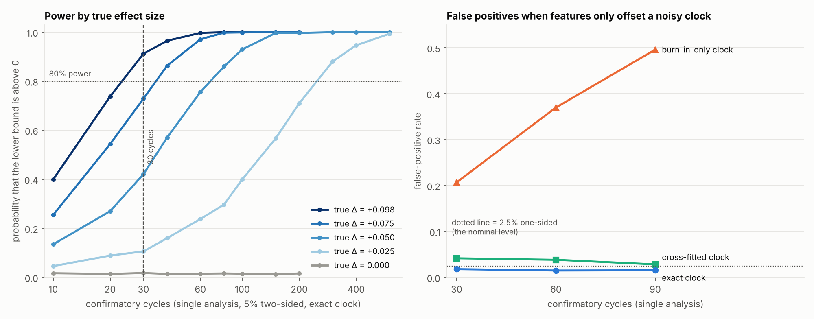

# Power analysis of the forward test, recalculated independently

*2026-11-24. Scripts: `src/bl_audit_power.py`, `bl_audit_power2.py`, `bl_audit_tables.py`, `make_audit_fig.py` → `outputs/audit/power_*.csv`, `required_cycles.json`, `power_curves.png`. Nothing here changes the frozen rule, score or endpoint. Software validation of the simulation: `tests/test_validation_audit.py`.*

## Result first
| Question | Answer |
|---|---|
| Are the original numbers (94% at +0.098; 42% at half) correct? | **They reproduce, under their own assumptions**: single analysis at 30 cycles, clock known exactly. Independent: 91–93% and 42–49%. |
| Do they describe the pre-registered design? | **No.** The design has two looks (30, 60) and a noisy burn-in clock. With two looks the half-effect power is **69–75%**, not 42%. With a noisy clock the test has a **validity** problem that power does not reveal (see 3). |
| Is 30 cycles enough? | **Only if the true effect is at least about +0.075** (first look: 73–79% power; two looks: 95%). For +0.050 the first look has 42–49% power and the pre-registered two-look design 69–75%; for **+0.025 the design cannot work** (18–29%). |
| Cycles needed (one analysis, exact clock) | +0.098: **24 / 29 / 37** cycles for 80 / 90 / 95% power; +0.075: **35 / 47 / 56**; +0.050: **68 / 92 / 117**; +0.025: **253 / 330 / 414**. |
| Does power analysis fix the optimistic effect size? | **No.** It conditions on an assumed effect. Whether +0.098 is the right assumption is the selection-bias question in `OVERFITTING_AUDIT.md`; assurance under skeptical priors is **26–50%**, not 94%. |

## 1. What was simulated
* **Data-generating model:** synthetic forward cycles are drawn **whole** from the 18 development cycles (real feature paths, 25 minutes × 2 sides). Labels are drawn from a logistic model using the frozen coefficients; the intercept keeps the development event rate (**48 events in 900 rows = 2.67 per cycle**).
* **Effect sizes:** a multiplier on the directional part is calibrated by bisection so that the **population** paired ΔAUC equals each target: +0.098, +0.075, +0.050, +0.025, and **0.000** (features add exactly as much as they cost). The fitted model itself (multiplier 1) implies **+0.134**, which is why the +0.098 held-out estimate is the better planning ceiling.
* **Statistic:** the frozen endpoint, stratified AUC within (cycle, side) blocks, model vs clock on **identical rows**; paired; clustered by cycle. The fast path equals the reference implementation exactly (tested).
* **Clustering and unequal events:** whole cycles are resampled; per-cycle event counts vary as in the data (at 30 cycles about **80 events**, **28 of 30 cycles** contribute any comparison pair, and the Kish effective number of independent cycles is about **23**; in the 18 development cycles it is 14.8).
* **Inference at each look:** percentile cluster bootstrap and linearised cluster-robust t interval, each at the level the design needs.
* **Designs:** single analysis at 5% two-sided; Pocock K=2 (looks at 30 and 60 cycles, nominal 2.94% per look); Pocock K=3 (30/60/90, nominal 2.21%); and the **v1 harness behaviour** (K=2 looks at 95%). Futility at look 1: stop if the primary point estimate ≤ 0. 1,000 replications per cell (600 for the cross-fit supplement).
* **Clock scenarios:** `exact` (the development table is the clock), `burnin` (the clock is estimated from 10 synthetic burn-in cycles and used by **both** score and baseline: the pre-registered regime-B baseline) and `crossfit` (burn-in plus the other confirmatory cycles, leave-own-cycle-out).

## 2. Power with the clock known exactly
Single analysis, 5% two-sided, linearised interval (percentile bootstrap within about ±5 points; both in `power_sim.csv`).
| cycles | +0.098 | +0.075 | +0.050 | +0.025 | 0.000 (false positives) |
|---|---|---|---|---|---|
| 20 | 74% | 54% | 27% | 9% | 1.4% |
| **30** | **91%** | **73%** | **42%** | 11% | 1.8% |
| 40 | 97% | 86% | 57% | 16% | 1.4% |
| 60 | 99.7% | 97% | 76% | 24% | 1.5% |
| 100 | 100% | 99.9% | 93% | 39% | 1.5% |
| 200 | 100% | 100% | 100% | 70% | 1.6% |

**Pre-registered designs (same clock):**
| design | +0.098 | +0.075 | +0.050 | +0.025 | 0.000 | `no information` |
|---|---|---|---|---|---|---|
| Pocock K=2 (30/60), linearised | 99.6% | 95.4% | **69.4%** | 18.0% | 1.8% | 0.0% |
| Pocock K=2, bootstrap | 99.8% | 96.6% | **74.9%** | 23.5% | 2.5% | 0.0% |
| Pocock K=3 (30/60/90), linearised | 100% | 99.1% | 83.8% | 25.8% | 1.8% | 0.0% |
| v1 harness (95% at each of 2 looks) | 99.7% | 97.3% | 76.7% | 26.5% | **2.8%** | 0.0% |

The v1 level bug inflates the false-positive rate by about 1.5× (2.8–3.9% against 1.8–2.5% one-sided) and buys only a few points of power.

## 3. The problem power does not show: a noisy baseline
In regime B the clock table comes from **10 burn-in cycles**, about 27 events spread over 50 cells. The frozen features correlate with minute-of-window, so they can **repair clock noise** and beat the baseline even when they carry nothing beyond the true clock.
| scenario, true Δ against the exact clock = 0 | 30 cycles | 60 cycles | 90 cycles | K=2 design |
|---|---|---|---|---|
| exact clock | 1.8% | 1.5% | 1.5% | 1.8% |
| **burn-in-only clock** | **20.7%** | **37.0%** | **49.5%** (interpolated) | **31.2%** |
| cross-fitted clock | 4.2% | 3.8% | 2.8% | 4.2% |
| *features carry no information at all* | *0.4%* | | | *0.3%* |

* With **no information at all** the test is valid (0.3–0.4%). The inflation appears when the features carry information that merely offsets what they cost against a *perfect* clock.
* The pre-registered endpoint therefore does not answer "do the features add to the true clock". It answers "do they beat a 10-cycle clock", which is easier and gets easier with more data.
* **Cross-fitting** (burn-in plus the other confirmatory cycles) cuts that to **3–4%**, close to nominal, and costs little power. See `VALIDATION_PROTOCOL_AMENDMENT.md` (A3).

## 4. Required cycles
Single analysis, 5% two-sided, exact clock (linearised; bootstrap gives about 3–7 fewer).
| true Δ | 80% | 90% | 95% |
|---|---|---|---|
| +0.098 | 24 | 29 | 37 |
| +0.075 | 35 | 47 | 56 |
| +0.050 | 68 | 92 | 117 |
| +0.025 | **253** | **330** | **414** |
| 0.000 | not applicable (size 1.4–1.8%) | | |

**Time (two indices per week, 10 burn-in cycles first).** First look at 30 confirmatory cycles = 40 cycles ≈ 20 weeks (about 26 Apr 2027). Second look at 60 = 70 cycles ≈ 35 weeks (about 9 Aug 2027). A third look at 90 = 100 cycles ≈ 50 weeks (about 22 Nov 2027). A +0.025 effect needs 250+ cycles, about 2.5 years.

## 5. Uncertainty in the assumed effect size
Assurance is the average power over a stated prior for the true Δ. The priors are **subjective and labelled as such**; they exist to show how fragile the 94% is.
| prior over the true Δ on {0, .025, .05, .075, .098} | K=2, exact clock | K=2, cross-fit | K=3, cross-fit |
|---|---|---|---|
| equal weights | 57% | 60% | 63% |
| skeptical (.30, .25, .20, .15, .10) | **43%** | 47% | 50% |
| very skeptical (.50, .25, .15, .07, .03) | **26%** | 30% | 32% |

The skeptical priors are not extreme. They follow from `OVERFITTING_AUDIT.md`: the held-out estimate is +0.098 with a 95% interval of +0.02 to +0.17; the coefficient fit and feature choice add about +0.03; and the strictly-pre-minute version of the same score shows **no** gain (−0.028 [−0.068, +0.014]).

## 6. Limits of this analysis
* The generating model assumes the frozen coefficients describe the truth up to a scalar. A different mechanism (for example a tick-level trigger) is not covered.
* Regime B may have a different event rate, window and clock shape. The simulation uses the regime-A event rate; at half that rate every number here gets worse.
* Cycles are resampled from only 18 development cycles; heterogeneity across cycles may be understated.
* The percentile bootstrap is slightly anti-conservative at small N and K=3; the linearised interval is slightly conservative. Neither is exact.
* The 90-cycle values for the exact and burn-in clocks in section 3 are interpolated between 80 and 100.
