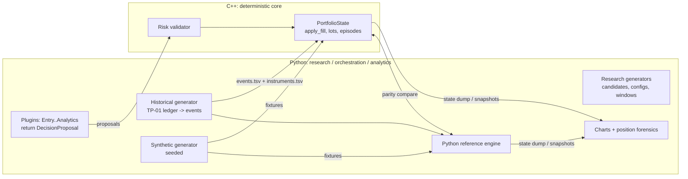
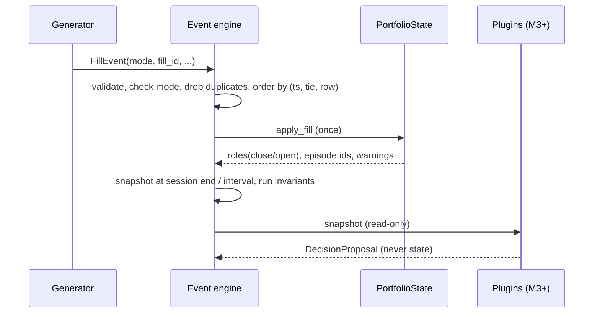

# Portfolio Construction Engine — Architecture Design (Milestone 0)

Branch `engineering/portfolio-construction-engine-skeleton`, created from the verified TP-02 head `a5feffafb5ba230f52ec8232390de3a8e10fb774`.
Status of this document: **design**. Only the parts marked *(M1)* are implemented in Milestone 1; everything else is a planned interface.

## 0. Interpretation of the brief (stated, not silently assumed)

| Word in the brief | Interpretation used here | Not assumed |
|---|---|---|
| **Plugin** | An in-process Python class implementing one of ten policy interfaces (`EntryPolicy` … `AnalyticsPolicy`), registered by name+version in a registry and swapped through configuration. It returns a `DecisionProposal`; it never mutates state. | no external/broker/vendor integration, no dynamic shared-library loader in the first milestones |
| **Generator** | A deterministic Python iterator/factory that *produces items* (events, candidate positions/baskets, configs, features, replay windows, test data), each item stamped with `source` and `execution_mode`. Three kinds: historical (reads actual data), research (builds candidates), synthetic (seeded test data). | not a code generator, not a random "alpha generator" |
| **Basket** | A *grouping of positions that the engine can act on as a unit*. Original Algo 8 basket membership is **not recoverable** from the export; every basket is either `EXPLICIT` (source evidence — none exists today) or `INFERRED` by a named grouping convention. | no original Algo 8 basket identifiers are ever invented |
| **70.8 %** | Rahul's stakeholder assessment; **not** an engineering metric and not used for acceptance. | — |

## 1. Answers to the 17 required questions

1. **Central portfolio state.** One `PortfolioState` object owned by the engine core (C++ in production, a Python reference implementation in M1): per-instrument inventory, open lots/pool, episodes, cumulative realized P&L (gross, no charges in the data), cash flow, parent-order aggregates, applied-fill set, warnings. State changes only by applying a `FillEvent`.
2. **Position.** A run of non-zero inventory in one contract and one direction (TP-01 "episode", id `contract#n`), made of one or more lots opened by one or more fills and reduced by closing fills. A position can be added to, partly closed, fully closed or reversed. *(M1: episodes. M2: the richer `Position` with basket link, ownership confidence, lifecycle history.)*
3. **Basket.** A set of position references plus lineage and provenance (§6.4). *(M2)*
4. **Assignment of positions to baskets.** By a pluggable `BasketGroupingConvention` (e.g. same underlying+expiry+session; time-cluster of opens; closing-batch grouping). Each assignment carries `membership_provenance` = `EXPLICIT | INFERRED:<convention>` and an evidence class. Several conventions can run side by side on the same fills. *(M2)*
5. **Parent order.** The broker order tag (raw column 163), the only order key (column 4 is reused across days: DAT-02). Aggregates its child fills; unfilled remainder is flagged, never invented. *(M1)*
6. **Fill.** One executed row: whole-second UTC epoch, per-fill price (raw col 137, **not** the running order average col 18), integer units, side. The only event that changes executed inventory. *(M1)*
7. **Order intent.** A policy's request to trade (`OrderIntent`), tagged `execution_mode`, `reason_code`, `evidence_class`. An intent is not a fill; the execution layer maps intents to simulated fills only in mode B. *(M3/M4)*
8. **Partial basket cut.** A `BasketCutPolicy` returns a `DecisionProposal` listing per-position `(position_id, close_qty, retain_qty)`; the risk layer validates `close_qty ≤ remaining`, basket scoping and the protection rule; accepted proposals become order intents; **only subsequent fills reduce inventory**. Inventory after a cut = inventory after the fills that actually arrived. *(M4)*
9. **Basket re-entry.** A separate `BasketReentryPolicy` evaluates a cut/closed basket (cooldown, risk gate, same/different strike, resized wings) and returns a proposal. Default policy = safe no-op. Lineage option: `NEW_ID_LINKED` (default) or `RESTORE_LINEAGE`. *(M4)*
10. **What updates state.** Exactly one path: `PortfolioState.apply_fill(fill)`. Policies, generators, risk checks and analytics are read-only against state.
11. **Plugin registration/replacement.** `PluginRegistry.register(kind, name, version, factory, schema)`; a run config names one plugin per kind; the run manifest stores the name, version and config hash. Replacement = changing config, no core edits. *(M3)*
12. **Generators.** Produce events, candidates, configurations, features, replay windows, test data (§6.6). They never write to the source ledger; every item has `source` and `execution_mode`. *(M1: historical + synthetic event generators)*
13. **Python ↔ C++.** M1: shared language-neutral files (TSV events + instruments in, TSV state dump out) and a CLI binary `pe_replay`; parity is proven by running identical files through both. Later: pybind11 only if a justified need appears (it is not installed; adding it is a dependency decision recorded in the plan).
14. **Historical replay.** A generator converts the TP-01 fill ledger to canonical events; the engine sorts by `(timestamp_s, tie_key, source_row_id)`, applies each fill once, and emits snapshots at every session end and at fixed event intervals. *(M1)*
15. **Preventing contamination.** Every event, intent, proposal, snapshot, run manifest and output directory carries `execution_mode ∈ {HISTORICAL_OBSERVED_REPLAY, RESEARCH_POLICY_SIMULATION, SYNTHETIC_TEST}`. A run has exactly one mode; the engine **rejects** any event of another mode (`ModeContaminationError`); results go to `runs/<mode>/<run_id>/`; every chart/report stamps the mode. *(M1: enforced and tested)*
16. **Position history.** Episodes keep opened/closed units, entry/exit value, open/close fill ids, fills count, end reason, remaining units; the fill list per instrument is retained so any position can be re-derived under another matching convention. *(M1: episodes; M2: lifecycle query)*
17. **Analytics/graphs.** A Python analytics layer reads engine dumps/snapshots only, exports chart data (CSV) next to each PNG and stamps source, period, units, matching convention and mode. *(M5)*

## 2. Component diagram

## 3. Event flow

## 4. Data flow (provenance)

`Trades_GKOHNP140.csv` (read-only, sha256 `86e65ab6…f528`) → TP-01 `fill_event_ledger.parquet` (read-only) → historical generator → `events.tsv` (+`instruments.tsv`) → engine (Python / C++) → `state dump` + `snapshots` → analytics. Every hop writes its input hash into the run manifest.

## 5. Python / C++ responsibility split

| Python | C++ |
|---|---|
| loading, generators, orchestration, plugin experimentation, forensics reports, charts | portfolio state, position/basket accounting, event transitions, inventory validation, core risk validation, fast replay |
| Python reference engine (same rules, used for parity and for tests) | production engine |

Both implement the identical rules (§7) and produce the identical canonical state dump (§8).

## 6. Core concepts

### 6.1 Position lifecycle
`OPENED → ADDED* → PARTIALLY_CLOSED* → CLOSED` or `→ REVERSED (closed, new episode opened in the opposite direction)` or `→ EXPIRED_UNCLOSED` (inventory remains after the contract expiry date: settlement value is **not available**, so no P&L is invented) or `→ OPEN_AT_END_OF_DATA`.

### 6.2 Basket lifecycle (M2/M4)
`CREATED → MEMBER_ADDED* → CUT_PROPOSED → CUT_PARTIAL | CUT_FULL (after fills) → REENTRY_PROPOSED → REENTRY_REJECTED | NEW_BASKET(linked) | RESTORED`. A basket is `CLOSED` only when member inventory is zero after fills.

### 6.3 Plugin lifecycle
`register → validate_config → bind (seed/config hash) → evaluate(snapshot, ...) → DecisionProposal → (risk validate) → intent → execution layer`. Plugins are pure functions of (snapshot, config, seed).

### 6.4 Basket membership provenance
Fields: `membership_provenance` (`EXPLICIT` / `INFERRED:<convention>`), `evidence_class`, `grouping_convention`, `lineage` (prior basket ids). An inferred id is namespaced `INF:<convention>:<n>` so it cannot be confused with an original Algo 8 identifier.

### 6.5 Execution modes
| Mode | Source of fills | Output directory |
|---|---|---|
| `HISTORICAL_OBSERVED_REPLAY` | recorded fills only | `runs/HISTORICAL_OBSERVED_REPLAY/<run_id>` |
| `RESEARCH_POLICY_SIMULATION` | simulated fills from policy intents | `runs/RESEARCH_POLICY_SIMULATION/<run_id>` |
| `SYNTHETIC_TEST` | generated events | `runs/SYNTHETIC_TEST/<run_id>` |

### 6.6 Generators
Historical (reads data), research (candidates for experiments), synthetic (seeded). Interface: `generate(config, seed) -> Iterator[Item]`; item carries `source`, `execution_mode`, `generator_name`, `generator_version`.

## 7. Accounting rules (identical in both languages)

* Quantities are integer **units** (never lots; lot size 65 NIFTY / 20 SENSEX is used for reporting only — verified: every export quantity is a multiple, TP-01 `config.yaml`). Tick 0.05 (100 % of fills on the grid).
* **Price representation:** integer **paise** (`round(price × 100)`, exact because all fills are on the 0.05 grid). FIFO/LIFO P&L is exact int64 (paise·units). Average-cost pools use IEEE double; parity tolerance 1e-6 paise·units, and bit-identity is reported as a bonus, not a claim.
* A fill's role depends only on the current net inventory of its own instrument: against inventory → closes `min(q, |inv|)`, remainder opens the opposite direction (a *reversal*); with inventory or flat → opens. (TP-01 `matching.py` docstring; reimplemented, not imported, and validated against TP-01 outputs.)
* Matching conventions: FIFO, LIFO, AVG. Tie orderings inside one (instrument, second): `src`, `sells_first`, `buys_first`. **Six fills have an order-dependent role; the engine reports them and never picks a "true" order.**
* Fills flagged `is_duplicate_fill` are ignored and counted. A `fill_id` is applied at most once.
* Realized P&L is gross (the export has no charge fields). Unrealized P&L requires marks; with none supplied it is reported as **unavailable** (`MISSING_MARKS`), never as zero.
* Realized and unrealized P&L, signed and gross inventory, units and lots, fill price and order-average price are separate fields and never summed into one another.

## 8. Canonical shared files

* `instruments.tsv`, `events.tsv`, `state_dump.tsv`, `roles.tsv` — see `docs/SCHEMAS.md`. TSV, not JSON Lines, because no JSON library exists in the toolchain (`nlohmann/json` and `pybind11` are absent) and a hand-written JSON parser would be an unreviewed risk; the records are flat, so TSV is lossless. Integers stay integers.

## 9. Error handling
Structural errors (missing column, non-integer quantity, price off the tick grid, unknown side, mode mismatch, duplicate `fill_id`) → `EventValidationError` with the file line; nothing is partially applied. Data-quality conditions that exist in real data (duplicates, partial fills, equal-second mixed sides, unfilled remainder, expired inventory) are **recorded as warnings in the run manifest**, not raised. An invariant violation aborts the run.

## 10. Data provenance
Run manifest: `run_id`, `execution_mode`, `config_hash`, `source_hashes` (raw CSV, ledger parquet, events file), `git_sha`, `matching`, `tie_order`, `timestamp_range`, `warnings`, `reproduce_command`. Evidence classes and claim types per behavior in `docs/EVIDENCE_REGISTRY.md`.

## 11. Test architecture
Layer 1 accounting invariants (synthetic + real); Layer 2 data-quality fixtures; Layer 3 mode isolation; Layer 4 cross-language parity on shared fixtures (synthetic, then all 41,421 real fills × 3 conventions × 3 tie orders); Layer 5 reconciliation to TP-01 (totals, 8,001 episodes, per-fill roles). Parity means **identical dumps**, not "both compile".

## 12. Evidence handling
Each implemented Algo 8 behavior needs a registry row (source report, finding id if one exists, source field, evidence class, claim type, limitation, implementation mode). M1 implements **accounting only**; it implements no entry/exit/basket behavior, so no TRIGGER claim is made anywhere.
