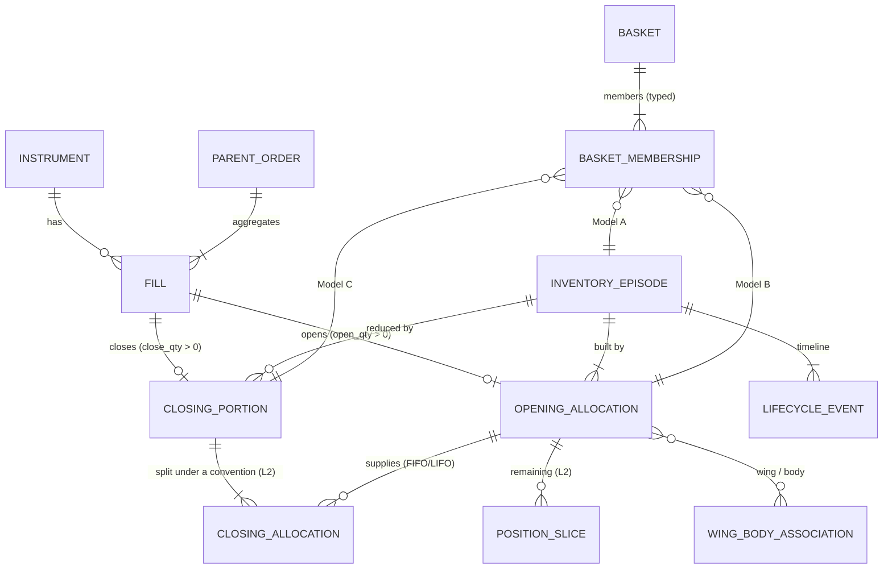

# Position and basket ontology (M2-A, DRAFT for review)

**Governing principle: observed inventory is a fact; historical ownership and original basket membership may be uncertain. Never confuse the two.**
Everything below is a *design*; nothing here is implemented yet. Counts quoted are ground truth already reproduced by M1/TP-01 (targets for M2-B), not M2 results.

## 1. Two layers

| Layer | Contains | Depends on matching convention? | Truth status |
|---|---|---|---|
| **L1 — observed / convention-independent** | Instrument, FillEvent, ParentOrder, InventoryEpisode, OpeningAllocation, ClosingPortion, lifecycle events, per-episode inventory | **No** (verified: open/close quantity of every fill is identical under FIFO, LIFO, AVG) | CONFIRMED_OBSERVATION (accounting identity over recorded fills) |
| **L2 — analytical** | ClosingAllocation (which opening source a closing portion consumed), PositionSlice, cost pool, realized P&L split, Baskets (3 models), WingBodyAssociation | **Yes** (ownership) or **inferred** (grouping) | UNRESOLVED / WEAKLY_SUPPORTED at best; always labelled |

L2 can differ between conventions; L1 never does. An L2 object may never change an L1 identifier or quantity.

## 2. Entities

| # | Entity | Definition | Stable identifier | Layer |
|---|---|---|---|---|
| A | **FillEvent** | one executed record (M1 schema) | `fill_id` (`F` + raw row) | L1 |
| B | **ParentOrder** | one order tag (raw col 163) with ≥ 1 fills; role derived from its fills: `OPENING_ONLY` 23,057, `CLOSING_ONLY` 16,791, `MIXED` 26 (23 reversals + 3 others) — counts from the TP-01 ledger | `parent_order_id` | L1 |
| C | **OpeningAllocation (OA)** | the *opening portion* of one fill: `open_qty` of the role rule. A reversal fill yields an OA for its excess only. Target count **23,684** (23,661 open-only fills + 23 reversal fills) | `OA:<fill_id>` | L1 |
| — | **ClosingPortion (CP)** *(added by this design)* | the *closing portion* of one fill (`close_qty`, against one episode). Target count **17,760** (= TP-02 `exit_event_timelines` rows). Needed because the closing quantity is convention-independent while its allocation is not | `CP:<fill_id>` | L1 |
| E | **InventoryEpisode** | continuous directional net inventory in one instrument (TP-01 definition, authoritative); ends flat or by reversal. 2,667 per convention (2,563 flat, 23 reversal, 81 open/expired) | `<instrument_id>#<n>` (TP-01) | L1 |
| — | **PositionLifecycleEvent** | one transition of an episode: `CREATED`, `ADDED`, `PARTIALLY_REDUCED`, `CLOSED`, `REVERSED`; terminal status `OPEN_AT_END_OF_DATA`, `EXPIRED_UNCLOSED`, `INCOMPLETE_SOURCE_HISTORY` | `LE:<episode_id>:<seq>` | L1 |
| D | **PositionSlice** | remaining inventory attributed to **one OA** after an event, under a declared convention: `kind = LOT` for FIFO/LIFO; for AVG a single `kind = POOL` slice per episode (`quantity`, `avg_cost`, `contributing_oa_ids` as provenance, **not ownership**) | `SL:<conv>:<oa_id>` / `SL:AVG:<episode_id>` | L2 |
| — | **ClosingAllocation (CA)** | one link `CP → OA` under FIFO/LIFO with `allocated_qty`, `realized_pnl`; under AVG one row `CP → POOL` with `pool_avg_cost`, `ownership = NOT_IDENTIFIABLE` | `CA:<conv>:<fill_id>:<n>` | L2 |
| F | **Basket** | an analytical grouping inside one *view* (grouping convention); members are typed (episode, OA or CP) | `INF:<KIND>@<convention>:...` (§5) | L2 |
| — | **BasketMembership** | one row `(basket_id, member_type, member_id, quantity, provenance, evidence_class)` | composite | L2 |
| — | **BasketGroupingConvention** | the registered definition of a view: name, member type, parameters, parameter hash, status (`REGISTERED` / `PROPOSED` / `APPROVED`) | `OC_WINDOW_INCL`, `CB_GAP_10S`, … | L2 |
| G | **ClosureBatch** | a Basket of kind `CLOSING_BATCH`: closing parent orders grouped by the registered gap rule. **Not** an opening basket | `INF:CLOSING_BATCH@...` | L2 |
| H | **CyclePortfolio** | a Basket of kind `CYCLE`: all episodes of one (underlying, expiry), D-1 and D0 together | `INF:CYCLE@...` | L2 |
| — | **WingBodyAssociation** | a scored candidate link between a long-wing item and a short-body item, per method; keeps alternatives and unmatched quantity | `WB:<method>:<wing_id>:<body_id>` | L2 |
| — | **PositionView** | a *read model* (query result) assembling one episode's L1 timeline plus its L2 allocations and group memberships; never stored as state | — | read model |

### Relationship diagram

## 3. Identity rules
1. IDs are derived from **source identifiers only** (`fill_id`, `instrument_id`, episode counter) — never from presentation order, FIFO/LIFO/AVG choice, sort position or run order.
2. `OA:<fill_id>` and `CP:<fill_id>` are convention-independent: one fill has at most one OA and at most one CP; both exist only for a reversal fill.
3. Episode numbering `#n` follows TP-01 (count of episodes so far in that instrument). It is invariant across FIFO/LIFO/AVG (verified). It is **conditional on the tie-order convention**: under `sells_first` / `buys_first` the 6 ambiguous fills may renumber episodes. This is a documented, tested property, not hidden.
4. A convention-dependent object (CA, SL, any Basket) carries the convention in its id/column, so two conventions can never collide.
5. Inferred IDs are namespaced `INF:` and can never be mistaken for a broker identifier. No `EXPLICIT` membership exists in the source data; a test asserts zero `EXPLICIT` rows in historical mode.

## 4. Ownership and matching semantics
* **Inventory** (L1) is exact: `Σ OA − Σ CP = remaining signed inventory` per instrument; per episode `opened − closed = remaining`.
* **FIFO / LIFO** supply an *analytical* answer to "which opening allocation did this closing portion consume". It is a convention, not a recorded fact. Where FIFO and LIFO disagree, the attribution is **convention-sensitive** and is reported as such.
* **AVG** has one cost pool per episode; a closing portion takes the pool average. **No individual ownership is claimed.**
* **Reversal**: a fill against inventory closes `min(q, |inv|)`; the excess opens a new episode (`started_by_reversal`). Example: 100 short + buy 130 → CP of 100 (episode ends `reversal`), OA of 30 (new long episode).
* **Expiry**: remaining units in an expired contract end the episode as `EXPIRED_UNCLOSED`; **no settlement P&L** is created (37,480 units, 81 episodes).

## 5. Provenance model
Every L2 row carries `provenance`, `grouping_convention`, `parameter_hash`, `evidence_class`, `claim_type`, `source_lineage` (list of fill / parent ids).

| `membership_provenance` | Used for | Ceiling evidence class |
|---|---|---|
| `EXPLICIT` | recorded basket / leg identifiers | none exist in the export → never produced |
| `INFERRED:CYCLE` | Model A | membership CONFIRMED_OBSERVATION (it is part of the contract identity); "the cycle is one portfolio" UNRESOLVED |
| `INFERRED:OPENING_COHORT` | Model B | membership of module/time/parent is CONFIRMED_ATTRIBUTION; "cohort = one decision" UNRESOLVED |
| `INFERRED:CLOSING_BATCH` | Model C | temporal clustering CONFIRMED_OBSERVATION; "batch = one decision / one basket" UNRESOLVED |
| `INFERRED:WING_BODY:<method>` | wing/body links | WEAKLY_SUPPORTED (window-level 1:1 is STRONGLY_SUPPORTED in TP-03 E7; a link between two specific lots is UNRESOLVED) |

ID format (convention token added so ids are unique across views — **needs reviewer approval**):
`INF:CYCLE@CY_UND_EXPIRY:NIFTY:2026-10-22:001` · `INF:OPENING_COHORT@OC_WIN_INCL:NIFTY:2026-10-22:SESSION_D1:001` · `INF:CLOSING_BATCH@CB_GAP_10S:SENSEX:2026-10-15:001`.

## 6. The three kinds of question the model must keep apart
| Question | Object | Never concluded from |
|---|---|---|
| What inventory existed? | episode, OA, CP (L1) | any grouping |
| Which opening supplied a closing? | CA / SL (L2, convention) | AVG |
| Which positions were built together? | Model B cohort | a closing batch |
| Which positions were closed together? | Model C batch | an opening cohort |
| Which wing protects which body? | WingBodyAssociation | window-level 1:1 quantity finding |
