# M2-E — Position case studies

**Purpose:** make single positions inspectable. **Not** an explanation of why Algo 8 acted: no rationale is offered or inferred.

## 1. Selection method (fixed before any case was looked at)

Candidates are scanned **chronologically** (first fill time, then id) and the **first qualifying candidate whose episode was not already used by an earlier case type** is taken (reuse only if every qualifying candidate was used; any skipped chronologically-first candidate is named in the case note). Profit, loss, price and every outcome are never consulted. A case type with no qualifying candidate in a cycle is **UNAVAILABLE** for that cycle (never borrowed from the other cycle). Rules (`pe/cases.py`, `RULES`):

| Case type | Rule |
|---|---|
| CT1_INCREMENTAL_OPENING | first episode (by first fill time) with >= 3 ADDED lifecycle events |
| CT2_PARTIAL_REDUCTION | first episode with >= 2 PARTIALLY_REDUCED events and terminal status CLOSED |
| CT3_FULL_CLOSURE | first episode whose only closing event is a single CLOSED event (no PARTIALLY_REDUCED, no REVERSED) |
| CT4_REMAINING_AT_EXPIRY | first episode whose M2-B terminal status is neither CLOSED nor REVERSED (expired unclosed) |
| CT5_REVERSAL | first episode ended by a REVERSED event (extra case type: reversal timeline) |
| CT6_MULTIPLE_CANDIDATE_WINGS | first opening BODY item (W1) with >= 2 candidate wing items |
| CT6b_WING_WITH_MULTIPLE_CANDIDATE_BODIES | first opening WING item (W1) with >= 2 candidate body items (extra) |
| CT7_NO_CANDIDATE_WING | first opening BODY item (W1) with 0 candidate wing items |
| CT8_W1_VS_W1S60_DISAGREEMENT | first opening BODY item whose W1 candidate-wing set differs from its W1_S60 candidate-wing set |
| CT9_MULTI_PARENT_CLOSING_BATCH | first C1 10 s closing batch (by start time) with >= 2 parent orders; the case episode is the episode of its first member portion |

## 2. Availability by cycle

| Case type | NIFTY_2026-06-30 | SENSEX_2026-07-16 |
|---|---|---|
| CT1_INCREMENTAL_OPENING | `NIFTY\|2026-06-30\|CE\|24100#1` | `SENSEX\|2026-07-16\|PE\|77400#1` |
| CT2_PARTIAL_REDUCTION | `NIFTY\|2026-06-30\|PE\|22100#1` | `SENSEX\|2026-07-16\|CE\|81200#1` |
| CT3_FULL_CLOSURE | `NIFTY\|2026-06-30\|CE\|26100#1` | `SENSEX\|2026-07-16\|CE\|79500#1` |
| CT4_REMAINING_AT_EXPIRY | **UNAVAILABLE** | **UNAVAILABLE** |
| CT5_REVERSAL | `NIFTY\|2026-06-30\|CE\|24100#1` (reused) | **UNAVAILABLE** |
| CT6_MULTIPLE_CANDIDATE_WINGS | `NIFTY\|2026-06-30\|CE\|24050#1` | `SENSEX\|2026-07-16\|CE\|77500#1` |
| CT6b_WING_WITH_MULTIPLE_CANDIDATE_BODIES | `NIFTY\|2026-06-30\|PE\|23200#1` | `SENSEX\|2026-07-16\|PE\|74900#1` |
| CT7_NO_CANDIDATE_WING | `NIFTY\|2026-06-30\|PE\|24100#1` (earlier-chronological candidate skipped; see case note) | `SENSEX\|2026-07-16\|CE\|77200#1` |
| CT8_W1_VS_W1S60_DISAGREEMENT | `NIFTY\|2026-06-30\|CE\|24000#1` | `SENSEX\|2026-07-16\|CE\|77600#1` |
| CT9_MULTI_PARENT_CLOSING_BATCH | `NIFTY\|2026-06-30\|PE\|24050#1` (earlier-chronological candidate skipped; see case note) | `SENSEX\|2026-07-16\|CE\|77400#1` (earlier-chronological candidate skipped; see case note) |

UNAVAILABLE items are reported, not substituted. Neither frozen cycle has a position that expired unclosed; SENSEX has no reversal.

Every case below links to a single-episode V2 chart (`m2e_figures/<cycle>/cases/<case>.png` + its CSV). Full records (all fills, all candidates, all batch rows): `m2e_data/<cycle>/case_studies.json`.

## 3. NIFTY 2026-06-30

### CT1_INCREMENTAL_OPENING — NIFTY|2026-06-30|CE|24100#1

* **Selection rule (predefined, outcome-free; chronological first qualifying candidate whose episode was not already used by an earlier case type):** first episode (by first fill time) with >= 3 ADDED lifecycle events
* **Instrument:** NIFTY|2026-06-30|CE|24100 (SHORT); **lifecycle events:** ADDED 10, CREATED 1, PARTIALLY_REDUCED 4, REVERSED 1; started by reversal: False; ended by: reversal
* **Quantity:** opened 715 · closed 715 · remaining 0 · terminal status **REVERSED**
* **First → last event (IST):** 2026-06-29 09:16:01 (CREATED, inventory -65) → 2026-06-30 14:18:25 (REVERSED, inventory +0)
* **Fill IDs (16):** F004753, F004755, F004759, F004787, F004791, F004795, F004799, F004818, F004827, F004831, F004835, F004853, F005079, F005092, F005680, F005681
* **Opening parents (11):** 10758104, 10758174, 10758362, 10759275, 10759367, 10759458, 10759539, 10760306, 10760387, 10760479, 10760910
* **Closing parents (4):** 10760055, 10772433, 10773504, h_30084825701151
* **Convention:** identical under FIFO, LIFO, AVG; 5 closing portions, 5 attribute to different opening lots under FIFO vs LIFO; AVG pooled; lot attribution NOT_IDENTIFIABLE
* **Related reversal episode:** `NIFTY|2026-06-30|CE|24100#2` (LONG, opened 390 · closed 390 · remaining 0; started by reversal: True; ended by: flat). The reversing fill is split between the two episodes; its opening portion belongs to the successor.
* **Closing batch C1 (10 s):** 4 closing parents fall in 4 batch(es); batch sizes (parents) [1, 2, 15], durations (s) [0, 17]; first: `CB_FIRST_FILL_GAP_10S:NIFTY:2026-06-30:2026-06-29:003`
* **Closing batch C2 (10 s):** 4 closing parents fall in 4 batch(es); batch sizes (parents) [1, 2, 15], durations (s) [0, 17]; first: `CB_LAST_TO_FIRST_GAP_10S:NIFTY:2026-06-30:2026-06-29:003`
* **Wing/body (opening items of this position):** 11 in M2-D tagged scope (items with an opening allocation in this episode), 0 outside it (module tag unclassified: not a claim of no wing). W1 candidates: none for 3, one for 6, several for 2; W1_S60: none 3, one 3, several 5
* **Evidence class:** lifecycle CONFIRMED_OBSERVATION · batch = temporal clustering only (decision UNRESOLVED) · W1 WEAKLY_SUPPORTED · W1_S60 UNRESOLVED · W3 UNRESOLVED · lot ownership / protective intent UNRESOLVED
* **Missing information:** historical market marks (source absent): no mark-to-market, unrealized P&L = NA; execution prices only; TP-03 per-parent window id (not published); the decision/rationale for any order (never observable from fills)
* **Can conclude:** the fills, parents, times and quantities listed, and the lifecycle they imply; the position ended REVERSED with remaining 0 (observed); which closing parents are time-connected within 10 s (C1/C2), as a temporal fact
* **Cannot conclude:** why any order was placed or closed; that a candidate wing/body is the protective counterpart of this position; which opening lot a closing portion consumed (convention-dependent); that a position lacked a wing merely because it is outside the role-specific analysis

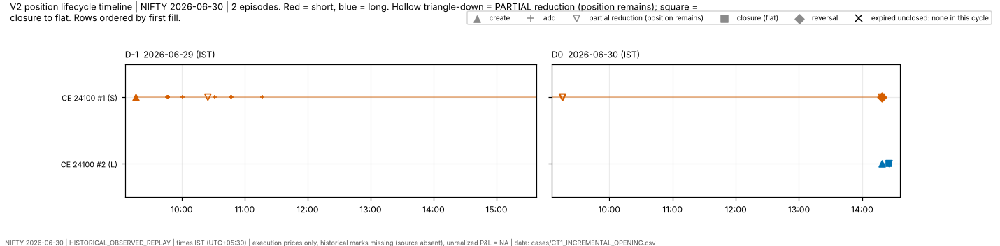

### CT2_PARTIAL_REDUCTION — NIFTY|2026-06-30|PE|22100#1

* **Selection rule (predefined, outcome-free; chronological first qualifying candidate whose episode was not already used by an earlier case type):** first episode with >= 2 PARTIALLY_REDUCED events and terminal status CLOSED
* **Instrument:** NIFTY|2026-06-30|PE|22100 (LONG); **lifecycle events:** ADDED 2, CLOSED 1, CREATED 1, PARTIALLY_REDUCED 2; started by reversal: False; ended by: flat
* **Quantity:** opened 195 · closed 195 · remaining 0 · terminal status **CLOSED**
* **First → last event (IST):** 2026-06-29 09:16:00 (CREATED, inventory +65) → 2026-06-29 12:18:00 (CLOSED, inventory +0)
* **Fill IDs (6):** F004750, F004752, F004758, F004782, F004926, F004942
* **Opening parents (3):** 10757955, 10758031, 10758317
* **Closing parents (3):** 10758960, 10763004, 10763411
* **Convention:** identical under FIFO, LIFO, AVG; 3 closing portions, 2 attribute to different opening lots under FIFO vs LIFO; AVG pooled; lot attribution NOT_IDENTIFIABLE
* **Closing batch C1 (10 s):** 3 closing parents fall in 3 batch(es); batch sizes (parents) [2, 5, 11], durations (s) [0, 5, 6]; first: `CB_FIRST_FILL_GAP_10S:NIFTY:2026-06-30:2026-06-29:001`
* **Closing batch C2 (10 s):** 3 closing parents fall in 3 batch(es); batch sizes (parents) [2, 5, 11], durations (s) [0, 5, 6]; first: `CB_LAST_TO_FIRST_GAP_10S:NIFTY:2026-06-30:2026-06-29:001`
* **Wing/body (opening items of this position):** 0 in M2-D tagged scope (items with an opening allocation in this episode), 3 outside it (module tag unclassified: not a claim of no wing). W1 candidates: none for 0, one for 0, several for 0; W1_S60: none 0, one 0, several 0
* **Evidence class:** lifecycle CONFIRMED_OBSERVATION · batch = temporal clustering only (decision UNRESOLVED) · W1 WEAKLY_SUPPORTED · W1_S60 UNRESOLVED · W3 UNRESOLVED · lot ownership / protective intent UNRESOLVED
* **Missing information:** historical market marks (source absent): no mark-to-market, unrealized P&L = NA; execution prices only; TP-03 per-parent window id (not published); the decision/rationale for any order (never observable from fills)
* **Can conclude:** the fills, parents, times and quantities listed, and the lifecycle they imply; the position ended CLOSED with remaining 0 (observed); which closing parents are time-connected within 10 s (C1/C2), as a temporal fact
* **Cannot conclude:** why any order was placed or closed; that a candidate wing/body is the protective counterpart of this position; which opening lot a closing portion consumed (convention-dependent); that a position lacked a wing merely because it is outside the role-specific analysis

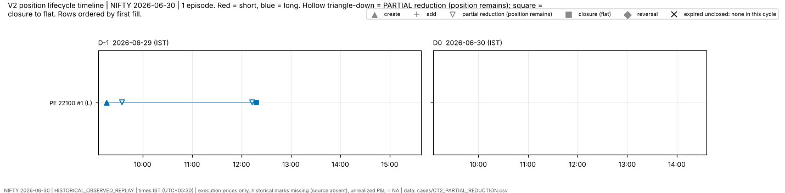

### CT3_FULL_CLOSURE — NIFTY|2026-06-30|CE|26100#1

* **Selection rule (predefined, outcome-free; chronological first qualifying candidate whose episode was not already used by an earlier case type):** first episode whose only closing event is a single CLOSED event (no PARTIALLY_REDUCED, no REVERSED)
* **Instrument:** NIFTY|2026-06-30|CE|26100 (LONG); **lifecycle events:** CLOSED 1, CREATED 1; started by reversal: False; ended by: flat
* **Quantity:** opened 65 · closed 65 · remaining 0 · terminal status **CLOSED**
* **First → last event (IST):** 2026-06-29 09:16:00 (CREATED, inventory +65) → 2026-06-29 15:03:09 (CLOSED, inventory +0)
* **Fill IDs (2):** F004749, F005062
* **Opening parents (1):** 10757908
* **Closing parents (1):** 10767071
* **Convention:** identical under FIFO, LIFO, AVG; 1 closing portions, 0 attribute to different opening lots under FIFO vs LIFO; AVG pooled; lot attribution NOT_IDENTIFIABLE
* **Closing batch C1 (10 s):** 1 closing parents fall in 1 batch(es); batch sizes (parents) [1], durations (s) [0]; first: `CB_FIRST_FILL_GAP_10S:NIFTY:2026-06-30:2026-06-29:016`
* **Closing batch C2 (10 s):** 1 closing parents fall in 1 batch(es); batch sizes (parents) [1], durations (s) [0]; first: `CB_LAST_TO_FIRST_GAP_10S:NIFTY:2026-06-30:2026-06-29:016`
* **Wing/body (opening items of this position):** 0 in M2-D tagged scope (items with an opening allocation in this episode), 1 outside it (module tag unclassified: not a claim of no wing). W1 candidates: none for 0, one for 0, several for 0; W1_S60: none 0, one 0, several 0
* **Evidence class:** lifecycle CONFIRMED_OBSERVATION · batch = temporal clustering only (decision UNRESOLVED) · W1 WEAKLY_SUPPORTED · W1_S60 UNRESOLVED · W3 UNRESOLVED · lot ownership / protective intent UNRESOLVED
* **Missing information:** historical market marks (source absent): no mark-to-market, unrealized P&L = NA; execution prices only; TP-03 per-parent window id (not published); the decision/rationale for any order (never observable from fills)
* **Can conclude:** the fills, parents, times and quantities listed, and the lifecycle they imply; the position ended CLOSED with remaining 0 (observed); which closing parents are time-connected within 10 s (C1/C2), as a temporal fact
* **Cannot conclude:** why any order was placed or closed; that a candidate wing/body is the protective counterpart of this position; which opening lot a closing portion consumed (convention-dependent); that a position lacked a wing merely because it is outside the role-specific analysis

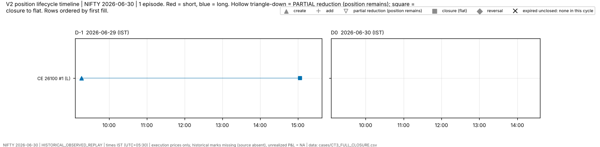

### CT4_REMAINING_AT_EXPIRY — **UNAVAILABLE**

* Rule: first episode whose M2-B terminal status is neither CLOSED nor REVERSED (expired unclosed)
* Reason: no qualifying candidate in this cycle (not borrowed from another cycle)

### CT5_REVERSAL — NIFTY|2026-06-30|CE|24100#1

* **Selection rule (predefined, outcome-free; chronological first qualifying candidate whose episode was not already used by an earlier case type):** first episode ended by a REVERSED event (extra case type: reversal timeline) — *reuses the episode of CT1_INCREMENTAL_OPENING (no unused qualifying episode)*
* **Instrument:** NIFTY|2026-06-30|CE|24100 (SHORT); **lifecycle events:** ADDED 10, CREATED 1, PARTIALLY_REDUCED 4, REVERSED 1; started by reversal: False; ended by: reversal
* **Quantity:** opened 715 · closed 715 · remaining 0 · terminal status **REVERSED**
* **First → last event (IST):** 2026-06-29 09:16:01 (CREATED, inventory -65) → 2026-06-30 14:18:25 (REVERSED, inventory +0)
* **Fill IDs (16):** F004753, F004755, F004759, F004787, F004791, F004795, F004799, F004818, F004827, F004831, F004835, F004853, F005079, F005092, F005680, F005681
* **Opening parents (11):** 10758104, 10758174, 10758362, 10759275, 10759367, 10759458, 10759539, 10760306, 10760387, 10760479, 10760910
* **Closing parents (4):** 10760055, 10772433, 10773504, h_30084825701151
* **Convention:** identical under FIFO, LIFO, AVG; 5 closing portions, 5 attribute to different opening lots under FIFO vs LIFO; AVG pooled; lot attribution NOT_IDENTIFIABLE
* **Related reversal episode:** `NIFTY|2026-06-30|CE|24100#2` (LONG, opened 390 · closed 390 · remaining 0; started by reversal: True; ended by: flat). The reversing fill is split between the two episodes; its opening portion belongs to the successor.
* **Closing batch C1 (10 s):** 4 closing parents fall in 4 batch(es); batch sizes (parents) [1, 2, 15], durations (s) [0, 17]; first: `CB_FIRST_FILL_GAP_10S:NIFTY:2026-06-30:2026-06-29:003`
* **Closing batch C2 (10 s):** 4 closing parents fall in 4 batch(es); batch sizes (parents) [1, 2, 15], durations (s) [0, 17]; first: `CB_LAST_TO_FIRST_GAP_10S:NIFTY:2026-06-30:2026-06-29:003`
* **Wing/body (opening items of this position):** 11 in M2-D tagged scope (items with an opening allocation in this episode), 0 outside it (module tag unclassified: not a claim of no wing). W1 candidates: none for 3, one for 6, several for 2; W1_S60: none 3, one 3, several 5
* **Evidence class:** lifecycle CONFIRMED_OBSERVATION · batch = temporal clustering only (decision UNRESOLVED) · W1 WEAKLY_SUPPORTED · W1_S60 UNRESOLVED · W3 UNRESOLVED · lot ownership / protective intent UNRESOLVED
* **Missing information:** historical market marks (source absent): no mark-to-market, unrealized P&L = NA; execution prices only; TP-03 per-parent window id (not published); the decision/rationale for any order (never observable from fills)
* **Can conclude:** the fills, parents, times and quantities listed, and the lifecycle they imply; the position ended REVERSED with remaining 0 (observed); which closing parents are time-connected within 10 s (C1/C2), as a temporal fact
* **Cannot conclude:** why any order was placed or closed; that a candidate wing/body is the protective counterpart of this position; which opening lot a closing portion consumed (convention-dependent); that a position lacked a wing merely because it is outside the role-specific analysis

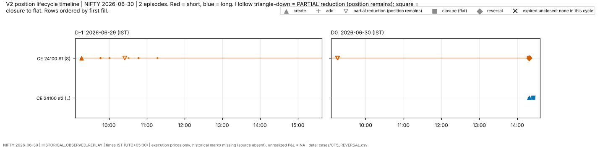

### CT6_MULTIPLE_CANDIDATE_WINGS — NIFTY|2026-06-30|CE|24050#1

* **Selection rule (predefined, outcome-free; chronological first qualifying candidate whose episode was not already used by an earlier case type):** first opening BODY item (W1) with >= 2 candidate wing items
* **Instrument:** NIFTY|2026-06-30|CE|24050 (SHORT); **lifecycle events:** ADDED 18, CLOSED 1, CREATED 1, PARTIALLY_REDUCED 14; started by reversal: False; ended by: flat
* **Quantity:** opened 1,235 · closed 1,235 · remaining 0 · terminal status **CLOSED**
* **First → last event (IST):** 2026-06-29 09:24:21 (CREATED, inventory -65) → 2026-06-30 14:25:17 (CLOSED, inventory +0)
* **Fill IDs (34):** F004761, F004767, F004768, F004777, F004803, F004805, F004807, F004812, F004823, F004841, F004845, F004849, F004857, F004868, F004872, F004880, F004884, F004888, F004921, F004992, F004993, F005004, F005051, F005057, F005085, F005091, F005100, F005101, F005322, F005382, F005401, F005776, F005783, F005788
* **Opening parents (19):** 10758447, 10758587, 10758621, 10758868, 10759648, 10759732, 10759791, 10759928, 10760631, 10760709, 10760814, 10760994 … (+7)
* **Closing parents (13):** 10760275, 10761489, 10762915, 10764997, 10765015, 10772437, 10772533, 10776112, 10776156, 10786343, 10788317, 10788345 … (+1)
* **Convention:** identical under FIFO, LIFO, AVG; 15 closing portions, 15 attribute to different opening lots under FIFO vs LIFO; AVG pooled; lot attribution NOT_IDENTIFIABLE
* **Closing batch C1 (10 s):** 13 closing parents fall in 10 batch(es); batch sizes (parents) [3, 4, 6, 8, 10, 11, 15, 18, 92], durations (s) [3, 4, 5, 6, 7, 8, 14, 17, 53]; first: `CB_FIRST_FILL_GAP_10S:NIFTY:2026-06-30:2026-06-29:004`
* **Closing batch C2 (10 s):** 13 closing parents fall in 10 batch(es); batch sizes (parents) [3, 4, 6, 8, 10, 11, 15, 18, 92], durations (s) [3, 4, 5, 6, 7, 8, 14, 17, 53]; first: `CB_LAST_TO_FIRST_GAP_10S:NIFTY:2026-06-30:2026-06-29:004`
* **Wing/body (opening items of this position):** 19 in M2-D tagged scope (items with an opening allocation in this episode), 0 outside it (module tag unclassified: not a claim of no wing). W1 candidates: none for 2, one for 8, several for 9; W1_S60: none 0, one 5, several 14
* **Anchor item:** `10758587 CE24050` (BODY, 65 units, tag role BODY_SHORT_BY_TAG)
  * W1 candidates: 2 — h_29040104435735 CE24650 (dt +4s, qty ratio 2.00); h_29040156004143 CE24650 (dt +56s, qty ratio 1.00) — *WEAKLY_SUPPORTED (inferred candidate)*
  * W1_S60 candidates: 2 — h_29040104435735 CE24650 (dt +4s, qty ratio 2.00); h_29040156004143 CE24650 (dt +56s, qty ratio 1.00) — *UNRESOLVED (execution proximity only)*
  * W2 weighted units (weights, not allocations): h_29040104435735 CE24650 43.33, h_29040156004143 CE24650 21.67; W3 queue-matched units (queue arithmetic, not ownership): h_29040227042126 CE24700 65
* **Evidence class:** lifecycle CONFIRMED_OBSERVATION · batch = temporal clustering only (decision UNRESOLVED) · W1 WEAKLY_SUPPORTED · W1_S60 UNRESOLVED · W3 UNRESOLVED · lot ownership / protective intent UNRESOLVED
* **Missing information:** historical market marks (source absent): no mark-to-market, unrealized P&L = NA; execution prices only; TP-03 per-parent window id (not published); the decision/rationale for any order (never observable from fills)
* **Can conclude:** the fills, parents, times and quantities listed, and the lifecycle they imply; the position ended CLOSED with remaining 0 (observed); which closing parents are time-connected within 10 s (C1/C2), as a temporal fact
* **Cannot conclude:** why any order was placed or closed; that a candidate wing/body is the protective counterpart of this position; which opening lot a closing portion consumed (convention-dependent); that a position lacked a wing merely because it is outside the role-specific analysis

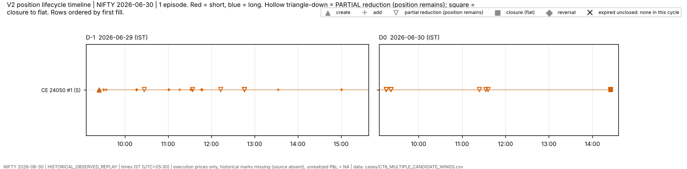

### CT6b_WING_WITH_MULTIPLE_CANDIDATE_BODIES — NIFTY|2026-06-30|PE|23200#1

* **Selection rule (predefined, outcome-free; chronological first qualifying candidate whose episode was not already used by an earlier case type):** first opening WING item (W1) with >= 2 candidate body items (extra)
* **Instrument:** NIFTY|2026-06-30|PE|23200 (LONG); **lifecycle events:** ADDED 7, CLOSED 1, CREATED 1, PARTIALLY_REDUCED 4; started by reversal: False; ended by: flat
* **Quantity:** opened 715 · closed 715 · remaining 0 · terminal status **CLOSED**
* **First → last event (IST):** 2026-06-29 09:31:04 (CREATED, inventory +130) → 2026-06-29 12:20:06 (CLOSED, inventory +0)
* **Fill IDs (13):** F004772, F004790, F004793, F004797, F004801, F004809, F004814, F004837, F004931, F004940, F004945, F004955, F004956
* **Opening parents (8):** h_29040104435632, h_29041603704445, h_29041634842084, h_29041710373191, h_29043113457644, h_29044605279217, h_29044700950299, h_29051735131026
* **Closing parents (4):** h_29064306595118, h_29064703133390, h_29064805524506, h_29065006770493
* **Convention:** identical under FIFO, LIFO, AVG; 5 closing portions, 5 attribute to different opening lots under FIFO vs LIFO; AVG pooled; lot attribution NOT_IDENTIFIABLE
* **Closing batch C1 (10 s):** 4 closing parents fall in 4 batch(es); batch sizes (parents) [3, 5, 6, 11], durations (s) [3, 5, 6]; first: `CB_FIRST_FILL_GAP_10S:NIFTY:2026-06-30:2026-06-29:008`
* **Closing batch C2 (10 s):** 4 closing parents fall in 4 batch(es); batch sizes (parents) [3, 5, 6, 11], durations (s) [3, 5, 6]; first: `CB_LAST_TO_FIRST_GAP_10S:NIFTY:2026-06-30:2026-06-29:008`
* **Wing/body (opening items of this position):** 8 in M2-D tagged scope (items with an opening allocation in this episode), 0 outside it (module tag unclassified: not a claim of no wing). W1 candidates: none for 1, one for 3, several for 4; W1_S60: none 0, one 2, several 6
* **Anchor item:** `h_29040104435632 PE23200` (WING, 130 units, tag role WING_LONG_BY_TAG)
  * W1 candidates: 2 — 10758654 PE24050 (dt +4s, qty ratio 2.00); 10758699 PE24050 (dt +4s, qty ratio 2.00) — *WEAKLY_SUPPORTED (inferred candidate)*
  * W1_S60 candidates: 2 — 10758654 PE24050 (dt +4s, qty ratio 2.00); 10758699 PE24050 (dt +4s, qty ratio 2.00) — *UNRESOLVED (execution proximity only)*
  * W2 weighted units (weights, not allocations): 10758654 PE24050 65.00, 10758699 PE24050 65.00; W3 queue-matched units (queue arithmetic, not ownership): 10758144 PE24100 65, 10758187 PE24100 65
* **Evidence class:** lifecycle CONFIRMED_OBSERVATION · batch = temporal clustering only (decision UNRESOLVED) · W1 WEAKLY_SUPPORTED · W1_S60 UNRESOLVED · W3 UNRESOLVED · lot ownership / protective intent UNRESOLVED
* **Missing information:** historical market marks (source absent): no mark-to-market, unrealized P&L = NA; execution prices only; TP-03 per-parent window id (not published); the decision/rationale for any order (never observable from fills)
* **Can conclude:** the fills, parents, times and quantities listed, and the lifecycle they imply; the position ended CLOSED with remaining 0 (observed); which closing parents are time-connected within 10 s (C1/C2), as a temporal fact
* **Cannot conclude:** why any order was placed or closed; that a candidate wing/body is the protective counterpart of this position; which opening lot a closing portion consumed (convention-dependent); that a position lacked a wing merely because it is outside the role-specific analysis

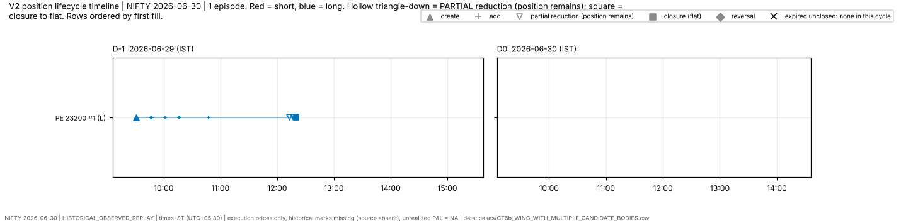

### CT7_NO_CANDIDATE_WING — NIFTY|2026-06-30|PE|24100#1

* **Selection rule (predefined, outcome-free; chronological first qualifying candidate whose episode was not already used by an earlier case type):** first opening BODY item (W1) with 0 candidate wing items — *chronologically first qualifying candidate (WBI:OPENING:BODY:10758104:NIFTY|2026-06-30|CE|24100) skipped: its episode was already used by CT1_INCREMENTAL_OPENING*
* **Instrument:** NIFTY|2026-06-30|PE|24100 (SHORT); **lifecycle events:** ADDED 12, CLOSED 1, CREATED 1, PARTIALLY_REDUCED 12; started by reversal: False; ended by: flat
* **Quantity:** opened 845 · closed 845 · remaining 0 · terminal status **CLOSED**
* **First → last event (IST):** 2026-06-29 09:16:01 (CREATED, inventory -65) → 2026-06-29 12:20:00 (CLOSED, inventory +0)
* **Fill IDs (26):** F004754, F004756, F004760, F004781, F004788, F004792, F004796, F004800, F004816, F004821, F004828, F004832, F004836, F004854, F004871, F004873, F004875, F004894, F004904, F004920, F004923, F004924, F004941, F004943, F004944, F004950
* **Opening parents (13):** 10758144, 10758187, 10758397, 10759322, 10759410, 10759502, 10759574, 10759999, 10760115, 10760353, 10760423, 10760525 … (+1)
* **Closing parents (13):** 10758952, 10761492, 10761498, 10761503, 10761947, 10762317, 10762890, 10762921, 10762955, 10763397, 10763447, 10763529 … (+1)
* **Convention:** identical under FIFO, LIFO, AVG; 13 closing portions, 13 attribute to different opening lots under FIFO vs LIFO; AVG pooled; lot attribution NOT_IDENTIFIABLE
* **Closing batch C1 (10 s):** 13 closing parents fall in 7 batch(es); batch sizes (parents) [2, 5, 6, 10, 11], durations (s) [0, 3, 5, 6, 7]; first: `CB_FIRST_FILL_GAP_10S:NIFTY:2026-06-30:2026-06-29:001`
* **Closing batch C2 (10 s):** 13 closing parents fall in 7 batch(es); batch sizes (parents) [2, 5, 6, 10, 11], durations (s) [0, 3, 5, 6, 7]; first: `CB_LAST_TO_FIRST_GAP_10S:NIFTY:2026-06-30:2026-06-29:001`
* **Wing/body (opening items of this position):** 13 in M2-D tagged scope (items with an opening allocation in this episode), 0 outside it (module tag unclassified: not a claim of no wing). W1 candidates: none for 3, one for 8, several for 2; W1_S60: none 3, one 5, several 5
* **Anchor item:** `10758144 PE24100` (BODY, 65 units, tag role BODY_SHORT_BY_TAG)
  * W1 candidates: 0 (none) — an empty candidate set is a finding about THIS method only; it does not show that no wing existed
  * W1_S60 candidates: 0 (none) — an empty candidate set is a finding about THIS method only; it does not show that no wing existed
  * W2 weighted units (weights, not allocations): none; W3 queue-matched units (queue arithmetic, not ownership): h_29040104435632 PE23200 65
* **Evidence class:** lifecycle CONFIRMED_OBSERVATION · batch = temporal clustering only (decision UNRESOLVED) · W1 WEAKLY_SUPPORTED · W1_S60 UNRESOLVED · W3 UNRESOLVED · lot ownership / protective intent UNRESOLVED
* **Missing information:** historical market marks (source absent): no mark-to-market, unrealized P&L = NA; execution prices only; TP-03 per-parent window id (not published); the decision/rationale for any order (never observable from fills)
* **Can conclude:** the fills, parents, times and quantities listed, and the lifecycle they imply; the position ended CLOSED with remaining 0 (observed); which closing parents are time-connected within 10 s (C1/C2), as a temporal fact
* **Cannot conclude:** why any order was placed or closed; that a candidate wing/body is the protective counterpart of this position; which opening lot a closing portion consumed (convention-dependent); that a position lacked a wing merely because it is outside the role-specific analysis

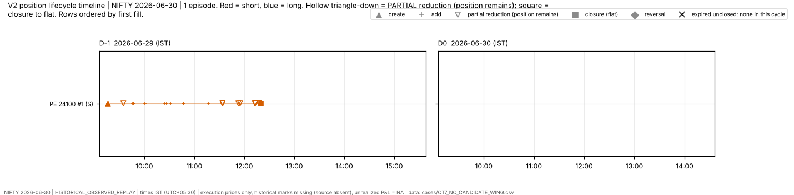

### CT8_W1_VS_W1S60_DISAGREEMENT — NIFTY|2026-06-30|CE|24000#1

* **Selection rule (predefined, outcome-free; chronological first qualifying candidate whose episode was not already used by an earlier case type):** first opening BODY item whose W1 candidate-wing set differs from its W1_S60 candidate-wing set
* **Instrument:** NIFTY|2026-06-30|CE|24000 (SHORT); **lifecycle events:** ADDED 4, CLOSED 1, CREATED 1, PARTIALLY_REDUCED 4; started by reversal: False; ended by: flat
* **Quantity:** opened 325 · closed 325 · remaining 0 · terminal status **CLOSED**
* **First → last event (IST):** 2026-06-29 09:25:20 (CREATED, inventory -65) → 2026-06-29 10:27:01 (CLOSED, inventory +0)
* **Fill IDs (10):** F004763, F004765, F004773, F004775, F004779, F004783, F004784, F004785, F004824, F004825
* **Opening parents (5):** 10758513, 10758555, 10758783, 10758831, 10758921
* **Closing parents (5):** 10759164, 10759166, 10759168, 10760277, 10760279
* **Convention:** identical under FIFO, LIFO, AVG; 5 closing portions, 4 attribute to different opening lots under FIFO vs LIFO; AVG pooled; lot attribution NOT_IDENTIFIABLE
* **Closing batch C1 (10 s):** 5 closing parents fall in 2 batch(es); batch sizes (parents) [4], durations (s) [3, 4]; first: `CB_FIRST_FILL_GAP_10S:NIFTY:2026-06-30:2026-06-29:002`
* **Closing batch C2 (10 s):** 5 closing parents fall in 2 batch(es); batch sizes (parents) [4], durations (s) [3, 4]; first: `CB_LAST_TO_FIRST_GAP_10S:NIFTY:2026-06-30:2026-06-29:002`
* **Wing/body (opening items of this position):** 5 in M2-D tagged scope (items with an opening allocation in this episode), 0 outside it (module tag unclassified: not a claim of no wing). W1 candidates: none for 0, one for 3, several for 2; W1_S60: none 0, one 1, several 4
* **Anchor item:** `10758513 CE24000` (BODY, 65 units, tag role BODY_SHORT_BY_TAG)
  * W1 candidates: 1 — h_29035524496241 CE24650 (dt +4s, qty ratio 1.00) — *WEAKLY_SUPPORTED (inferred candidate)*
  * W1_S60 candidates: 2 — h_29035424195739 CE24700 (dt -56s, qty ratio 1.00); h_29035524496241 CE24650 (dt +4s, qty ratio 1.00) — *UNRESOLVED (execution proximity only)*
  * W2 weighted units (weights, not allocations): h_29035524496241 CE24650 65.00; W3 queue-matched units (queue arithmetic, not ownership): h_29040104435735 CE24650 65
* **Evidence class:** lifecycle CONFIRMED_OBSERVATION · batch = temporal clustering only (decision UNRESOLVED) · W1 WEAKLY_SUPPORTED · W1_S60 UNRESOLVED · W3 UNRESOLVED · lot ownership / protective intent UNRESOLVED
* **Missing information:** historical market marks (source absent): no mark-to-market, unrealized P&L = NA; execution prices only; TP-03 per-parent window id (not published); the decision/rationale for any order (never observable from fills)
* **Can conclude:** the fills, parents, times and quantities listed, and the lifecycle they imply; the position ended CLOSED with remaining 0 (observed); which closing parents are time-connected within 10 s (C1/C2), as a temporal fact
* **Cannot conclude:** why any order was placed or closed; that a candidate wing/body is the protective counterpart of this position; which opening lot a closing portion consumed (convention-dependent); that a position lacked a wing merely because it is outside the role-specific analysis

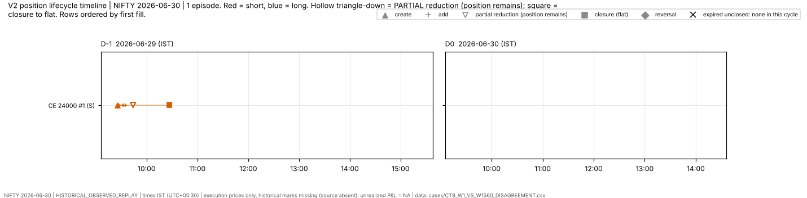

### CT9_MULTI_PARENT_CLOSING_BATCH — NIFTY|2026-06-30|PE|24050#1

* **Selection rule (predefined, outcome-free; chronological first qualifying candidate whose episode was not already used by an earlier case type):** first C1 10 s closing batch (by start time) with >= 2 parent orders; the case episode is the episode of its first member portion — *chronologically first qualifying candidate (INF:CLOSING_BATCH@CB_FIRST_FILL_GAP_10S:NIFTY:2026-06-30:2026-06-29:001) skipped: its episode was already used by CT7_NO_CANDIDATE_WING*
* **Instrument:** NIFTY|2026-06-30|PE|24050 (SHORT); **lifecycle events:** ADDED 13, CLOSED 1, CREATED 1, PARTIALLY_REDUCED 13; started by reversal: False; ended by: flat
* **Quantity:** opened 910 · closed 910 · remaining 0 · terminal status **CLOSED**
* **First → last event (IST):** 2026-06-29 09:31:00 (CREATED, inventory -65) → 2026-06-29 12:33:02 (CLOSED, inventory +0)
* **Fill IDs (28):** F004769, F004770, F004804, F004806, F004808, F004813, F004820, F004842, F004846, F004850, F004858, F004870, F004874, F004881, F004885, F004889, F004922, F004938, F004939, F004951, F004952, F004953, F004954, F004971, F004977, F004978, F004979, F004980
* **Opening parents (14):** 10758654, 10758699, 10759703, 10759832, 10759899, 10759983, 10760090, 10760677, 10760756, 10760864, 10761042, 10761649 … (+2)
* **Closing parents (14):** 10761416, 10761495, 10762917, 10763319, 10763361, 10763769, 10763846, 10763887, 10763899, 10764299, 10764443, 10764491 … (+2)
* **Convention:** identical under FIFO, LIFO, AVG; 14 closing portions, 14 attribute to different opening lots under FIFO vs LIFO; AVG pooled; lot attribution NOT_IDENTIFIABLE
* **Closing batch C1 (10 s):** 14 closing parents fall in 6 batch(es); batch sizes (parents) [2, 3, 6, 8, 10, 11], durations (s) [3, 4, 6, 7, 8]; first: `CB_FIRST_FILL_GAP_10S:NIFTY:2026-06-30:2026-06-29:005`
* **Closing batch C2 (10 s):** 14 closing parents fall in 6 batch(es); batch sizes (parents) [2, 3, 6, 8, 10, 11], durations (s) [3, 4, 6, 7, 8]; first: `CB_LAST_TO_FIRST_GAP_10S:NIFTY:2026-06-30:2026-06-29:005`
* **Wing/body (opening items of this position):** 14 in M2-D tagged scope (items with an opening allocation in this episode), 0 outside it (module tag unclassified: not a claim of no wing). W1 candidates: none for 2, one for 8, several for 4; W1_S60: none 0, one 6, several 8
* **Anchor batch:** `CB_FIRST_FILL_GAP_10S:NIFTY:2026-06-30:2026-06-29:005`
* **Evidence class:** lifecycle CONFIRMED_OBSERVATION · batch = temporal clustering only (decision UNRESOLVED) · W1 WEAKLY_SUPPORTED · W1_S60 UNRESOLVED · W3 UNRESOLVED · lot ownership / protective intent UNRESOLVED
* **Missing information:** historical market marks (source absent): no mark-to-market, unrealized P&L = NA; execution prices only; TP-03 per-parent window id (not published); the decision/rationale for any order (never observable from fills)
* **Can conclude:** the fills, parents, times and quantities listed, and the lifecycle they imply; the position ended CLOSED with remaining 0 (observed); which closing parents are time-connected within 10 s (C1/C2), as a temporal fact
* **Cannot conclude:** why any order was placed or closed; that a candidate wing/body is the protective counterpart of this position; which opening lot a closing portion consumed (convention-dependent); that a position lacked a wing merely because it is outside the role-specific analysis

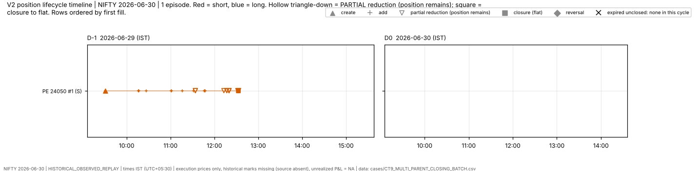

## 3. SENSEX 2026-07-16

### CT1_INCREMENTAL_OPENING — SENSEX|2026-07-16|PE|77400#1

* **Selection rule (predefined, outcome-free; chronological first qualifying candidate whose episode was not already used by an earlier case type):** first episode (by first fill time) with >= 3 ADDED lifecycle events
* **Instrument:** SENSEX|2026-07-16|PE|77400 (SHORT); **lifecycle events:** ADDED 5, CLOSED 1, CREATED 1, PARTIALLY_REDUCED 5; started by reversal: False; ended by: flat
* **Quantity:** opened 120 · closed 120 · remaining 0 · terminal status **CLOSED**
* **First → last event (IST):** 2026-07-15 09:21:27 (CREATED, inventory -20) → 2026-07-15 12:39:47 (CLOSED, inventory +0)
* **Fill IDs (12):** F011970, F012065, F012083, F012084, F012103, F012104, F012109, F012110, F012111, F012114, F012115, F012119
* **Opening parents (6):** 11019847, 11022571, 11023074, 11023118, 11023605, 11023630
* **Closing parents (6):** 11023720, 11023782, 11023784, 11023900, 11023904, 11024080
* **Convention:** identical under FIFO, LIFO, AVG; 6 closing portions, 6 attribute to different opening lots under FIFO vs LIFO; AVG pooled; lot attribution NOT_IDENTIFIABLE
* **Closing batch C1 (10 s):** 6 closing parents fall in 2 batch(es); batch sizes (parents) [5, 10], durations (s) [4, 7]; first: `CB_FIRST_FILL_GAP_10S:SENSEX:2026-07-16:2026-07-15:004`
* **Closing batch C2 (10 s):** 6 closing parents fall in 2 batch(es); batch sizes (parents) [5, 10], durations (s) [4, 7]; first: `CB_LAST_TO_FIRST_GAP_10S:SENSEX:2026-07-16:2026-07-15:004`
* **Wing/body (opening items of this position):** 6 in M2-D tagged scope (items with an opening allocation in this episode), 0 outside it (module tag unclassified: not a claim of no wing). W1 candidates: none for 0, one for 6, several for 0; W1_S60: none 0, one 6, several 0
* **Evidence class:** lifecycle CONFIRMED_OBSERVATION · batch = temporal clustering only (decision UNRESOLVED) · W1 WEAKLY_SUPPORTED · W1_S60 UNRESOLVED · W3 UNRESOLVED · lot ownership / protective intent UNRESOLVED
* **Missing information:** historical market marks (source absent): no mark-to-market, unrealized P&L = NA; execution prices only; TP-03 per-parent window id (not published); the decision/rationale for any order (never observable from fills)
* **Can conclude:** the fills, parents, times and quantities listed, and the lifecycle they imply; the position ended CLOSED with remaining 0 (observed); which closing parents are time-connected within 10 s (C1/C2), as a temporal fact
* **Cannot conclude:** why any order was placed or closed; that a candidate wing/body is the protective counterpart of this position; which opening lot a closing portion consumed (convention-dependent); that a position lacked a wing merely because it is outside the role-specific analysis

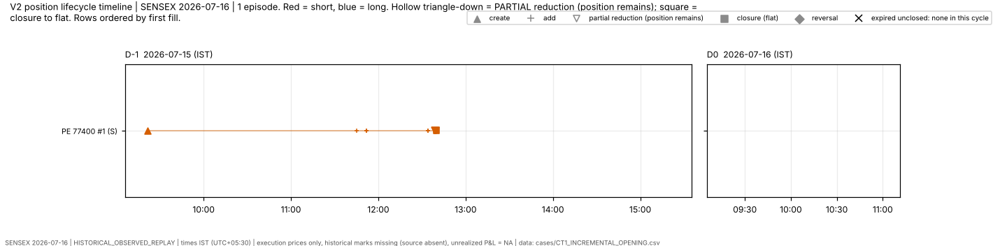

### CT2_PARTIAL_REDUCTION — SENSEX|2026-07-16|CE|81200#1

* **Selection rule (predefined, outcome-free; chronological first qualifying candidate whose episode was not already used by an earlier case type):** first episode with >= 2 PARTIALLY_REDUCED events and terminal status CLOSED
* **Instrument:** SENSEX|2026-07-16|CE|81200 (LONG); **lifecycle events:** ADDED 2, CLOSED 1, CREATED 1, PARTIALLY_REDUCED 2; started by reversal: False; ended by: flat
* **Quantity:** opened 60 · closed 60 · remaining 0 · terminal status **CLOSED**
* **First → last event (IST):** 2026-07-15 09:16:00 (CREATED, inventory +20) → 2026-07-15 09:26:02 (CLOSED, inventory +0)
* **Fill IDs (6):** F011958, F011960, F011966, F011973, F011975, F011977
* **Opening parents (3):** 11019253, 11019365, 11019654
* **Closing parents (3):** 11019924, 11020022, 11020138
* **Convention:** identical under FIFO, LIFO, AVG; 3 closing portions, 2 attribute to different opening lots under FIFO vs LIFO; AVG pooled; lot attribution NOT_IDENTIFIABLE
* **Closing batch C1 (10 s):** 3 closing parents fall in 3 batch(es); batch sizes (parents) [2], durations (s) [2]; first: `CB_FIRST_FILL_GAP_10S:SENSEX:2026-07-16:2026-07-15:001`
* **Closing batch C2 (10 s):** 3 closing parents fall in 3 batch(es); batch sizes (parents) [2], durations (s) [2]; first: `CB_LAST_TO_FIRST_GAP_10S:SENSEX:2026-07-16:2026-07-15:001`
* **Wing/body (opening items of this position):** 0 in M2-D tagged scope (items with an opening allocation in this episode), 3 outside it (module tag unclassified: not a claim of no wing). W1 candidates: none for 0, one for 0, several for 0; W1_S60: none 0, one 0, several 0
* **Evidence class:** lifecycle CONFIRMED_OBSERVATION · batch = temporal clustering only (decision UNRESOLVED) · W1 WEAKLY_SUPPORTED · W1_S60 UNRESOLVED · W3 UNRESOLVED · lot ownership / protective intent UNRESOLVED
* **Missing information:** historical market marks (source absent): no mark-to-market, unrealized P&L = NA; execution prices only; TP-03 per-parent window id (not published); the decision/rationale for any order (never observable from fills)
* **Can conclude:** the fills, parents, times and quantities listed, and the lifecycle they imply; the position ended CLOSED with remaining 0 (observed); which closing parents are time-connected within 10 s (C1/C2), as a temporal fact
* **Cannot conclude:** why any order was placed or closed; that a candidate wing/body is the protective counterpart of this position; which opening lot a closing portion consumed (convention-dependent); that a position lacked a wing merely because it is outside the role-specific analysis

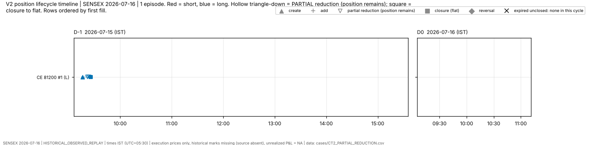

### CT3_FULL_CLOSURE — SENSEX|2026-07-16|CE|79500#1

* **Selection rule (predefined, outcome-free; chronological first qualifying candidate whose episode was not already used by an earlier case type):** first episode whose only closing event is a single CLOSED event (no PARTIALLY_REDUCED, no REVERSED)
* **Instrument:** SENSEX|2026-07-16|CE|79500 (LONG); **lifecycle events:** CLOSED 1, CREATED 1; started by reversal: False; ended by: flat
* **Quantity:** opened 40 · closed 40 · remaining 0 · terminal status **CLOSED**
* **First → last event (IST):** 2026-07-15 09:31:05 (CREATED, inventory +40) → 2026-07-15 12:44:44 (CLOSED, inventory +0)
* **Fill IDs (2):** F011983, F012127
* **Opening parents (1):** h_15040104604092
* **Closing parents (1):** h_15071444209192
* **Convention:** identical under FIFO, LIFO, AVG; 1 closing portions, 0 attribute to different opening lots under FIFO vs LIFO; AVG pooled; lot attribution NOT_IDENTIFIABLE
* **Closing batch C1 (10 s):** 1 closing parents fall in 1 batch(es); batch sizes (parents) [3], durations (s) [4]; first: `CB_FIRST_FILL_GAP_10S:SENSEX:2026-07-16:2026-07-15:006`
* **Closing batch C2 (10 s):** 1 closing parents fall in 1 batch(es); batch sizes (parents) [3], durations (s) [4]; first: `CB_LAST_TO_FIRST_GAP_10S:SENSEX:2026-07-16:2026-07-15:006`
* **Wing/body (opening items of this position):** 1 in M2-D tagged scope (items with an opening allocation in this episode), 0 outside it (module tag unclassified: not a claim of no wing). W1 candidates: none for 0, one for 1, several for 0; W1_S60: none 0, one 0, several 1
* **Evidence class:** lifecycle CONFIRMED_OBSERVATION · batch = temporal clustering only (decision UNRESOLVED) · W1 WEAKLY_SUPPORTED · W1_S60 UNRESOLVED · W3 UNRESOLVED · lot ownership / protective intent UNRESOLVED
* **Missing information:** historical market marks (source absent): no mark-to-market, unrealized P&L = NA; execution prices only; TP-03 per-parent window id (not published); the decision/rationale for any order (never observable from fills)
* **Can conclude:** the fills, parents, times and quantities listed, and the lifecycle they imply; the position ended CLOSED with remaining 0 (observed); which closing parents are time-connected within 10 s (C1/C2), as a temporal fact
* **Cannot conclude:** why any order was placed or closed; that a candidate wing/body is the protective counterpart of this position; which opening lot a closing portion consumed (convention-dependent); that a position lacked a wing merely because it is outside the role-specific analysis

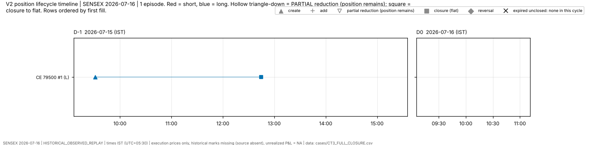

### CT4_REMAINING_AT_EXPIRY — **UNAVAILABLE**

* Rule: first episode whose M2-B terminal status is neither CLOSED nor REVERSED (expired unclosed)
* Reason: no qualifying candidate in this cycle (not borrowed from another cycle)

### CT5_REVERSAL — **UNAVAILABLE**

* Rule: first episode ended by a REVERSED event (extra case type: reversal timeline)
* Reason: no qualifying candidate in this cycle (not borrowed from another cycle)

### CT6_MULTIPLE_CANDIDATE_WINGS — SENSEX|2026-07-16|CE|77500#1

* **Selection rule (predefined, outcome-free; chronological first qualifying candidate whose episode was not already used by an earlier case type):** first opening BODY item (W1) with >= 2 candidate wing items
* **Instrument:** SENSEX|2026-07-16|CE|77500 (SHORT); **lifecycle events:** ADDED 30, CLOSED 1, CREATED 1, PARTIALLY_REDUCED 21; started by reversal: False; ended by: flat
* **Quantity:** opened 620 · closed 620 · remaining 0 · terminal status **CLOSED**
* **First → last event (IST):** 2026-07-15 09:46:00 (CREATED, inventory -20) → 2026-07-16 11:00:52 (CLOSED, inventory +0)
* **Fill IDs (53):** F011984, F011996, F012026, F012030, F012034, F012038, F012042, F012068, F012072, F012076, F012087, F012091, F012095, F012099, F012107, F012375, F012407, F012409, F012413, F012443, F012449, F012451, F012453, F012467, F012471, F012476, F012478, F012479, F012480, F012502, F012516, F012518, F012526, F012545, F012550, F012566, F012567, F012568, F012580, F012581, F012582, F012583, F012600, F012609, F012610, F012611, F012615, F012618, F012630, F012636, F012639, F012642, F012644
* **Opening parents (31):** 11020380, 11020665, 11021478, 11021563, 11021677, 11021763, 11021870, 11022636, 11022734, 11022819, 11023166, 11023268 … (+19)
* **Closing parents (18):** 11037482, 11041780, 11042384, 11042498, 11042982, 11043036, 11043070, 11043576, 11043620, 11043624, 11043706, 11044232 … (+6)
* **Convention:** identical under FIFO, LIFO, AVG; 22 closing portions, 22 attribute to different opening lots under FIFO vs LIFO; AVG pooled; lot attribution NOT_IDENTIFIABLE
* **Closing batch C1 (10 s):** 18 closing parents fall in 5 batch(es); batch sizes (parents) [5, 7, 8, 16, 75], durations (s) [3, 9, 10, 24, 92]; first: `CB_FIRST_FILL_GAP_10S:SENSEX:2026-07-16:2026-07-16:006`
* **Closing batch C2 (10 s):** 18 closing parents fall in 5 batch(es); batch sizes (parents) [5, 7, 8, 16, 75], durations (s) [3, 9, 10, 24, 92]; first: `CB_LAST_TO_FIRST_GAP_10S:SENSEX:2026-07-16:2026-07-16:006`
* **Wing/body (opening items of this position):** 31 in M2-D tagged scope (items with an opening allocation in this episode), 0 outside it (module tag unclassified: not a claim of no wing). W1 candidates: none for 2, one for 16, several for 13; W1_S60: none 0, one 11, several 20
* **Anchor item:** `11020380 CE77500` (BODY, 20 units, tag role BODY_SHORT_BY_TAG)
  * W1 candidates: 2 — h_15041603157527 CE79300 (dt +3s, qty ratio 1.00); h_15041634697563 CE79400 (dt +35s, qty ratio 1.00) — *WEAKLY_SUPPORTED (inferred candidate)*
  * W1_S60 candidates: 2 — h_15041603157527 CE79300 (dt +3s, qty ratio 1.00); h_15041634697563 CE79400 (dt +35s, qty ratio 1.00) — *UNRESOLVED (execution proximity only)*
  * W2 weighted units (weights, not allocations): h_15041603157527 CE79300 10.00, h_15041634697563 CE79400 10.00; W3 queue-matched units (queue arithmetic, not ownership): h_15043112933521 CE79200 20
* **Evidence class:** lifecycle CONFIRMED_OBSERVATION · batch = temporal clustering only (decision UNRESOLVED) · W1 WEAKLY_SUPPORTED · W1_S60 UNRESOLVED · W3 UNRESOLVED · lot ownership / protective intent UNRESOLVED
* **Missing information:** historical market marks (source absent): no mark-to-market, unrealized P&L = NA; execution prices only; TP-03 per-parent window id (not published); the decision/rationale for any order (never observable from fills)
* **Can conclude:** the fills, parents, times and quantities listed, and the lifecycle they imply; the position ended CLOSED with remaining 0 (observed); which closing parents are time-connected within 10 s (C1/C2), as a temporal fact
* **Cannot conclude:** why any order was placed or closed; that a candidate wing/body is the protective counterpart of this position; which opening lot a closing portion consumed (convention-dependent); that a position lacked a wing merely because it is outside the role-specific analysis

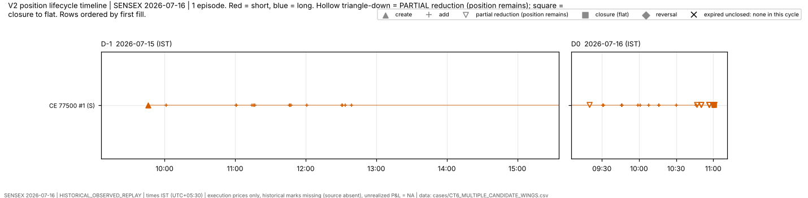

### CT6b_WING_WITH_MULTIPLE_CANDIDATE_BODIES — SENSEX|2026-07-16|PE|74900#1

* **Selection rule (predefined, outcome-free; chronological first qualifying candidate whose episode was not already used by an earlier case type):** first opening WING item (W1) with >= 2 candidate body items (extra)
* **Instrument:** SENSEX|2026-07-16|PE|74900 (LONG); **lifecycle events:** ADDED 1, CLOSED 1, CREATED 1, PARTIALLY_REDUCED 1; started by reversal: False; ended by: flat
* **Quantity:** opened 60 · closed 60 · remaining 0 · terminal status **CLOSED**
* **First → last event (IST):** 2026-07-15 09:21:30 (CREATED, inventory +20) → 2026-07-15 12:39:46 (CLOSED, inventory +0)
* **Fill IDs (4):** F011971, F011982, F012113, F012117
* **Opening parents (2):** h_15035130050844, h_15040104603988
* **Closing parents (2):** h_15070858088900, h_15070946404303
* **Convention:** identical under FIFO, LIFO, AVG; 2 closing portions, 2 attribute to different opening lots under FIFO vs LIFO; AVG pooled; lot attribution NOT_IDENTIFIABLE
* **Closing batch C1 (10 s):** 2 closing parents fall in 2 batch(es); batch sizes (parents) [5, 10], durations (s) [4, 7]; first: `CB_FIRST_FILL_GAP_10S:SENSEX:2026-07-16:2026-07-15:004`
* **Closing batch C2 (10 s):** 2 closing parents fall in 2 batch(es); batch sizes (parents) [5, 10], durations (s) [4, 7]; first: `CB_LAST_TO_FIRST_GAP_10S:SENSEX:2026-07-16:2026-07-15:004`
* **Wing/body (opening items of this position):** 2 in M2-D tagged scope (items with an opening allocation in this episode), 0 outside it (module tag unclassified: not a claim of no wing). W1 candidates: none for 0, one for 1, several for 1; W1_S60: none 0, one 1, several 1
* **Anchor item:** `h_15040104603988 PE74900` (WING, 40 units, tag role WING_LONG_BY_TAG)
  * W1 candidates: 2 — 11020304 PE77600 (dt +3s, qty ratio 2.00); 11020234 PE77600 (dt +4s, qty ratio 2.00) — *WEAKLY_SUPPORTED (inferred candidate)*
  * W1_S60 candidates: 2 — 11020304 PE77600 (dt +3s, qty ratio 2.00); 11020234 PE77600 (dt +4s, qty ratio 2.00) — *UNRESOLVED (execution proximity only)*
  * W2 weighted units (weights, not allocations): 11020304 PE77600 20.00, 11020234 PE77600 20.00; W3 queue-matched units (queue arithmetic, not ownership): 11019612 PE77200 20, 11019807 PE77200 20
* **Evidence class:** lifecycle CONFIRMED_OBSERVATION · batch = temporal clustering only (decision UNRESOLVED) · W1 WEAKLY_SUPPORTED · W1_S60 UNRESOLVED · W3 UNRESOLVED · lot ownership / protective intent UNRESOLVED
* **Missing information:** historical market marks (source absent): no mark-to-market, unrealized P&L = NA; execution prices only; TP-03 per-parent window id (not published); the decision/rationale for any order (never observable from fills)
* **Can conclude:** the fills, parents, times and quantities listed, and the lifecycle they imply; the position ended CLOSED with remaining 0 (observed); which closing parents are time-connected within 10 s (C1/C2), as a temporal fact
* **Cannot conclude:** why any order was placed or closed; that a candidate wing/body is the protective counterpart of this position; which opening lot a closing portion consumed (convention-dependent); that a position lacked a wing merely because it is outside the role-specific analysis

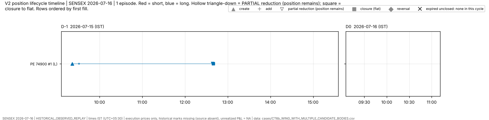

### CT7_NO_CANDIDATE_WING — SENSEX|2026-07-16|CE|77200#1

* **Selection rule (predefined, outcome-free; chronological first qualifying candidate whose episode was not already used by an earlier case type):** first opening BODY item (W1) with 0 candidate wing items
* **Instrument:** SENSEX|2026-07-16|CE|77200 (SHORT); **lifecycle events:** ADDED 2, CLOSED 1, CREATED 1, PARTIALLY_REDUCED 2; started by reversal: False; ended by: flat
* **Quantity:** opened 60 · closed 60 · remaining 0 · terminal status **CLOSED**
* **First → last event (IST):** 2026-07-15 09:16:02 (CREATED, inventory -20) → 2026-07-15 09:26:00 (CLOSED, inventory +0)
* **Fill IDs (6):** F011962, F011964, F011968, F011972, F011974, F011976
* **Opening parents (3):** 11019448, 11019572, 11019766
* **Closing parents (3):** 11019894, 11019986, 11020088
* **Convention:** identical under FIFO, LIFO, AVG; 3 closing portions, 2 attribute to different opening lots under FIFO vs LIFO; AVG pooled; lot attribution NOT_IDENTIFIABLE
* **Closing batch C1 (10 s):** 3 closing parents fall in 3 batch(es); batch sizes (parents) [2], durations (s) [2]; first: `CB_FIRST_FILL_GAP_10S:SENSEX:2026-07-16:2026-07-15:001`
* **Closing batch C2 (10 s):** 3 closing parents fall in 3 batch(es); batch sizes (parents) [2], durations (s) [2]; first: `CB_LAST_TO_FIRST_GAP_10S:SENSEX:2026-07-16:2026-07-15:001`
* **Wing/body (opening items of this position):** 3 in M2-D tagged scope (items with an opening allocation in this episode), 0 outside it (module tag unclassified: not a claim of no wing). W1 candidates: none for 3, one for 0, several for 0; W1_S60: none 3, one 0, several 0
* **Anchor item:** `11019448 CE77200` (BODY, 20 units, tag role BODY_SHORT_BY_TAG)
  * W1 candidates: 0 (none) — an empty candidate set is a finding about THIS method only; it does not show that no wing existed
  * W1_S60 candidates: 0 (none) — an empty candidate set is a finding about THIS method only; it does not show that no wing existed
  * W2 weighted units (weights, not allocations): none; W3 queue-matched units (queue arithmetic, not ownership): h_15040104604092 CE79500 20
* **Evidence class:** lifecycle CONFIRMED_OBSERVATION · batch = temporal clustering only (decision UNRESOLVED) · W1 WEAKLY_SUPPORTED · W1_S60 UNRESOLVED · W3 UNRESOLVED · lot ownership / protective intent UNRESOLVED
* **Missing information:** historical market marks (source absent): no mark-to-market, unrealized P&L = NA; execution prices only; TP-03 per-parent window id (not published); the decision/rationale for any order (never observable from fills)
* **Can conclude:** the fills, parents, times and quantities listed, and the lifecycle they imply; the position ended CLOSED with remaining 0 (observed); which closing parents are time-connected within 10 s (C1/C2), as a temporal fact
* **Cannot conclude:** why any order was placed or closed; that a candidate wing/body is the protective counterpart of this position; which opening lot a closing portion consumed (convention-dependent); that a position lacked a wing merely because it is outside the role-specific analysis

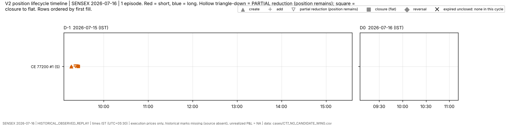

### CT8_W1_VS_W1S60_DISAGREEMENT — SENSEX|2026-07-16|CE|77600#1

* **Selection rule (predefined, outcome-free; chronological first qualifying candidate whose episode was not already used by an earlier case type):** first opening BODY item whose W1 candidate-wing set differs from its W1_S60 candidate-wing set
* **Instrument:** SENSEX|2026-07-16|CE|77600 (SHORT); **lifecycle events:** ADDED 12, CLOSED 1, CREATED 1, PARTIALLY_REDUCED 6; started by reversal: False; ended by: flat
* **Quantity:** opened 260 · closed 260 · remaining 0 · terminal status **CLOSED**
* **First → last event (IST):** 2026-07-15 09:31:00 (CREATED, inventory -20) → 2026-07-16 11:00:52 (CLOSED, inventory +0)
* **Fill IDs (20):** F011978, F011979, F011988, F011992, F012002, F012004, F012005, F012010, F012014, F012018, F012022, F012046, F012376, F012575, F012608, F012614, F012617, F012621, F012632, F012638
* **Opening parents (13):** 11020165, 11020230, 11020470, 11020566, 11020811, 11020890, 11020926, 11021083, 11021193, 11021283, 11021378, 11021966 … (+1)
* **Closing parents (6):** 11037504, 11044696, 11044957, 11045009, 11045153, s_16053046299662
* **Convention:** identical under FIFO, LIFO, AVG; 7 closing portions, 6 attribute to different opening lots under FIFO vs LIFO; AVG pooled; lot attribution NOT_IDENTIFIABLE
* **Closing batch C1 (10 s):** 6 closing parents fall in 2 batch(es); batch sizes (parents) [5, 75], durations (s) [10, 92]; first: `CB_FIRST_FILL_GAP_10S:SENSEX:2026-07-16:2026-07-16:006`
* **Closing batch C2 (10 s):** 6 closing parents fall in 2 batch(es); batch sizes (parents) [5, 75], durations (s) [10, 92]; first: `CB_LAST_TO_FIRST_GAP_10S:SENSEX:2026-07-16:2026-07-16:006`
* **Wing/body (opening items of this position):** 13 in M2-D tagged scope (items with an opening allocation in this episode), 0 outside it (module tag unclassified: not a claim of no wing). W1 candidates: none for 2, one for 10, several for 1; W1_S60: none 0, one 9, several 4
* **Anchor item:** `11020165 CE77600` (BODY, 20 units, tag role BODY_SHORT_BY_TAG)
  * W1 candidates: 0 (none) — an empty candidate set is a finding about THIS method only; it does not show that no wing existed
  * W1_S60 candidates: 1 — h_15040104604092 CE79500 (dt +5s, qty ratio 2.00) — *UNRESOLVED (execution proximity only)*
  * W2 weighted units (weights, not allocations): none; W3 queue-matched units (queue arithmetic, not ownership): h_15041634697563 CE79400 20
* **Evidence class:** lifecycle CONFIRMED_OBSERVATION · batch = temporal clustering only (decision UNRESOLVED) · W1 WEAKLY_SUPPORTED · W1_S60 UNRESOLVED · W3 UNRESOLVED · lot ownership / protective intent UNRESOLVED
* **Missing information:** historical market marks (source absent): no mark-to-market, unrealized P&L = NA; execution prices only; TP-03 per-parent window id (not published); the decision/rationale for any order (never observable from fills)
* **Can conclude:** the fills, parents, times and quantities listed, and the lifecycle they imply; the position ended CLOSED with remaining 0 (observed); which closing parents are time-connected within 10 s (C1/C2), as a temporal fact
* **Cannot conclude:** why any order was placed or closed; that a candidate wing/body is the protective counterpart of this position; which opening lot a closing portion consumed (convention-dependent); that a position lacked a wing merely because it is outside the role-specific analysis

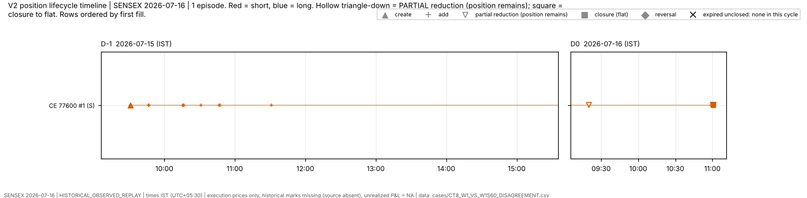

### CT9_MULTI_PARENT_CLOSING_BATCH — SENSEX|2026-07-16|CE|77400#1

* **Selection rule (predefined, outcome-free; chronological first qualifying candidate whose episode was not already used by an earlier case type):** first C1 10 s closing batch (by start time) with >= 2 parent orders; the case episode is the episode of its first member portion — *chronologically first qualifying candidate (INF:CLOSING_BATCH@CB_FIRST_FILL_GAP_10S:SENSEX:2026-07-16:2026-07-15:001) skipped: its episode was already used by CT7_NO_CANDIDATE_WING*
* **Instrument:** SENSEX|2026-07-16|CE|77400 (SHORT); **lifecycle events:** ADDED 30, CLOSED 1, CREATED 1, PARTIALLY_REDUCED 26; started by reversal: False; ended by: flat
* **Quantity:** opened 620 · closed 620 · remaining 0 · terminal status **CLOSED**
* **First → last event (IST):** 2026-07-15 11:15:06 (CREATED, inventory -20) → 2026-07-16 11:00:52 (CLOSED, inventory +0)
* **Fill IDs (58):** F012036, F012063, F012064, F012080, F012081, F012082, F012101, F012102, F012125, F012126, F012138, F012254, F012271, F012322, F012326, F012329, F012330, F012331, F012337, F012362, F012364, F012367, F012377, F012381, F012403, F012417, F012421, F012439, F012461, F012463, F012475, F012486, F012490, F012491, F012495, F012496, F012498, F012506, F012507, F012512, F012522, F012523, F012527, F012532, F012543, F012552, F012553, F012557, F012564, F012565, F012571, F012603, F012605, F012613, F012631, F012637, F012640, F012643
* **Opening parents (31):** 11021718, 11022483, 11022502, 11022924, 11022941, 11022980, 11023502, 11023514, 11024599, 11028456, 11035745, 11035859 … (+19)
* **Closing parents (24):** 11024166, 11024202, 11033707, 11036974, 11037128, 11037230, 11037532, 11037866, 11039166, 11041774, 11041784, 11041792 … (+12)
* **Convention:** identical under FIFO, LIFO, AVG; 27 closing portions, 27 attribute to different opening lots under FIFO vs LIFO; AVG pooled; lot attribution NOT_IDENTIFIABLE
* **Closing batch C1 (10 s):** 24 closing parents fall in 13 batch(es); batch sizes (parents) [2, 3, 4, 5, 7, 8, 10, 16, 33, 75], durations (s) [0, 3, 4, 5, 9, 10, 13, 24, 92]; first: `CB_FIRST_FILL_GAP_10S:SENSEX:2026-07-16:2026-07-15:006`
* **Closing batch C2 (10 s):** 24 closing parents fall in 13 batch(es); batch sizes (parents) [2, 3, 4, 5, 7, 8, 10, 16, 33, 75], durations (s) [0, 3, 4, 5, 9, 10, 13, 24, 92]; first: `CB_LAST_TO_FIRST_GAP_10S:SENSEX:2026-07-16:2026-07-15:006`
* **Wing/body (opening items of this position):** 31 in M2-D tagged scope (items with an opening allocation in this episode), 0 outside it (module tag unclassified: not a claim of no wing). W1 candidates: none for 0, one for 28, several for 3; W1_S60: none 0, one 17, several 14
* **Anchor batch:** `CB_FIRST_FILL_GAP_10S:SENSEX:2026-07-16:2026-07-15:006`
* **Evidence class:** lifecycle CONFIRMED_OBSERVATION · batch = temporal clustering only (decision UNRESOLVED) · W1 WEAKLY_SUPPORTED · W1_S60 UNRESOLVED · W3 UNRESOLVED · lot ownership / protective intent UNRESOLVED
* **Missing information:** historical market marks (source absent): no mark-to-market, unrealized P&L = NA; execution prices only; TP-03 per-parent window id (not published); the decision/rationale for any order (never observable from fills)
* **Can conclude:** the fills, parents, times and quantities listed, and the lifecycle they imply; the position ended CLOSED with remaining 0 (observed); which closing parents are time-connected within 10 s (C1/C2), as a temporal fact
* **Cannot conclude:** why any order was placed or closed; that a candidate wing/body is the protective counterpart of this position; which opening lot a closing portion consumed (convention-dependent); that a position lacked a wing merely because it is outside the role-specific analysis

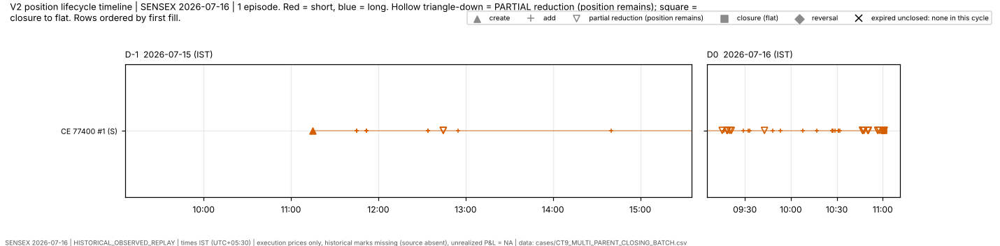

