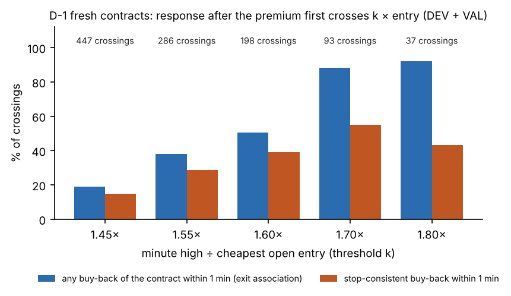
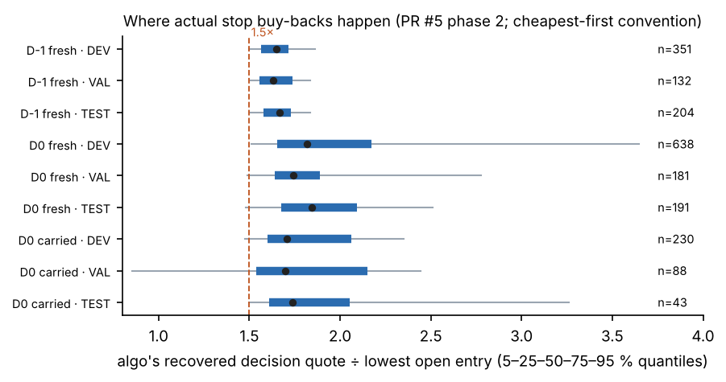
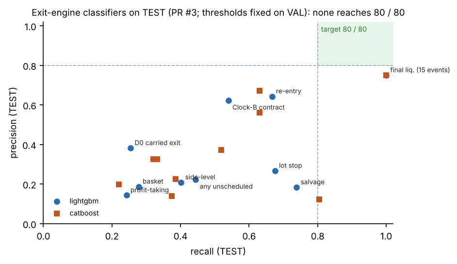
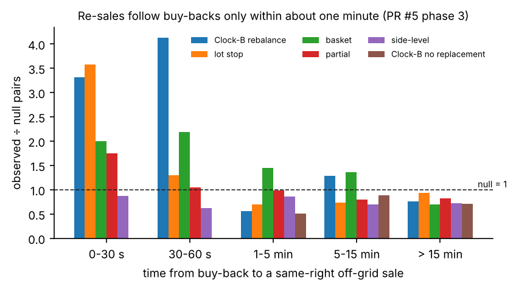
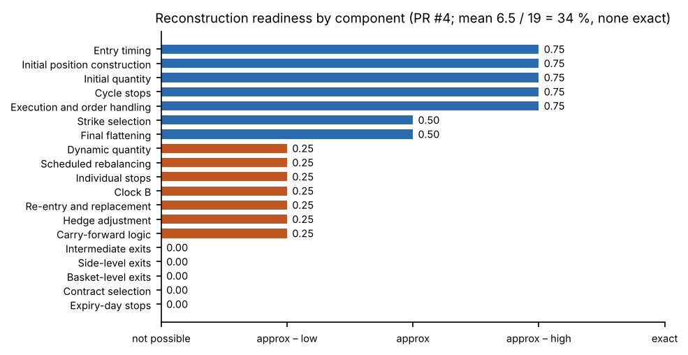

**Repository:** [SadamAnjaneyulu/Algo-8-Reverse-Engineer](https://github.com/SadamAnjaneyulu/Algo-8-Reverse-Engineer) ·
**Report branch:** `docs/algo8-complete-research-report` (stacked on PR #6) · **Research date:** 11 November 2026

**Scope.** This report documents research already completed in PRs #1–#6. It is an audit and write-up; **no new experiment
was run for it.** Every number below is taken from a committed result file, a findings document, or a reviewed PR artifact,
and the source is cited. Numbers from different research lineages are never placed in one comparison without an
explanation of how they differ.

**How to read the evidence labels.**

| Label | Meaning |
|---|---|
| **Confirmed observation** | Directly visible in the trade export (counts, timestamps, tags); not a claim about intent. |
| **Strong evidence** | Repeated, consistent pattern across splits and instruments; the exact rule is still not identified. |
| **Partial reconstruction** | Part of the behaviour (e.g. timing or quantity) is reproducible; the trigger is not. |
| **Unresolved** | Not identified in the available data. This does **not** mean the strategy has no such rule. |
| **Rejected hypothesis** | Tested and contradicted by the data. |

No finding in this report is out-of-sample confirmation: **every trading day in the sample has already been inspected**
(§10).

# 1. Executive summary

**Objective.** Reverse-engineer "Algo 8", a NIFTY / SENSEX weekly-options strategy run for client GKOHNP140, from its broker
trade export and 1-minute market data. The supplied description (`Info.txt`) is three sentences: a *BTST algorithm with a
carry-forward SL of 4 % on positions carried to expiry and 1 % on the entire capital on expiry day*, capital ₹2 crore.

**What Algo 8 appears to do.** It is a weekly **short-option premium-carry engine**:

- Each weekly expiry is one **cycle**: the pre-expiry session (**D-1**) and the expiry session (**D0**).
- From 09:16 on D-1 it sells at-the-money (ATM) calls and puts in one-lot child orders (65 NIFTY / 20 SENSEX), buys far out-of-the-money **wings** as protection, and adds more short straddles at **17 fixed clock windows**.
- It carries the hedged book overnight into expiry day, then manages it with per-lot buy-backs, side-level and basket reductions, and a **Clock-B** rebalancer that buys back one lot and re-sells near ATM.
- It liquidates on a **cycle-level loss limit** (≈ −₹1.30–1.35 lakh mark-to-market) or flattens late on expiry day (15:14 in the later period).

**Data.** A fills-only broker export (41,421 fills; 39,874 orders; 35 cycles, 23 Jun – 22 Oct 2026), and Breeze 1-minute
candles: index bars for 85 sessions and option bars for the 3,243 contract-days Algo 8 traded. There is no order book,
bid/ask, full option chain, decision log, allocation id or original configuration.

**Method.** Two independent research lineages decoded the export, validated the decode against market data, labelled every
order, and tested candidate rules and machine-learning models on **chronological, whole-cycle splits** (DEV 18 / VAL 8 /
TEST 9 cycles in lineage Y; six expanding folds in lineage X). Successive passes:

- an audit that corrected a data defect;
- an allocation-level study;
- a causal OHLCV feature library for indicator and alpha work.

**Most important discoveries.**

1. **The structure is well established; the decision logic largely is not.** The schedule (544 / 544 pre-expiry windows), opening book, ATM strike rule, wing budget, base unit, order pricing (limit = LTP × 1.15 / 0.85) and cycle stop are reproducible. Exact triggers for reductions, extra entries, re-entries and Clock-B actions are not.
2. **A data defect was found and corrected.** Column 4 ("order id") is reused across days. Grouping by it merges 4,840 real orders into 2,224 groups and silently drops 2,616 orders (6.6 %). All later work uses column 163 (`UniqueOrderIdentifier`). The first exit-engine results were withdrawn and rebuilt.
3. **A per-lot stop exists on D-1 but no single rule explains it.**
   - After a contract's minute high crosses **1.7×** its cheapest open entry, 88 % of crossings are followed by a buy-back within a minute.
   - About **95 %** of stop buy-backs occur when the algo's own quote is already ≥ **1.5×** the lowest open entry.
   - But crossing 1.5× is not sufficient: no tested reference price and constant reaches 80 % precision and recall (0 of 18 rules).
4. **No model in either lineage reproduces the decisions.** Best exit-engine classifier on TEST: lot stop precision 0.27–0.37, recall 0.52–0.68 (PR #3). The ML decision engine met its 75 % standard on 0 of 20 tasks (PR #1). Autonomous replay matches about a quarter of actual exits at best.
5. **No independent alpha is demonstrated.**
   - Algo 8's gross P&L (+₹15.5 L over 30 clean cycles, lineage Y) is the carry of options sold, mostly calls in a falling market.
   - There is no measurable timing, sizing or directional skill.
   - The market ATM-straddle premium is not statistically significant in this sample.
   - A searched candidate (BTST afternoon short straddle) did not pass the reality check (p = 0.104) and is frozen for an out-of-sample test that has not yet been run.

**Biggest unresolved questions.** Exact entry and extra-entry conditions; the exact stop reference and why most crossings are
not stopped; Clock-B act / no-act; replacement strike and quantity; allocation ownership; dynamic sizing; hedge-adjustment
logic; the meaning of the "4 %" and "1 %" rules; and the short sales seen just after some cycle stops.

**Have we identified the original decision engine?** **No.** An approximate **behavioural replica** can be built (calendar,
clocks, ATM strikes, wings, base units, a stop band, the cycle stop, the late flatten). The readiness index is 34 %: a
subjective, unweighted score over 19 components, **none of them exact** (§8).

**Have we demonstrated independent, profitable alpha?** **No.** The only pre-registered candidate awaits its locked
out-of-sample test on data not yet fetched (§9).

# 2. Data inventory and quality

## 2.1 Broker trade export

| Item | Value | Source |
|---|---|---|
| File | `Trades_GKOHNP140.csv` (on `main`), 167 / 168 columns, no header (names inferred from Algo 7's export, which has one) | [`audit/ALGO8_DATA_GAPS_AND_REQUIREMENTS.md`](../audit/ALGO8_DATA_GAPS_AND_REQUIREMENTS.md) |
| Fill rows | **41,421** | [`analysis/exit_engine/EXIT_ENGINE_FINDINGS.md`](../analysis/exit_engine/EXIT_ENGINE_FINDINGS.md) §2 |
| Orders (column-163 key) | **39,874**; 16,733 closing orders (11,007 short buy-backs = 15,327 lots; 5,726 long closes) | same |
| Cycles | **35** (18 NIFTY, 17 SENSEX), sessions 23 Jun – 22 Oct 2026; 65 underlying-sessions | register DAT-01; [`ohlcv_research/data_manifest.md`](../ohlcv_research/data_manifest.md) |
| Content | Fills only: fill time (1 s), order time (minute), side, contract, limit and fill price, quantities, validity, status, **column 163 order tag**, column 144 AlgoId | data gaps doc |
| Not present | Unfilled, cancelled, rejected or modified orders; acknowledgements; allocation / parent ids; decision reasons | same |
| Known gaps | Four log gaps (10 Aug, 1 Sep, 14 Sep, 29 Sep) and three D0-only cycles | same |

**Order identity (the correction).** Column 4 ("order id") is **reused across days**:

- Grouping by it merges 4,840 real orders into 2,224 groups, 2,200 of which span different cycles.
- `groupby(oid).first()` drops 2,616 orders (6.6 %).
- Column 163 is unique per order: each tag maps to exactly one date, underlying, expiry, right, strike, side and module, and all fills of a tag finish within 57 s (0 violations over 39,874 tags).

Sources: [`order_key_audit.csv`](../analysis/exit_engine/results/order_key_audit.csv), register DAT-01 / DAT-02.

- **Impact:** six older lineage-Y scripts were re-run in a sandbox with the correct key, and no headline conclusion changed.
- **One older result could not be re-run:** the P4 strike-choice model (68.5 % top-1). It remains **unverified** (DAT-03).
- **Lineage X** was not affected.

**Decoded order semantics** (register DAT-05 to DAT-07, Confirmed observations):

| Element | Meaning |
|---|---|
| Tag prefix | numeric = body (strategy orders); `h_` = wing hedge (IOC); `v_` = overnight lump hedge; `s_` = stop-loss module; `m_` = manual. Non-numeric tags embed a microsecond decision timestamp. |
| Pricing | Every order is a marketable limit at LTP × 1.15 (buy) / × 0.85 (sell). So limit ÷ 1.15 or ÷ 0.85 recovers **the price the algo saw** when it decided (the "recovered quote"). |
| AlgoId | One per underlying book (99999 NIFTY, 1E+16 SENSEX), a platform risk actor (152432) and a separate SENSEX hedge app (2.18811E+15). AlgoIds do not identify sub-strategies. |

**Book reconciliation.** A unit-lot replay of the fills reproduces every contract's net position. Cycle MTM from the lot book
equals an independent fills-plus-candles MTM (median difference ₹0; DAT-08). Lineage X's ledger reconciles independently
(252 tests, DAT-09).

## 2.2 Market data (Breeze 1-minute)

Audited in PR #6 Phase 0 ([`ohlcv_research/data_manifest.md`](../ohlcv_research/data_manifest.md),
[`results/data_audit_report.txt`](../ohlcv_research/results/data_audit_report.txt)).

| Item | Index bars (NIFTY, SENSEX) | Option bars |
|---|---|---|
| Coverage | 85 sessions per index, 22 Jun – 22 Oct 2026; identical dates | 3,243 contract-days, 23 Jun – 22 Oct 2026; only D-1 and D0 of each expiry |
| Rows | 63,678 | 1,230,065 (1,210,547 in session) |
| Duplicates | 0 | 0 |
| Missing bars | 72 minutes, all in 12–22 Oct (15:16–15:19, sometimes 15:29) | 95.2 % of contract-days have all 375 bars; 97.8 % ≥ 370; 28 have < 300 |
| Extra bars | none | 19,518 post-close bars (15:30–15:39), dropped |
| OHLC sanity | 0 inconsistent rows | 0 inconsistent rows; every close on the ₹0.05 tick |
| Volume | **Invalid: zero in every row** | Valid: 100 % multiples of the lot size; ≥ Algo 8's own filled quantity in 99.99 % of 24,898 traded contract-minutes |
| Stale prices | 0.9 % zero-range bars | 2.3 % zero-volume bars (99 % flat = carried price); 5.5 % flat bars |

**Timestamp convention, confirmed against the ledger.** Bars are labelled by their **start**. 97.3 % of Algo 8 fills lie
inside [low, high] of the bar labelled with the fill's own minute, against 61.3 % for the next bar and 58.7 % for the previous one.

**Ledger ↔ market mapping.** 100 % of orders have candles for their contract-day, and all 65 ledger sessions have index bars.

## 2.3 What the data can and cannot establish

| Can establish | Cannot establish |
|---|---|
| What was traded, when (fills to the second; body-order decisions to the minute), at what price, in which module | Why: no decision log, no configuration, no allocation id |
| The price the algo saw at each decision (recovered quote) | Prices between its decisions at sub-minute resolution (bars are 1-minute) |
| Position and P&L at every point (exact replay) | Which lot a buy-back closed (lots in a contract are fungible; ownership is a convention) |
| Behaviour around the traded strikes | Anything about strikes Algo 8 did not trade (no full chain), true implied volatility, bid/ask, order-book conditions |
| Associations in June–October 2026 | Whether any rule holds outside this sample (no untouched data) |

**ATM straddle coverage** (both legs of the nearest strike):

- D-1: 99.8–99.9 % of minutes.
- D0: only 91 % (NIFTY) and 84 % (SENSEX), and near 0 % on the worst days, when spot left Algo 8's strike set.

# 3. Reconstructed Algo 8 trading architecture

Each row says what is **observed** in the export and what is **inferred** as a rule. Sources:
[`audit/ALGO8_STRATEGY_SPECIFICATION.md`](../audit/ALGO8_STRATEGY_SPECIFICATION.md) and the register
[`audit/ALGO8_MASTER_FINDINGS_REGISTER.md`](../audit/ALGO8_MASTER_FINDINGS_REGISTER.md) (IDs in brackets).

| Component | Observed | Inferred rule and status |
|---|---|---|
| **Weekly cycle** | One cycle per (underlying, weekly expiry): NIFTY Mon / Tue, SENSEX Wed / Thu; one underlying per day (STR-01) | Confirmed observation |
| **D-1 / D0** | D-1 builds the book; D0 manages and liquidates it | Confirmed observation |
| **Opening entries** | First paired CE / PE short sale at **09:16** on D-1 (ENT-01); opening book matches jointly in ≈ 28 / 32 sessions | Strong evidence |
| **ATM strike** | Opening strike = nearest ATM to the completed 09:15 close, same for CE and PE (31 / 31) (STK-01). Later scheduled shorts within one strike of the moving ATM 97.4 % NIFTY / 94.6 % SENSEX; exactly ATM only ≈ 70 % / 68 % (STK-02) | Opening: strong evidence. Later: partial reconstruction. Off-grid "one strike toward the move" (STK-03 / 04): hypothesis; the 68.5 % model is unverified |
| **Short-option legs** | Book is a superposition of many one-lot allocations across neighbouring strikes, not one four-leg basket (STR-02). Old strikes are kept, not re-centred (MGT-01) | Confirmed observation |
| **Protective wings** | Seed wings NIFTY ≈ ± 2,000 pts; SENSEX ≈ ± 4,000 before 16 Sep, ± 2,000 after (HDG-01). Routine wing = highest OTM premium ≤ 2.5 % of the ATM leg (exact strike ≈ 50 %, within one strike 92–95 %) (HDG-02). Wings bought within 5 s of most new shorts (HDG-03). Carry books keep long ≥ short per right (HDG-05) | Strong evidence (approximate selector) |
| **Quantity / lots** | Child-order base unit 65 / 20 (SIZ-01); opening 3 units per role (SIZ-02); a modal ladder 3, 2, 3, 1, … shared across indices (SIZ-03) | Base unit: confirmed. Ladder: partial (≈ half of later slots). Sizing formula vs capital: unresolved (SIZ-05) |
| **Scheduled additions** | **17 pre-expiry windows** (09:30, 09:45 … 14:30; window T − 2 s … T + 3 min) contain fresh CE / PE shorts in 544 / 544 cases (ENT-02). On D0, fresh shorts continue while the book is active (95.1 % / 100 %, but given the actual book; ENT-03) | D-1 times: confirmed observation. D0: strong evidence, conditional on the actual book |
| **Extra entries** | Off-schedule sales on both days (ENT-04) | Trigger **unresolved**. Lineage Y timer model ranks minutes (AUC 0.887); lineage X rule search catches 13 / 93 events |
| **Reductions / buy-backs** | 11,007 short buy-backs classified into 11 categories plus an unexplained class of 0.6 % (EXT-01) | Classification: confirmed. Triggers: §4 |
| **Clock-B rebalancing** | D0 ticks at :14 / :29 / :44 / :59 from 09:29 (MGT-02). 42–47 % of ticks act; one lot per contract (MGT-03 / 04) | Timing: strong evidence. Act / no-act and contract choice: unresolved |
| **Replacement / re-entry** | Re-sales within ≈ 60 s of buy-backs are 3–4× more frequent than chance after Clock-B rebalances and lot stops (§5.4) | Association: strong evidence. Strike, quantity and trigger rule: unresolved |
| **Stop-loss and liquidation** | Per-lot stop on D-1 near 1.6–1.7× entry, one lot at a time (EXT-02 / 03). Cycle stop: the `s_` module liquidates at cumulative cycle MTM ≈ −₹1.30–1.35 L (executed −₹1.44 L on average because of 1–20 s latency; 12 stop cycles) (RSK-01) | Strong evidence (levels bracketed, not exact) |
| **Final flattening** | Short book closed in the **15:14** minute in 9 / 10 late closures after 3 Aug (EXT-08); earlier period more spread | Strong evidence for the later period; universal rule unresolved |
| **Overnight lump hedge** (`v_`) | On the heavier short side (29 / 31), 0.9–2.3 % OTM (SIZ-04) | Side / OTM: strong evidence. Size: unresolved (models worse than the naive median) |

**Indicators.** PR #2 tested 75 causal index indicators, 14 option measures and crossover events against 8 decisions, with
date-shuffled nulls and FDR control. **No classical technical or option indicator is identifiably used** (STR-03). The algo
reacts to recent price movement and price location, not to a computed RSI or EMA (`FINDINGS.md` §0c).

# 4. Exit-engine reverse engineering

Main source: PR #3, [`analysis/exit_engine/EXIT_ENGINE_FINDINGS.md`](../analysis/exit_engine/EXIT_ENGINE_FINDINGS.md), rebuilt
on the corrected order key. Split: whole cycles, chronological, **DEV 18 / VAL 8 / TEST 9**. Models are fitted on DEV,
thresholds set on VAL, and TEST is scored once. TEST is not an unseen period: hand-derived constants were first seen on
all 35 cycles.

**Five measures that must not be mixed** (PR #4 §7.0). A number from one row says nothing about another.

| # | Measure | What it is |
|---|---|---|
| 1 | Exit-event association | Any buy-back of the contract within *W* minutes after a price crossing |
| 2 | Stop-consistent classification | A non-scheduled buy-back whose own quote is still beyond the threshold, quantity ≤ lots crossed |
| 3 | ML event prediction | Precision / recall / PR-AUC of a classifier on contract-minute rows |
| 4 | Autonomous portfolio replay | A model runs its own book; exit match within ± 2 min |
| 5 | Replay P&L | Cash result of the replay under a fill assumption |

## 4.1 Exit taxonomy

Share of the 15,327 short buy-back lots (PR #3 §3; a labelling, **not** a recovery of triggers):

| Category | Lot share | Category | Lot share |
|---|---:|---|---:|
| Individual lot stop (quote ≥ 1.45× cheapest open entry) | 22.5 % | Final flatten (D0 ≥ 15:10) | 13.1 % |
| Same-contract partial buy-back | 5.3 % | Clock B without replacement | 2.7 % |
| Side-level reduction (≥ 2 contracts, one side) | 5.7 % | Expiry-day salvage (≤ ₹1 or ≤ 5 % of entry) | 13.5 % |
| Basket-level reduction (both sides) | 11.8 % | Clock-B rebalance / grid rebalance | 4.9 % / 4.6 % |
| Cycle stop & liquidation | 13.8 % | Platform / manual | 1.7 % |
| Trailing stop / target | **no rule found** | Unexplained | **0.6 %** |

The lot-stop label itself uses a 1.45× threshold, so its zero hazard below 1.45× is by construction. The first-passage tests
below are the independent check.

## 4.2 Individual lot stop

**Hazard step (D-1).** Per-minute stop hazard by minute high ÷ cheapest entry (PR #3 §4):

| Ratio band | 1.45–1.55 | 1.55–1.7 | 1.7–2.0 | 2.0–3.0 |
|---|---:|---:|---:|---:|
| D-1 | 1.5 % | 10.5 % | 52 % | 75 % |
| D0 | 2.7 % | 6.9 % | 12 % | 9 % |

**First passage** (DEV + VAL, D-1 fresh contracts; [`first_passage_response_curve.csv`](../analysis/exit_engine/results/first_passage_response_curve.csv)):

| k | Crossings | Any buy-back ≤ 1 min | Stop-consistent ≤ 1 min |
|---|---:|---:|---:|
| 1.45 | 447 | 19.0 % | 15.0 % |
| 1.55 | 286 | 38.1 % | 28.7 % |
| 1.60 | 198 | 50.5 % | 38.9 % |
| **1.70** | 93 | **88.2 %** | 54.8 % |
| 1.80 | 37 | 91.9 % | 43.2 % |

At 1.7× the 1-minute association is 0.88 / 0.88 / 0.76 on DEV / VAL / TEST.

- **One lot at a time:** the stop closes exactly one lot in 79–100 % of cases.
- **Coverage is limited:** the best single threshold covers ≈ 45 % of stop-like exits on D-1.
- **D0 is weak:** carried lots show no per-lot stop at all (hazard flat at ≈ 2–3 % per minute from 1.04× to 3×).
- **No trailing stop or points floor:** `entry + max(a·entry, b)` is no better than the pure ratio.

**The stop constant (PR #5 phase 2; pre-registered).**

Design:

- **References:** six (own entry, cheapest open entry, slot-allocation average, chain-allocation average, lot-weighted and order-average contract averages).
- **Grid and conventions:** *k* = 1.40–2.00, three ownership conventions, three position segments.
- **Matching:** one buy-back to at most one event, confirmed with the algo's own recovered quote.
- **Selection:** *k* chosen on DEV only.

Result:

- **Verdict: UNKNOWN retained.** 0 of 18 (convention × reference) global rules reach 80 % precision and recall on VAL and TEST ([`stop_ref_verdict.csv`](../analysis/allocation/results/stop_ref_verdict.csv)).
- **Best rule:** own entry, *k* = 1.55. TEST precision **0.27** [0.21, 0.32], recall **0.63** [0.58, 0.68] (90 % cycle bootstrap); 1,011 of 1,381 events unanswered.
- **Ceiling:** even choosing *k* on each split's own data, the best min(precision, recall) is 0.52 (0.66 with looser matching).

**What the data do support** ([`stop_ref_exit_ratio_quantiles.csv`](../analysis/allocation/results/stop_ref_exit_ratio_quantiles.csv)):

- **Necessary lower edge:** the 5th percentile of the algo's recovered quote ÷ lowest open entry at actual stop buy-backs is 1.50 / 1.51 / 1.51 (D-1, DEV / VAL / TEST), with median 1.63–1.67. About 95 % of stop buy-backs happen at ≥ 1.5×.
- **Not sufficient:** most 1.5× crossings are not stopped within minutes. Matched responses are spread over 0–5 minutes: 21 % in the crossing minute, 38 % the next minute, 41 % later ([`stop_lag.csv`](../analysis/allocation/results/stop_lag.csv)).

**Earlier conflicting statistic, reconciled (PR #4 §7A).** PR #2 reported "74 % of D-1 lots stopped within 2 min at 1.55×
own entry".

- **It reproduces on clean data under its own definition:** 74.1 % of 1,045 lot events.
- **It is inflated by composition:** 22 % of events had an exit *before* the trigger, 851 of 1,045 are follow-on lots of a contract already crossed, and 88 fire when no lot is still open.
- **Population-matched comparison:** on the 151 contracts common to both studies, first crossings give PR #2 58.3 % vs PR #3 67.5 % within 2 minutes.
- **Status:** the 1.55× claim is **rejected as stated**. The band 1.6–1.7× is strong evidence; the exact constant is unresolved.

## 4.3 Side-level and basket-level exits

| Item | Side-level | Basket |
|---|---|---|
| Book-minute LightGBM, VAL (PR #3 §6) | AUC 0.87 (base rate 3.5 %, AP 0.25) | AUC 0.86 (2.2 %, AP 0.15) |
| Clock + inventory baseline AUC | 0.80 | 0.85 |
| Contract-minute AUC gain from spot move (T4) | **+0.21** | +0.03 |
| Depth-3 tree VAL precision | 0.11 | 0.05 |
| TEST classifier (LightGBM / CatBoost P / R) | 0.21 / 0.40, 0.22 / 0.39 | 0.19 / 0.28, 0.14 / 0.38 |
| Which contracts are closed (hit@1 vs random, VAL) | largest exposure 0.77 vs 0.47 | 0.58 vs 0.35 |

- **Side-level reductions** respond to adverse spot moves against the short side (strong evidence of association).
- **Basket reductions** are mostly timing-driven.
- **Neither trigger is recovered.** Status: unresolved.

## 4.4 Cycle-level stop

- **Mechanism (RSK-01, strong evidence):** the `s_` module liquidates the whole cycle when cumulative LTP mark-to-market (D-1 + D0, body + hedges) reaches ≈ −₹1.30–1.35 L. It is size-independent (56–209 short lots) and fires on both days.
- **Execution:** executed MTM averages −₹1.44 L (SD ₹6.8 K over 10 non-gap stops) because of 1–20 s check latency. There were two gap-through stops (−₹2.1 L, −₹2.5 L).
- **First-passage check:** every minute-close crossing of −₹1.25 L to −₹1.5 L ended in a stop, so there are no false triggers at that level (PR #3 §5).
- **"1 % of capital on expiry day"** (₹2 L at ₹2 Cr) is **not reproduced**: the observed limit is ≈ −₹1.3 L and fires on D-1 too (RSK-03, rejected as "₹2 L expiry stop").
- **Open item (flagged, PR #5 ALC-09):** in 7 of 12 cycle-stop cycles, short-opening fills arrive within ≈ 140 s after the liquidation starts (603 lots link to a liquidation buy-back up to 38 s earlier). They may be in-flight orders; the export has no order lifecycle. This sits uneasily with the register's "no new entries afterwards" wording and is **unresolved**.

## 4.5 Clock-B actions

- **Timing and quantity:**
  - A tick acts in 46.5 % (DEV) / 42.3 % (VAL) of D0 ticks (MGT-03).
  - It buys back **one lot** (89–99 %) and re-sells the same lots a median 28 s later (PR #3 §6).
- **Act / no-act:** partly predictable (LightGBM VAL AUC 0.78; depth-3 tree precision 0.77, recall 0.55; strongest signals time-to-expiry, time since last trade, theta exposure) but **unresolved**.
- **Contract choice:**
  - Best single criterion "most lots" 0.66 hit@1 vs 0.41 random (VAL).
  - On TEST: LightGBM top-1 0.56, CatBoost 0.48, vs 0.35 random (59 tick-sides).
  - Status: unresolved.
- **"Re-sold at ATM" holds only loosely** (PR #5 phase 3): 66 of 203 re-sold lots within 60 s are at 0 strike steps from ATM; the rest are 1–3 steps either side.

## 4.6 Carry-forward risk ("4 % SL")

Six interpretations were tested, and none separates trigger from non-trigger cases on DEV, VAL and TEST (PR #3 §7; RSK-02):

- carried premium ≥ 1.04 × D-1 close;
- book value ≥ 1.04 ×;
- loss ≥ 4 % of ₹2 Cr or ₹1 Cr;
- D0 loss ≥ 4 % of |MTM at D-1 close|;
- spot move ≥ 4 %;
- drawdown ≥ 4 % of premium collected.

The meaning of "4 %" is **unresolved**. Carried lots also show no per-lot premium or spot stop.

## 4.7 Replacement and re-entry (exit-engine view)

The re-entry classifier (same-side sale within 60 s of a buy-back episode) has the only clear lift among exit classes, but
remains below target: TEST precision 0.64–0.67, recall 0.63–0.67 against a 44 % base rate. The allocation study (§5.4)
quantifies the association more carefully.

## 4.8 Exit-engine models and replay (PR #3)

| Model (TEST) | Events (base rate) | LightGBM P / R | CatBoost P / R |
|---|---|---|---|
| Lot stop | 339 (0.6 %) | 0.27 / 0.68 | 0.37 / 0.52 |
| Any unscheduled buy-back (label-free) | 788 (1.4 %) | 0.22 / 0.44 | 0.33 / 0.33 |
| Side-level reduction | 122 (1.3 %) | 0.21 / 0.40 | 0.22 / 0.39 |
| Basket reduction | 72 (1.5 %) | 0.19 / 0.28 | 0.14 / 0.38 |
| D0 carried-position exit | 228 (1.7 %) | 0.38 / 0.25 | 0.32 / 0.32 |
| Salvage | 153 (0.6 %) | 0.18 / 0.74 | 0.12 / 0.80 |
| Re-entry after a buy-back | 192 (44 %) | 0.64 / 0.67 | 0.67 / 0.63 |
| Final liquidation | **15** (12.5 %) | 0.75 / 1.00 | 0.75 / 1.00 (too few events) |
| Multi-class controller | macro-F1 0.17 | | |

**Robustness and ablation.**

- **Bootstrap:** 90 % cycle-bootstrap intervals on TEST for the lot stop are precision 0.25–0.30 and recall 0.63–0.74.
- **D-1 segment:** precision 0.34, recall 0.84; the model over-fires where the stop is crisp.
- **Ablation:** removing the premium ratio cuts TEST average precision from 0.39 to 0.27, and removing the spot move to 0.33. Removing Greeks, IV, inventory, timing or clock costs nothing.
- **Interpretation:** the classifiers learn the same price-move signal, not a hidden rule.

**Autonomous replay** (TEST, 9 cycles; actual TEST P&L +₹7.5 L):

| Fill assumption | Mode A (actual entries) exit-match P / R; replay P&L | Mode B (fully autonomous) P / R; replay P&L |
|---|---|---|
| Minute open | 0.40 / 0.24; +₹4.6 L | 0.37 / 0.12; −₹3.5 L |
| One-minute delay | 0.40 / 0.22; +₹5.7 L | 0.36 / 0.12; −₹3.5 L |
| Adverse (buys at high, sells at low) | 0.47 / 0.16; −₹10.3 L | 0.38 / 0.12; −₹6.1 L |

- **Fills don't explain the low fidelity:** which exits match barely moves across fill assumptions, so this is a decision problem, not an execution problem.
- **Replay P&L is not evidence:** it swings sign with fills, and Mode A's P&L similarity comes from the actual entries it is given. **Replay P&L is not evidence of reconstruction.**

**Why exact triggers remain unknown.** The data show *that* the algo acts near certain price levels and clocks, but not:

- which allocation it was managing;
- when it checked;
- what else it evaluated.

Every model reaches the same ceiling with the same features. The missing ingredient is information (decision logs,
allocation ids, order lifecycle), not model capacity.

# 5. Allocation reconstruction (PR #5)

Sources: [`analysis/allocation/ALLOCATION_FINDINGS.md`](../analysis/allocation/ALLOCATION_FINDINGS.md) (phases 1–2) and
[`analysis/allocation/REPLACEMENT_REENTRY_FINDINGS.md`](../analysis/allocation/REPLACEMENT_REENTRY_FINDINGS.md) (phase 3).

## 5.1 Allocation hypotheses

Allocation ids are not in the data, so "allocation" is a hypothesis. Three definitions were built from the same clean orders
and reported separately:

| Definition | Rule | Short allocations | Mean lots (single-lot share) |
|---|---|---:|---|
| **Slot** | One per (cycle, date, schedule slot, right); off-grid sales form "extra" allocations per sale burst | 6,545 | 2.26 (56 %) |
| **Chain** | Lineage Y's timer-phase chains, re-run on clean bursts (gap > 4 s, which reproduces the legacy 5,481 bursts exactly) | 4,355 | 3.40 (63 %) |
| **Lot** | Every unit lot is its own allocation | — | 1 |

Which lot a buy-back closes is unobservable. Every result is repeated under **cheapest-first, FIFO and LIFO** ownership
conventions.

## 5.2 Slot-, chain- and lot-level ownership tests

| Test | Result | Reading |
|---|---|---|
| Contract chosen at D-1 stop buy-backs (691 orders; random hit@1 0.115) | Lowest individual entry 0.560; slot average 0.551; chain average 0.556; **contract average 0.493** (paired gap 6.7 points, 90 % CI [3.4, 9.9]) | The stop references an **individual entry**, not the contract-average position. Strong evidence |
| Reference sharpness (AP of the raw ratio, D-1) | Lowest entry 0.36 / 0.24 / 0.39 (DEV / VAL / TEST) ≥ slot ≥ chain > contract average 0.22 / 0.13 / 0.32 | Same ordering on all splits |
| Allocation-sized stops | Stops close one lot; 14–19 % of D-1 stops contradict a whole-allocation close | Partly contradicted |
| Discriminating test (entries ≥ 10 % below the average) | Contract average rejected on D0, unsupported on D-1; slot / chain averages **not separable** from the individual entry | Allocation identity unresolved |
| Wing coupling | Released wings belong to the closed short's allocation 26.6 % (slot) / 40.6 % (chain) vs permutation nulls 17.7 % / 34.5 % | Weak association |

## 5.3 Individual-lot attribution

Because 56–63 % of slot / chain allocations are single lots, these tests **cannot separate "per lot" from "per small
allocation"**. The data support the statement "the stop is anchored to an individual entry or a very small allocation".
They do not identify which.

## 5.4 Buy-back-to-resale event linking (phase 3)

**Linker.**

- Every buy-back (11,007 orders, 15,327 lots) is linked to later same-right sales (13,410 orders, 15,312 lots).
- **Capacity:** no buy-back is matched to more lots than it closed, and no sale lot is used twice (both asserted in code). Splits are explicit rows.
- **Scheduled-window sales** are treated as independent entries.

**Association vs a time-shifted null** ([`replacement_association_null.csv`](../analysis/allocation/results/replacement_association_null.csv)):

| Reduction type | Observed ÷ null, 0–30 s | 30–60 s | Share of lots re-sold ≤ 60 s |
|---|---:|---:|---:|
| Clock-B rebalance | 3.31 | 4.13 | 31.5 % (≈ 70 % ignoring competing buy-backs) |
| Lot stop | 3.58 | 1.30 | 4.1 % |
| Basket reduction | 2.00 | 2.19 | 18.1 % |
| Partial buy-back | 1.76 | 1.05 | 20.0 % |
| Side-level reduction | 0.87 | 0.62 | 6.2 % |
| Clock B, no replacement | 0 pairs | 0 pairs | 0 % |

- **Within about a minute:** re-sales are real and Clock-B labels behave as their names say.
- **Beyond one minute:** observed pairs are mostly at or below the null, so later "replacements" are indistinguishable from independent entries.
- **Side-level reductions** are not followed by re-sales, which is consistent with genuine de-risking.

## 5.5 Competing antecedents and ownership ambiguity

Of 3,611 replacement / re-entry lot pairs:

| Outcome | Share |
|---|---:|
| Cannot distinguish: competing buy-backs on ≥ 2 contracts within 15 min | 73.1 % |
| Cannot distinguish: owner changes with the ownership convention | 23.4 % |
| Slot and chain models say "new allocation"; event model says "continuation" | 3.2 % |
| Ownership **identified** | **3.5 %** |

Slot and chain models almost never treat a re-sale as continuing the old allocation (0.4–0.8 % and 2.6–3.6 %).
**Allocation ownership is not identified in the available data.**

## 5.6 Inventory reconciliation — what "zero mismatch" means

- **The result:** all nine lifecycle ledgers (three linkage models × three conventions) reproduce the observed short inventory after every one of **39,874 orders**, with **0 mismatches** and 0 negative inventories ([`state_transition_metrics.csv`](../analysis/allocation/results/state_transition_metrics.csv)).
- **What it proves:** the replay accounting, linkage bookkeeping and capacity constraints are correct, and no event is double-counted.
- **What it does not prove:** that any allocation model is right. Conservation holds **by construction**, because every model partitions the same exact lot replay. A wrong ownership story conserves inventory just as well. Zero mismatch is a software check, not evidence of reconstruction.

# 6. ML decision engine (PR #1, lineage X)

Kept separate from the exit-engine models: different target, dataset and evaluation (PR #4 §7C).

| Item | PR #1 (lineage X) |
|---|---|
| Source | [PR #1](https://github.com/SadamAnjaneyulu/Algo-8-Reverse-Engineer/pull/1), code `research/ml_decision_engine/` at `c5c4f285`; results in GitHub Actions run 41223605040, artifact `algo8-research-report` (expires 30 Nov 2026; reviewed 9 Nov) |
| Dataset | **1,280,181** minute-opportunity rows; input revision `dee20138` |
| Target | The **next-minute execution action actually received**, at basket / side / contract level (≈ 20 tasks, e.g. `add_both`, `buy_protection`, `new_short`, `reduce_contract`, `reenter`). Decision intent is not observed |
| Folds | Six expanding chronological folds: train 8 → 28 cycles, each testing the next 4 cycles (24 test cycles); inner validation 2 cycles |
| Model families | Logistic, LightGBM, CatBoost, GAM, discrete hazard |
| Feature sets | clock + inventory, spot / ATR, option IV, Greeks + P&L, full |
| Registered acceptance | Precision ≥ 0.75 **and** recall ≥ 0.75, ≥ 30 target events, ≥ 5 cycles, ≥ 0.8 coverage (`protocol.json`, fixed before training) |

**Results.**

- **0 of 20 action / level tasks meet the registered standard.** Best full-feature rows:

  | Task | Precision / recall | Note |
  |---|---|---|
  | basket `initial_entry` | 0.83 / 1.00 | only 19 events, below the 30-event minimum |
  | `add_both` | 0.70 / 0.62 | |
  | side `buy_protection` | 0.73 / 0.59 | |
  | contract `new_short` | 0.38 / 0.46 | |
  | `reduce_contract` | 0.37 / 0.43 | |
  | `reenter` | 0.08 / 0.22 | |

- **Autonomous replay is abstention-limited:** 288 rows (24 cycles × 4 roles × 3 tolerances), **0 predicted orders and 0 simulated fills**. The "final inventory reproduced" flag (True in 216 / 288 rows) describes an empty replayed book and is **not** evidence of reproduction.

**Earlier lineage-X controller studies** (on `research/strong-findings`; register ML-01):

- A constrained autonomous controller selected in August reached a later-period event macro-F1 of 23.3 % vs 18.2 % for a clock baseline.
- A policy / execution separation reached 24.3 %.
- An unrestricted rule search (15.9 M contexts) fit history only with hundreds of branches.

**Why the ML did not recover the algorithm.**

1. **The target is the received action, not the decision.** Unfilled orders, allocation ids and decision times are not in the data.
2. **Actions are rare and clock-driven.** Clock + inventory already explains most predictable variance; market features add little (PR #1's `incremental_market_feature_value.csv`).
3. **Effective sample is small:** 35 cycles, ~24 test cycles, and the two indices move together.
4. **Shared failure point:** both lineages, with different targets and models, fail in the same place. That points to missing information, not to a modelling choice.

# 7. OHLCV research foundation (PR #6)

Source: [PR #6](https://github.com/SadamAnjaneyulu/Algo-8-Reverse-Engineer/pull/6), folder [`ohlcv_research/`](../ohlcv_research/).
**Status: Phase 0 (data audit) and Phase 1 (feature library) are complete. Phase 2 (indicator-trigger models and alpha
screening) is not complete:** no Phase-2 result is in the repository (see §11).

| Component | What exists |
|---|---|
| **Phase 0 data audit** | [`data_manifest.md`](../ohlcv_research/data_manifest.md), [`data_audit.py`](../ohlcv_research/data_audit.py), audit CSVs (summarised in §2.2) |
| **Feature library** | [`features.py`](../ohlcv_research/features.py), [`OHLCV_FEATURE_CATALOG.md`](../ohlcv_research/OHLCV_FEATURE_CATALOG.md): **42 market features in six groups + 4 clock fields**, every formula documented |
| **Index features (25)** | Momentum: returns 1–60 min, 5-min EMA slope, RSI, MACD histogram, ADX. Mean reversion: 60-min z-score, Bollinger %B, EMA distance. Volatility: ATR, realised and Parkinson volatility, range expansion, Bollinger width. Market structure: return from open, opening-range position / break, distance to previous-day high / low, gap, session range / position |
| **Option features (11)** | Premium returns 1 / 5 / 15 min, premium / spot, 5-min range, VWAP distance, relative volume, volume z-score, OBV imbalance, Chaikin money flow, bar age |
| **ATM straddle features (6)** | ATM strike, CE + PE premium ÷ spot, straddle returns (strike held fixed), ln(CE / PE), ATM relative volume. This is an observed premium, **not** implied volatility |
| **Feature correlations** | 8 pairs with Spearman \|ρ\| > 0.9 and 16 > 0.8, e.g. RSI / EMA distance / EMA slope / %B at 0.86–0.98. Results can be attributed to **families**, not to a named formula |
| **Leakage prevention** | Each row keyed by decision minute *m* uses only bars completed before *m*; the forming candle is never used; 5-min bars released at their end; sessions, contracts, expiries and instruments never mix; no full-sample fitting |
| **Causality tests** | 25 unit / leakage tests pass (formulas vs independent loops, truncation invariance on synthetic and real data, split boundary, future- and current-candle perturbation, isolation, post-close bars, straddle rules, staleness, loaders). **Mutation check:** 12 deliberately injected leaks, all caught ([`mutation_test_report.txt`](../ohlcv_research/results/mutation_test_report.txt)) |
| **Proposed opportunity panels** | [`OPPORTUNITY_PANEL_DESIGN.md`](../ohlcv_research/OPPORTUNITY_PANEL_DESIGN.md): scheduled-entry sizing, extra entries, individual buy-backs (including a "crossed but not stopped" panel), side-level, basket, Clock-B ticks, hedge adjustments. Event counts are in [`opportunity_counts.csv`](../ohlcv_research/results/opportunity_counts.csv) |
| **Baseline models (proposed)** | B1 = clock + calendar + D-1 / D0 + inventory. B2 = B1 + premium relative to entry + cycle MTM. A market family must add information over **B2**, so the known premium-stop effect is not mistaken for an indicator |
| **Research tracks** | **Track A:** does Algo 8 use OHLCV-derived conditions? **Track B:** independent alpha (five families: option premium vs realised move, momentum, mean reversion, opening-range breakout, volatility compression). Kept separate |

# 8. Key findings and unknowns

| Component | Finding | Evidence | Confidence | Status |
|---|---|---|---|---|
| Order identity | Column 4 reused across days; column 163 unique | 4,840 orders in 2,224 col-4 groups; 0 violations on col 163 (DAT-01 / 02) | High | Confirmed observation |
| Order pricing | Limit = LTP × 1.15 / 0.85; decision quote recoverable | DAT-05 | High | Confirmed observation |
| Module tags | body / `h_` / `v_` / `s_` / `m_` | DAT-06 | High | Confirmed observation |
| Cycle structure | D-1 build-up, D0 management | STR-01 | High | Confirmed observation |
| Pre-expiry schedule | 17 windows, 544 / 544 | ENT-02 | High (in-sample) | Confirmed observation |
| Opening book | 09:16, ATM from 09:15 close, 3 units per role, seed wings | ENT-01, STK-01, SIZ-02, HDG-01 (≈ 28 / 32 jointly) | High | Strong evidence |
| Later strikes | Within one strike of ATM 95–97 %; exact ≈ 70 % | STK-02 | Medium | Partial reconstruction |
| Wing budget | ≤ 2.5 % of ATM leg premium; ± 1 strike 92–95 % | HDG-02 | Medium–high | Strong evidence |
| Ladder quantities | Modal ladder; ≈ half of later slots match | SIZ-03 | Medium | Partial reconstruction |
| Indicators | No classical indicator identifiably used | STR-03 (PR #2) | Medium–high | Strong evidence (negative) |
| D-1 lot stop | Response 88 % at 1.7×; ≈ 95 % of stops at ≥ 1.5×; one lot at a time | EXT-02 / 03; PR #5 phase 2 | Medium | Strong evidence (band); exact rule unresolved |
| "1.55× own-entry, 74 %" | Inflated by composition | PR #4 §7A | High | Rejected hypothesis (as stated) |
| Single stop rule ≥ 80 / 80 | 0 of 18 rules | PR #5 phase 2 | High | Rejected hypothesis |
| Trailing stop / points floor | Not better than the pure ratio | EXT-06 | Medium–high | Rejected hypothesis |
| Cycle stop | ≈ −₹1.30–1.35 L cumulative MTM, both days | RSK-01 (12 stops) | Medium–high | Strong evidence |
| "1 % expiry stop = ₹2 L" | Not observed | RSK-03 | High | Rejected hypothesis |
| "4 % carry SL" | No interpretation separates triggers | RSK-02 | High (negative) | Unresolved |
| Side-level reductions | Respond to adverse spot moves; trigger unknown | MGT-05; T4 +0.21 | Medium | Partial reconstruction |
| Basket reductions | Timing-driven; trigger unknown | MGT-05 | Medium | Unresolved |
| Clock B | Ticks, one lot, re-sale ≈ 28–48 s | MGT-02–04; PR #5 phase 3 | Medium–high | Partial reconstruction |
| Stop reference level | Individual entry, not contract average | PR #5 T2 / T3 | Medium | Strong evidence |
| Re-sale association | Real within ≈ 60 s, not beyond | PR #5 phase 3 | Medium–high | Strong evidence |
| Allocation ownership | Identified for 3.5 % of pairs | PR #5 phase 3 | High (negative) | Unresolved |
| Post-cycle-stop short fills | 7 of 12 stop cycles | ALC-09 | Low | Unresolved (flagged) |
| ML reconstruction | No class ≥ 80 / 80 (PR #3); 0 / 20 tasks ≥ 75 / 75 (PR #1) | PR #3, PR #1 | High (negative) | Rejected hypothesis ("an ML model reproduces Algo 8") |
| Economic alpha | Not demonstrated | ALP-01, ALP-02 | Medium–high | Unresolved / not shown |

**Most important unknowns (not identified in the available data):**

| Unknown | Best current evidence | What would resolve it |
|---|---|---|
| Exact entry and extra-entry conditions | Schedule known; extra entries ranked by timers (AUC 0.887) but not triggered | Decision logs or configuration |
| Exact stop trigger and ownership | Necessary ≥ 1.5×; band 1.6–1.7× on D-1; no rule ≥ 80 / 80 | Sub-minute decision times, allocation ids |
| Clock-B act / no-act | AUC 0.78, tree 0.77 / 0.55 | Decision logs |
| Replacement strike and quantity | Re-sale ≤ 60 s, mostly a different strike, not strictly ATM | Full chain, allocation ids |
| Allocation ownership | 3.5 % identified | Allocation / parent ids |
| Dynamic sizing | Modal ladder only; lump size unpredictable | NAV / margin records, configuration |
| Hedge adjustment logic | Budget rule approximate; releases loosely tied to own allocation | Configuration, full chain |
| Cycle-stop behaviour and in-flight orders | Constant bracketed; post-stop fills unexplained | Order-lifecycle (submit / ack / cancel) records |

**Readiness index** (PR #4, [`ALGO8_RECONSTRUCTION_READINESS.md`](../audit/ALGO8_RECONSTRUCTION_READINESS.md)):

- **Method:** 19 components, each placed by judgement into Exact 1.0 / Approx-high 0.75 / Approx 0.5 / Approx-low 0.25 / Not possible 0, then averaged.
- **Result:** 6.5 / 19 = **34 %**; 25 % if approx-low counts 0; 74 % of components implementable at all; **0 exact**.
- **Caveat:** it is a subjective evidence index, not the share of code recovered and not a probability of replication. Phases 2–3 of PR #5 changed no score.

# 9. Alpha research: what we know and what we don't

Four objectives are often conflated. Success in one does **not** imply success in another.

| # | Objective | Status | Why it does not carry over |
|---|---|---|---|
| 1 | **Reconstruct Algo 8's mechanics** (what it does) | Largely done for structure | Knowing the schedule and stop band does not tell us its decisions |
| 2 | **Recover Algo 8's exact decision logic** | **Not achieved** (0 / 19 exact; no model ≥ 80 / 80) | A faithful replica could still lose money if the original does not have an edge |
| 3 | **Discover an independent alpha** from market data | **Not demonstrated** | A statistically real effect may be too small to survive costs |
| 4 | **Build a profitable, executable strategy** | **Not built** | Requires 3, plus realistic execution, costs and capacity |

**What the evidence says about Algo 8's own P&L** (lineage Y, PR #2 `FINDINGS.md` §0d; gross of costs; 30 complete cycles):

| Component | ₹ lakh |
|---|---:|
| Body short sales held to expiry (selection) | **+31.1** |
| Management of those shorts (stops, rebalances, exits) | −5.8 |
| Wings | −5.9 |
| Overnight lump | −4.0 |
| **Actual total** | **+15.5** (t = 1.39) |

- **Skill:**
  - Timing vs selling the ATM straddle at every minute of the same session: −0.3 bp (D-1) and −3.0 bp (D0).
  - Sizing: Spearman +0.17, p = 0.34.
  - Directional forecasting: book delta vs next 15 / 60-min move, correlation −0.007 / +0.025.
  - None is detectable.
- **Market premium:** the ATM straddle sold on D-1 and held to expiry earned **+3.9 bp of spot**, 95 % CI **[−12.3, +19.3]**. It is negative after removing the best 2 sessions, so options look roughly fairly priced in this sample.
- **Direction:** the carry is directional by leg: short calls +₹53.8 L, short puts −₹22.7 L, in a window where both indices fell (NIFTY ≈ −7 %).
- **Lineage X's independent attribution** (ALP-01): marked P&L ₹18.9 L over 32 cycles, ₹4.75 L under conservative costs, −₹4.8 L under adverse execution; removing the two largest winners turns it negative.
- **Conclusion:** Algo 8 harvests short-dated option premium. Its profit in this window is consistent with selling calls into a falling market, **not** with demonstrated informational alpha.

**The candidate strategy (PR #2 §0e; frozen in `alpha_freeze/`).**

| Item | Value |
|---|---|
| Search | 4,512 structural configurations + 480 execution-stress variants on the development sample (Jun–Oct 2026, 30 cycles) |
| Best region | BTST: sell the ATM straddle on D-1 afternoon, 1.55× per-lot stop, exit at the D0 open |
| Pre-registered H1 | Sell 1 ATM straddle at 13:16 on D-1, per-lot stop 1.55×, exit D0 09:16 (`alpha_freeze/PRIMARY_HYPOTHESIS.md`) |
| Development statistics | Searched-grid numbers: e.g. BTST median Sharpe 2.99 vs D0-only −0.55; execution-stressed top region Sharpe 5.2, PF 3.0 |
| Selection-bias controls | **White reality check p = 0.104; probability of backtest overfitting (PBO) = 0.25** → not significant after accounting for the search |
| Freeze | SHA-256 `c0623b61…` and `21856dcb…`, commit `d695b777`; `oos_run.py` refuses to run if hashes change |
| Status | **Hypothesis.** The locked out-of-sample test needs 2025–26 history (not fetched; needs Breeze credentials) and confirmed lot sizes. It has **not been run** |
| Other | Cheap far-OTM short calls (< ₹10) were the only module whose carry CI excluded zero (+₹0.88 L, CI [+0.42, +1.37]); labelled exploratory, not pre-registered |

Lineage X's documents mention a prior backtest screenshot (3 Mar 2025 – 27 May 2026: return 47.22 %, CAGR 36.88 %,
Sharpe 2.19). It covers a different period, comes with no trades, and was **not reproduced**; it is not evidence here.

**Track B (independent alpha from OHLCV).** Five families (option premium vs realised move, momentum, mean reversion,
opening-range breakout, volatility compression) are named in PR #6's research plan. A pre-registered hypothesis register was drafted
for Phase 2 but exists only in an unpushed work-in-progress commit. **No screening result exists in the repository.** Nothing can be said yet about momentum,
mean reversion, breakout or volatility-compression alpha in this sample.

**Bottom line.** No independent profitable alpha has been demonstrated. The single candidate is honestly labelled
"not yet proven" by its own selection-bias tests and awaits genuinely new data.

# 10. Limitations and research risks

| Risk | Detail | Consequence |
|---|---|---|
| **Limited sample** | 35 cycles over four months (Jun–Oct 2026); 12 cycle stops; 9 TEST cycles | Wide intervals; small classes (Clock-B, side-level) cannot support strong claims |
| **NIFTY–SENSEX correlation** | Open-to-close return correlation 0.95 | ≈ 85 independent days, not 170 underlying-sessions |
| **No untouched dates** | Every session was inspected by at least one study; TEST is contaminated for hand-derived constants | All results are exploratory; nothing is confirmed out of sample |
| **Missing full option chain** | Only contracts Algo 8 traded (36–44 strikes per session-expiry) | Strike selection and hedge selection cannot be tested without bias; ATM coverage on D0 incomplete |
| **OHLCV-only** | No bid / ask, no order book; index volume is zero | No order-flow or liquidity features; no true implied volatility |
| **Spread and fill uncertainty** | Fills must be assumed (minute open, next open, adverse high / low) | Replay P&L swings from +₹4.6 L to −₹10.3 L on identical decisions |
| **Cost assumptions** | Turnover / per-order / per-unit cost schedules are assumptions, not verified broker charges | Net results are scenario-dependent |
| **Minute-bar resolution** | Body orders stamped to the minute; trigger times bracketed, not known | Exact trigger levels and latencies cannot be measured |
| **Multiple testing** | Thousands of configurations (e.g. 4,512) and many rule variants were examined | Selection bias; reality check and PBO show the best result is not significant |
| **Model instability / few events** | Final liquidation has 15 TEST events; Clock-B tick panels are small | Precision / recall on small classes is fragile |
| **Label dependence** | Exit categories are rule-based (e.g. 1.45× for "lot stop") | Circularity, partly handled with label-free variants |

# 11. Current status and next research priorities

**Status (11 November 2026).**

- **PRs:** six draft PRs, none merged. PRs #1–#5 are complete for their stated scope; PR #6 has completed Phases 0–1.
- **Phase 2 status:** Phase 2 (Track A indicator triggers, Track B alpha screening) was started on 11 November and then halted on request.
- **What exists of it:** only a local, unpushed work-in-progress commit on `research/algo8-phase2-indicator-alpha`:
  - opportunity-panel builder;
  - model runner;
  - screening script;
  - pre-registered Track B hypothesis register;
  - outputs for one panel only.
- **None of it is in the repository or reported here.**

**Ranked next tasks** (bounded; each produces a decision-relevant output):

| Rank | Task | Expected output | Why it matters |
|---|---|---|---|
| 1 | **Run the locked out-of-sample test of H1**: fetch 2025–26 Breeze history (`analysis/history_fetch.py`; needs credentials) and confirm lot sizes, then run `oos_run.py` unchanged | Pass / fail of a pre-registered hypothesis on unseen data, with rank stability and reality-check results | The only path to genuine alpha evidence; everything so far is in-sample |
| 2 | **Obtain additional Algo 8 trade exports** (months before June or after October 2026) and re-apply the frozen findings unchanged (schedule, stop band, cycle stop, Clock-B timing) | A table of which reconstructed rules hold on new months | The only route to out-of-sample validation of the reconstruction |
| 3 | **Finish Phase 2 Track B screening** with the pre-registered register (five families; 21 primary tests; BH / Holm) | Reject / keep list with costs and stability | Quickly eliminates or promotes simple market hypotheses; inexpensive to run |
| 4 | **Finish Phase 2 Track A** (seven panels; family gains over baseline B2 with nulls) | A clean answer to "does any OHLCV family add information beyond the known premium mechanics?" | Closes the indicator question on clean data; the prior is negative |
| 5 | **Explain the post-cycle-stop short fills** (ALC-09) with existing data, and request order-lifecycle records | Whether they are in-flight orders or a behaviour of the stop module | Affects the cycle-stop rule, the most important risk control |

# 12. Technical appendix

## 12.1 PRs, branches and commits

All PRs are open **drafts**; none is merged. Heads verified against GitHub on 11 November 2026.

| PR | Branch | Base | Head | Content |
|---|---|---|---|---|
| [#1](https://github.com/SadamAnjaneyulu/Algo-8-Reverse-Engineer/pull/1) | `research/ml-decision-engine` | `research/strong-findings` (`dee20138`) | `c5c4f285` | Lineage X ML decision engine |
| [#2](https://github.com/SadamAnjaneyulu/Algo-8-Reverse-Engineer/pull/2) | `claude/friendly-galileo-r3zezw` | `main` (`5d6cc5cd`) | `07eee688` | Lineage Y decode, alpha anatomy, backtester, frozen H1 |
| [#3](https://github.com/SadamAnjaneyulu/Algo-8-Reverse-Engineer/pull/3) | `research/algo8-exit-engine` | PR #2 | `6b4ef390` | Exit engine on corrected data |
| [#4](https://github.com/SadamAnjaneyulu/Algo-8-Reverse-Engineer/pull/4) | `audit/algo8-reconstruction-audit` | PR #3 | `28739d50` | Reconstruction audit and reconciliation |
| [#5](https://github.com/SadamAnjaneyulu/Algo-8-Reverse-Engineer/pull/5) | `research/algo8-allocation-reconstruction` | PR #4 | `4fab9d8f` | Allocation reconstruction phases 1–3 |
| [#6](https://github.com/SadamAnjaneyulu/Algo-8-Reverse-Engineer/pull/6) | `research/algo8-ohlcv-indicator-alpha` | PR #5 | `aec2e090` | OHLCV foundation (Phases 0–1) |

Lineage X's other branch `data/local-breeze-fetch` (`34c21f27`) holds the Breeze market data (639 MB), ~90 research scripts,
the rulebook and Rahul's earlier report (`Rahul_Algo8_Reverse_Engineering_Report.pdf`); `research/strong-findings`
(`dee20138`) holds `STRONG_FINDINGS.md` v7.

## 12.2 Key files

| Area | Files |
|---|---|
| Raw input | `Trades_GKOHNP140.csv`, `Info.txt` |
| Lineage Y findings | `FINDINGS.md`; `analysis/*.py` (decode, indicators, clone, alpha search); `alpha_freeze/` |
| Exit engine | `analysis/exit_engine/EXIT_ENGINE_FINDINGS.md`; `results/exit_model_metrics.csv`, `first_passage_*.csv`, `autonomous_replay_metrics_{open,delay1,adverse}.csv`, `robustness_results.csv`, `order_key_audit.csv` |
| Audit | `audit/ALGO8_COMPLETE_RECONSTRUCTION_AUDIT.md`, `ALGO8_MASTER_FINDINGS_REGISTER.md`, `ALGO8_STRATEGY_SPECIFICATION.md`, `ALGO8_RECONSTRUCTION_READINESS.md`, `ALGO8_DATA_GAPS_AND_REQUIREMENTS.md`, `ALGO8_RECONSTRUCTION_ROADMAP.md`, `audit/evidence/` |
| Allocation | `analysis/allocation/ALLOCATION_FINDINGS.md`, `REPLACEMENT_REENTRY_FINDINGS.md`; `results/stop_ref_*.csv`, `replacement_*.csv`, `position_lifecycle_ledger.csv`, `state_transition_metrics.csv` |
| OHLCV | `ohlcv_research/data_manifest.md`, `OHLCV_FEATURE_CATALOG.md`, `OPPORTUNITY_PANEL_DESIGN.md`, `features.py`, `tests/test_features.py`, `results/` |
| This report | `report/ALGO8_COMPLETE_RESEARCH_REPORT.md` / `.pdf`, `report/ALGO8_CALL_BRIEF.md`, `report/assets/make_charts.py` (plots existing CSVs only) |

## 12.3 Important statistics

| Quantity | Value |
|---|---|
| Fills / orders / cycles | 41,421 / 39,874 / 35 |
| Short buy-back orders / lots | 11,007 / 15,327 |
| Short-opening sales (all modules) | 13,410 orders, 15,312 lots |
| Contract-minute panel (PR #3) | 205,752 rows (DEV 106,389 / VAL 43,679 / TEST 55,684) |
| PR #1 dataset | 1,280,181 rows |
| Index bars / option bars | 63,678 / 1,230,065 |
| Split | DEV 18 cycles (≤ 20 Aug), VAL 8 (≤ 22 Sep), TEST 9 |

## 12.4 Definitions

| Term | Definition |
|---|---|
| **D-1 / D0** | The pre-expiry session and the expiry session of a weekly cycle |
| **BTST** | Buy today, sell tomorrow; here, positions sold on D-1 and carried into D0 |
| **ATM / OTM** | At-the-money (strike nearest the index) / out-of-the-money |
| **Wing** | A far-OTM long option bought as protection for a short |
| **Lot / base unit** | Exchange lot (NIFTY 65, SENSEX 20); Algo 8 sends one lot per child order |
| **₹ L** | Lakh = ₹100,000 |
| **MTM** | Mark-to-market P&L at last traded prices |
| **Recovered quote** | limit ÷ 1.15 (buys) or ÷ 0.85 (sells): the price the algo saw when it decided |
| **First passage** | The first minute in which a price crosses a threshold |
| **Exit association / stop-consistent** | See §4 (measures 1 and 2) |
| **Precision / recall** | Share of predicted events that happened / share of actual events predicted |
| **PR-AUC (AP)** | Area under the precision-recall curve; compare it with the base rate, not with 0.5 |
| **DEV / VAL / TEST** | Chronological whole-cycle splits: fit / threshold / score-once |
| **Mode A / Mode B replay** | Replay with actual entries and model exits / fully autonomous replay |
| **Ownership convention** | Which lot a buy-back is assumed to close: cheapest-first, FIFO or LIFO |
| **Slot / chain allocation** | Hypothesised allocation by schedule window / by recurring timer phase |
| **BH-FDR** | Benjamini–Hochberg false-discovery-rate control for many tests |
| **Reality check / PBO** | White's reality check for data snooping; probability of backtest overfitting |
| **Readiness index** | Subjective, unweighted mean of 19 component scores (§8) |
