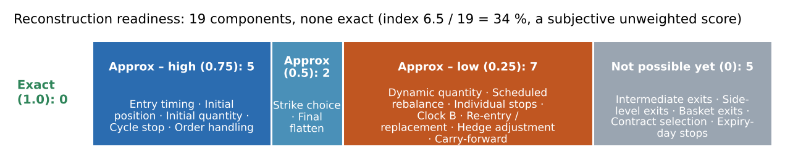
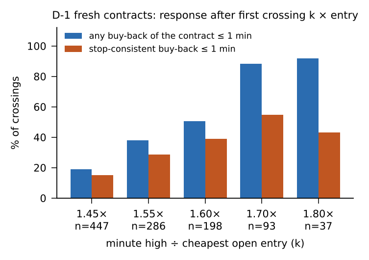
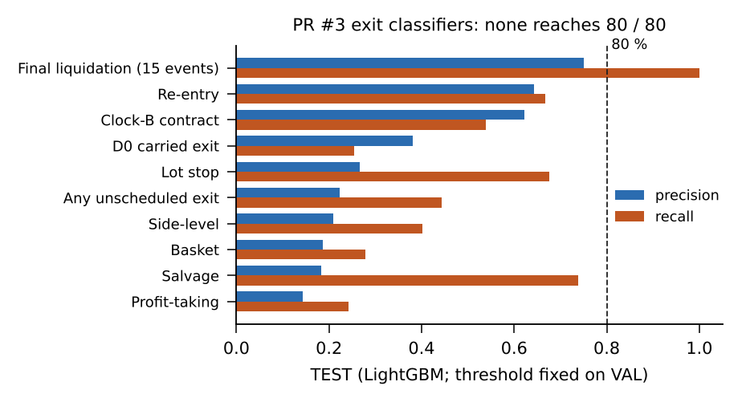
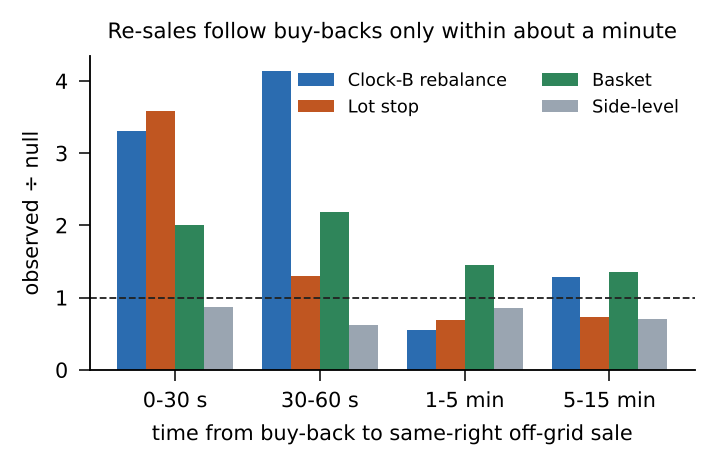

::: {.masthead}
::: {.mt}
Algo 8 Reverse Engineering — Research Summary
:::
::: {.ms}
Prepared for Rahul (Quant Researcher) · Research date: 11 November 2026 · Condensed from a 31-page detailed report · Exploratory research: every trading day in the sample has already been inspected · Basis: PRs #1–#7 of the Algo-8-Reverse-Engineer repository; detail in the 31-page archival report
:::
:::

# 1. Executive summary

**Objective.** Reverse-engineer "Algo 8", a NIFTY / SENSEX weekly-options strategy run for client GKOHNP140, from its broker trade export and 1-minute market data, and separately look for independent alpha. The only description supplied is three sentences: *BTST algorithm, carry-forward SL of 4 % on positions carried to expiry, 1 % on entire capital on expiry day; capital ₹2 crore.*

**What Algo 8 appears to do.** It is a weekly **short-option premium-carry engine**. Each weekly expiry is one cycle: the pre-expiry session (**D-1**) and the expiry session (**D0**).

- From 09:16 on D-1 it sells ATM calls and puts in one-lot child orders (65 NIFTY / 20 SENSEX), buys far-OTM **wings** for protection, and adds short straddles at **17 fixed clock windows**.
- It carries the hedged book into expiry day, then manages it with per-lot buy-backs, side and basket reductions and a **Clock-B** rebalancer (buy back one lot, re-sell near ATM).
- It liquidates on a **cycle loss limit** (≈ −₹1.30–1.35 lakh MTM) or flattens late on expiry day (15:14 in the later period).

**Data.** Fills-only broker export: 41,421 fills, 39,874 orders, 35 cycles (23 Jun – 22 Oct 2026). Breeze 1-minute bars: 85 sessions per index; 3,243 option contract-days (only contracts Algo 8 traded). There is no order book, bid/ask, full chain, decision log, allocation id or configuration.

**Method.** Two research lineages decoded the export, validated it against market data, labelled every order and tested candidate rules and ML models on **chronological whole-cycle splits**. Later passes corrected a data defect, studied allocation ownership, and built a causal OHLCV feature library.

## Five most important findings

1. **Structure is reproducible; decision logic is not.** The 17-window schedule (544 / 544), opening book, ATM rule, wing budget, base unit, order pricing (limit = LTP × 1.15 / 0.85) and cycle stop reproduce. Triggers for reductions, extra entries, re-entries and Clock-B actions do not. **0 of 19 components are exactly reconstructed.**
2. **A data defect was found and fixed.** Column 4 ("order id") is reused across days: grouping by it merges 4,840 real orders into 2,224 groups and drops 2,616 orders (6.6 %). All work now uses column 163 (`UniqueOrderIdentifier`); the first exit-engine results were withdrawn and rebuilt.
3. **A per-lot stop exists, but no single rule explains it.** After a D-1 contract's minute high crosses 1.7× its cheapest entry, 88 % of crossings are bought back within a minute, and ≈ 95 % of stop buy-backs occur at ≥ 1.5× the lowest entry. But **0 of 18** reference-price rules reach 80 % precision and recall (best on TEST: precision 0.27, recall 0.63).
4. **No model reproduces the decisions.** PR #3 exit classifiers on TEST: lot stop precision 0.27–0.37 / recall 0.52–0.68; side-level 0.21 / 0.40; basket 0.19 / 0.28. PR #1 ML decision engine: **0 of 20** tasks met its 75 / 75 standard.
5. **Allocation ownership cannot be inferred, and no alpha is demonstrated.** Ownership is identified for 3.5 % of 3,611 replacement lot pairs. Algo 8's +₹15.5 L gross P&L is premium carry with no measurable timing, sizing or directional skill.

## Current conclusion

| Question | Answer |
|-------|--------------------------|
| Reconstructed Algo 8's mechanics? | **Largely** — structure, clocks, pricing, risk limits (approximate) |
| Recovered its exact decision logic? | **No.** 0 / 19 components exact; readiness index 34 % is a **subjective, unweighted evidence score**, not the share of logic recovered |
| Identified an independent alpha? | **No.** The one searched candidate did not pass its reality check (p = 0.104); its locked out-of-sample test has not been run |
| Built a profitable executable strategy? | **No** |
| Untouched validation period? | **None exists.** Every date was inspected; TEST is contaminated for hand-derived constants |

::: {.pg2}

# 2. Data and strategy reconstruction

::: {.cols}
::: {.col}
## Data inventory and quality

| Dataset | Content |
|------|--------------------|
| Broker export | 41,421 fills → 39,874 orders; 35 cycles (18 NIFTY, 17 SENSEX); 65 sessions; fills-only |
| Index bars | 63,678 rows; 85 sessions per index; 72 missing minutes (12–22 Oct); **volume = 0 in every row** |
| Option bars | 1,230,065 rows; 3,243 contract-days; 95.2 % have all 375 bars; post-close bars (15:30–15:39) dropped |
| Option volume | Valid: 100 % lot multiples; ≥ Algo 8's own fills in 99.99 % of 24,898 traded minutes |
| Bar label | **Bar start** (97.3 % of fills inside the bar of their own minute vs 61 % / 59 % for neighbours) |
| Mapping | 100 % of orders have candles for their contract-day |

**Decoded semantics.** Tag prefix: numeric = body, `h_` = wing, `v_` = overnight lump hedge, `s_` = stop module, `m_` = manual. Every order is a marketable limit at LTP × 1.15 (buy) / × 0.85 (sell), so limit ÷ 1.15 or ÷ 0.85 recovers **the price the algo saw**. The unit-lot replay reconciles every contract position and cycle MTM (median difference ₹0).
:::
::: {.col}
## Limits of the data

| Can establish | Cannot establish |
|-----------|-----------|
| What was traded, when (fills to the second, body decisions to the minute), at what price | **Why**: no decision log, configuration or allocation id |
| The price the algo saw at each decision | Sub-minute order of events (bars are 1-minute) |
| Exact position and P&L | Which lot a buy-back closed (lots are fungible) |
| Behaviour around traded strikes | Untraded strikes, true IV, bid/ask, order book |
| Associations in Jun–Oct 2026 | Whether any rule holds outside this sample |

ATM straddle pairs exist in 99.8 % of D-1 minutes but only 84–91 % on D0. NIFTY and SENSEX returns correlate 0.95, so there are ≈ 85 independent days, not 170.
:::
:::

## Weekly architecture: observed vs inferred

| Component | Observed in the export | Reconstruction status |
|-----|------------------------|---------|
| Cycle | One cycle per (underlying, weekly expiry): D-1 builds the book, D0 manages and liquidates | Confirmed observation |
| Opening entries | First paired CE / PE short sale at **09:16**; opening book matches jointly in ≈ 28 / 32 sessions | Strong evidence |
| ATM strikes | Opening strike = nearest ATM to the 09:15 close (31 / 31). Later shorts within one strike of ATM 95–97 %, exactly ATM only ≈ 70 % | Opening: strong. Later: partial |
| Wings | Seed wings ± 2,000 pts NIFTY; SENSEX ± 4,000 then ± 2,000 from 16 Sep. Routine wing ≤ 2.5 % of the ATM leg premium (within one strike 92–95 %). Long ≥ short per right in every carry book | Strong evidence (approximate selector) |
| Quantity | Child unit 65 / 20 (confirmed); opening 3 units per role; modal ladder 3, 2, 3, 1 … (≈ half of later slots) | Unit: confirmed. Sizing formula: **unresolved** |
| Scheduled additions | **17 pre-expiry windows** with fresh CE / PE shorts in 544 / 544 cases; on D0 they continue while the book is active (95.1 % / 100 %, given the actual book) | D-1 times: confirmed. D0: strong, conditional |
| Extra entries | Off-schedule sales on both days | **Unresolved** trigger (timer model ranks minutes, AUC 0.887; rule search catches 13 / 93 events) |
| Lump hedge (`v_`) | On the heavier short side (29 / 31), 0.9–2.3 % OTM | Side / OTM: strong. Size: **unresolved** |
| Final flatten | Short book closed in the 15:14 minute in 9 / 10 late closures after 3 Aug; earlier period more spread | Strong (later period) |
| Indicators | 75 index and 14 option indicators tested with date-shuffled nulls and FDR: none identifiably used | Strong evidence (negative) |

## Reconstructed vs inferred vs unknown

::: {.three}
::: {.box}
**Observed / confirmed** — what the export directly shows: tags and modules, pricing band, one-lot child orders, the 17 pre-expiry windows (544 / 544), the exact lot-level position and P&L, cycle structure, 15:14 closures.
:::
::: {.box}
**Inferred, approximate** — rules consistent with the data but not validated: ATM and wing selectors, opening size, the cycle-stop level, the D-1 stop band (1.6–1.7×), Clock-B timing and one-lot size, modal ladder quantities.
:::
::: {.box}
**Not identified in the available data** — extra-entry trigger, exact stop reference, side / basket / partial-reduction triggers, Clock-B act / no-act, replacement strike and quantity, sizing formula, lump size, "4 %" and "1 %" rules, allocation ownership. *Not identified* does not mean the strategy has no such rule.
:::
:::

*Sources: findings register (DAT-01…09, STR, ENT, STK, SIZ, HDG), Phase 0 data audit, FINDINGS.md §0c.*

:::

::: {.pg3}

# 3. Exit engine research

All results below are from **PR #3** (rebuilt on the corrected order key). Splits are whole cycles: **DEV 18 / VAL 8 / TEST 9**; thresholds are fixed on VAL and TEST is scored once. Five measures are kept apart throughout: exit-event association, stop-consistent classification, ML event prediction, autonomous replay, replay P&L.

| Component | What we found | Status |
|------|-----------------------------|-------|
| **Individual lot stop** | Hazard steps up between 1.55× and 1.7× the cheapest entry on D-1 (1.5 % → 10.5 % → 52 % per minute); closes **one lot at a time**; covers only ≈ 45 % of stop-like exits. D0 is weak; carried lots show no per-lot stop. No trailing stop or points floor | Strong evidence for the band; **exact rule unresolved** |
| **Stop constant (PR #5)** | Six reference prices × k 1.40–2.00 × three ownership conventions: **0 of 18** rules reach 80 / 80. Best (own entry, k = 1.55) TEST precision 0.27 [0.21, 0.32], recall 0.63 [0.58, 0.68]. ≈ 95 % of stops occur at ≥ 1.5× the lowest entry, but most 1.5× crossings are not stopped within minutes | UNKNOWN retained |
| **Side-level / basket** | Side-level reductions respond to adverse spot moves (AUC +0.21 over timing + inventory); basket reductions barely do (+0.03). Trees: precision 0.11 / 0.05 | Triggers **unresolved** |
| **Cycle stop** | `s_` module liquidates when cumulative MTM ≈ −₹1.30–1.35 lakh (executed −₹1.44 L average; 12 stops; 1–20 s latency); both days; no false triggers at −₹1.25 to −1.5 L | Strong evidence |
| **Clock-B** | Ticks :14 / :29 / :44 / :59 on D0; 42–47 % act; one lot bought back, same lots re-sold a median 28–48 s later (mostly another strike, not strictly ATM) | Timing: strong. Act / no-act and contract choice **unresolved** |
| **Carry "4 % SL"** | Six interpretations tested; none separates triggers on DEV, VAL and TEST. The "1 % / ₹2 L expiry stop" is not observed | Unresolved / rejected as stated |
| **Replacement / re-entry** | Re-sales within ≈ 60 s of buy-backs are 3–4× chance after Clock-B and lot stops; none beyond a minute (see page 4) | Association strong; rule **unresolved** |

::: {.charts}

:::

## Autonomous replay and why exact rules remain unknown

| TEST (9 cycles; actual P&L +₹7.5 L) | Exit-match P / R | Replay P&L |
|--------------|----|----|
| Mode A (actual entries, model exits), minute-open fills | 0.40 / 0.24 | +₹4.6 L |
| Mode A, adverse fills (buys at high, sells at low) | 0.47 / 0.16 | −₹10.3 L |
| Mode B (fully autonomous), minute-open / adverse | 0.37 / 0.12 → 0.38 / 0.12 | −₹3.5 L / −₹6.1 L |

Which exits match barely moves with fills, so low fidelity is a **decision** problem, not an execution problem. Replay P&L swings sign with fills and is not evidence of reconstruction. Ablation shows the models rely on the premium ratio and spot move (average precision 0.39 → 0.27 / 0.33 when removed); Greeks, IV, inventory, timing and clock add nothing. **Why unknown:** the data show *that* the algo acts near price levels and clocks, not which allocation it managed, when it checked, or what else it evaluated. Every model hits the same ceiling with the same features, so the missing ingredient is information (decision logs, allocation ids, order lifecycle), not model capacity.

*Sources: EXIT_ENGINE_FINDINGS.md §3–10; exit_model_metrics.csv; autonomous_replay_metrics (three fill files); stop_ref_verdict.csv.*

:::

::: {.pg4}

# 4. Allocation and ML research

## Allocation reconstruction (PR #5)

Allocation ids are not in the data, so "allocation" is a hypothesis. Three definitions were built from the same clean orders — **slot** (schedule window × right; 6,545 allocations), **chain** (timer-phase chains; 4,355) and **lot** — and every test was repeated under **cheapest-first, FIFO and LIFO** ownership conventions.

::: {.cols}
::: {.col}
| Test | Result |
|----------|---------------|
| Contract chosen at D-1 stop buy-backs (691; random 0.115) | Lowest individual entry 0.560; slot 0.551; chain 0.556; **contract average 0.493** (gap 6.7 pts, 90 % CI [3.4, 9.9]) |
| Stop-reference sharpness (AP, D-1) | Lowest entry 0.36 / 0.24 / 0.39 vs contract average 0.22 / 0.13 / 0.32 (DEV / VAL / TEST) |
| Allocation-sized stops | Stops close one lot; 14–19 % of D-1 stops contradict a whole-allocation close |
| Wing coupling | Released wing in the closed short's allocation 26.6 % (slot) vs null 17.7 % |

**Reading.** The stop is anchored to an **individual entry or a very small allocation**, not the contract-average position. Because 56–63 % of allocations are single lots, the tests **cannot separate "per lot" from "per small allocation"**.
:::
::: {.col}

**Buy-back → re-sale linking.** 11,007 buy-backs (15,327 lots) linked to 13,410 later same-right sales under a capacity rule: no buy-back is matched to more lots than it closed, no sale lot is used twice. Clock-B labels behave as named; side-level reductions are not followed by re-sales; after a minute, pairs are at or below chance.
:::
:::

**Ownership ambiguity.** Of 3,611 replacement / re-entry lot pairs: **73.1 %** have competing buy-backs on ≥ 2 contracts within 15 minutes, **23.4 %** change owner with the ownership convention, and only **3.5 %** are identified. Slot and chain models almost never agree that a re-sale continues the old allocation (0.4–0.8 % and 2.6–3.6 %). **Allocation ownership is not identified in the available data.**

**What zero-mismatch reconciliation proves.** All nine lifecycle ledgers (3 linkage models × 3 conventions) reproduce the observed short inventory after every one of **39,874 orders** — **0 mismatches**, 0 negative inventories. This **proves** the replay accounting, linkage bookkeeping and capacity constraints are correct and nothing is double-counted. It **does not prove** any allocation model is right: conservation holds by construction because every model partitions the same exact lot replay, and a wrong ownership story conserves inventory just as well.

## Machine-learning results — two separate lineages (not comparable)

| | **PR #1** (lineage X, ML decision engine) | **PR #3** (lineage Y, exit engine) |
|---|----------|----------|
| Dataset | 1,280,181 minute-opportunity rows | 205,752 contract-minute rows (DEV 106,389 / VAL 43,679 / TEST 55,684) |
| Target | Next-minute **received** execution action at basket / side / contract level (≈ 20 tasks) | Taxonomy-labelled exit classes plus a label-free "any unscheduled buy-back" |
| Validation | Six expanding chronological folds (train 8 → 28 cycles; 4-cycle test blocks); precision and recall ≥ 0.75, ≥ 30 events, ≥ 5 cycles registered in advance | DEV 18 / VAL 8 / TEST 9 cycles; thresholds on VAL; TEST scored once |
| Models | Logistic, LightGBM, CatBoost, GAM, hazard | Logistic, LightGBM, CatBoost, depth-3 trees, hazard |
| Result | **0 of 20** tasks meet the standard. Best: `initial_entry` 0.83 / 1.00 on only 19 events; `add_both` 0.70 / 0.62; `new_short` 0.38 / 0.46; `reenter` 0.08 / 0.22. Replay: **0 predicted orders** (abstention-limited; the "inventory reproduced" flag describes an empty book) | None reaches 80 / 80 (see page 3). Re-entry 0.64–0.67 / 0.63–0.67 against a 44 % base rate; final liquidation 0.75 / 1.00 on only 15 events |

Both fail at the same place — different targets and models, same ceiling — which points to missing information rather than a modelling choice.

*Sources: ALLOCATION_FINDINGS.md; REPLACEMENT_REENTRY_FINDINGS.md; replacement result files; state_transition_metrics.csv; PR #1 artifact report (run 41223605040, expires 30 Nov 2026).*

:::

::: {.pg5}

# 5. OHLCV and alpha research

## PR #6 — OHLCV research foundation: Phases 0 and 1 are complete

| Item | Result |
|-----|------------------------|
| **Phase 0 data audit** | Bars labelled by start; no duplicates; 100 % ledger-to-candle mapping; index volume invalid (zero); option volume valid. The audit identifies the usable sample: Track A 35 cycles / 65 sessions; Track B index signals 85 sessions; option work 67 underlying-sessions |
| **Phase 1 feature library** | **42 market features** in six groups + 4 clock fields: momentum (returns, EMA slope, RSI, MACD, ADX), mean reversion (z-score, %B, EMA distance), volatility (ATR, realised, Parkinson, range expansion, width), market structure (opening range, previous-day levels, gap, session range), option OHLCV and volume, ATM-straddle premium (an observed premium, **not** implied volatility) |
| **Redundancy** | 8 feature pairs with \|ρ\| > 0.9 (e.g. RSI / EMA distance / EMA slope / %B), so results can be attributed to **families**, not a named formula |
| **Leakage and causality** | Each row uses only bars completed before its decision minute; 5-minute bars released at their end; sessions, contracts, expiries and instruments never mix; nothing fitted on the whole sample. **25 tests pass**, including truncation invariance on real data; **12 of 12** deliberately injected leaks are caught |
| **Proposed design** | Seven opportunity panels (entry sizing, extra entries, buy-backs, side, basket, Clock-B, hedges) and two baselines; a market family must add information over clock + inventory **plus** premium-vs-entry and cycle MTM, so the known stop effect is not mistaken for an indicator |

**Phase 2 (indicator-trigger models and alpha screening) is not complete.** No Phase-2 result exists in the repository: the panel builder, model runner and screening script were started and halted, and nothing from them is reported here.

## Alpha: what we know

| Algo 8 P&L, 30 complete cycles (gross, ₹ lakh) | |
|----------------|--|
| Body shorts held to expiry (carry) | **+31.1** |
| Management of those shorts (stops, rebalances) | −5.8 |
| Wings / overnight lump | −5.9 / −4.0 |
| **Actual total** | **+15.5** (t = 1.39) |

- **No skill detected:** timing vs selling the ATM straddle every minute: −0.3 bp (D-1), −3.0 bp (D0); sizing Spearman +0.17, p = 0.34; book delta vs next 15 / 60-min move: −0.007 / +0.025.
- **Market premium not significant:** ATM straddle sold on D-1 and held to expiry earned +3.9 bp of spot, 95 % CI [−12.3, +19.3]; negative after removing the best two sessions. Carry was directional: short calls +₹53.8 L, short puts −₹22.7 L in a window where both indices fell (NIFTY ≈ −7 %).
- **Independent attribution (lineage X):** ₹18.9 L marked over 32 cycles, ₹4.75 L under conservative costs, −₹4.8 L under adverse execution; removing the two largest winners turns it negative.

## Searched candidate strategy (PR #2) and its statistical caveats

| Item | Value |
|----|--------------------------|
| Strategy region | BTST: sell the ATM straddle on the D-1 afternoon, 1.55× per-lot stop, exit at the D0 open; pre-registered **H1** = sell 1 ATM straddle at 13:16 on D-1, exit D0 09:16 |
| Search | **4,512** structural configurations + 480 execution-stress variants on 30 cycles (Jun–Oct 2026); BTST median Sharpe 2.99 vs D0-only −0.55 |
| Execution stress | Top region under bar-high stop fills and adverse costs: Sharpe 5.2, PF 3.0, +₹16.2 K per lot, both indices positive |
| Selection-bias tests | **White reality check p = 0.104; probability of backtest overfitting (PBO) = 0.25** — not significant after accounting for the search |
| Status | H1 frozen (SHA-256 hashes, commit `d695b777`) for a locked out-of-sample test that **has not been run** (needs 2025–26 history and confirmed lot sizes) |
| Caveats | Development statistics come from a searched grid in one falling-market window (NIFTY ≈ −7 %), with only 12 stop cycles; NIFTY and SENSEX are 0.95 correlated; no untouched data; entry universe is limited to contracts Algo 8 traded |

**Has independent alpha been demonstrated? No.** The sample is one four-month, falling-market window in which every date was inspected; no genuinely untouched validation data exists. An earlier backtest screenshot (Mar 2025 – May 2026, Sharpe 2.19) has no trades behind it and was not reproduced. The OHLCV alpha families (premium vs realised move, momentum, mean reversion, opening-range breakout, volatility compression) are defined but **not yet tested**.

*Sources: data_manifest.md; OHLCV_FEATURE_CATALOG.md; FINDINGS.md §0d–0e; register ALP-01…03.*

:::

# 6. Findings, limitations and next steps

## Key findings

| Component | Finding | Confidence | Status |
|------|-----------------------------|------|---------|
| Order identity, pricing | Column 4 reused across days, column 163 unique (39,874 orders, 0 violations); limit = LTP × 1.15 / 0.85; tags decoded | High | Confirmed observation |
| Schedule | 17 pre-expiry windows, 544 / 544 | High (in-sample) | Confirmed observation |
| Opening book, wings | 09:16 ATM entry, seed wings, ≤ 2.5 % wing budget (strong); later strikes within one strike 95–97 %, ladder ≈ half of later slots (partial) | Medium–high | Strong / partial |
| Indicators | No classical indicator identifiably used | Medium–high | Strong evidence (negative) |
| D-1 lot stop | 88 % at 1.7×; ≈ 95 % of stops at ≥ 1.5×; one lot at a time | Medium | Strong (band); rule **unresolved** |
| "1.55× / 74 %" stop claim (PR #2) | Reproduces only under its own definition; inflated by pre-trigger exits, follow-on lots, closed lots | High | **Rejected as stated** |
| Single stop rule ≥ 80 / 80 | 0 of 18 rules | High | **Rejected hypothesis** |
| Cycle stop | ≈ −₹1.30–1.35 L cumulative MTM (strong); the "1 % / ₹2 L expiry stop" is not observed (rejected) | Medium–high | Strong / rejected |
| Side-level reductions | Respond to adverse spot moves; trigger unknown | Medium | Partial reconstruction |
| Clock-B | Timing and one-lot size known; act / no-act, contract unknown | Medium–high | Partial reconstruction |
| Re-sale linkage | Real within ≈ 60 s only | Medium–high | Strong evidence |
| Allocation ownership | Identified for 3.5 % of pairs | High (negative) | **Unresolved** |
| ML reproduction of decisions | No class ≥ 80 / 80 (PR #3); 0 / 20 ≥ 75 / 75 (PR #1) | High (negative) | Rejected hypothesis |
| Economic alpha | Not demonstrated | Medium–high | Unresolved |

::: {.cols}
::: {.col}
## Major unresolved questions

- Exact entry and extra-entry conditions
- Exact stop trigger, reference and ownership; why most 1.5× crossings are not stopped
- Clock-B act / no-act and contract choice
- Replacement strike and quantity
- Dynamic sizing and capital link; lump size
- Hedge-adjustment logic
- Meaning of the "4 %" and "1 %" rules
- Cycle stop: in 7 of 12 stop cycles, short fills follow the liquidation within ≈ 140 s (603 lots) — possibly in-flight orders; unexplained
:::
::: {.col}
## Limitations

- **Sample:** 35 cycles in four months; 12 cycle stops; 9 TEST cycles
- **Independence:** NIFTY–SENSEX correlation 0.95
- **No untouched dates**; all results exploratory
- **No full option chain**, bid/ask or order book; index volume zero
- **Minute bars:** triggers bracketed, not timed; fills and costs are assumptions (replay P&L ranges +₹4.6 L to −₹10.3 L on identical decisions)
- **Multiple testing:** thousands of variants searched
- **Small classes** (e.g. 15 final-liquidation events)
:::
:::

## Five prioritized next research tasks

| # | Task | Expected output | Why it matters |
|-|--------------|-----------|---------|
| 1 | **Run H1's locked out-of-sample test** (fetch 2025–26 history; confirm lot sizes) | Pass / fail on unseen data | Only route to genuine alpha evidence |
| 2 | **Obtain more Algo 8 trade months**; re-apply frozen findings unchanged | Which rules hold on new months | Only out-of-sample test of the reconstruction |
| 3 | **Finish Phase 2 Track B** (five pre-registered families, BH / Holm) | Reject / keep list with costs | Cheaply eliminates or promotes simple hypotheses |
| 4 | **Finish Phase 2 Track A** (seven panels, premium-aware baseline) | Whether any OHLCV family adds information | Closes the indicator question on clean data |
| 5 | **Explain post-cycle-stop fills**; request order-lifecycle records | In-flight orders or stop-module behaviour | Affects the key risk control |

**Final conclusion.** We have reconstructed *what* Algo 8 does with approximate accuracy but not *why*: the original decision engine has **not** been identified, no component is exact, and no independent alpha has been demonstrated. An approximate behavioural replica is possible; exact reconstruction needs decision logs, allocation ids, order-lifecycle records or genuinely new trade data.
