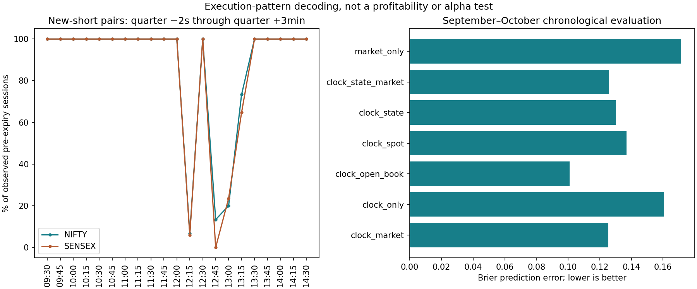

# What repeatedly triggers additions in the observed Algo 8 cycles?

**The strongest decoded pattern is a scheduled pre-expiry build-up of short
straddles. A market-dependent rule for every extra trade, and economic alpha,
remain unproven.** Spot, option prices and reconstructed positions were aligned
before each decision opportunity, then compared with opportunities without an
addition. All times below are IST.

## 1. Seventeen recurring pre-expiry windows

Across **all 32 observed pre-expiry sessions** (15 NIFTY, 17 SENSEX), a fresh
same-strike CE/PE short pair occurs in every one of these windows:

| Window starts | Observed attendance |
| --- | --- |
| 09:30, 09:45 | 32/32 at each time |
| 10:00, 10:15, 10:30, 10:45 | 32/32 at each time |
| 11:00, 11:15, 11:30, 11:45 | 32/32 at each time |
| 12:00, 12:30 | 32/32 at each time |
| 13:30, 13:45 | 32/32 at each time |
| 14:00, 14:15, 14:30 | 32/32 at each time |

That is **544/544 session-window observations**. It repeats in the earlier 18
sessions and the later 14 sessions; these are repeated observations within 32
sessions, not 544 independent experiments. The initial opening around 09:16 is
separate from this later build-up.

An execution window is **[listed time − 2 seconds, listed time + 3 minutes)**.
This does not mean an exact fill at, for example, 10:00:00, nor does it establish
an unconditional instruction on unobserved eligible dates. The CSV identifies
fresh short parents, not an original four-leg basket ID. Long-wing coupling
and quantity for each scheduled basket are not inferred from this count.

**Timestamp correction:** CE and PE can have different order-label minutes, and
NIFTY afternoon first fills can occur one second before the quarter. Requiring
identical label minutes or exact minute boundaries produced apparent skips.
The strict zero-early-tolerance counts and coarser label counts are retained in
`addition_clock_recurrence.csv`; for example, strict NIFTY 14:15 attendance is
6/15, versus 15/15 with the two-second tolerance. Source rows and exact first/
last fills are preserved. Every positive pre-expiry opportunity also has a
same-strike paired execution burst under the separate two-second clustering
check; attendance is not created merely by combining unrelated far-apart fills.

Other quarter-hour windows are different:

| Window | NIFTY | SENSEX |
| --- | ---: | ---: |
| 12:15 | 1/15 | 1/17 |
| 12:45 | 2/15 | 0/17 |
| 13:00 | 3/15 | 4/17 |
| 13:15 | 11/15 | 11/17 |

The 13:15 pattern changes over calendar time: it appears in the first 11 observed
NIFTY sessions through 21 September, then none of the final four; in the first
11 SENSEX sessions through 9 September, then none of the final six. A changed
schedule/configuration is a plausible explanation. A specific market filter
causing this change has not been recovered. Do not invent a date switch as an
original rule.

## 2. The additions do not require falling premiums or one market direction

Features use completed data with a one-minute embargo before the execution
window. Among the 544 universal-window additions:

- The preceding five-minute spot return is positive in **273**, negative in
  **271**. The observed range is approximately −0.256% to +0.245%.
- The known reference straddle's five-minute premium change is positive in
  **227**, negative in **309**, unchanged in **6**; two quotes are unavailable.
- The same-strike IV proxy's 15-minute change is positive in **184**, negative
  in **328**; 32 comparisons are unavailable. These are model estimates, not
  exchange-provided IV observations.

Examples from the later period, using information available before each window:

| Date / index | Window | Spot 5m | Reference premium 5m | IV change 15m | New short CE / PE quantity in window |
| --- | --- | ---: | ---: | ---: | ---: |
| 16 Sep, SENSEX | 09:45 | −0.127% | +1.236% | +0.150 points | 60 / 60 |
| 16 Oct, NIFTY | 09:45 | +0.165% | −1.534% | −0.255 points | 195 / 195 |

The last price bar in these examples starts at 09:43. Premiums refer to an
already sold strike known before the window, not a future-selected strike.
This evidence rejects “additions only happen after premiums fall” and “every
addition needs IV to rise.” It does not rule out a broad volatility eligibility
filter or prove that a timer alone explains all trading.

## 3. Repeated parent-order sizing and near-ATM selection

Partial fills were collapsed into parents before counting. Out of 39,874
reconstructed parent orders, 13,403 are unambiguously pure new-short parents;
11 mixed or tie-sensitive new-short candidates are excluded.

| Pre-expiry index | Common new-short parent quantity | Frequency |
| --- | ---: | ---: |
| NIFTY | 65 | 2,022 / 2,032 (99.5%) |
| SENSEX | 20 | 2,375 / 2,375 (100%) |

These are units per parent order, not a guarantee of one order per basket or
the verified exchange lot size on other dates. Several parents often arrive
together. For example, the 09:45 window has 195 CE and 195 PE total new shorts
on 13/15 NIFTY dates, and 60/60 on 16/17 SENSEX dates. Extra coincident orders
can change the window totals. Maximum exposure and the complete sizing formula
are unresolved.

For later paired execution bursts between 09:30 and 14:45, nearest-strike
rounding of the preceding completed cash-index close matches **1,123/1,379
NIFTY bursts (81.4%)** and **710/899 SENSEX bursts (79.0%)**. Option-parity forward
rounding matches fewer: 925/1,379 and 481/899. This supports continued near-ATM
selection using the index as a useful proxy. It is not a perfect quote/strike
decoder; different allocations and quote timing remain material.

## 4. Test on later cycles: clock versus market and position state

There are 1,365 quarter-hour opportunities in 65 sessions with fills. Calibrate
on expiries through 31 August: 798 opportunities / 20 cycles. Evaluate on
September–October expiries: 567 opportunities / 15 cycles. Keep whole cycles
together and cross-fit calibration clock probabilities by cycle. Later months
were previously examined, so this is chronological evaluation, not a blinded
holdout. Model choices are in the [protocol](ADDITION_PATTERN_DISCOVERY_PLAN.md).

There are 245 positive and 49 negative later pre-expiry opportunities. The
clock-only attendance model achieves **281/294 correct (95.6%)**, **96.0%
precision**, **98.8% recall**, and **89.2% balanced accuracy**. These statistics
describe the 21 tested windows, not every minute or every trade in a session.

Brier score measures probability prediction error; lower is better. These are
trade-occurrence predictions, not investment returns:

| Model | All later opportunities | Pre-expiry | Expiry, short book still open |
| --- | ---: | ---: | ---: |
| Clock only | 0.1606 | 0.0475 | 0.2351 |
| Clock, only while a short book is open | **0.1009** | 0.0475 | 0.2351 |
| Market features without clock | 0.1714 | 0.1720 | **0.1571** |
| Clock + spot | 0.1368 | **0.0442** | 0.2289 |
| Clock + market | 0.1254 | 0.0453 | 0.2297 |
| Clock + position state | 0.1303 | 0.0968 | 0.2460 |
| Clock + position state + market | 0.1258 | 0.0957 | 0.2322 |

Interpretation and counterevidence:

- Pre-expiry occurrence is largely explained by the schedule. The small market
  improvement over clock has a week-cluster bootstrap interval crossing zero:
  +0.00214 Brier improvement, 95% interval **[−0.00675, +0.00948]**.
- Recognizing that the book is already flat helps expiry prediction. The simple
  clock/open-book rule is stronger overall than the fitted market/state trees.
  This is not discovery of the stop threshold that flattened the book.
- Market-only does improve probability error on the **184 active expiry
  opportunities** over clock: +0.07792, interval **[+0.05509, +0.09502]** across
  only six expiry weeks. Its occurrence recall is just **54.1%**, versus 75.8%
  for clock; F1 is 0.694 versus 0.818. This is a real predictive lead in this
  retrospective sample, not a recovered universal trigger or profit edge.
- Adding market features to clock+state yields only +0.00449 overall, interval
  **[−0.00020, +0.01073]**. A price/IV condition that improves reliably beyond
  state has not been established. Several exploratory models were compared;
  these intervals do not correct for that search.
- The secondary afternoon single-condition search selects **clock-only**, ahead
  of premium, spot movement, IV change, equity and time-since-last-pair candidates
  on calibration cycle cross-validation. Later performance does not justify
  replacing the clock with one of those thresholds.

Some fitted trees split near −0.422% cycle MTM/capital. This is an approximate
learned separator, not the original stop: it can distinguish sessions that have
already stopped/closed. It must not replace the supplied 1% expiry-day capital
stop or be added to the rulebook as a decoded control.

## 5. Extra additions outside quarter-hour windows

There are 151 pre-expiry and 315 expiry off-quarter case minutes in the studied
09:30–14:45 band. All 151 pre-expiry cases and 160 expiry cases have eligible
same-clock controls from other observed sessions with the same index, phase,
period block and open/flat book state. Report unmatched cases rather than
silently extending their matched results.

| Known prior condition | Pre-expiry cases versus controls | Expiry cases versus controls |
| --- | ---: | ---: |
| Median difference in absolute 5m spot move | +0.00256 percentage points | +0.00446 percentage points |
| Median difference in distance from last short strike | −0.069 strike steps | −0.040 strike steps |
| Median difference in larger leg's premium change | −0.34 percentage points | +3.83 percentage points |
| Median difference in 15m IV change | −0.014 IV points | −0.103 IV points |
| Any short buyback in known preceding 5m | 11/151 (7.3%); controls 15.0% | 69/160 (43.1%); controls 38.9% |

No single condition in this comparison explains most off-quarter additions.
Expiry extras show somewhat more leg-price stress and recent covers; pre-expiry
extras mostly have **no recent cover** in the measured window. Therefore “all
middle trades are risk-reducing adjustments” is inconsistent with the evidence.
The earlier Greek study also finds most new-short batches increase short-vega
exposure. Some trades may re-enter after covers; others add exposure.

These matched differences are descriptive, not causal tests or independently
validated trigger thresholds. Features are embargoed by one minute, so immediate
buyback/re-entry sequences can be missed. Parent timestamps and the starting
inventory are inferred, not exporter-confirmed. A fuller order state machine
must allow single-sided additions, covers, pending orders and renewed entries.

## 6. What has and has not been decoded

The strongest current reconstruction is:

```
around 09:16 on observed pre-expiry sessions: open protected near-ATM allocations
at 17 recurring windows: build additional short CE/PE allocations
during both sessions: also cover, add/re-enter, and change protection
when the book is closed: later scheduled additions often cease on expiry day
```

This supports staggered premium selling plus separate management decisions.
It does not establish that each new sale is a response to rising IV, a belief
that the market is currently range-bound, or a risk-reducing action. The complete
entry-eligibility, extra-entry, hedge-selector and stop/re-entry functions remain
unresolved. Initial four-role timing was established earlier; this study does
not claim every subsequent short pair is an atomic four-leg fill.

**Economic alpha is still not established.** The existing risk-matched frozen-
basket benchmark does not show repeatable incremental improvement overall;
SENSEX's stronger result remains a separate lead. Successful prediction of
execution times cannot substitute for profit after costs at comparable risk.

## Reproduction and artifacts

Run `python research/discover_addition_patterns.py --plot`. This run used Python
3.12, numpy 2.3.5 and scikit-learn 1.8.0; matplotlib generates the optional chart.
Run checks with `python -m unittest discover -s research -p
test_addition_pattern_discovery.py -v`.

The `research/outputs/addition_*` artifacts contain parent/source-row audits,
paired bursts, causal opportunity features, all later predictions, per-cycle
scores, matched controls and differences, strike checks, model comparisons,
raw tree/support information and the JSON summary. The session-exclusion file
lists NIFTY 1 and 29 September with no recorded expiry-day fills; they are not
assumed negative opportunities. Sparse/missing option quotes are never filled
to invent replay prices. Model-feature imputation is calibration-only.



Related evidence: [IV/theta hypothesis](IV_THETA_HYPOTHESIS_FINDINGS.md),
[benchmark](HEDGED_STRADDLE_BENCHMARK_FINDINGS.md),
[working rulebook](../ALGO8_RULEBOOK.md).
