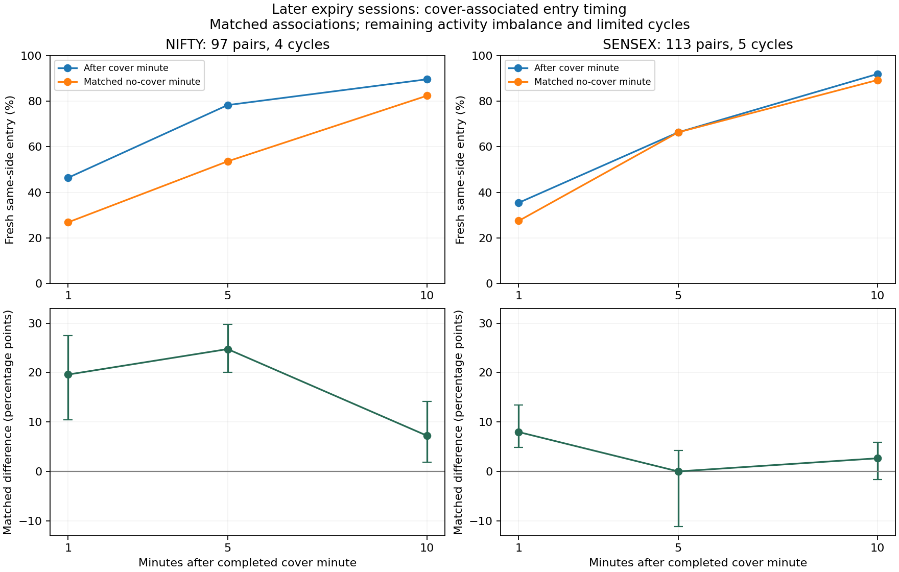

# Does covering trigger a new entry? Controlled Algo 8 study

**There is a NIFTY expiry-day association, but no recovered general cover-to-
re-entry trigger.** It also predicts entries on the opposite side, matches are
drawn from only four later NIFTY cycles, stricter matching has very limited
support, and adding cover history barely changes predictive performance.
SENSEX does not replicate the five-minute later-sample association.

This executes the first recommended experiment in the supplied assessment.
The initial specification is `COVER_REENTRY_TEST_PLAN.md`; the balance-driven
strict sensitivity is explicitly recorded as a later amendment. Data through
31 August set scaling and model fits; later dates were already inspected in
earlier research and are not untouched independent validation.

## 1. Correct the probability question

The original counts—136/2032 versus 1802/4210 NIFTY and 165/2375 versus
2613/4786 SENSEX—measure **P(recent cover | fresh short parent)**. They do not
say that 42.8% or 54.6% of covers cause another entry.

At the cover-minute level, the forward descriptive question gives:

| Index | Phase | Cover_minutes | Entry_within_5min |
| --- | --- | --- | --- |
| NIFTY | preexpiry | 182 | 76/182 (41.8%) |
| NIFTY | expiry | 1151 | 769/1151 (66.8%) |
| SENSEX | preexpiry | 304 | 111/304 (36.5%) |
| SENSEX | expiry | 1490 | 1069/1490 (71.7%) |

The units differ from the original parent-order table: multiple covers in one
minute are collapsed. This is not a numerical reciprocal. Simultaneous entries
are included in this descriptive table, and final shutdowns count too. A single
late SENSEX cover after 15:35 cannot have five observable minutes before 15:40
and is excluded here. The matched experiment below separates the time ordering.

## 2. What was matched

A landmark T is the boundary after the cover minute completes. A treatment
requires a cover in [T−1m,T), preceded by five quiet cover minutes. The forward
outcome is a fresh same-side short-parent first fill in **[T,T+5m)**. This starts
strictly after the completed cover minute, not necessarily exactly five minutes
after its first fill. Horizons one and ten minutes are sensitivities.

Both treated/control landmarks require an active same-side short before the
previous minute and some short book still active at T. Full-flat events and
missing prior state are recorded as exclusions, not negative outcomes. The
common clock band is 09:16–15:04, leaving all horizons before 15:15.

Match within the **same index, expiry cycle, date and option right**, with the
same quarter-hour phase, identical timer-overlap seconds in the next five
minutes, and no more than 45 minutes' time difference. Nearest controls use
remaining quantities, premium-loss/equity state, Greeks, IV, spot returns,
range and recent entry activity, scaled on earlier rows only. Controls have no
cover in the preceding six minutes. They may cover later; that crossover is
reported rather than removed using future knowledge. Outcomes never select
the match. Controls can be reused; uncertainty resamples expiry weeks.

Primary matching on remaining inventory asks whether cover history adds
information **given the current book**. It may condition away a mechanical
quantity-replacement pathway. The pre-cover-state sensitivity is reported
separately; neither comparison identifies causation.

## 3. Later five-minute comparisons

| Index | Phase | Matched | Cycles | After_cover | Control | Difference_pp | Weekly_interval_pp |
| --- | --- | --- | --- | --- | --- | --- | --- |
| NIFTY | preexpiry | 46/50 | 7 | 32.6% | 41.3% | -8.7 | [-32.2, +7.8] |
| NIFTY | expiry | 97/118 | 4 | 78.4% | 53.6% | +24.7 | [+20.0, +29.8] |
| SENSEX | preexpiry | 69/72 | 7 | 34.8% | 31.9% | +2.9 | [-5.5, +17.9] |
| SENSEX | expiry | 113/135 | 5 | 66.4% | 66.4% | +0.0 | [-11.1, +4.2] |

NIFTY expiry: **76/97** cover landmarks versus **52/97** controls contain a fresh
same-side short in the next five minutes. The 97 matches cover 97/118 eligible
onsets (82.2%), but only **four cycles**, with 90 distinct controls. SENSEX has
**75/113 on each side of the comparison**, across five cycles and 108 distinct
controls. Pre-expiry results do not support a common cover-driven entry rule.

## 4. The NIFTY effect is not specific to the covered side

| Index | Outcome | After_cover | Control | Difference_pp |
| --- | --- | --- | --- | --- |
| NIFTY | entry1 | 46.4% | 26.8% | +19.6 |
| NIFTY | offtimer_entry5 | 35.1% | 21.6% | +13.4 |
| NIFTY | opposite_entry5 | 80.4% | 54.6% | +25.8 |
| NIFTY | both_rights_entry5 | 75.3% | 49.5% | +25.8 |
| NIFTY | later_label_entry5 | 78.4% | 53.6% | +24.7 |
| NIFTY | backward_entry5 | 69.1% | 58.8% | +10.3 |
| SENSEX | entry1 | 35.4% | 27.4% | +8.0 |
| SENSEX | offtimer_entry5 | 43.4% | 46.9% | -3.5 |
| SENSEX | opposite_entry5 | 72.6% | 72.6% | +0.0 |
| SENSEX | both_rights_entry5 | 61.1% | 61.1% | +0.0 |
| SENSEX | later_label_entry5 | 66.4% | 63.7% | +2.7 |
| SENSEX | backward_entry5 | 61.9% | 54.0% | +8.0 |

NIFTY's opposite-side effect is at least as large as its same-side effect.
Both rights receive entries in 73/97 post-cover windows versus 48/97 controls;
these entries need not be simultaneous, equal sized or at one strike. This is
compatible with portfolio/allocation activity and does not isolate a rule that
reopens just the stopped leg. Entries also precede these covers more often than
they precede controls, warning of a pre-existing trading burst.

Removing physical timer-window entries leaves a NIFTY association, but this
does not fully remove delayed timer submissions. Candidate order-label checks
exclude already-labeled pending fills from the later-label outcome; order labels
are minute-resolution inferred timestamps, not verified submission records.

## 5. Balance and common support limit the conclusion

Primary match balance still shows material recent-entry/range differences:

| Index | Largest_absolute_SMD | Feature |
| --- | --- | --- |
| NIFTY | 0.523 | since_entry |
| SENSEX | 0.273 | new_short1 |

Therefore the primary controls should not be called perfectly equivalent.
The stricter diagnostic requires exact recent-entry zero/nonzero states,
tighter market/activity calipers and mean distance <= 0.5:

| Index | Matched | Coverage | After_cover | Control | Weekly_interval_pp |
| --- | --- | --- | --- | --- | --- |
| NIFTY | 15/118 | 12.7% | 80.0% | 60.0% | [+0.0, +50.0] |
| SENSEX | 3/135 | 2.2% | 66.7% | 100.0% | Too few weeks |

The 80% NIFTY treated rate here is only 12/15 cases, with a 60% control rate and
12.7% matching coverage; it is not an 80%-recovered trigger. The interval includes
no difference. SENSEX has three matched cases, insufficient for a weekly interval.
Tightening balance sacrifices common support. Four cycles and retrospectively
inspected data cannot establish an independent general mechanism.

## 6. Does cover history improve prediction beyond known state?

Fixed regularized logistic models use clock/timer, current inventory, recent
entries, side and market/risk features. The second model adds prior-minute
cover, onset, recent cover quantity and time since cover. Earlier validation
holds complete cycles apart; later fits/thresholds are frozen. Lower log loss
and Brier are better; average precision is not accuracy or a win rate.

| Index | Phase | Inputs | Log_loss | Brier | Average_precision |
| --- | --- | --- | --- | --- | --- |
| NIFTY | preexpiry | base | 0.5270 | 0.1691 | 0.7594 |
| NIFTY | preexpiry | plus_cover | 0.5250 | 0.1685 | 0.7548 |
| NIFTY | expiry | base | 0.5342 | 0.1801 | 0.8579 |
| NIFTY | expiry | plus_cover | 0.5368 | 0.1810 | 0.8573 |
| SENSEX | preexpiry | base | 0.4792 | 0.1529 | 0.7875 |
| SENSEX | preexpiry | plus_cover | 0.4778 | 0.1527 | 0.7926 |
| SENSEX | expiry | base | 0.5714 | 0.1963 | 0.8668 |
| SENSEX | expiry | plus_cover | 0.5694 | 0.1956 | 0.8655 |

Changes are small and inconsistent: NIFTY expiry log loss worsens slightly;
SENSEX improves slightly. Positive change below means worse prediction:

| Index | Phase | Log_loss_change | Weekly_interval |
| --- | --- | --- | --- |
| NIFTY | expiry | +0.0026 | [+0.0001, +0.0135] |
| NIFTY | preexpiry | -0.0021 | [-0.0055, +0.0019] |
| SENSEX | expiry | -0.0020 | [-0.0119, +0.0063] |
| SENSEX | preexpiry | -0.0013 | [-0.0056, +0.0031] |

NIFTY expiry's weekly interval is just above zero, indicating deterioration in
this fitted comparison; the other intervals include zero. None establishes
a general predictive improvement. This limited model comparison does not prove cover history has
no possible predictive information; it fails to establish a broad standalone
cover-triggered controller. A five-minute future-entry task is also different
from exact-minute order matching or exit-rule recovery.

## 7. What changes in the working hypothesis

The working architecture remains timed protected short-volatility allocations
with separate risk management. The new process lead is **coordinated activity
around some NIFTY expiry covers**, potentially allocation reseeding or processing
bursts. It is not a verified universal same-side replacement rule, and it does
not transfer automatically to SENSEX. No new 80–90% original trigger or economic
alpha is established. No trading rule or strong-register rate is promoted from
these comparisons.

Other recommendations in the supplied assessment have existing partial work:

- FIFO/LIFO first-reduction/closure studies and entry-module/rank stops:
  `DEEP_CONTROLLER_FINDINGS.md`. Exact exit recovery remains low; do not treat
  the assessment's older 20–38% cohort range as one universal latest score.
- Hedge cost/distance/Greeks timing search and inward-replacement effects:
  `DEEP_CONTROLLER_FINDINGS.md`; effect and trigger remain distinct.
- Overnight time/forward/IV attribution: `IV_THETA_HYPOTHESIS_FINDINGS.md`;
  24/31 carry books fit completely, not an unbiased full-lifecycle attribution.
- Earlier-selected autonomous NIFTY recipe: `outputs/alpha_highest_ranked_rulebook.json`.
  It is already frozen in the economic study; a genuinely untouched complete-chain
  period is not present in the inspected logs. Resplitting them cannot create one.

## Reproduction and evidence

Run `python research/study_cover_reentry_controls.py`, then
`python research/summarize_cover_reentry_study.py`. Dependencies are in
`requirements-deep-controller.txt`. This targeted experiment uses existing
local market/state data and execution records; it makes no broker requests.

Outputs include raw forward rates, all landmarks, matched controls and unmatched
cases, match balance, phase/index/horizon comparisons, model predictions and
weekly loss increments. Boundary and matching tests are in
`test_cover_reentry_controls.py`. Inventory remains conditional on the received
logs and the zero-initial-inventory convention; stable parent role labels and
candidate timestamps do not reveal original strategy allocation IDs.
