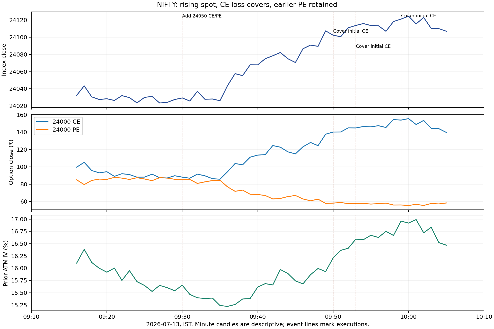
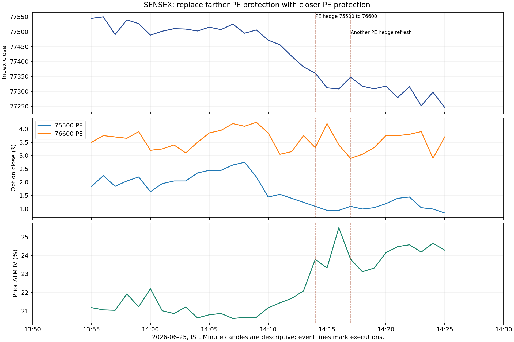

# Algo 8: expanded controller search and what it establishes

**The 80–90% reconstruction target has not been reached.** A broader relevant
search still does not recover a precise general exit, re-entry or hedge-refresh
controller. The new useful findings are that most hedge buying accompanies fresh
shorts, genuine expiry-day hedge replacements usually move protection inward,
and side exits materially change the economics of the sampled allocations.

## Search scope and validation

| Search | Programs |
| --- | --- |
| Contract-side exits | 16,994,880 |
| Off-schedule side entries | 5,176,704 |
| Held-hedge replacement timing | 1,806,592 |

These total **23,978,176 state-program/group scores**.
They test premium loss/profit, FIFO/LIFO lot costs, previous-close and expiry-open
carry references, activated trailing stops, adverse spot moves, Delta, IV,
Gamma, side/portfolio equity, exposure, old-hedge decay, hedge/ATM premium ratios,
clock gates and time since entries/covers. The grammar includes three-condition
AND programs and gated loss/profit OR programs. It is finite and does not cover
every possible original program. The same expression can be scored in separate
index, right and session groups; these are not millions of independent hypotheses.

A separate allocation-level search tests **367 atoms**, including
1–200% premium losses, 10–99% profits, fixed low-price exits and activated trails,
in **27,927 stop/target pairs** with 0/1/2-minute delays.
The final study scores **178,956,216 pair/lag/context
comparisons**, including entry-clock modules and order rank within the entry
minute. Those are repeated contextual comparisons, not that many unique rules.

Thresholds and schedules use expiries through 31 August; later September/October
measurements are reported separately. These later dates were already inspected
in previous research and are not untouched validation. The broad state search
selects on earlier scores without nested cross-validation. Sparse-event tasks
can overfit severely; fitted rules must not be assigned probabilities of being
the original code. Five-minute prediction cooldown results are shown below;
0/15-minute variants are also exported and were not selected on later performance.

## 1. Separate CE/PE exits

| Market_input | Ownership | Program | Later | Match |
| --- | --- | --- | --- | --- |
| completed_close | fifo | clock_only | 923/4538 | 20.3% |
| completed_close | fifo | entry_module_program | 1151/4538 | 25.4% |
| completed_close | fifo | entry_module_rank_program | 1176/4538 | 25.9% |
| completed_close | fifo | entry_rank_program | 1317/4538 | 29.0% |
| completed_close | fifo | global_program | 1313/4538 | 28.9% |

Matches allow ±2 minutes around the first attributed partial short cover.
FIFO and LIFO ownership are both tested because shared strikes hide original
allocation identity. Simple global programs match approximately 29% of later
first reductions on completed closes. Intrabar high-touch variants improve the
global match only to about 31–32%; a high touch is a within-candle bound, not an
available pre-candle signal or an executable price. Clock/rank refinements do
not establish an 80–90% controller.

For the completed-close/FIFO global candidates, pre-expiry CE fitted loss
thresholds are 48% NIFTY / 55% SENSEX, while SENSEX pre-expiry PE selects 66%.
NIFTY expiry PE selects 61%. These are low-coverage fitted candidates, **not
recovered stop instructions**. Other groups select trailing/profit conditions.
The stated 4% carry stop and 1% of ₹2 crore expiry capital stop retain unresolved
denominators, reset conventions and scope. This search does not redefine them.

The first illustration shows a rising NIFTY, increasing initial CE prices and
separate initial CE covers while the initial PE survives. A rise normally hurts
the short CE and a fall normally hurts the short PE; hedges and IV can modify
the net side result. These illustrative charts are not independent validation.

## 2. Extra entries and re-entry

The entry search retains no-entry opportunities while testing recent covers,
re-entry delays, fresh allocations, range/movement, Greeks, equity and capacity.
Whole-minute timer neighbors are excluded to avoid treating a T−2-second fill
as an off-schedule decision. These are side-minute labels, not same-strike pair
labels. No tested program combines 80–90% precision with broad event coverage.

| Index | Phase | Hedge_buys | Near_new_short | New_shorts_after_cover_5min |
| --- | --- | --- | --- | --- |
| NIFTY | preexpiry | 1630 | 1482/1630 (90.9%) | 136/2032 |
| NIFTY | expiry | 3058 | 2388/3058 (78.1%) | 1802/4210 |
| SENSEX | preexpiry | 1788 | 1657/1788 (92.7%) | 165/2375 |
| SENSEX | expiry | 3169 | 2684/3169 (84.7%) | 2613/4786 |

The last column is temporal association, not causation: a new short within five
minutes of a cover may also be due to the next timer or another module. Later
high-frequency expiry flow contains far more such associations than pre-expiry
flow. No exact reset/re-entry controller is established.

## 3. What genuine hedge replacements do

Among matched equal-quantity different-strike long replacements within five
seconds, with no nearby same-right fresh short, expiry contributes
**243 parent pairs**. Of these:

- **198/243 (81.5%)** move the hedge strike inward.
- **191/233 (82.0%)** increase modeled Gamma protection.
- **183/233 (78.5%)** reduce absolute modeled portfolio Vega.
- **151/233 (64.8%)** reduce absolute modeled portfolio Delta.

This supports strengthening protection closer to spot near expiry. It does not
make 81–82% a probability that a trigger has been decoded. Before/after risk is
priced at the **same preceding snapshot** and isolates the matched replacement;
other simultaneous orders are omitted from that counterfactual. Associations
are inferred, with 24 ambiguous expiry pairs.
Trade candles and low premiums limit Greek precision.

The timing search tests held-long premium/cost ratios, premium/ATM ratios,
Delta, distance, spot moves, IV and book risk. It includes
202 positive contract-minutes;
19 observed target contract-minutes
lack a valid held-long/preceding-price/guide representation and remain excluded,
not no-action labels. Timing rules fail to generalize.

Routine hedge-strike selection remains approximated by the prior 2.5%-of-ATM-leg
premium budget, with index/phase rounding and an incomplete historical chain.
The existing within-one-strike match is not exact strike recovery. Frequent
hedge purchases and true replacements are separate mechanisms.

## 4. Size and maximum exposure

All window definitions now predict the **same** T−2-second to T+180-second filled
quantity target. This prevents a narrow two-second window full of zeros from
creating misleading 80–90% sizing accuracy. On earlier-positive timer slots:

| Index | Phase | Windows | Four_roles | Short_pair |
| --- | --- | --- | --- | --- |
| NIFTY | preexpiry | 133 | 54.1% | 55.6% |
| SENSEX | preexpiry | 133 | 48.9% | 50.4% |
| NIFTY | expiry | 114 | 19.3% | 22.8% |
| SENSEX | expiry | 105 | 11.4% | 14.3% |

The shared normalized clock template remains useful but cannot explain all
orders or the maximum-exposure controller. Actual per-cycle/per-role peaks are
exported in `deep_exposure_peaks.csv`; base units of 65/20 are descriptive units,
not asserted exchange lot sizes. Observed maxima are not configured caps.
Hedge purchases, different strikes, partial fills and late overlays make gross
quantity an inadequate risk or capital measure. Premium receipts are not margin.
There is no broker margin/capital-allocation ledger in this export.

One exceptional NIFTY 16 October sequence adds 7,800 long 24000 calls and 15,600
short 24500 calls in three observed 1:2 groups, followed by other closer-call
purchases. It illustrates why not every new short is a fresh ATM straddle and
why a gross peak cannot be interpreted as the normal allocation limit. This
is one cycle, not a recovered general overlay rule or proof of its purpose.

## 5. Do the selected exits improve economics?

Freeze earlier-selected global completed-close/FIFO stops and compare them with
the time exit. Both arms share recorded short entries and unambiguous inferred
equal-quantity outward hedges. Stops execute one further minute later at candle
open; a preplanned time exit uses its clock open. The following common subset
has nonzero endpoint volume and checked vertical-spread price bounds:

| Index | Allocations | Cycles | Candidate_net | Clock_net | Improved_cycles |
| --- | --- | --- | --- | --- | --- |
| NIFTY | 916 | 8 | ₹315,890.30 | ₹-290,048.40 | 3 |
| SENSEX | 1006 | 7 | ₹-458,614.10 | ₹-1,363,828.09 | 5 |
| pooled | 1922 | 15 | ₹-142,723.81 | ₹-1,653,876.49 | 8 |

Candidate minus clock differences improve the aggregate, but weekly confidence
intervals include zero for both indices and pooled results. Only 8/15 pooled
cycles improve, and pooled candidate net remains negative. Higher cost stress
does not change that limitation. This is conditional component attribution,
**not actual Algo 8 P&L, autonomous entry alpha or equal dynamic/margin risk**.
Observed entries, incomplete quote paths and inferred links limit interpretation;
the quality screen checks endpoints, not every trigger candle or capacity.

The strongest working profit-engine hypothesis remains protected near-expiry
volatility carry, with timed allocation and separate management. We have not
established that a range indicator predicts entry or that the expanded controls
reproduce the original alpha. The separate autonomous NIFTY carry approximation
in `ALPHA_CANDIDATE_FINDINGS.md` remains a hypothesis, not a complete replica.

## Detailed event decisions and reproduction

`deep_event_market_casebook.csv.gz` contains every reconstructed parent order,
its role/quantity/fill price, preceding spot moves, option premium changes,
ATM IV and available book/side Greeks. Missing context is not replaced with
zero. `deep_order_label_fill_lags.csv` highlights order-label/execution delays;
filled-order logs do not identify all pending orders or cancellations.

Reproduce in order: `deep_event_audit.py`, `deep_controller_search.py`,
`deep_extra_search.py`, `deep_hedge_refresh.py`, `deep_hedge_timing.py`,
`deep_size_windows.py`, `deep_allocation_stops.py`,
`deep_controller_economics.py`, `plot_deep_controller_cases.py`, then
`summarize_deep_controller_study.py`, all under `research/`.
Install dependencies with `python -m pip install -r research/requirements-deep-controller.txt`.
The focused and existing suite passed **165 tests**, including packed-rule
scoring, interleaved-contract crossings, gap handling, first touches and exclusion
of later targets from earlier stop selection. Output checks reconcile all 39,874
parent IDs and verify unique inferred hedge pairs and explicit target coverage.

### State-program event metrics

Exact-minute precision/recall and one-to-one ±2-minute precision/recall are
distinct. A high precision on a tiny subset is not broad controller recovery.

| Task | Precision | Recall | Tolerance_precision | Tolerance_recall |
| --- | --- | --- | --- | --- |
| preexpiry|NIFTY|CE | 36.0% | 22.0% | 40.0% | 24.4% |
| preexpiry|NIFTY|PE | 43.3% | 22.8% | 56.7% | 29.8% |
| preexpiry|SENSEX|CE | 0.0% | 0.0% | 13.0% | 3.5% |
| preexpiry|SENSEX|PE | 53.8% | 7.7% | 76.9% | 11.0% |
| expiry|NIFTY|CE | 3.7% | 2.0% | 18.5% | 9.9% |
| expiry|NIFTY|PE | 10.3% | 2.7% | 23.1% | 6.1% |
| expiry|SENSEX|CE | 0.0% | 0.0% | 0.0% | 0.0% |
| expiry|SENSEX|PE | 12.8% | 2.2% | 15.4% | 2.6% |
| preexpiry|NIFTY|extra_side | 10.3% | 4.2% | 22.4% | 9.2% |
| preexpiry|SENSEX|extra_side | 28.1% | 10.3% | 57.9% | 21.2% |
| expiry|NIFTY|extra_side | 15.3% | 14.4% | 51.2% | 48.3% |
| expiry|SENSEX|extra_side | 13.5% | 5.0% | 53.9% | 20.2% |
| preexpiry|NIFTY|hedge_refresh | 0.0% | 0.0% | — | 0.0% |
| preexpiry|SENSEX|hedge_refresh | 0.0% | 0.0% | — | 0.0% |
| expiry|NIFTY|hedge_refresh | 0.0% | 0.0% | 0.0% | 0.0% |
| expiry|SENSEX|hedge_refresh | 0.0% | 0.0% | 1.7% | 3.6% |
