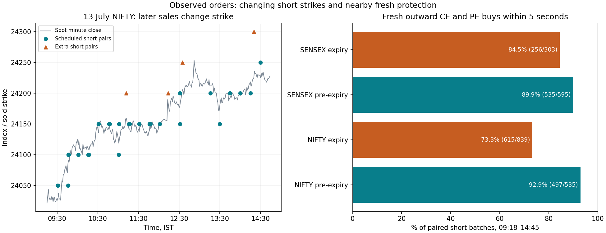

# Algo 8: changing short strikes, fresh protection and mass rule matching

**Treat the strategy as automated.** The purpose is to recover its programmed
decisions, not attribute unexplained trades to discretion. This study finds
stronger evidence for fresh protection, and two useful new candidates: directional
placement of extra pre-expiry straddles and a relative hedge-premium budget.
The exact extra-entry trigger and universal exit instructions remain unresolved.
All times are IST; the observed logs cover June–October 2026.

## 1. First correct the interpretation of the timer

The 17 recurring time windows were established for **pre-expiry sessions**.
They are not an instruction to sell every 15 minutes on both days regardless of
the book. In the later-period expiry observations, fresh pairs occur in only
**157/273 quarter-hour opportunities**. Some books have already closed.

Nor are all later short sales at the opening strike. In the 09:18–14:45 cohort,
excluding the first minute of initial paired sales where a pre-expiry reference
exists:

| Index / phase | Different from every initial first-minute paired strike |
| --- | ---: |
| NIFTY pre-expiry | 431/535 (80.6%) |
| SENSEX pre-expiry | 496/600 (82.7%) |
| NIFTY expiry | 596/652 (91.4%) |
| SENSEX expiry | 296/304 (97.4%) |

The opening reference can contain multiple strikes, so it is a set rather than
an assumed unique contract. Expiry-only cycles without a pre-expiry opening
reference do not enter these denominators. Counts are paired-strike observations;
one execution batch can contain more than one paired strike.

## 2. A concrete example: 13 July NIFTY

| Short-sale time | Sold CE and PE strike | Nearby new CE wing | Nearby new PE wing |
| --- | ---: | ---: | ---: |
| Around 09:16 | 24,000 | 26,000 | 22,000 |
| 09:31:00 | 24,050 | 24,800 | 23,300 |
| 09:46:31 | 24,100 | 24,750 | 23,250 |
| 13:30:00 | 24,150 | 24,700 | 23,000 |

These are actual observed contract selections. The nearby buys are within five
seconds of a short-parent start; all four orders need not fill simultaneously.
The opening allocation is 195 units per role across its opening executions;
the 09:31 batch adds 130 CE and 130 PE, while the listed 09:46 and 13:30 batches
add 65 per short right. Other packets also occur during the same time windows.

This directly demonstrates changing sold strikes and changing wing distances.
The original ±2,000 seed wings are not a fixed gap for every later purchase.
Source references and all events that day are in `rule_match_example_13_july.csv`.

## 3. Do later sales receive new hedges?

Separate new-long buys from buys covering shorts. Collapse partial fills into
parents. Assign each fresh long parent at most once to its nearest paired-short
batch; exclude equal-distance ambiguities. For 09:18–14:45:

| Index / day | Short batches with fresh outward CE **and** PE buys within 5 seconds |
| --- | ---: |
| NIFTY pre-expiry | 497/535 (92.9%) |
| SENSEX pre-expiry | 535/595 (89.9%) |
| NIFTY expiry | 615/839 (73.3%) |
| SENSEX expiry | 256/303 (84.5%) |

At the snapshot six seconds after the last short-parent start, both outward long
rights are present in the reconstructed inventory in **every** pre-expiry batch
in this cohort, and every expiry batch here too. Protection already exists
before most additions. Absence of a fresh paired buy within five seconds does
not establish absence of protection.

These are temporal/inventory associations, not verified original basket IDs.
Presence of long CE/PE is also not a complete quantity-, Greek- or loss-budget
test. The 2/5/30-second sensitivity and source links are retained in the artifacts.

Some additions align with buybacks of other strikes, but not all: within 30
seconds, a unique nearest buyback is associated with 30/161 extra pre-expiry
paired-short batches and 94/350 extra expiry batches. The links can precede or
follow new sales. Timing alone does not identify the original stop or prove a
particular roll sequence.

## 4. A new distinction: scheduled ATM sales versus directional extra sales

The nearest current cash-index strike is a better explanation of **scheduled**
sales than of extra pre-expiry sales. On later scheduled observations, the
earlier-selected rounding rules match 186/216 NIFTY strikes (86.1%) and 173/216
SENSEX strikes (80.1%). Quotes are minute proxies; allocations and intraminute
prices prevent a claim of an exact live-ATM decoder.

Extra pre-expiry paired sales frequently centre **one strike in the direction
of the recent spot move**, rather than at the nearest current ATM:

```
ATM = d × floor(S / d + 0.5)
candidate extra-sale strike = ATM + sign(S − earlier_S) × d
d = 50 NIFTY; 100 SENSEX
```

Use only completed spot closes preceding the first fill. Calibrate the momentum
lookback and offset on earlier cycles:

| Extra pre-expiry candidate | Earlier selected lookback / offset | Later exact matches |
| --- | --- | ---: |
| NIFTY | 10-minute direction / one 50-point step | **33/39 (84.6%)**, 7 cycles |
| SENSEX | 15-minute direction / one 100-point step | **26/34 (76.5%)**, 7 cycles |

For example, with NIFTY near 24,020 and positive recent movement, this candidate
chooses 24,050; with negative movement it chooses 23,950. This is an explanation
of **where a recorded extra sale is placed**, conditional on an extra sale
occurring. It does not yet explain when that sale is triggered.

An above-market short-straddle centre can create positive directional exposure;
a below-market centre can create negative exposure, subject to option-forward
basis and the rest of the book. Thus an adaptive directional component is a
plausible addition to premium collection. This is not measured incremental alpha.

The directional hypothesis was introduced after inspecting off-quarter offsets,
including previously seen later data. Earlier-only parameter selection is useful
but cannot turn this into an independent replication. Other correlated lookbacks
can fit similarly. Do not declare the exact original lookback recovered.

## 5. Hedge selection: a relative premium budget is a stronger candidate

Routine hedge selection is better explained by a fraction of the corresponding
current **ATM option leg's** premium than by a fixed rupee target. This treats CE
and PE separately; the ATM reference can differ from a directionally shifted
short strike.

Earlier-cycle searches select **2.5%** for both indices' routine pre-expiry
hedges, with a ceiling selector:

```
CE budget = 0.025 × current ATM CE premium
PE budget = 0.025 × current ATM PE premium
candidate wing = quoted OTM option with the highest premium within its budget
```

For illustration, ATM premiums of ₹80 CE and ₹100 PE produce separate budgets
of ₹2 and ₹2.50. Changing those premiums changes the target and selected strike;
a fixed ±2,000 gap or an invariant ₹2/₹7 price is not implied.

Using positive-volume prior completed quotes and identical later cohorts:

| Routine cohort | Relative ATM-leg budget candidate | Fixed ₹2 NIFTY / ₹7 SENSEX nearest-premium reference |
| --- | ---: | ---: |
| NIFTY pre-expiry | **316/637 (49.6%)** | 109/637 (17.1%) |
| SENSEX pre-expiry | **312/623 (50.1%)** | 196/623 (31.5%) |
| NIFTY expiry | **288/743 (38.8%)** | 154/743 (20.7%) |
| SENSEX expiry | **378/806 (46.9%)** | 57/806 (7.1%) |

For NIFTY expiry the earlier-selected method is nearest premium; for SENSEX
expiry it is a ceiling. Both still select a 2.5% fraction. This is a much stronger
cross-index lead, **not a complete selector**: many exact strikes remain wrong.
Keep seed wings, routine protection and large late purchases distinct.

The first broader hedge grid also finds an expiry absolute-delta candidate near
0.02, but it matches fewer exact later strikes than the ATM-premium fraction.
The conditional linked-short-leg premium version performs worse than the ATM
reference; its input is an observed adjacent short strike, not an independently
predicted one. No future short execution price is used.

The received option chain includes only contracts traded somewhere in the log.
Alternative quotes are incomplete and retrospective. Positive-volume trade bars
are not executable bid/ask quotes. Signal-time changes, tick rounding, liquidity
constraints and missing neighbours may explain some mismatches, but that is not
proof that the 2.5% candidate is the original implementation.

## 6. What the mass indicator test actually established

There are **3,368 predeclared indicator/threshold/state-or-cross predicates**.
Across targets, phases, gates and other selector/exit contexts, the completed
search contains **68,516 calibration comparisons**, not that many independent
strategies. Search all parameters on earlier cycles; report selected candidates
on later cycles, including failures and no-action opportunities.

| Search | Calibration comparisons |
| --- | ---: |
| Indicators / market / book conditions with one-minute embargo | 33,688 |
| Faster causal indicator sensitivity | 20,214 |
| Short-strike references, cohorts and directional shifts | 1,980 |
| Initial / routine / late hedge selectors | 9,636 |
| Portfolio exit conditions and freshness variants | 2,086 |
| Carried-contract first-buyback conditions | 480 |
| Additional hedge-leg premium ratio conditions | 432 |

Families include Wilder RSI, EMA pairs, Bollinger z-scores, ATR, ADX, Supertrend,
Donchian breakouts, returns/ranges, opening context, TWAP, option premium/IV
changes and book state. Cash-index VWAP is not fabricated from absent volume.
The [protocol](MASS_RULE_MATCH_PLAN.md) records ranges and exploratory expansions.

The primary feature matrix contains 21,255 minute opportunities. The faster
sensitivity contains 21,190 and uses the most recently completed minute without
the extra one-minute embargo. Its targets use the actual first-fill minute;
the early-tolerant quarter-window task is excluded to prevent own-fill leakage.
Missing/warm-up inputs never satisfy a predicate and remain in denominators.

Findings:

- Pre-expiry quarter additions still select the **clock/open-book baseline**,
  with later precision 96.0% and recall 98.8%.
- The selected faster candidate for extra pre-expiry additions is a 30-bar
  Bollinger z-score crossing above 1.5. It catches only **5/93 later event
  minutes**, while generating 121 signals. Even allowing one-to-one matches
  within the following two minutes, it catches **12/93**, with 9.9% precision.
  This is a failed trigger reconstruction, not evidence of a Bollinger strategy.
- Buyback occurrence has some clustering/state predictability, but selected
  rules also emit many unmatched signals. The faster expiry cover rule has
  228 true positives and 591 false positives; it is not an exact exit instruction.
- Clock attendance explains many new-long purchases as well, consistent with
  the fresh protection associations. It does not recover every hedge change.

These tests reject the tested simple reconstructions as complete clones. They
do not exclude combinations, distinct allocation states, other parameters,
intraminute monitoring or programmed controls not represented in these grids.

## 7. Exact exits: still unresolved after the search

The supplied note states 4% on carried positions and 1% on entire capital on
expiry, with ₹2 crore capital. These remain stated rules with unresolved
reference/scope; 1% of that capital is ₹200,000.

For terminal material short reductions, 27 cycles have eligible carry, observed
terminal reduction and active completed marks: 16 calibration / 11 later. The
earlier-selected cycle-equity stop near −0.5% plus the fixed late-time fallback
matches 7/11 later reductions within two minutes. The time-only fallback already
matches 6/11. The selected rule's mean absolute timing error is about **82 minutes**.
It does not establish a replacement 0.5% capital stop.

Separately, for 349 carried-short contracts, alternative entry-cost references
are reconstructed under pooled average, FIFO and LIFO allocation. Calibrate on
207; check the later 142. Allowing opening-price proxies:

| First-buyback timing candidate | Later matches within 2 minutes |
| --- | ---: |
| 4% increase from previous derivative close, plus late fallback | 44/142 (31.0%) |
| 4% increase from pooled remaining entry cost, plus late fallback | 37/142 (26.1%) |
| Best earlier-selected expiry-only trailing candidate | 51/142 (35.9%) |

These targets are first buybacks in carried **contracts**, not identified original
lots. New expiry-day sales and allocation ambiguity matter. The best trailing
candidate does not recover the original 4% rule. Completed quotes also cannot
resolve every intraminute stop, while simultaneous option OHLC extremes cannot
be assumed to be a real portfolio loss.

The concentrated late exit near 15:14 in the later regime is still observed.
An exact early-stop, profit-target, pending-order and re-entry state machine has
not been recovered. Do not convert the highest matching threshold into code
and label it Algo 8.

## 8. Resulting working explanation

The stronger current reconstruction is **timed protected position building,
changing near-ATM strikes, extra directionally shifted allocations, and separate
exits/protection changes**. A routine protection budget proportional to ATM
premiums fits materially better than a fixed rupee hedge price.

That is decoder progress. The extra-entry timing condition, precise hedge
implementation and complete exit state machine still need identification.
Neither rule matching nor the earlier screenshot proves that these candidate
components generate incremental profit after costs at comparable risk.



## Reproduction and audit

Run from the repository root after the existing option replay and addition study:

```sh
python research/audit_strike_hedge_rules.py
python research/mass_match_strategy_rules.py
python research/mass_match_strategy_rules.py --fast-only
python research/scan_carried_contract_rules.py
python research/scan_hedge_leg_ratios.py
python research/summarize_rule_matching.py --plot
python -m unittest discover -s research -p test_mass_rule_matching.py -v
```

`--reuse-features` reruns the main parameter search using its saved compressed
feature matrix; `--skip-hedge-grid` reruns strike/association work without
rebuilding the earlier hedge-candidate table. Runtime: Python 3.12, numpy 2.3.5,
scikit-learn 1.8.0; optional matplotlib 3.10.8.

The `rule_match_*` artifacts contain all calibration scores, selected later
predictions, source-linked parent/buyback/hedge associations, causal feature and
candidate-quote matrices, entry-reference diagnostics, exclusions and summaries.
The analysis keeps three partially filled buy parents at their observed executed
quantity; it does not invent their remaining requested fills. Raw prices and
original logs are unchanged. The tests cover causal prefixes, warm-up, time
alignment, own-cycle exclusion, allocation ambiguity, one-to-one matching,
unquoted-strike handling and conditional selector inputs.
