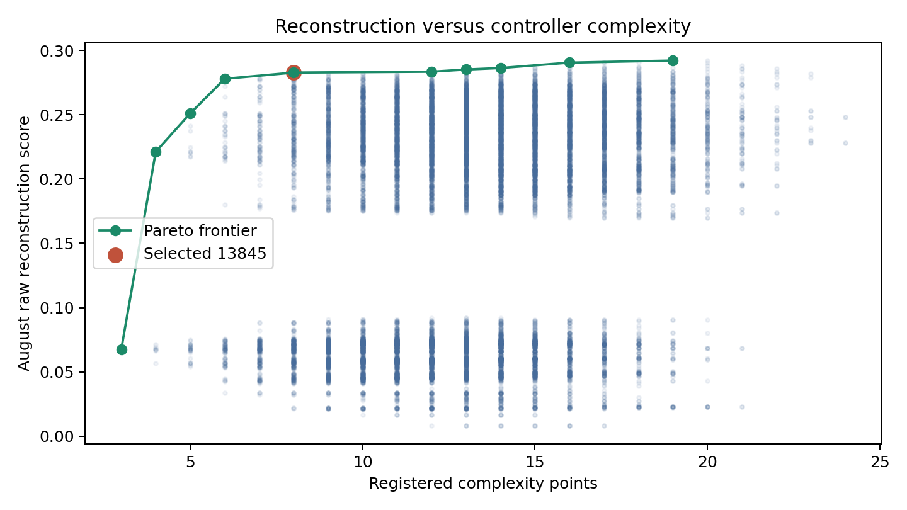

# Algo 8 — constrained controller search

**The search makes measurable reconstruction progress, but does not recover an
80–90% controller or establish economic alpha.** The registered August-selected
leader reaches **23.3% event macro F1** on the 15 already-
inspected later cycles. The pooled-budget clock baseline reaches
**18.2%**, and the stricter seed baseline
17.3%. These are autonomous action comparisons, not
teacher-forced predictions using the historical book.

The completed bank contains **13,864 unique controller definitions**:
13,824 main combinations plus 40 earlier-fit local refinements. Every one is
replayed over all 35 cycles / 65 received cycle-sessions. Candidate count is not
effective sample size; there is no external researcher-blind evaluation.

## Twelve direct answers

1. **Initial entry:** a calendar-conditioned 09:16 clock and nearest preceding-
   close ATM remain the simplest structural explanation. Missing eligible/no-trade
   records prevent identifying the original eligibility gate. The aggregate leader
   is not a faithful opening reconstruction: it uses routine-budget wings from
   the start and scales the opening too. In the first-three-minute gross-action
   comparison it matches both first wing strikes on 0/32
   received pre-expiry starts, and both short quantities on 0/32.
2. **Allocation quantities:** pooled normalized clock sizing is the leading
   composite family. Candidate 13845 multiplies fitted clock weights by 1.25
   and rounds each role to whole base units. Its later quantity score is only
   **15.7%**. That is normalized action-quantity overlap,
   not exact size accuracy or a recovered capital budget.
3. **Clock versus target/risk:** the clock explanation survives best in this
   grammar. Target restoration, cover replacement and fitted risk/IV sizing are
   genuine autonomous competitors, not calculations from actual future covers.
   Their best validation results are shown below; configured caps remain unknown.
4. **Market gate:** the leader has **no range/efficiency entry gate**. Paired
   ablations below keep the other rules fixed. They do not establish that no
   original filter exists outside the received-session universe.
5. **Intermediate reductions:** the selected composite uses a **50% premium
   increase above its own pooled contract entry cost**, evaluated on completed
   candles. This is a tested approximation, not the original stop. The before-
   15:00 table excludes deadline exits and shows its limited actual cover recall.
6. **Rapid reopen/neutralisation:** safe idempotent closes cannot generate the
   observed opposite-position overshoots. On 59 conservative motifs,
   a full stale duplicate close matches the immediate opposite quantity in
   49 cases. This comparison is
   **conditioned on the observed liquidation**; it does not predict its cause or
   prove an execution bug. Submission/cancellation/acknowledgement records are absent.
7. **Final liquidation:** the leader uses 15:27 before 3 August and 15:14 later,
   with separate short and wing instructions and explicit failed fills. Its
   later final-short-flat match is 50.0% on resolved targets.
   This is not a universal all-leg exit rule; early exits and residuals remain.
8. **Risk control:** no tested risk threshold recovers the complete controller.
   Rs200,000 is an explicitly scoped full-cycle expiry loss hypothesis; 4% of
   the simulated preceding-session short debit is one denominator hypothesis.
   Neither is the verified supplied rule. Continuous matched call quantities are
   contradicted by the canonical book; all 31 last pre-expiry carry snapshots
   nevertheless have same-right long quantities covering shorts. Fitted caps and
   flat-ATM-IV Greeks are modeling inputs, not original margin limits.
9. **Indistinguishable rules:** 9,841 distinct action-
   fingerprint groups contain the 13,864 definitions. The leader's group has
   1 definition(s). Hash equality is a reproducible observational
   signature, not proof of original code; exact top-cohort traces are compared
   separately. Near-equivalent leaders and their actual disagreements are exported.
10. **Improvement:** later event F1 improves by
    **5.16 percentage points** over
    the pooled-budget clock baseline. Its penalized composite improves by
    3.01 points on the 0–100 scale.
    Cycle bootstrap intervals below include the small sample and do not adjust
    away the earlier researcher inspection or broad candidate selection.
11. **Complexity/weights:** complexity is penalized before ranking. The alternative
    fixed weights select the configurations listed below; exact parameter recovery
    is not robust merely because related clock/budget families recur.
12. **Needed observations:** original strategy/allocation IDs, controller decisions,
    submissions/replacements/cancellations/acknowledgements, tick bid/ask, certified
    eligible/no-trade sessions, complete-chain quotes, settlement and account
    NAV/margin. New untouched records are needed for external validation.

## What was executed and how it was scored

[Registered specification](SEARCH_SPEC.md), [manifest](outputs/search_manifest.json),
[all definitions](outputs/candidate_registry.csv),
[all scores](outputs/candidate_scores.csv),
[ranked leaders](outputs/ranked_candidates.csv),
[saved leader YAML](outputs/best_candidate.yaml).

The six sizing, twelve exit, three market-gate, four wing, four re-entry,
two deadline and two spot-reference families form the main Cartesian bank.
Stage1 baseline slices and stage2 one-component slices are identified in the
registry; stage3 combines them; stage4 refines only June–July-ranked parents.
August chooses the final ranking. September–October were already inspected in
prior work and are labeled an internal chronological check, never a blind test.
Rolling June->July uses separately recalibrated June-only schedules and caps.

Decisions use only previous completed candles and the simulated book. No
historical fill triggers an assumed candidate fill. A positive candle open is a
hypothetical fill; missing opens leave requests unfilled. Exact fixed seed
contracts can be absent in the traded-only chain, so alternative simple budget
baselines are reported. Order labels never become confirmed decision times.
Fragmentation is charged as one request per 65/20 units; the original unfilled
request queue is unknown. Safe repeated closes are capped at current inventory.

Primary score: **0.40 event macro F1 + 0.20 quantity + 0.30 inventory + 0.10 final
closure − 0.002 per complexity point**. Missing final targets are unavailable;
the other weights renormalize, rather than awarding a correct invented closure.
Each cycle is scored separately, then averaged. Exact-contract/action matches
use one-to-one ±2-minute chronological matching. Independent 0/1-minute counts
and one-grid strike tolerance are exported separately. Quantity score is
1−absolute action-quantity error / (actual+predicted quantity); inventory score
is 1−contract L1 path error / (actual+predicted gross path quantity). Neither is
a percentage of completely correct books. False predicted and missed actions
remain in all applicable denominators. P&L never ranks candidates.

## Frozen comparison

| Period | Controller | Cycles | Event_macro_F1 | Quantity_score | Inventory_score | Final_match | Final_targets | Penalized_score |
| --- | --- | --- | --- | --- | --- | --- | --- | --- |
| Fit June–July | 0: Strict seed clock | 12 | 13.7% | 9.5% | 42.0% | 0.0% | 11 | 0.1881 |
| Fit June–July | 2320: Pooled budget clock | 12 | 14.0% | 9.6% | 43.9% | 0.0% | 11 | 0.1992 |
| Fit June–July | 13845: Registered leader | 12 | 16.5% | 10.9% | 45.7% | 45.5% | 11 | 0.2528 |
| Internal August | 0: Strict seed clock | 8 | 16.9% | 12.2% | 40.0% | 37.5% | 8 | 0.2356 |
| Internal August | 2320: Pooled budget clock | 8 | 16.9% | 12.2% | 40.6% | 37.5% | 8 | 0.2412 |
| Internal August | 13845: Registered leader | 8 | 21.1% | 14.2% | 44.2% | 37.5% | 8 | 0.2669 |
| Inspected Sep–Oct | 0: Strict seed clock | 15 | 17.3% | 13.6% | 40.5% | 42.9% | 14 | 0.2462 |
| Inspected Sep–Oct | 2320: Pooled budget clock | 15 | 18.2% | 13.8% | 42.3% | 50.0% | 14 | 0.2662 |
| Inspected Sep–Oct | 13845: Registered leader | 15 | 23.3% | 15.7% | 46.1% | 50.0% | 14 | 0.2963 |

Later action precision/recall by index and phase (micro counts within each
stratum; F1 column is a mean of cycle F1s):

| Index | Phase | Action | Precision | Recall | Cycle_mean_F1 |
| --- | --- | --- | --- | --- | --- |
| NIFTY | Pre-expiry | New shorts | 94.8% | 35.7% | 52.0% |
| NIFTY | Pre-expiry | Short covers | 80.0% | 10.4% | 17.0% |
| NIFTY | Pre-expiry | Wing buys | 55.2% | 21.7% | 31.3% |
| NIFTY | Pre-expiry | Wing sells | 47.7% | 15.7% | 20.7% |
| NIFTY | Expiry | New shorts | 66.7% | 17.6% | 21.9% |
| NIFTY | Expiry | Short covers | 45.6% | 5.8% | 9.0% |
| NIFTY | Expiry | Wing buys | 34.4% | 9.7% | 12.9% |
| NIFTY | Expiry | Wing sells | 17.8% | 4.7% | 6.1% |
| SENSEX | Pre-expiry | New shorts | 85.7% | 31.5% | 46.4% |
| SENSEX | Pre-expiry | Short covers | 77.8% | 11.4% | 18.5% |
| SENSEX | Pre-expiry | Wing buys | 57.9% | 23.2% | 33.3% |
| SENSEX | Pre-expiry | Wing sells | 35.2% | 10.3% | 15.8% |
| SENSEX | Expiry | New shorts | 75.0% | 15.3% | 21.5% |
| SENSEX | Expiry | Short covers | 51.0% | 6.1% | 12.3% |
| SENSEX | Expiry | Wing buys | 64.3% | 14.3% | 17.1% |
| SENSEX | Expiry | Wing sells | 23.8% | 5.8% | 13.1% |

Intermediate short covers before 15:00, ±2 minutes, exact contract/action:

| Controller | Index | Before_1500_predicted | Observed | Matched | Precision | Recall |
| --- | --- | --- | --- | --- | --- | --- |
| 0 | NIFTY | 0 | 587 | 0 | unavailable | 0.0% |
| 0 | SENSEX | 3 | 894 | 1 | 33.3% | 0.1% |
| 2320 | NIFTY | 0 | 587 | 0 | unavailable | 0.0% |
| 2320 | SENSEX | 5 | 894 | 1 | 20.0% | 0.1% |
| 13845 | NIFTY | 53 | 587 | 34 | 64.2% | 5.8% |
| 13845 | SENSEX | 83 | 894 | 55 | 66.3% | 6.2% |

Source [mismatch ledger](outputs/event_mismatch_ledger.csv.gz),
[predictions](outputs/replay_predictions.csv.gz),
[inventory paths](outputs/inventory_replay.csv.gz),
[tolerance checks](outputs/timestamp_tolerance_scores.csv),
[initial-entry contradictions](outputs/initial_entry_reconstruction.csv).

## What improves sizing and management

Each allocation-family row is its August-selected composite champion; other
components can differ, so this is not a causal isolated allocation comparison.

| Allocation | August_champion | August_score | Later_score | Later_quantity |
| --- | --- | --- | --- | --- |
| clock_risk_iv | 11920 | 0.2597 | 0.2798 | 16.1% |
| fixed_increment | 5008 | 0.2314 | 0.2589 | 14.9% |
| index_clock | 13855 | 0.2637 | 0.2944 | 15.7% |
| pooled_clock | 13845 | 0.2669 | 0.2963 | 15.7% |
| replace_covers | 9616 | 0.0745 | 0.0883 | 3.4% |
| target_restore | 7344 | 0.2402 | 0.2489 | 13.5% |

Paired market-gate ablation on the same main-bank controller, other parameters
fixed (a selected-model diagnostic, not an independent test):

| Gate | Period | Event_F1 | Quantity | Inventory | Score |
| --- | --- | --- | --- | --- | --- |
| none | August | 21.3% | 14.6% | 42.1% | 0.2660 |
| none | Later | 23.4% | 16.2% | 44.1% | 0.2957 |
| range | August | 20.7% | 14.0% | 40.8% | 0.2547 |
| range | Later | 20.7% | 14.3% | 39.7% | 0.2567 |
| efficiency | August | 17.5% | 11.5% | 32.3% | 0.2115 |
| efficiency | Later | 20.7% | 14.2% | 38.7% | 0.2538 |

Leading exit-family composites selected on August, not later returns:

| Exit_family | August_champion | August_score | August_cover_F1 |
| --- | --- | --- | --- |
| premium_loss50 | 13845 | 0.2669 | 11.2% |
| premium_loss75 | 2896 | 0.2601 | 7.5% |
| premium50_or_capital200k | 4432 | 0.2600 | 11.1% |
| adverse_spot0p3 | 3472 | 0.2558 | 8.1% |
| premium_loss30 | 2512 | 0.2520 | 9.9% |
| side_equity100k | 3860 | 0.2511 | 8.8% |

The leader's scale 1.25 and budget-from-opening choices conflict with ordinary
195/60 initial books and separate seed-wing geometry. That is a concrete reason
to retain competing controllers and decline a near-complete reconstruction claim.
Routine hedge additions, held-wing replacement and processing reversals are not
identified as the same intentional action. Flow-class agreement is only an
observable open/reduce/mixed classification; intent remains unknown.

## Robustness, uncertainty and complexity

| Baseline | Metric | Cycles | Mean_difference | Cycle_bootstrap_95 |
| --- | --- | --- | --- | --- |
| 0 | primary_score | 15 | +5.01 pp | [+2.04, +9.05] pp |
| 0 | event_macro_f1 | 15 | +6.03 pp | [+3.53, +8.84] pp |
| 0 | inventory_score | 15 | +5.63 pp | [+1.42, +10.21] pp |
| 2320 | primary_score | 15 | +3.01 pp | [+1.29, +4.91] pp |
| 2320 | event_macro_f1 | 15 | +5.16 pp | [+3.12, +7.45] pp |
| 2320 | inventory_score | 15 | +3.79 pp | [+0.88, +7.08] pp |

Expanding-origin checks, with schedules/caps recalibrated before each origin:

| Origin | Period | Controller | Cycles | Event_F1 | Score |
| --- | --- | --- | --- | --- | --- |
| June fit -> July | fit_June | 0 | 3 | 8.6% | 0.1225 |
| June fit -> July | validation_July | 0 | 9 | 15.5% | 0.2116 |
| June fit -> July | fit_June | 5202 | 3 | 12.9% | 0.1615 |
| June fit -> July | validation_July | 5202 | 9 | 16.8% | 0.2286 |
| June-July fit -> August | fit_June_July | 0 | 12 | 13.7% | 0.1881 |
| June-July fit -> August | validation_August | 0 | 8 | 16.9% | 0.2356 |
| June-July fit -> August | fit_June_July | 2898 | 12 | 15.7% | 0.2483 |
| June-July fit -> August | validation_August | 2898 | 8 | 19.2% | 0.2581 |

One-minute fill-latency override, unchanged saved decisions/rules and own-book
state replayed under delayed fills:

| Controller | Period | Latency1_event_F1 | Latency1_inventory | Latency0_event_F1 |
| --- | --- | --- | --- | --- |
| 0 | August | 17.0% | 39.9% | 16.9% |
| 0 | Later | 17.3% | 40.4% | 17.3% |
| 2320 | August | 16.9% | 40.5% | 16.9% |
| 2320 | Later | 18.1% | 42.2% | 18.2% |
| 13845 | August | 20.3% | 43.8% | 21.1% |
| 13845 | Later | 22.5% | 46.2% | 23.3% |

The strict quote screen requires positive volume for every held preceding mark
and every execution candle, with both policies actively trading. Its later
common baseline/leader cohort contains
0 cycles. This is an
ex-post data-quality sensitivity, not an available entry filter or capacity
proof. This severe screen includes opening warm-up minutes without a completed
same-day candle; zero support is not proof of corrupt broker data. It must not
be used to remove losing cases selectively. Missing-IV and
flat-surface Greek assumptions are retained in [coverage](outputs/data_coverage.csv).

A simpler alternative, candidate 2704, has complexity 6 versus the selected
leader's 8, with August penalized scores 0.2660 versus 0.2669. Its later score is
0.2957 versus 0.2963. Such small differences do not identify the extra scaling or
deadline branch as the original rule. It is retained as a competing explanation.

Fixed-weight sensitivity:

| Weights | August_selected | Complexity | August_score | Later_event_F1 |
| --- | --- | --- | --- | --- |
| primary | 13845 | 8 | 0.2669 | 23.3% |
| event_heavy | 2704 | 6 | 0.2383 | 23.4% |
| inventory_heavy | 13845 | 8 | 0.3165 | 23.3% |

August reconstruction/complexity Pareto frontier:

| Controller | Complexity | August_raw_score | August_event_F1 |
| --- | --- | --- | --- |
| 4640 | 3 | 0.0674 | 2.0% |
| 4624 | 4 | 0.2213 | 17.4% |
| 2320 | 5 | 0.2512 | 16.9% |
| 2704 | 6 | 0.2780 | 21.3% |
| 13845 | 8 | 0.2829 | 21.1% |
| 2740 | 12 | 0.2836 | 21.6% |
| 13648 | 13 | 0.2853 | 21.6% |
| 13632 | 14 | 0.2864 | 21.9% |
| 13680 | 16 | 0.2906 | 21.9% |
| 13684 | 19 | 0.2922 | 21.9% |

Full [frontier](outputs/pareto_frontier.csv),
[all equivalence groups](outputs/candidate_equivalence_groups.csv),
[top exact overlaps](outputs/top_candidate_equivalence.csv),
[discriminating events](outputs/discriminating_events.csv),
[conditional order mechanics](outputs/order_mechanics_diagnostic.csv).
The discriminating table gives actual timestamp/instrument/quantity contrasts,
own preceding state and both candidates' actions. Missing controller/order
records prevent turning the better historical match into proof of intent.

## Secondary economic diagnostics

| Controller | Index | Cycles | Priced | Net_sum | High_cost_net |
| --- | --- | --- | --- | --- | --- |
| 0 | NIFTY | 8 | 8 | ₹-447,126 | ₹-467,719 |
| 0 | SENSEX | 7 | 7 | ₹-1,580,252 | ₹-1,606,537 |
| 2320 | NIFTY | 8 | 8 | ₹-553,074 | ₹-574,642 |
| 2320 | SENSEX | 7 | 7 | ₹-1,493,573 | ₹-1,519,240 |
| 13845 | NIFTY | 8 | 8 | ₹-313,998 | ₹-342,112 |
| 13845 | SENSEX | 7 | 7 | ₹-313,334 | ₹-342,587 |

These are marked gross P&L minus assumed costs: 25bps premium turnover, Rs20 per
base request and Rs0.05 per transacted unit; high cost uses 50bps turnover.
Open residuals use available preceding-candle marks, with no invented settlement.
They are not actual Algo8 returns, equal-margin comparisons, executable bid/ask
or evidence that this reconstruction has alpha. Quote failures, changing
exposure and the traded-only option universe prevent that conclusion.

## Reproducibility and validation

The existing playbook book remains the canonical baseline. Feeding its recorded
incremental fills through the simulation accounting reproduces all
**24,860 minute quantity boundaries** over
35 cycles. Maximum cash difference is 7.3e-12
rupees. Simulated pooled-cost/realised accounting is also compared with the
canonical event ledger. Atomic child source IDs, requested versus filled sizes,
before/after positions, prior quotes/Greeks and timestamp flags are retained in
[canonical events](outputs/canonical_events.csv.gz) and
[atomic books](outputs/canonical_atomic_books.csv.gz).

Full replay traces are persisted for the 14 declared top/baseline
controllers; all 13,864 configurations, scores, whole-cycle
metrics, phase score vectors and fingerprints remain reproducible. Tests check
accounting, pending fills, missing quotes, deterministic definitions, split
boundaries, independent tolerance matching, and that historical target changes
cannot affect candidate decisions. Tests establish software behavior only.
See [validation audit](outputs/validation_audit.json) for the final results and
[README](README.md) for commands and saved-config replay.

## Best-supported reconstructed behaviour

A clock-driven accumulation engine, moving near-ATM shorts, outward protection
and separate management remain the strongest structure. This search adds an
executable autonomous approximation and measures its limited improvement over
several simple baselines. It does not upgrade prior structural match rates into
full-controller accuracy.

## Plausible competing explanations

Pooled versus index clock schedules, seed versus routine-budget initialization,
premium stops versus other side management, and dated versus uniform deadlines
remain competing approximations. Similar scores and identical observed action
paths identify equivalence classes, not a unique original implementation.

## Unresolved controller logic

The true sizing budget, eligibility, exact per-allocation exits/trails, queue and
re-entry mechanics, large overlays, hedge-refresh cause, 4%/1% scope/reset and
account-level risk limits remain unidentified. The best broad event fit is far
below 80–90%; no missing rule is invented to complete the narrative.
