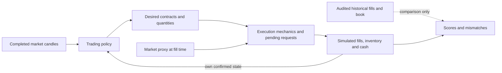

# Algo 8 — latent trading policy versus order management

**The reversals look compatible with cleanup/reconciliation mechanics, but the
mechanism and its activation are not identified. Separating the layers does not
materially improve broad reconstruction in the tested family.** The selected
model is **28**, a pooled-clock policy with a pooled-contract premium50% stop
and safe execution. Later event macro F1 is **24.3%** on
**14 pre-initialised cycles**, far below 80–90%. These later records were already
inspected in previous work; there is no researcher-blind external validation.

## Six direct answers

1. **Deliberate reversals or order management?** Within the immutable59 cases,
   49 have an opposite quantity equal to the final atomic close, all 59 use a
   different received parent at that boundary, and 27 involve a parent with multiple received child fills.
   This supports investigating repeated/stale close requests or zero-target
   correction. It does not confirm duplicates. An intentional fast round trip
   remains observationally possible, and the strict matched-control sample has
   only 1 case with 1 control.
2. **Does separation improve later reconstruction?** No material overall gain
   over the same policy with safe execution. Sequential execution and pending-
   aware reconciliation give the same later event F1 at the minute level.
   Delayed variants add about1pp F1 outside motifs, but worsen final liquidation
   and the registered composite. The universal duplicate variant generates
   559 motifs and
   matches0/59 original cases by exact contract within two minutes.
3. **What is identifiable?** Executed quantities, child fragmentation, received
   parent references, atomic book transitions and relative recorded times.
   Original targets, submissions, cancellations, acknowledgement latency and
   whether a repeated payload was intentional are not observed. Some models
   share identical minute action paths despite different subminute execution.
4. **Better intermediate exits without weaker opening?** Opening short quantity
   reconstruction improves from the earlier 0/32 benchmark to
   **28/32**; true first-wing strike pairs improve
   to **17/32**. All-four-role09:17 net matching is
   only **19/32**. The regular execution variants
   preserve those opening metrics, but do not recover the original exit trigger.
   The overactive stale-state variant breaks opening quantities and is rejected
   by both fit and complexity. Intermediate and final exit results remain separate.
5. **Simplest captured behaviour?** Fixed three-base opening intent, separate
   seed geometry, scheduled pooled-clock accumulation, independent side reductions
   and a dated liquidation deadline, with safe target-bounded execution. This is
   the simplest scored approximation here. Its50% stop,15:10/15:20 carry guard
   and literal seed points are hypotheses, not recovered original instructions.
6. **What remains unresolved?** The latent risk/exit activation, exact seed
   selection, extra allocations/re-entry, allocation ownership, stop reset/scope,
   original pending queue, and causes of the 59 overshoots. Submission/cancel/ack
   logs, decision IDs, tick bid/ask, complete-chain data and missing prior
   initialization records would discriminate these explanations.

## Architecture and fixed experiment

[Registered plan](REGISTERED_PLAN.md), [measurement audit](MEASUREMENT_NOTES.md).
The experiment contains **12 policies × 7 mechanics =84 models**, without another
indicator bank. Policies compare fixed increments, pooled clock increments,
cumulative targets and capped target restoration, crossed with deadline-only,
premium50 and side-equity100k episode management. All use the same frozen
opening module. Older targets survive additions unless an explicit reduction
changes them. Actual historical inventory/actions never enter a simulated policy.

The seven mechanisms specify base fragmentation, delays, pending persistence,
cancellation acknowledgement, one stale close copy, pending-aware reconciliation
and a deliberately overactive stale/ignore-pending control. Parameters are
explicit in [execution definitions](execution_mechanics_candidates.csv).
The last mechanism is a negative control, not a credible recovered controller.
The selected policy is also replayed with **the same frozen safe-generated target
stream** under every mechanic, separating execution effects from policy feedback.
Those targets are simulated hypotheses, not inferred original decisions.

Quantity/cash accounting and minute scoring reuse the existing reconciled replay
implementation. Primary weights remain.40 event F1,.20 quantity,.30 inventory,
.10 resolved final closure, minus.002 per complexity point. Exact contract/action
matches are one-to-one within ±2 minutes. Quantity and inventory scores are normalized
overlap measures, not percentages of entirely correct orders/books. P&L does not
select the model. Calendars are conditional on received sessions. Fit quantities
use June–July, August selects, September–October is an already-inspected check.

The quote universe remains the historically traded-contract subset. That is
not independent full-chain eligibility. All comparisons share this restriction
and use only preceding market prices; missing geometric seed contracts have no
fabricated quotes or fills.

All 35 cycles are simulated. The3 received expiry-only starts lack prior
initialization and are retained in full outputs, but the same 32 pre-initialised
cycles determine selection for every model:11 fit,7 August,14 later. The delayed
NIFTY 5 October start is retained as an explicit contradiction, without a date-coded
policy exception. Nonstandard observed opening sizes are also separate.

## Forensics: all 59 original motifs

The source cohort hash and all source row IDs are preserved in
[forensic manifest](forensic_manifest.json) and
[59-case ledger](reversal_motif_ledger.csv). Its views include:

- [second-by-second net states](reversal_second_timelines.csv.gz);
- [child fills, requested sizes and raw export references](reversal_child_fills.csv.gz);
- [same-contract, same-right and opposite-right activity through15minutes](reversal_neighbor_activity.csv.gz);
- preceding/following minute spot and option marks, subsequent received inventory,
  next activity times and round-trip cashflows in the case ledger.

Recorded seconds are corroborated to export minutes, not independently certified
exchange timestamps. Post-event market changes are descriptive only. A carried
ledger quantity after the last received fill is not independent broker-position
confirmation. No tick price, intent or cancellation is invented.

The quantities are **49 equal, 10 below, 0 above** the final atomic closed amount.
Zero above is imposed by the original conservative size restriction; it is not
independent evidence that over-sized reversals cannot occur. Equality against
the entire monotone closing burst is **48/59**. Only6 atomic closes are one base;
53 are multi-unit. **46/59** have a repeated requested parent size at the
close/open boundary, and **57/59** share at least one export order-label
minute. **10/59** also repeat a requested-size / candidate-limit-price pair
across distinct references. The limit field is inferred from price bounds, not
an exporter-confirmed order-type schema. Repeated size/price/minute does not
establish duplicated intent. Encoded export-tag categories remain uninterpreted.

Every opposite opening uses a different grouped parent than the final close:
**0/59** share that parent. Thus a *single parent merely filling across zero*
is contradicted under the received grouping convention. Nevertheless **27/59**
involve a parent with multiple received children somewhere in the sequence: partial execution
can coexist with a second close request or reconciliation.

| Motif | Contract | Close | Old_q | Opposite_q | Zero_again | Same_grouped_parent | Partial_parent_present |
| --- | --- | --- | --- | --- | --- | --- | --- |
| M01 | NIFTY 2026-06-23 25400CE | 14:04:09 | 130 | -130 | 14:04:19 | False | False |
| M03 | NIFTY 2026-06-30 23550PE | 14:25:32 | 1170 | -1170 | 14:25:42 | False | True |
| M04 | NIFTY 2026-06-30 23850CE | 14:25:17 | -260 | 130 | 14:25:31 | False | False |

For example, M03's opposite-order request is 1170 units, with child fills 260 and
910. The1170 requested field repeats on its children; adding those request fields
would falsely count 2340. Incremental quantities sum to 1170. Distinct parent
references still separate the earlier close from that opposite request.

### Competing hypotheses are nonexclusive

| Hypothesis | Variant | Compatible | Contradicted_variant | Unresolved |
| --- | --- | --- | --- | --- |
| A_duplicate_stale_close | distinct_parent_requested_quantity_repeats | 46 | 13 | 0 |
| A_duplicate_stale_close | distinct_parent_size_and_limit_candidate_repeat | 10 | 49 | 0 |
| A_duplicate_stale_close | two_distinct_parent_full_atomic_duplicate | 49 | 10 | 0 |
| B_intentional_rotation | nearby_paired_shorts_at_prior_clock_label | 0 | 0 | 59 |
| B_intentional_rotation | persistent_opposite_exposure_at5min | 0 | 59 | 0 |
| C_target_synchronisation | zero_target_correction_within5sec | 38 | 21 | 0 |
| D_protective_adjustment | old_long_and_near_equal_new_long | 0 | 16 | 43 |
| E_partial_or_ordering | multiple_child_fills_in_involved_parent | 27 | 32 | 0 |
| E_partial_or_ordering | one_grouped_parent_spans_flat_boundary | 0 | 59 | 0 |
| F_other_unresolved | unique_cause_identification | 0 | 0 | 59 |

[Per-case compatibility/contradiction ledger](reversal_hypothesis_scores.csv).
These are necessary observable implications of named variants, not probabilities
or exclusive cause labels. A persistent five-minute reversal fails all 59 cases;
a fast intentional round trip is not ruled out. Return to zero within 60 seconds
is part of case selection, so it cannot independently prove zero-target intent.
The within 5 second variant fits38/59. The paired-short/clock-label variant tests
a different possible allocation context without requiring five-minute position
persistence. The strict protective-rotation variant's short exclusion can also
exclude an execution overshoot; it does not rule out a mixed hedging purpose.
All59 remain unresolved as unique causes.

### Is quantity equality unusual?

There are **2244** aged same-contract closes to zero; only **93** have another
nonzero same-contract event within 10 seconds. The others are not counted as
unequal reopenings. A non-motif event can itself be a reversal; strict negative
controls below reopen in the *original* direction. Both case and control rows
receive the same peak-size restriction for this comparison.

| Size | Cohort | N | Cycles | Equal | Rate |
| --- | --- | --- | --- | --- | --- |
| all | fixed_motifs | 59 | 10 | 49 | 83.1% |
| all | strict_nonreversal_controls | 14 | 8 | 9 | 64.3% |
| one_base | fixed_motifs | 6 | 4 | 6 | 100.0% |
| one_base | strict_nonreversal_controls | 7 | 5 | 7 | 100.0% |
| multiple_base | fixed_motifs | 53 | 10 | 43 | 81.1% |
| multiple_base | strict_nonreversal_controls | 7 | 6 | 2 | 28.6% |

One-base equality is forced when positive quantities are integral base units and
reopening cannot exceed the old one-base quantity. The unadjusted all-size
case/control rate difference is+18.8pp, with cycle bootstrap
95% interval[-2.4,+43.1]pp. For multi-unit cases the
contrast is+52.6pp
[+9.3,+87.4]pp, but only 7 strict controls contribute.
These intervals do not correct selection or poor state overlap.

Exact index/cycle/phase/old-role/closed-size matching without replacement yields
**one case and one control**, separated by about109minutes. There is no adequate
matched sample for a causal unusual-equality conclusion. The result is a
mechanics lead, not an83%-decoded trigger.
Sources: [all closure opportunities](all_closure_controls.csv),
[all/strict control counts](quantity_equality_controls.csv),
[matched controls](matched_nonreversal_controls.csv),
[cycle uncertainty](control_cycle_uncertainty.csv).

## Opening is scored independently

| Model | N | Both_first_wings | Both_short_gross_quantities | All_four_net_at0917 |
| --- | --- | --- | --- | --- |
| prior selected13845 | 32 | 0 | 0 | unavailable |
| prior13845 child-second re-audit | 32 | 0 | 0 | unavailable |
| 28 | 32 | 17 | 28 | 19 |
| 29 | 32 | 17 | 28 | 19 |
| 32 | 32 | 17 | 28 | 19 |
| 33 | 32 | 17 | 28 | 19 |
| 34 | 32 | 17 | 0 | 0 |

The old 0/32 benchmark is preserved and a raw-child-second re-audit also gives0/32.
A provisional new 9/32 wing count was invalid because minute aggregation sorted
strikes rather than executions. Corrected actual first-fill order uses event
seconds then source row; **2** starts have multiple strikes tied in at least
one first-event second and retain that flag. This measurement correction changes
neither primary minute scores nor selected rules.

The common ordinary sample has 31 starts;5October is the delayed exception.
The fixed policy has no hindsight date override. Observed nonstandard ordinary
opening-size dates are2026-09-21, 2026-09-30, 2026-10-14. The literal intended
seed geometry lies within two grids of both observed wings on **28/32**
starts; this is compatibility with prior geometry, not an exact executable rule.
Missing stored seed contracts/quotes remain unfilled. The exact strike reference
and complete option universe are still unresolved.
Sources: [per-start scores and exceptions](opening_initialisation_scores.csv),
[intended geometry versus quote availability](seed_geometry_and_quote_audit.csv),
[prior benchmark and re-audit](opening_vs_prior_contradiction.csv).

## Full policy/execution comparison

August selection by system, on the identical cycle cohort:

| System | August_selected | Complexity | August_score | Later_F1 | Later_score |
| --- | --- | --- | --- | --- | --- |
| inventory_reconciliation | 33 | 17 | 0.2495 | 24.3% | 0.2798 |
| policy_alone | 28 | 12 | 0.2593 | 24.3% | 0.2898 |
| stateful_execution | 29 | 14 | 0.2553 | 24.3% | 0.2858 |

Same selected policy, all mechanics:

| Period | Model | Mechanics | Cycles | Event_F1 | Quantity | Inventory | Final | Penalized_score |
| --- | --- | --- | --- | --- | --- | --- | --- | --- |
| Fit Jun-Jul | 28 | safe_immediate | 11 | 17.7% | 12.2% | 44.6% | 40.0% | 0.2440 |
| Fit Jun-Jul | 29 | sequential_base_slices | 11 | 17.7% | 12.2% | 44.6% | 40.0% | 0.2400 |
| Fit Jun-Jul | 30 | delayed_partial_keep | 11 | 18.1% | 12.8% | 44.6% | 20.0% | 0.2204 |
| Fit Jun-Jul | 31 | delayed_cancel_replace | 11 | 18.2% | 12.8% | 44.6% | 20.0% | 0.2192 |
| Fit Jun-Jul | 32 | stale_flatten_duplicate | 11 | 17.1% | 10.9% | 44.6% | 40.0% | 0.2288 |
| Fit Jun-Jul | 33 | pending_aware_reconcile | 11 | 17.7% | 12.2% | 44.6% | 40.0% | 0.2340 |
| Fit Jun-Jul | 34 | stale_ignore_pending | 11 | 3.5% | 0.4% | 35.4% | 0.0% | 0.0825 |
| Internal Aug | 28 | safe_immediate | 7 | 22.3% | 15.0% | 40.5% | 42.9% | 0.2593 |
| Internal Aug | 29 | sequential_base_slices | 7 | 22.3% | 15.0% | 40.5% | 42.9% | 0.2553 |
| Internal Aug | 30 | delayed_partial_keep | 7 | 22.5% | 15.3% | 40.4% | 14.3% | 0.2241 |
| Internal Aug | 31 | delayed_cancel_replace | 7 | 22.5% | 15.3% | 40.4% | 14.3% | 0.2222 |
| Internal Aug | 32 | stale_flatten_duplicate | 7 | 21.3% | 12.9% | 40.5% | 42.9% | 0.2411 |
| Internal Aug | 33 | pending_aware_reconcile | 7 | 22.3% | 15.0% | 40.5% | 42.9% | 0.2495 |
| Internal Aug | 34 | stale_ignore_pending | 7 | 2.5% | 0.3% | 31.3% | 0.0% | 0.0643 |
| Inspected Sep-Oct | 28 | safe_immediate | 14 | 24.3% | 17.1% | 45.6% | 46.2% | 0.2898 |
| Inspected Sep-Oct | 29 | sequential_base_slices | 14 | 24.3% | 17.1% | 45.6% | 46.2% | 0.2858 |
| Inspected Sep-Oct | 30 | delayed_partial_keep | 14 | 25.2% | 17.8% | 45.6% | 7.7% | 0.2513 |
| Inspected Sep-Oct | 31 | delayed_cancel_replace | 14 | 25.3% | 17.8% | 45.6% | 7.7% | 0.2497 |
| Inspected Sep-Oct | 32 | stale_flatten_duplicate | 14 | 23.9% | 16.1% | 45.6% | 46.2% | 0.2762 |
| Inspected Sep-Oct | 33 | pending_aware_reconcile | 14 | 24.3% | 17.1% | 45.6% | 46.2% | 0.2798 |
| Inspected Sep-Oct | 34 | stale_ignore_pending | 14 | 2.3% | 0.3% | 35.7% | 0.0% | 0.0782 |

### Parent orders and child fills are different

| Model | Index | Parents | One_base | Rate |
| --- | --- | --- | --- | --- |
| 28 | NIFTY | 536 | 269 | 50.2% |
| 28 | SENSEX | 609 | 303 | 49.8% |
| 29 | NIFTY | 953 | 953 | 100.0% |
| 29 | SENSEX | 1085 | 1085 | 100.0% |
| observed | NIFTY | 2032 | 2022 | 99.5% |
| observed | SENSEX | 2375 | 2375 | 100.0% |

[Parent-request diagnostic](parent_order_granularity.csv). Fragmented expansion
submits one base per parent; delayed partial execution can instead fill one
larger parent in base-sized slices. These are distinct hypotheses. Minute actions
are unchanged by this request partition, so the primary score cannot identify
it. The received requested-size fields support unit fragmentation for routine
pre-expiry short entries, while neither the number of allocation units nor the
exact subsecond leg delays is recovered. The simple safe model is the aggregate
score baseline; it is not a recovered submission engine.

The 50% stop is a pooled-contract rule: it is not identified allocation ownership
or a proven original stop. Capital100k episode management and target restoration
are tested alternatives. No result recovers the supplied4%/1% implementation.
The declared delays/expiry assumptions can themselves worsen final fills; that
rejects these configurations, not every possible order-management process.
Full [84-model comparison](policy_vs_execution_comparison.csv),
[policies](desired_inventory_candidates.csv), [selected configuration](selected_model_config.yaml).

### Outside the 59 selected sequences

The primary exclusion removes each affected contract-minute overlapping
close−5seconds through neutralisation+5seconds. A second exclusion adds a
±2minute matching halo. Both observed and predicted actions and inventory cells
use the same fixed masks; no historical mask informs a candidate decision.

| Model | Full_F1 | Outside_motifs_F1 | Outside_halo_F1 | Change_vs_safe | Cycle95 |
| --- | --- | --- | --- | --- | --- |
| 28 | 24.3% | 24.4% | 24.4% | reference | reference |
| 29 | 24.3% | 24.4% | 24.4% | +0.00 pp | [+0.00, +0.00] pp |
| 30 | 25.2% | 25.3% | 25.4% | +0.98 pp | [+0.21, +1.76] pp |
| 31 | 25.3% | 25.4% | 25.4% | +1.04 pp | [+0.37, +1.77] pp |
| 32 | 23.9% | 23.9% | 23.9% | -0.44 pp | [-0.89, +0.03] pp |
| 33 | 24.3% | 24.4% | 24.4% | +0.00 pp | [+0.00, +0.00] pp |
| 34 | 2.3% | 2.3% | 2.3% | -22.03 pp | [-25.37, -19.08] pp |

Later comparisons have14 cycles, bootstrapped by whole cycle. Delayed execution
can improve action F1 outside the selected motifs while degrading liquidation;
this partial improvement is not hidden, but does not produce a better complete
controller. [Paired cycle contrasts](paired_cycle_uncertainty.csv).

### Frozen desired targets: isolate execution

| Model | Cycles | Event_F1 | Quantity | Inventory | Final |
| --- | --- | --- | --- | --- | --- |
| 28 | 14 | 24.3% | 17.1% | 45.6% | 46.2% |
| 29 | 14 | 24.3% | 17.1% | 45.6% | 46.2% |
| 30 | 14 | 25.2% | 17.8% | 45.6% | 7.7% |
| 31 | 14 | 25.3% | 17.8% | 45.6% | 7.7% |
| 32 | 14 | 23.9% | 16.1% | 45.6% | 46.2% |
| 33 | 14 | 24.3% | 17.1% | 45.6% | 46.2% |
| 34 | 14 | 1.8% | 0.3% | 33.7% | 0.0% |

These seven replays receive identical safe-generated target streams. Changes
are therefore execution effects under that hypothetical policy, without feeding
observed original targets to the model. [Frozen goals](frozen_targets_goals.csv.gz),
[frozen-target cycle scores](frozen_targets_cycle_scores.csv.gz).

### Later allocations and intermediate exits

Exact 17-window pre-expiry quantities, using child seconds and the same
T−2second to T+180second target as the original analysis:

| Model | Windows | Cycles | Exact_short_pair | Exact_four_roles | Mean_abs_error_units |
| --- | --- | --- | --- | --- | --- |
| 28 | 238 | 14 | 52.5% | 51.3% | 2.66 |
| 29 | 238 | 14 | 52.5% | 51.3% | 2.66 |
| 30 | 238 | 14 | 52.5% | 51.3% | 2.65 |
| 31 | 238 | 14 | 52.5% | 51.3% | 2.66 |
| 32 | 238 | 14 | 52.5% | 51.3% | 2.66 |
| 33 | 238 | 14 | 52.5% | 51.3% | 2.66 |

The overactive control retains complete aggregate actions but no exact child-window
size metric. Its extra events still count against the main reconstruction score.
[Allocation detail](recurring_allocation_scores.csv).

Intermediate covers before 15:00, both rights pooled within each index:

| Model | Index | Predicted | Observed | Matched | Precision | Recall |
| --- | --- | --- | --- | --- | --- | --- |
| 28 | NIFTY | 47 | 487 | 31 | 66.0% | 6.4% |
| 28 | SENSEX | 83 | 894 | 55 | 66.3% | 6.2% |
| 30 | NIFTY | 89 | 487 | 47 | 52.8% | 9.7% |
| 30 | SENSEX | 120 | 894 | 64 | 53.3% | 7.2% |
| 32 | NIFTY | 47 | 487 | 31 | 66.0% | 6.4% |
| 32 | SENSEX | 83 | 894 | 55 | 66.3% | 6.2% |
| 33 | NIFTY | 47 | 487 | 31 | 66.0% | 6.4% |
| 33 | SENSEX | 83 | 894 | 55 | 66.3% | 6.2% |

[Right/cycle exit detail](intermediate_exit_scores.csv). The first reduction,
final short-book closure and remaining protection are distinct targets.

## Reversal prediction and intraminute inventory

| Model | Predicted_motifs | Matched_of 59 | False_motifs | Precision | Recall |
| --- | --- | --- | --- | --- | --- |
| 28 | 0 | 0 | 0 | unavailable | 0.0% |
| 29 | 0 | 0 | 0 | unavailable | 0.0% |
| 30 | 0 | 0 | 0 | unavailable | 0.0% |
| 31 | 0 | 0 | 0 | unavailable | 0.0% |
| 32 | 559 | 0 | 559 | 0.0% | 0.0% |
| 33 | 0 | 0 | 0 | unavailable | 0.0% |
| 34 | 260 | 0 | 260 | 0.0% | 0.0% |

At the recorded first-close times, compare the selected model's own held
contract and desired target to the observed transition. This is a diagnostic,
not an assumption that the original target was zero:

| Comparison | Cases |
| --- | --- |
| model_contract_absent | 32 |
| target_retained_at_recorded_flat | 27 |

[Case-level localisation](case_policy_execution_localisation.csv). An absent
model contract points to entry/strike/sizing discrepancies; a retained model
target points to a different decision path if the original intended to flatten.
A zero model target with residual simulated inventory points to execution/data
availability. Original intent remains latent in all three categories.

Observed aged closes by time context:

| Context | Aged_closures | Fixed_motifs | Reopenings10 |
| --- | --- | --- | --- |
| expiry_after1500 | 454 | 0 | 7 |
| expiry_before1500 | 1386 | 52 | 77 |
| preexpiry | 404 | 7 | 9 |

[Context controls](closure_context_controls.csv). Time buckets are observable
proxies, not labels for risk or deadline intent. They test a universal
close-copy explanation without inventing original triggers.

The full-copy variant generates the expected flat/opposite/flat *shape* at its
own hypothesized liquidations, but does not predict any of the original59
contract/time sequences. Its559 false motifs are retained as negative evidence.
The real activation gate is still missing. A conditional stale-close explanation
at observed timestamps is not an autonomous reconstruction.
[Coverage](reversal_pattern_coverage.csv), [all simulated closure opportunities](closed_loop_closures.csv.gz).

Some mechanics restore the same inventory before each minute ends, so minute
inventory scores cannot capture their temporary exposure. The detailed trace
therefore integrates absolute quantity distance from the **simulated desired
target**, in base-unit-seconds, and time holding a contract whose target is zero.
These are not comparisons to unobserved original targets. Missing/unfilled seed
quotes also contribute, including for safe execution.

| Model | Target_error_base_unit_seconds | Zero_target_contract_seconds | Scope |
| --- | --- | --- | --- |
| 28 | 928440 | 480 | 35 received cycles; latent-target deviation, not original target error |
| 29 | 1048985 | 12162 | 35 received cycles; latent-target deviation, not original target error |
| 30 | 2808695 | 197354 | 35 received cycles; latent-target deviation, not original target error |
| 31 | 2560103 | 160580 | 35 received cycles; latent-target deviation, not original target error |
| 32 | 946048 | 2716 | 35 received cycles; latent-target deviation, not original target error |
| 33 | 1081836 | 14404 | 35 received cycles; latent-target deviation, not original target error |

[Conservation and transient audit](detailed_request_audit.csv.gz),
[child fills](detailed_fills.csv.gz), [latent requests](detailed_requests.csv.gz).
These are simulated events, not fabricated historical submissions.

## Identifiability and discriminating evidence

[Observable equivalence](observable_equivalence.csv) compares full minute action
traces, not just equal scores. [Discriminating events](candidate_discriminating_events.csv)
gives timestamp, instrument, quantity, each model's action and nearby original
source/parent references. Sequential variants can share minute actions while
assigning different seconds. For example, the tested two-second per-leg staggering is not inferred from
minute agreement; the observed ordinary CE/PE first shorts are within one second
in 31/31 starts. Original relative fill ordering is observable;
submission times, queues and acknowledgement/cancellation ordering are absent.

Two policy modules emitting overlapping closes can also look like one policy
instruction copied inside the OMS. Filled-order references do not locate that
duplication at a particular software layer.

A zero target plus stale pending close and correction can produce the same
received inventory pattern as a deliberate brief opposite target followed by
zero. Post-hoc latent choices can explain either; they are not predictive fit.
The observed filled-order references and market minute bars cannot uniquely
choose between such intent hypotheses. The tested universal full-copy process
is contradicted by non-motif opportunities. A more selective duplicate or
reconciliation process remains possible but its actual trigger is not identified.

## Reproduction, tests and remaining conclusion

[README](README.md) contains commands. **217 repository tests pass**: prior201
plus16 tests for the separated engine and forensic measurement. Tests cover
atomic chronology, first-child ordering, opening constraints, independent desired
state, duplicate and delayed fills, cancellation, pending reconciliation,
quantity/cash accounting, future-state independence and deterministic replay.
They establish software behavior, not original-policy truth.

The existing canonical accounting remains the reference. All 84×35 model-cycle
request audits conserve requested = executed + cancelled + failed + remaining.
A cold-cache rebuild exactly reproduces the original canonical binary while
preserving checked committed prior outputs. A saved-configuration replay is
verified against the selected detailed trace. See [validation audit](validation_audit.json).

Complete scores, goals and closure audits cover all 84 definitions. The August-
selected trace cohort has complete minute actions and a mismatch ledger; detailed
child records cover six regular mechanics of the selected policy. The overactive
negative control keeps all coarse actions and reversals, without its repetitive
multi-gigabyte child dump. All definitions remain reproducible.

**Best-supported behaviour:** timed accumulation with distinct opening/routine
protection and separate risk management. Some rapid opposite openings are
consistent with execution cleanup and should not automatically be called new
intentional allocations.

**Competing explanations:** stale/duplicate close requests, target reconciliation,
multiple pending/partial requests, and deliberate very brief rotations remain
partly observationally equivalent. These are not exclusive posterior labels.

**Unresolved:** original exit activation, exact seed choice, allocation sizing,
re-entry/reset, maximum exposure and queue rules. The separation is useful for
identifying those gaps; it does not recover an80–90% controller or proven alpha.
