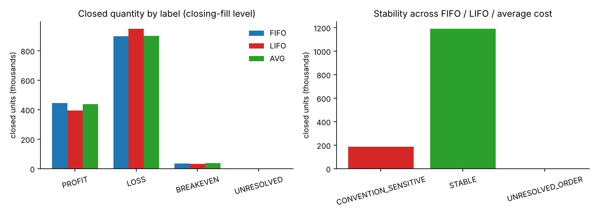
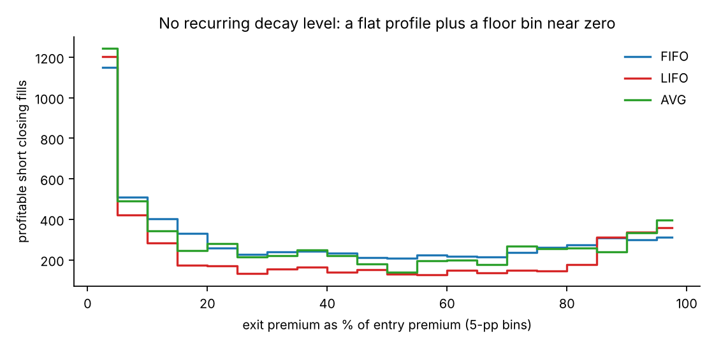
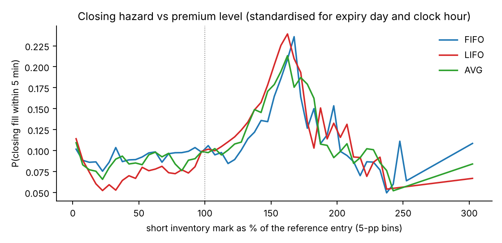
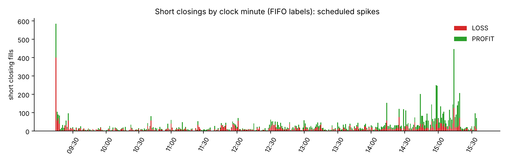

# TP-01 · Profitable position reconstruction and exit classification

**Verdict: PASS (reconstruction and descriptive analysis). The take-profit rule is NOT recovered.** The data support a stop-like response
(closing hazard peaks near 160–170 % of the reference entry) and clock-driven closing spikes. They do **not** show a fixed premium-decay take-profit level.
Everything here is observed behaviour or a labelled hypothesis. All results are in-sample on the same 65 sessions; nothing is validated on new data.
Branch `research/tp01-position-reconstruction` (from the Stage 1 tip `80baac08`). Phase 0 audit: [`PHASE0_AUDIT.md`](PHASE0_AUDIT.md).

## 1. Executive summary

| Question | Answer |
|---|---|
| Reconstructed | **2,667 inventory episodes** (positions) in 1,890 contract-direction cells; **1,377,065 units closed** (31,456 lots) by **17,760 closing fills**; 1,414,545 units opened; 37,480 units never closed (all in contracts that expired) |
| Reconciliation | opened = closed + remaining in every contract and direction; every fill unit is opened or closed; **0 unexplained units**; cash identity exact (difference 0.0) |
| Labels per closing fill (PROFIT / LOSS / BREAKEVEN / UNRESOLVED) | FIFO: 7,233 / 10,328 / 196 / 3 · LIFO: 5,920 / 11,602 / 235 / 3 · AVG: 6,991 / 10,581 / 185 / 3 |
| Stable across FIFO / LIFO / average cost | **86.5 % of closed units** (82.9 % of fills); position-level results are identical (fully closed positions: 643 profit / 1,860 loss / 83 breakeven) |
| Sensitive to the convention | **13.5 % of closed units** (3,040 fills): the label depends on which lot a closing fill is assumed to close |
| Unresolved by order | 3 closing fills (150 units): equal-second ordering changes their closing quantity |
| Realised gross P&L of closed quantities | ₹21.01 L FIFO · ₹20.97 L LIFO · ₹21.00 L average cost. **Net P&L: unavailable** (no charge fields). Excludes expiry settlement of the 37,480 unclosed units |
| Profitable short exits | median exit premium **37 %** of entry (quartiles 9–72 %), median profit 38.3 points/unit; **no decay-level cluster under all three conventions** |
| Closing hazard | stop-like peak at 165–170 % (FIFO) / 160–165 % (LIFO) / 160–165 % (average cost) of the reference entry, hazard 0.24 / 0.24 / 0.21 versus about 0.09 elsewhere; **no peak on the profit side** (maximum 0.11) |
| Cannot be inferred | which lot a closure belongs to; the decision rule behind any closure; settlement P&L of unclosed units; net P&L; anything about periods outside these 65 sessions |

## 2. Raw source and verified counts

| Item | Verified |
|---|---|
| File / SHA-256 | `Trades_GKOHNP140.csv` · `86e65ab6ece492a74402cb3f0ed0fc3c0d638a46a8b62b33ff2bf0094c06f528` |
| Fill rows | **41,421** (columns: 167); ledger rows 41,421; rows flagged by a data-quality rule: 0 |
| Parent orders (`UniqueOrderIdentifier`, column 163) | **39874**; column 4 order numbers 37258 (reused across days: not an identity) |
| Sessions / contracts | 65 sessions (2026-06-23 to 2026-10-22); 1674 contracts |
| Quantity convention | units (multiples of 65 NIFTY / 20 SENSEX). P&L in rupees = points × units, **no lot multiplier** |
| Price convention | per-fill price = column 137. **Column 18 is the running order-average price** (differs from the fill price on 431 fills of multi-fill orders) |

The earlier research (41,421 fills, 39,874 parent orders) is confirmed from the file, not assumed.

## 3. Data-quality findings

| check | value | status | note |
|---|---|---|---|
| raw rows | 41421 | INFO |  |
| parent orders (col 163) | 39874 | INFO |  |
| order numbers (col 4), reused across days | 37258 | INFO | not an order identity |
| sessions | 65 | INFO | 2026-06-23 to 2026-10-22 |
| contracts | 1674 | INFO |  |
| file order chronological (execution second) | 0 | PASS | number of backward steps |
| duplicate raw rows | 0 | PASS |  |
| duplicate fills (order, trade id, time, qty, price, side, contract) | 0 | PASS |  |
| trade id not unique (rows sharing an id) | 44 | FLAG | trade id is a reference, never a key |
| missing / unparseable key fields | 0 | PASS |  |
| non-positive or non-lot-multiple quantity | 0 | PASS |  |
| non-positive or off-tick fill price (col 137) | 0 | PASS | tick 0.05 |
| instrument fields inconsistent with description | 0 | PASS |  |
| exchange tokens mapping to >1 contract | 8 | FLAG | token reused across expiries; identity uses (underlying, expiry, type, strike) |
| fills dated after the contract expiry | 0 | PASS |  |
| fills outside 09:15-15:40 | 0 | PASS |  |
| fills after 15:30 (post-close) | 420 | INFO |  |
| price min / max (col 137) | 0.05 / 878.8 | INFO |  |
| fills whose per-fill price differs from the running order average (col 18) | 431 | INFO | col 18 is a running order average; col 137 is the fill price |
| orders with several fills | 1059 | INFO |  |
| partially-filled rows | 1550 | INFO |  |
| orders whose fills do not add up to the order quantity | 3 | FLAG | unfilled remainder; fill rows are kept as executed |
| contract-seconds with >= 2 fills | 4464 | INFO |  |
| contract-seconds mixing buys and sells (ordering ambiguity) | 56 | FLAG | alternative orderings are run in the sensitivity |
| module tags | num:26954; h_:13181; s_:763; v_:515; m_:8 | INFO | num = body, h_ wing, s_ cycle stop, v_ lump, m_ manual |
| charge / brokerage fields in the raw file | 0 | FLAG | none exist: net P&L is not computed |

Material points: (i) nothing is duplicated, missing or off-tick; (ii) trade ids and exchange tokens are **not** identities (tokens are reused across expiries); (iii) 6 fills sit in 56 equal-second buy/sell groups whose open/close role depends on an ordering assumption; (iv) there is no charge information.

## 4. Position reconstruction

* **Identity:** (underlying, expiry, type, strike); contracts are never merged.
* **Role of a fill** is set by the current net inventory of its contract: against it → closes `min(qty, |inventory|)`, the excess opens the opposite direction (a reversal); with it or flat → opens. Partial fills are separate events.
* **Position (episode):** a run of non-zero inventory in one direction in one contract; flat or a reversal ends it. An episode is an **inventory** identity, not a claim about which strategy leg owns a lot (PR #5: ownership identified for 3.5 % of replacement pairs).
* **Order of events:** (execution second, file row). The file is chronological (0 backward steps). Alternative tie orders (sells first, buys first) are run for the ambiguity check.
* **Conventions:** FIFO, LIFO and average cost run on identical fills; none is called the truth. Average cost closes at the pool's quantity-weighted average price; a reversal re-opens at the reversing fill price.
* **Remaining quantity at the end:** every remaining unit is in a contract whose expiry date is within the data, so it is `EXPIRED_UNCLOSED` (no settlement fill exists; no settlement P&L is invented). `OPEN_AT_END_OF_DATA` = 0 units.
* **Labels:** PROFIT / LOSS if |gross P&L per unit| > **0.025 points** (half the 0.05 tick, fixed in `config.yaml` before any classification), BREAKEVEN otherwise, UNRESOLVED if the closing fill's closing quantity changes with the tie ordering. Values are rounded to 1e-9 before comparison.

## 5. FIFO / LIFO / average-cost comparison

| section | key | closing_fills | units | share_of_fills | share_of_units |
|---|---|---|---|---|---|
| closing-fill stability | CONVENTION_SENSITIVE | 3,040 | 186,430 | 0.1712 | 0.1354 |
| closing-fill stability | STABLE | 14,717 | 1,190,485 | 0.8287 | 0.8645 |
| closing-fill stability | UNRESOLVED_ORDER | 3 | 150 | 0.0002 | 0.0001 |
| consensus label | BREAKEVEN | 89 | 14,340 | 0.005 | 0.0104 |
| consensus label | CONVENTION_SENSITIVE | 3,040 | 186,430 | 0.1712 | 0.1354 |
| consensus label | LOSS | 9,451 | 832,380 | 0.5322 | 0.6045 |
| consensus label | PROFIT | 5,177 | 343,765 | 0.2915 | 0.2496 |
| consensus label | UNRESOLVED | 3 | 150 | 0.0002 | 0.0001 |

Total realised gross P&L differs by only ₹0.04 L across the three conventions, because the P&L of a **fully closed position is convention-independent**
(largest difference between conventions: 1.60e-10 ₹). What the convention changes is which closing fill carries the profit or the loss.

Label transitions FIFO → LIFO (closing fills): PROFIT→LOSS 1,981, LOSS→PROFIT 678; all matrices are in `analysis/matching_sensitivity.csv`.

**What is stable, sensitive, unidentifiable.** Stable: quantities, episode structure, position-level P&L and labels, the direction of the aggregate profit/loss split. Sensitive: the label of 17.1 % of closing fills, concentrated in short closings (NIFTY short: 21.6 % of units sensitive). Unidentifiable: which opening lot a closing fill closes.

## 6. PROFIT / LOSS / BREAKEVEN / UNRESOLVED counts

Closing fills (PROFIT / LOSS / BREAKEVEN / UNRESOLVED) and matched pieces:

| Convention | Closing fills | Units | Matched pieces |
|---|---|---|---|
| FIFO | 7,233 / 10,328 / 196 / 3 | 445,240 / 897,505 / 34,170 / 150 | 9,391 / 15,356 / 273 / 3 |
| LIFO | 5,920 / 11,602 / 235 / 3 | 394,370 / 948,870 / 33,675 / 150 | 8,188 / 16,430 / 327 / 3 |
| AVG | 6,991 / 10,581 / 185 / 3 | 437,550 / 901,805 / 37,560 / 150 | 6,991 / 10,581 / 185 / 3 |

Positions (episodes): 2,667 in total; 2,586 fully closed (643 profit / 1,860 loss / 83 breakeven under every convention); 81 expired with quantity still open (no result label, no invented settlement).
Short closings are 11,716 fills (6,355 PROFIT, 5,312 LOSS under FIFO); long closings (mostly protective wings) are 6,044, with LOSS dominating (wings decay).

## 7. Reconciliation of opened, closed and remaining quantity

| method | fill_units | opened_units | closed_units | matched_units | remaining_units | unexplained_fill_units | open − close − remaining | cells not reconciling | cash_identity_difference |
|---|---|---|---|---|---|---|---|---|---|
| FIFO | 2,791,610 | 1,414,545 | 1,377,065 | 1,377,065 | 37,480 | 0 | 0 | 0 | 0.0 |
| LIFO | 2,791,610 | 1,414,545 | 1,377,065 | 1,377,065 | 37,480 | 0 | 0 | 0 | 0.0 |
| AVG | 2,791,610 | 1,414,545 | 1,377,065 | 1,377,065 | 37,480 | 0 | 0 | 0 | 0.0 |

* Every one of the 41,421 fills is accounted for: 23,661 open only, 17,737 close only, 23 split (reversals: 3,345 units re-opened in the opposite direction); 0 fills were flagged by a quality rule and 0 excluded as duplicates.
* Remaining units: 7,105 short (premium collected ₹7.70 L) and 30,375 long (premium paid ₹0.83 L), all in expired contracts. The realised P&L above therefore **omits** the settlement result of these units.
* **Cross-check against the Stage 1 order-level ledger** (decision-time ordering, per-order VWAP): lots per order agree on 100 % of orders; closing/opening status agrees on 39,644 of 39,874 orders. The 230 that differ (0.58 %) arise from decision-time versus execution-time ordering: 75 stop-module (`s_`) orders (the overshoot of RSK-12: by execution time they open a short), 130 body orders, 19 wing (`h_`) and 6 lump (`v_`) orders (the `s_` cases are the RSK-12 overshoot; the cause of the other cases was not examined order by order). TP-01 orders by execution time, as required. Details: `analysis/crosscheck_vs_stage1_ledger.csv`.

## 8. Profitable versus losing exits (descriptive)

**Premium decay (short closings).** Profitable closings exit at a median 37 % of the entry premium; losing closings at a median 152 %. The profit-side distribution over 5-point bins is flat
(208–329 fills per bin from 15 % to 100 %) with one tall bin at 0–5 % (premium near its 0.05 floor).

**Profit per unit.** Profitable short closings earn a median 38.3 points per unit (₹1,479 per lot, quartiles 16.9–79.9). The five most common profit values cover only 1.2 % of profitable fills: **no repeatable profit amount**.
Losing short closings lose a median -44.6 points per unit.

**Holding time (median minutes, FIFO).**

| label | session_relation | closing_fills | hold_min_p25 | hold_min_p50 | hold_min_p75 |
|---|---|---|---|---|---|
| LOSS | CARRIED | 865 | 1171.0 | 1251.0 | 1349.0 |
| LOSS | SAME_SESSION | 4,438 | 27.0 | 73.0 | 133.0 |
| PROFIT | CARRIED | 1,602 | 1289.0 | 1423.0 | 1540.0 |
| PROFIT | SAME_SESSION | 4,733 | 45.0 | 123.0 | 210.0 |

Carried positions are held about a day (≈ 1,250–1,420 minutes) whichever way they end; same-session profits are held longer than same-session losses.

**Exit behaviour (FIFO labels).**

| label | closing_fills | share_partial | share_one_lot | share_next_close_same_contract_within_60s | share_followed_by_replacement_open_within_60s | share_with_other_closings_same_und_within_10s | share_carried |
|---|---|---|---|---|---|---|---|
| PROFIT | 6,355 | 0.939 | 0.883 | 0.58 | 0.444 | 0.976 | 0.255 |
| LOSS | 5,312 | 0.888 | 0.92 | 0.643 | 0.366 | 0.994 | 0.164 |
| BREAKEVEN | 47 | 0.553 | 0.426 | 0.426 | 0.468 | 0.979 | 0.255 |
| ALL | 11,716 | 0.914 | 0.898 | 0.608 | 0.409 | 0.984 | 0.214 |

Closings are overwhelmingly one-lot partial exits (91 % partial, 90 % one lot); about 61 % are followed by another closing fill in the same contract within 60 s; about 41 % are followed by an opening fill in the same underlying and right within 60 s (a replacement or re-entry); nearly all happen within 10 s of another closing in the same underlying (batch behaviour).

**Market context at the exit** (index bars completed before the exit minute only; stale closing minutes excluded; short closings with a stable PROFIT or LOSS label; 56 dates). AUC = P(feature higher at a profit exit than at a loss exit); the second AUC is computed within strata of expiry-day × clock hour and weighted by pair count; intervals are date-cluster bootstrap (500 resamples).

| feature | n_profit | n_loss | median_profit | median_loss | auc_profit_gt_loss | auc_ci_lo | auc_ci_hi | auc_within_strata | auc_within_strata_ci_lo | auc_within_strata_ci_hi |
|---|---|---|---|---|---|---|---|---|---|---|
| idx_ret_15m_bp | 3,925 | 3,567 | -1.08 | -3.475 | 0.5074 | 0.4398 | 0.5713 | 0.4845 | 0.3953 | 0.5752 |
| idx_ret_60m_bp | 3,925 | 3,567 | -4.123 | -6.43 | 0.5158 | 0.4518 | 0.5861 | 0.5058 | 0.435 | 0.5665 |
| rv30_bp | 3,925 | 3,567 | 15.594 | 14.352 | 0.5524 | 0.4834 | 0.6191 | 0.4635 | 0.3902 | 0.5527 |
| range_expansion | 3,925 | 3,567 | 1.012 | 1.398 | 0.3393 | 0.3041 | 0.3837 | 0.3637 | 0.319 | 0.4276 |
| dist_from_open_bp | 3,925 | 3,567 | -12.085 | -12.618 | 0.4969 | 0.4341 | 0.569 | 0.5241 | 0.4708 | 0.5687 |
| tod_min | 3,925 | 3,567 | 336.0 | 234.0 | 0.7531 | 0.7141 | 0.7919 | 0.5996 | 0.5365 | 0.6592 |
| minutes_to_expiry | 3,925 | 3,567 | 39.15 | 198.983 | 0.212 | 0.1689 | 0.2502 | 0.4013 | 0.3437 | 0.4611 |

Index return, volatility and distance from the open do not separate profit from loss (intervals include 0.5). **Time of day, expiry proximity and range expansion do**: losing closings follow a range expansion (AUC 0.34, 0.36 within strata), profitable ones occur later in the day and nearer expiry (raw AUC 0.75, falling to 0.60 once expiry day and hour are held fixed). This is consistent with adverse moves triggering losing exits, not with a market-state trigger for profits.

## 9. Candidate exit patterns (hypotheses only)

Candidates were selected by the rule fixed in `config.yaml` before any table was inspected: a 5-point decay bin, or a clock minute, whose count is ≥ 3× the median of its neighbours (≥ 100 fills); at most 3 per family. Each was evaluated once. No threshold was searched and none was optimised.

| Pattern | Result | Verdict |
|---|---|---|
| Premium-decay level (profit side) | Cluster bins: 0–5 % in ['AVG', 'LIFO']. FIFO's 0–5 % bin has an excess ratio of 2.87, just under the 3.0 rule. | **No decay level is a cluster under all three conventions** |
| Near-zero premium (0–5 %) | closing hazard 1.6–2.4× its neighbours, but **0.86–1.07× once expiry day and clock hour are controlled**; exists only on expiry days | Artefact of time and the 0.05 price floor; **not a premium-level pattern** |
| Clock minute 09:15 | 602 short closings; closing hazard 4.4× neighbouring minutes (3.8× within expiry-day strata); elevated in 22/31 cycles; per underlying NIFTY 4.24 / SENSEX 4.52 | HYPOTHESIS: scheduled (clock-driven) closing; the profit share of its closings depends on the convention (FIFO 31 % profit / LIFO 21 % profit / AVG 28 % profit) |
| Clock minute 14:44 | 203 short closings; closing hazard 4.2× neighbouring minutes (4.2× within expiry-day strata); elevated in 20/35 cycles; per underlying NIFTY 4.13 / SENSEX 4.27 | HYPOTHESIS: scheduled (clock-driven) closing; the profit share of its closings depends on the convention (FIFO 80 % profit / LIFO 62 % profit / AVG 80 % profit) |
| Clock minute 14:29 | 119 short closings; closing hazard 4.1× neighbouring minutes (4.1× within expiry-day strata); elevated in 21/35 cycles; per underlying NIFTY 4.53 / SENSEX 3.77 | HYPOTHESIS: scheduled (clock-driven) closing; the profit share of its closings depends on the convention (FIFO 85 % profit / LIFO 56 % profit / AVG 82 % profit) |

Other clock clusters under the same rule (not carried forward by the 3-candidate cap): 09:15, 14:29, 14:44, 14:58, 14:59, 15:14, 15:19.
**Not a take-profit candidate, for contrast:** the closing hazard rises from about 0.09 to 0.21–0.24 when a short is marked near 160–170 % of its reference entry (a loss), matching the per-lot stop found in Stage 1 (≈ 1.6–1.7×). The profit side is flat (maximum 0.11).

**Phase 6 checklist for the evaluated candidates** (`analysis/exit_pattern_summary.csv`): how often the condition occurred (`rows_in_condition`) · how often a closing fill followed (`hazard_in_condition`, i.e. the condition without an exit is 1 − hazard) · profitability after the condition (`label_mix_*`) · expiry stability (`cycles_elevated`) · NIFTY vs SENSEX (`per_underlying_ratio`) · FIFO / LIFO / average cost (one row each, or `label_mix_by_convention`) · control for time of day and expiry proximity (`hazard_ratio_controlled_for_expiry_day_and_clock_hour`).
Hazard ratios carry no confidence interval; the cycle count is the stability evidence.

## 10. Expiry-wise and underlying-wise consistency

| und | direction | closing_fills | closed_units | stable_share_units | pnl_FIFO | pnl_LIFO | pnl_AVG |
|---|---|---|---|---|---|---|---|
| NIFTY | short | 5,484 | 506,870 | 0.784 | 1,280,376 | 1,272,836 | 1,276,252 |
| NIFTY | long | 2,933 | 573,495 | 0.93 | -461,676 | -457,093 | -460,000 |
| SENSEX | short | 6,232 | 150,040 | 0.806 | 1,619,343 | 1,613,323 | 1,618,300 |
| SENSEX | long | 3,111 | 146,660 | 0.947 | -337,492 | -332,192 | -334,440 |

By expiry (35 cycles; `analysis/expiry_level_summary.csv`): realised closed P&L is positive in 16 and negative in 19 cycles under FIFO (between -222,267 and 478,224 ₹); the stable share of closed units ranges from 0.76 to 0.99.
Short closings realise gains and long (wing) closings realise losses in both underlyings. The closed-position P&L of a cycle is not the cycle's P&L, because unclosed units settle outside the data.

## 11. Limitations and unresolved ownership

1. **Ownership is not identified.** FIFO, LIFO and average cost are assumptions on identical fills; 13.5 % of closed units change label with the convention. Positions are inventory episodes, not strategy legs.
2. **A profitable closure is not a take-profit.** Profitable closings include scheduled closings (clock minutes), expiry-day flattening, replacement-linked buy-backs and closings of wing hedges.
3. **No settlement and no charges:** 37,480 units expire unclosed (their P&L is outside the data); net P&L is unavailable.
4. **Equal-second ordering:** 6 fills depend on an ordering assumption (labelled UNRESOLVED; their effect is 150 units).
5. **NIFTY 23 Jun cycle:** its D-1 session is not in the export; a few first fills may close unseen inventory (3 cycles have no D-1 session in the export).
6. **Market context** covers the closings with a valid index bar before the exit minute (stale closing minutes, DAT-15 of the alpha branch, are excluded); option bars are the 1-minute marks of contracts Algo 8 traded, with 2–3 % carried prices.
7. **In-sample:** 65 sessions, all inspected before; hazard ratios have no intervals; no external validation.
8. The Stage 1 order-level ledger and this execution-time ledger differ on 0.58 % of orders; conclusions that depend on a single order should name the ordering used.

## 12. Final TP-01 verdict

**PASS.** Completion criteria: every source fill accounted for ✔ · opened = closed + remaining ✔ · partial and full closures represented ✔ · gross realised P&L transparent (points × units, no multiplier) ✔ · FIFO/LIFO/average-cost sensitivity quantified ✔ · unresolved cases identified ✔ · labels reproducible (config tolerance, deterministic) ✔ · descriptive exit patterns available ✔ · tests pass ✔ · observed behaviour kept apart from hypotheses ✔.
**Not claimed:** a recovered take-profit rule, a validated trigger, or exact position ownership.

### Answers to the assignment's closing questions

1. **Reconstructed:** 2,667 positions, 17,760 closing fills, 1,377,065 closed units (31,456 lots).
2. **Counts (closing fills, P / L / BE / U):** FIFO: 7,233 / 10,328 / 196 / 3; LIFO: 5,920 / 11,602 / 235 / 3; AVG: 6,991 / 10,581 / 185 / 3.
3. **Stable across methods:** quantities, episodes, position-level results; 86.5 % of closed units keep their label.
4. **Candidate patterns:** clock-driven closing at 09:15 / 14:29 / 14:44 (hypothesis); a stop-like hazard peak near 160–170 %; **no** fixed premium-decay take-profit level; the 0–5 % bin is an artefact.
5. **Impossible to infer now:** lot ownership, the decision rule, settlement and net P&L, behaviour outside these sessions.
6. **Ready to pass:** yes, as a data-reconstruction and descriptive milestone.
7. **TP-02 should investigate:** section 13 (nothing has been started; your authorisation and decisions are needed first).

## 13. Proposal for TP-02 (not started)

TP-01 shows that profit and loss closings are not separated by a premium level, and that a large part of closing activity is scheduled or stop-like. TP-02 should therefore first **separate mechanisms before looking for a take-profit**:

1. **Mechanism taxonomy of closing fills on execution-time evidence** (pre-registered): clock-minute closings, stop-like closings (hazard peak near 160–170 %), expiry-day flattening, replacement-linked buy-backs, wing closings. Then ask what profit closings remain unexplained. *Decision needed:* may the taxonomy reuse the Stage 1 labels (decision-time ordering) as a cross-check, or must it be rebuilt on execution time only?
2. **Settlement completion.** Add expiry settlement for the 37,480 unclosed units so that cycle P&L is complete. *Needs:* official settlement prices for the expiry dates (not in the repository).
3. **Ownership evidence.** Any information that identifies which lot or leg a closing belongs to (order-tag semantics, configuration, logs) would turn the 13.5 % convention-sensitive closings into identified ones; Stage 1 questions Q1–Q9 are still open.
4. **Out-of-sample check.** Every pattern here is in-sample. A later period of the same account's trades is the only way to test the clock and hazard findings. *Needs:* new trades.
