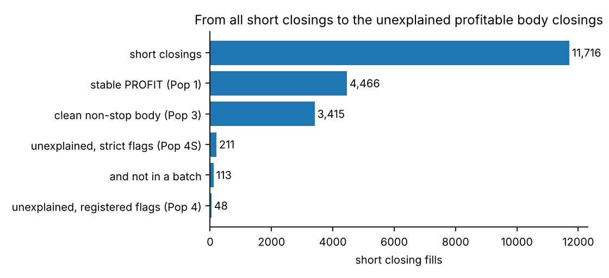
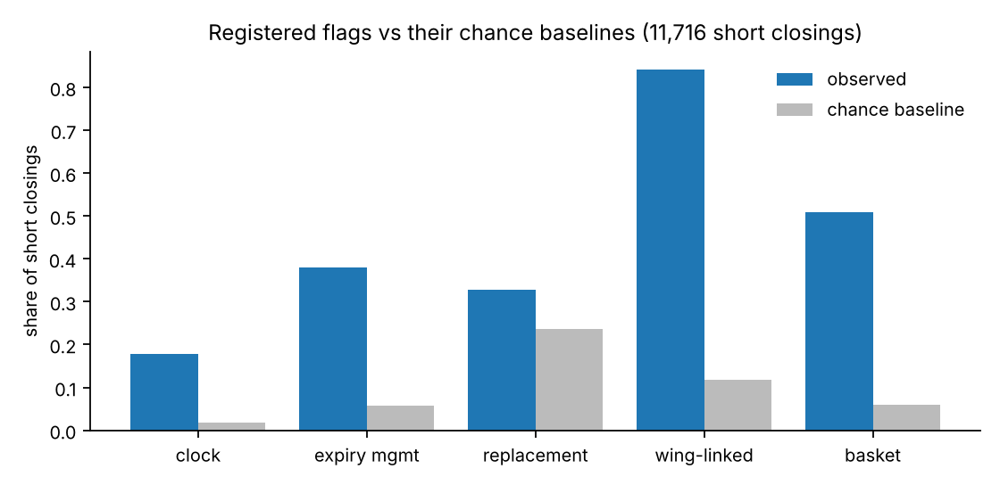
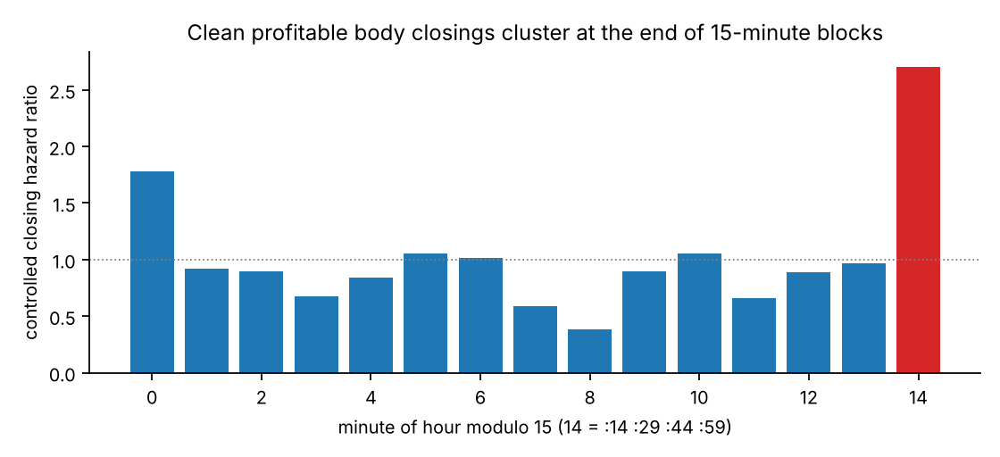
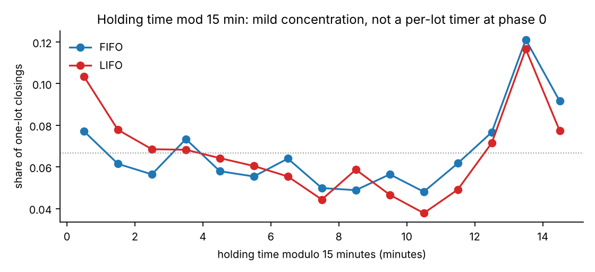

# TP-02 · Exit-mechanism attribution and the profitable short exits

**Verdict: PASS (attribution complete). A take-profit rule was NOT found.** Profitable short body closings are mostly part of **scheduled, multi-contract expiry-day actions that end on 15-minute block boundaries and release the wings together**, not independent per-position premium targets.
The trigger that decides *which* actions happen is still unidentified. All results are in-sample on 65 inspected sessions and descriptive, not causal. Branch `research/tp02-exit-mechanism-attribution` (from TP-01 `086b8612`). Pre-registration: [`TP02_PHASE0_AUDIT.md`](TP02_PHASE0_AUDIT.md), [`tp02/config.yaml`](tp02/config.yaml).

## 1. Executive summary

| Question | Answer |
|---|---|
| 1. Short closings attributable to a stop | **4.0 % confirmed** (`s_` module, 468 fills); a further **56.3 % possible** (price or timing evidence only; 33.7 %–61.2 % of all short closings under the 1.5× / 1.15× thresholds for the price rule alone); 39.7 % not evidenced |
| 2. Explained by clock | 17.8 % of short closings fall on the 7 registered clock minutes (chance 1.8 %); **82 % of the 09:15 cluster is stop-related**; the other six minutes are expiry-day body closings. Across all minutes of the hour, the 15-minute block end (:14 :29 :44 :59) has **2.7×** the closing hazard (Holm p = 0.030) |
| 3. Explained by expiry management | 37.9 % of short closings are on an expiry day from 14:30 (chance 5.8 %); 88.3 % of all short closings and 96.0 % of Pop 3 are on expiry days |
| 4. Replacement / re-entry | 32.9 % (chance 23.7 %): only 4.9 points above chance among Pop 3 (CI -0.8 to 10.2); **not supported as an explanation** |
| 5. Wing / hedge management | **84 %** of short closings have a wing closing of the same right within ±10 s (chance 12 %); 93 % of `h_` wing closings have a body short closing partner (chance 13 %) |
| 6. Profitable body closings left unexplained | Pop 3 (clean, profitable, non-stop, body) = **3,415**; unexplained by the registered flags **48**, by the stricter flags **211** (113 outside any multi-contract batch); counting only the excess of each flag over chance, up to **2,440** |
| 7. Repeatable TP-related behaviour in them | **No.** Decay-level hazard (H1) not supported in any convention; no decay cluster in Pop 4 / 4S; no portfolio mark-to-market threshold distinguishable (H4b). Only market-state effects are small (§12) |
| 8. Stable under FIFO / LIFO / average cost | Pop 3 is stable by construction (PROFIT under all three); H1 is NOT_SUPPORTED under each; mechanism shares move by a few points (clock 20.4 % FIFO, 24.7 % LIFO) |
| 9. Strongest explanation | scheduled expiry-day, multi-contract closing actions on 15-minute block ends with hedge release (H2a and H4a SUPPORTED, §12) |
| 10. Data that would help most | decision logs or configuration (what triggers the batch), per-order leg identifiers, decision times for body orders, expiry settlement prices, a later out-of-sample period (§17) |

## 2. Research question
What makes Algo 8 close a profitable short position when no stop-loss is being triggered? TP-01 left an unexplained mix of stop-like, clock-driven and partial one-lot closings. TP-02 attributes every closing fill to evidence flags, isolates the profitable short body closings that no stop explains, and tests six registered hypotheses on them.

## 3. Data and methodology
* **Inputs (read-only):** TP-01 ledger, roles, exit events (17,760 closing fills, 11,716 short), the exposure panel (209,489 short-inventory minutes), the raw trade file and raw Breeze bars. No Stage 2 file is used.
* **Three times kept apart:** decision time (exact only for tagged `h_ s_ v_ m_` orders; unavailable for the 12,196 body closings, where only bounds exist), order-entry minute, execution second. One order-entry stamp exceeds its first fill by under 60 s (minute rounding); the bound then uses the first fill.
* **Evidence flags, not forced labels** (definitions fixed in `config.yaml` before any result): stop (`STOP_CONFIRMED` = module `s_`; `STOP_POSSIBLE` = inside a cycle-stop execution window, or the contract mark ≥ 1.25× the reference in the previous 15 minutes, or exit price ≥ 1.25× the reference; else `STOP_NOT_EVIDENCED`, which is not proof of absence); clock (all 7 TP-01 minutes); expiry (expiry day from 14:30); replacement; wing; basket.
* **Deviation, disclosed:** the registered flags are near-saturated (98 % of short closings carry one), so presence alone proves nothing. I therefore added, after seeing this, (i) stricter variants (`REPLACEMENT_STRICT`, `WING_LINKED_STRICT`) and (ii) a **chance baseline** for every flag (time-shift null for association flags, exposure share for calendar flags). The registered results are reported unchanged next to them. The effect rule for the holding-time test (H2b) was also not in the registered config (R ≥ 0.10, more than 3× the null 97.5th percentile).
* **Inference:** permutation labels shuffled only inside cycle × day-type × hour strata; bootstrap over whole expiry cycles (1000 resamples); Holm over the 16 registered primary tests; no ML. Hazard ratios and AUCs are descriptive.
* **Reconciliation with TP-01:** all 23 checks agree (closing fills 17,760, closed units 1,377,065, per-convention label counts, per-module counts); difference 0 on every line (`data/mechanism_reconciliation.csv`).

## 4. Module-specific exit analysis
| module | candidate_mechanism | events | share_of_short |
|---|---|---|---|
| h_ | MULTIPLE_POSSIBLE_MECHANISMS | 109 | 0.009 |
| h_ | WING_LINKED | 15 | 0.001 |
| num | MULTIPLE_POSSIBLE_MECHANISMS | 9,375 | 0.8 |
| num | WING_LINKED | 1,165 | 0.099 |
| num | EXPIRY_MGMT | 251 | 0.021 |
| num | REPLACEMENT | 195 | 0.017 |
| num | UNEXPLAINED_BODY | 69 | 0.006 |
| num | STOP_POSSIBLE | 52 | 0.004 |
| num | CLOCK | 15 | 0.001 |
| num | UNRESOLVED | 2 | 0.0 |
| s_ | STOP_CONFIRMED | 468 | 0.04 |

Short closings by module: `num` 11,124, `s_` 468, `h_` 124. A `num` order is a body order; none of the `num` closings is called a take-profit here. `candidate_mechanism` is `MULTIPLE_POSSIBLE_MECHANISMS` for 81 % of short closings, because the flags overlap; the per-flag shares with chance baselines are the informative numbers:

| population | item | events | share_of_events | chance_rate | excess_over_chance | cycles |
|---|---|---|---|---|---|---|
| short closings (all) | STOP_CONFIRMED (module s_) | 468 | 0.04 |  |  | 12 |
| short closings (all) | STOP_POSSIBLE | 6,601 | 0.563 |  |  | 35 |
| short closings (all) | STOP_NOT_EVIDENCED | 4,647 | 0.397 |  |  | 35 |
| short closings (all) | sensitivity: adverse premium >= 1.15x reference in the previous 15 min | 7,174 | 0.612 |  |  | 35 |
| short closings (all) | sensitivity: adverse premium >= 1.5x reference in the previous 15 min | 3,952 | 0.337 |  |  | 35 |
| short closings (all) |   of which: inside a cycle-stop window | 902 | 0.077 |  |  | 12 |
| short closings (all) |   of which: adverse premium >= 1.25x | 6,151 | 0.525 |  |  | 35 |
| short closings (all) |   of which: exit price >= 1.25x reference | 5,291 | 0.452 |  |  | 35 |
| short closings (all) | CLOCK (registered minute) | 2,083 | 0.178 | 0.018 | 0.16 | 31 |
| short closings (all) | EXPIRY_MGMT (expiry day, 14:30 onward) | 4,443 | 0.379 | 0.058 | 0.321 | 21 |
| short closings (all) | REPLACEMENT (same right, <= 60 s, registered) | 3,850 | 0.329 | 0.237 | 0.092 | 35 |
| short closings (all) | REPLACEMENT_STRICT (+ later order number, same units) | 2,944 | 0.251 |  |  | 35 |
| short closings (all) | WING_MODULE (h_) | 124 | 0.011 |  |  | 13 |
| short closings (all) | WING_LINKED (wing closing same right, +-10 s, registered) | 9,852 | 0.841 | 0.118 | 0.723 | 35 |
| short closings (all) | WING_LINKED_STRICT (+ same units) | 5,768 | 0.492 |  |  | 35 |
| short closings (all) | BASKET (>= 2 other contracts, +-5 s) | 5,966 | 0.509 | 0.059 | 0.45 | 35 |
| short closings (all) | any registered non-stop flag | 11,507 | 0.982 |  |  | 35 |
| short closings (all) | any strict non-stop flag | 9,825 | 0.839 |  |  | 35 |
| short closings (all) | no registered flag at all (unexplained) | 69 | 0.006 |  |  | 18 |
| short, stable PROFIT | STOP_CONFIRMED (module s_) | 164 | 0.037 |  |  | 12 |
| short, stable PROFIT | STOP_POSSIBLE | 793 | 0.178 |  |  | 29 |
| short, stable PROFIT | STOP_NOT_EVIDENCED | 3,509 | 0.786 |  |  | 33 |
| short, stable PROFIT | sensitivity: adverse premium >= 1.15x reference in the previous 15 min | 1,162 | 0.26 |  |  | 33 |
| short, stable PROFIT | sensitivity: adverse premium >= 1.5x reference in the previous 15 min | 244 | 0.055 |  |  | 21 |
| short, stable PROFIT |   of which: inside a cycle-stop window | 246 | 0.055 |  |  | 12 |
| short, stable PROFIT |   of which: adverse premium >= 1.25x | 770 | 0.172 |  |  | 28 |
| short, stable PROFIT |   of which: exit price >= 1.25x reference | 0 | 0.0 |  |  | 0 |
| short, stable PROFIT | CLOCK (registered minute) | 1,070 | 0.24 | 0.018 | 0.222 | 29 |
| short, stable PROFIT | EXPIRY_MGMT (expiry day, 14:30 onward) | 2,653 | 0.594 | 0.058 | 0.536 | 21 |
| short, stable PROFIT | REPLACEMENT (same right, <= 60 s, registered) | 1,608 | 0.36 | 0.237 | 0.123 | 35 |
| short, stable PROFIT | REPLACEMENT_STRICT (+ later order number, same units) | 1,285 | 0.288 |  |  | 35 |
| short, stable PROFIT | WING_MODULE (h_) | 103 | 0.023 |  |  | 12 |
| short, stable PROFIT | WING_LINKED (wing closing same right, +-10 s, registered) | 3,446 | 0.772 | 0.118 | 0.654 | 35 |
| short, stable PROFIT | WING_LINKED_STRICT (+ same units) | 1,969 | 0.441 |  |  | 33 |
| short, stable PROFIT | BASKET (>= 2 other contracts, +-5 s) | 2,375 | 0.532 | 0.059 | 0.473 | 35 |
| short, stable PROFIT | any registered non-stop flag | 4,404 | 0.986 |  |  | 35 |
| short, stable PROFIT | any strict non-stop flag | 4,148 | 0.929 |  |  | 35 |
| short, stable PROFIT | no registered flag at all (unexplained) | 48 | 0.011 |  |  | 15 |
| short body, stable PROFIT, clean non-stop (Pop 3) | STOP_CONFIRMED (module s_) | 0 | 0.0 |  |  | 0 |
| short body, stable PROFIT, clean non-stop (Pop 3) | STOP_POSSIBLE | 0 | 0.0 |  |  | 0 |
| short body, stable PROFIT, clean non-stop (Pop 3) | STOP_NOT_EVIDENCED | 3,415 | 1.0 |  |  | 33 |
| short body, stable PROFIT, clean non-stop (Pop 3) | sensitivity: adverse premium >= 1.15x reference in the previous 15 min | 377 | 0.11 |  |  | 25 |
| short body, stable PROFIT, clean non-stop (Pop 3) | sensitivity: adverse premium >= 1.5x reference in the previous 15 min | 0 | 0.0 |  |  | 0 |
| short body, stable PROFIT, clean non-stop (Pop 3) |   of which: inside a cycle-stop window | 0 | 0.0 |  |  | 0 |
| short body, stable PROFIT, clean non-stop (Pop 3) |   of which: adverse premium >= 1.25x | 0 | 0.0 |  |  | 0 |
| short body, stable PROFIT, clean non-stop (Pop 3) |   of which: exit price >= 1.25x reference | 0 | 0.0 |  |  | 0 |
| short body, stable PROFIT, clean non-stop (Pop 3) | CLOCK (registered minute) | 791 | 0.232 | 0.018 | 0.214 | 25 |
| short body, stable PROFIT, clean non-stop (Pop 3) | EXPIRY_MGMT (expiry day, 14:30 onward) | 1,978 | 0.579 | 0.058 | 0.521 | 21 |
| short body, stable PROFIT, clean non-stop (Pop 3) | REPLACEMENT (same right, <= 60 s, registered) | 1,120 | 0.328 | 0.237 | 0.091 | 33 |
| short body, stable PROFIT, clean non-stop (Pop 3) | REPLACEMENT_STRICT (+ later order number, same units) | 1,038 | 0.304 |  |  | 33 |
| short body, stable PROFIT, clean non-stop (Pop 3) | WING_MODULE (h_) | 0 | 0.0 |  |  | 0 |
| short body, stable PROFIT, clean non-stop (Pop 3) | WING_LINKED (wing closing same right, +-10 s, registered) | 2,821 | 0.826 | 0.118 | 0.708 | 33 |
| short body, stable PROFIT, clean non-stop (Pop 3) | WING_LINKED_STRICT (+ same units) | 1,655 | 0.485 |  |  | 33 |
| short body, stable PROFIT, clean non-stop (Pop 3) | BASKET (>= 2 other contracts, +-5 s) | 1,724 | 0.505 | 0.059 | 0.446 | 32 |
| short body, stable PROFIT, clean non-stop (Pop 3) | any registered non-stop flag | 3,367 | 0.986 |  |  | 33 |
| short body, stable PROFIT, clean non-stop (Pop 3) | any strict non-stop flag | 3,204 | 0.938 |  |  | 33 |
| short body, stable PROFIT, clean non-stop (Pop 3) | no registered flag at all (unexplained) | 48 | 0.014 |  |  | 15 |

## 5. Clock-driven exit findings (all 7 registered minutes)
| minute | short_closings | cycles | share_expiry_day | share_body_module | share_stop_class_confirmed_or_possible | share_stable_profit | median_second | median_lots_closed | median_position_lots_before | share_closing_whole_position | share_with_ge3_other_contracts_within_30s |
|---|---|---|---|---|---|---|---|---|---|---|---|
| 09:15 | 602 | 22 | 1.0 | 0.73 | 0.82 | 0.2 | 13.0 | 1.0 | 10.0 | 0.17 | 0.87 |
| 14:29 | 119 | 21 | 0.92 | 0.98 | 0.45 | 0.54 | 29.0 | 1.0 | 29.0 | 0.02 | 0.79 |
| 14:44 | 203 | 21 | 1.0 | 1.0 | 0.47 | 0.59 | 44.0 | 1.0 | 21.0 | 0.01 | 0.87 |
| 14:58 | 255 | 13 | 1.0 | 1.0 | 0.42 | 0.7 | 33.0 | 1.0 | 21.0 | 0.01 | 0.96 |
| 14:59 | 248 | 18 | 1.0 | 1.0 | 0.46 | 0.69 | 32.0 | 1.0 | 22.0 | 0.02 | 0.96 |
| 15:14 | 447 | 19 | 0.99 | 1.0 | 0.42 | 0.64 | 31.0 | 1.0 | 11.0 | 0.25 | 0.97 |
| 15:19 | 209 | 10 | 1.0 | 1.0 | 0.48 | 0.63 | 28.0 | 1.0 | 5.0 | 0.16 | 0.99 |

* **09:15 is a stop cluster**: 602 short closings, 82 % stop-related, all on expiry days. It coincides with the 8 cycle stops executed in the opening minutes (decision times precede the fills by seconds; one SENSEX stop was decided at 09:14:13 and filled at 09:15:13).
* **14:29, 14:44, 14:58, 14:59, 15:14, 15:19** are almost exclusively expiry-day body closings (one lot per fill, partial in 92 % on average), batch-like (≥ 3 other contracts within 30 s in 92 %), and stably profitable in 63 % of cases. Seconds-of-minute are not fixed (medians 28–44 s with day-specific bursts), so there is no exact-second schedule.
* **A 15-minute structure exists but is not a per-lot timer.** Over all 15 minute-of-hour residues the controlled closing hazard peaks at residue 14 (:14 :29 :44 :59) at **2.70×** (cycle-bootstrap CI 2.09–3.45; NIFTY 2.76, SENSEX 2.66; effect in 26/33 cycles; permutation p = 0.002 corrected for the choice of residue; Holm 0.030), and a smaller one at residue 0 (1.78×). Holding time modulo 15 minutes is mildly concentrated (Rayleigh R = 0.14 FIFO, 0.17 LIFO versus a null ≤ 0.03) but only 3.0 % of closings fall within 10 s of an exact multiple (chance 2.3 %), so a timer anchored at each lot's entry is **not** supported.

## 6. Expiry-management findings
| expiry_category | events | share_of_short_events | stable_profit | share_stable_profit | cycles |
|---|---|---|---|---|---|
| D0_FINAL | 1,615 | 0.138 | 1,071 | 0.663 | 21 |
| D0_LATE | 2,538 | 0.217 | 1,361 | 0.536 | 21 |
| D0_MIDDAY | 4,541 | 0.388 | 1,325 | 0.292 | 26 |
| D0_OPEN | 883 | 0.075 | 148 | 0.168 | 31 |
| D0_POST | 223 | 0.019 | 155 | 0.695 | 2 |
| D1_CARRY_DAY_REDUCTION | 1,324 | 0.113 | 139 | 0.105 | 31 |

Stably profitable short body closings are concentrated late on expiry day: the share that is stably profitable rises from 17 % at the open to 66 % in the final 20 minutes, while carry-day reductions are 10 % profitable. Late-day profit is consistent with time decay of positions that had already decayed (median exit at 15 % of the reference, §11); **an expiry-day profit is not treated as a take-profit**.

## 7. Replacement and re-entry findings
Registered flag: an opening short in the same underlying and right by another order within 60 s of the closing. 32.9 % of short closings carry it against a chance rate of 23.7 %; the strict variant (the opening order has a later number in the same block **and** the same units) is 25.1 %.
Where an opening order of the same block follows, it was submitted after the closing order in 99.3 % of comparable cases, so the replacements are real sequences, not just nearby timestamps.

| first_open_relation | qty_relation | first_open_sequence_evidence | events | median_dt_s | stable_profit_share |
|---|---|---|---|---|---|
| same_right_other_strike | same units | opening_order_submitted_after | 2,509 | 21.0 | 0.435 |
| opposite_right | same units | opening_order_submitted_after | 1,051 | 17.0 | 0.14 |
| same_contract | same units | opening_order_submitted_after | 435 | 29.0 | 0.444 |
| same_right_other_strike | more units | opening_order_submitted_after | 350 | 16.0 | 0.263 |
| same_right_other_strike | same units | unknown | 233 | 27.0 | 0.296 |
| same_right_other_strike | fewer units | opening_order_submitted_after | 127 | 6.0 | 0.543 |
| same_right_other_strike | fewer units | unknown | 91 | 17.0 | 0.615 |
| same_right_other_strike | more units | unknown | 58 | 15.5 | 0.138 |

Among Pop 3 the excess over chance is only 4.9 points (cycle-bootstrap CI -0.8 to 10.2, one-sided bootstrap p 0.050, Holm 0.40) and re-adding the same contract within 300 s is **not** above chance (-3.0 points). Most buy-backs are therefore not strike migrations; a profitable closing is not explained by the opening that follows it.

## 8. Wing and hedge exit findings
| module | closings | units | share_of_long_closings | gross_pnl_FIFO | stable_profit_share | stable_loss_share | share_partial | share_with_body_short_closing_within_10s_same_right | chance_rate |
|---|---|---|---|---|---|---|---|---|---|
| h_ | 4,487 | 500,775 | 0.742 | -447,510 | 0.107 | 0.795 | 0.757 | 0.928 | 0.132 |
| m_ | 7 | 1,040 | 0.001 | -1,638 | 0.0 | 1.0 | 1.0 | 1.0 | 0.357 |
| num | 1,072 | 132,235 | 0.177 | -111,157 | 0.168 | 0.744 | 0.624 | 0.769 | 0.099 |
| s_ | 145 | 44,530 | 0.024 | -18,263 | 0.276 | 0.628 | 0.434 | 0.903 | 0.0 |
| v_ | 333 | 41,575 | 0.055 | -220,600 | 0.036 | 0.931 | 0.985 | 0.946 | 0.172 |
| ALL long closings | 6,044 | 720,155 | 1.0 | -799,168 | 0.118 | 0.79 | 0.739 | 0.9 | 0.126 |

Wing closings are long-direction closings: **6,044 fills, gross P&L about ₹-8.0 L**, 79 % stably losing. Wing P&L is never merged with short-body P&L. `h_` wing orders are tightly coupled to body closings (partner within ±10 s in 93 % against 13 % by chance): wings are closed together with the body rather than on a separate schedule.

## 9. Basket / portfolio-level evidence
| basket_bin | events | stable_profit_share | both_rights_share | loss_leg_share | stop_class_possible_or_confirmed |
|---|---|---|---|---|---|
| 0 | 2,928 | 0.412 | 0.0 | 0.0 | 0.499 |
| 1 | 2,822 | 0.314 | 0.304 | 0.479 | 0.647 |
| 2 | 1,967 | 0.338 | 0.452 | 0.672 | 0.632 |
| 3-4 | 1,961 | 0.428 | 0.729 | 0.739 | 0.6 |
| 5-9 | 1,714 | 0.424 | 0.942 | 0.943 | 0.652 |
| 10+ | 324 | 0.444 | 1.0 | 1.0 | 0.762 |

* **H4a (SUPPORTED):** among Pop 3, 50 % of closings have ≥ 2 other contracts closed within ±5 s, **43 points above the time-shift chance rate** (CI 35 to 51; NIFTY 38, SENSEX 46; effect in 32/33 cycles; Holm 0.016).
* Closing groups of 3 or more contracts include both rights in 89 % of cases and a concurrent losing leg in 89 %: profitable shorts are frequently closed **together with losing legs and the wings**.
* **H4b (portfolio mark-to-market, PARTIAL):** the highest controlled hazard is near a cycle mark-to-market of ₹-100 K (1.85× its neighbours), but the interval (0.72–2.42) and the permutation p (0.17) do not distinguish it from chance. **No portfolio trigger is claimed.**

## 10. Stop-confirmed, stop-possible, stop-not-evidenced
| population | item | events | share_of_events | cycles |
|---|---|---|---|---|
| short closings (all) | STOP_CONFIRMED (module s_) | 468 | 0.04 | 12 |
| short closings (all) | STOP_POSSIBLE | 6,601 | 0.563 | 35 |
| short closings (all) | STOP_NOT_EVIDENCED | 4,647 | 0.397 | 35 |
| short, stable PROFIT | STOP_CONFIRMED (module s_) | 164 | 0.037 | 12 |
| short, stable PROFIT | STOP_POSSIBLE | 793 | 0.178 | 29 |
| short, stable PROFIT | STOP_NOT_EVIDENCED | 3,509 | 0.786 | 33 |
| short, stable PROFIT, stop-related (Pop 2 ∩ profit) | STOP_CONFIRMED (module s_) | 164 | 0.171 | 12 |
| short, stable PROFIT, stop-related (Pop 2 ∩ profit) | STOP_POSSIBLE | 793 | 0.829 | 29 |
| short, stable PROFIT, stop-related (Pop 2 ∩ profit) | STOP_NOT_EVIDENCED | 0 | 0.0 | 0 |
| long closings (wings and other) | STOP_CONFIRMED (module s_) | 145 | 0.024 | 11 |
| long closings (wings and other) | STOP_POSSIBLE | 223 | 0.037 | 11 |
| long closings (wings and other) | STOP_NOT_EVIDENCED | 5,676 | 0.939 | 35 |

* Cycle stops: 12 cycles, 763 `s_` fills; decision-to-fill lag median 3.1 s (decision time exact from the tag). Inside the stop windows other modules keep acting: 434 body short closings and 133 body short openings versus 117 short openings by the stop module itself (the RSK-12 overshoot, seen again at execution time).
* **Price-based stop evidence is deliberately broad**: 53 % of short closings had a mark ≥ 1.25× the reference in the previous 15 minutes (under any convention) and 45 % exited above 1.25× (losses). It identifies where a stop could have acted, not that it did; the three thresholds (1.15 / 1.25 / 1.5) bracket the share from 34 % to 61 %.
* Of the stably profitable short closings, 3.7 % are `s_` liquidations (a cycle stop also closes profitable legs), 18 % stop-possible, 79 % not evidenced. `STOP_NOT_EVIDENCED` is not proof that no stop occurred.

## 11. Profitable non-stop body-exit investigation
| population | events | units | lots | nifty | sensex | cycles | expiry_day_share | gross_pnl_FIFO |
|---|---|---|---|---|---|---|---|---|
| Pop1 stable PROFIT short | 4,466 | 262,760 | 6289.0 | 2053 | 2413 | 35 | 0.965 | 12,888,845 |
| Pop1b convention-sensitive PROFIT short | 2,523 | 123,155 | 2875.0 | 1220 | 1303 | 35 | 0.933 | 1,908,756 |
| Pop2 stop-related short | 7,069 | 402,655 | 9209.0 | 3455 | 3614 | 35 | 0.866 | -8,525,410 |
| Pop2 ∩ stable profit | 957 | 73,725 | 1695.0 | 484 | 473 | 32 | 0.982 | 2,504,803 |
| Pop3 clean profitable non-stop body | 3,415 | 184,350 | 4407.0 | 1564 | 1851 | 33 | 0.96 | 9,888,851 |
| Pop4 unexplained (registered flags) | 48 | 3,280 | 56.0 | 40 | 8 | 15 | 0.938 | 140,099 |
| Pop4S unexplained (strict flags) | 211 | 14,105 | 379.0 | 117 | 94 | 29 | 0.834 | 860,765 |

By convention (profit defined under each):

| convention | profit_short_closings | stop_confirmed | stop_possible | clean_nonstop_body | clean_nonstop_unexplained_registered | clean_nonstop_unexplained_strict |
|---|---|---|---|---|---|---|
| FIFO | 6355 | 186 | 1933 | 4142 | 51 | 341 |
| LIFO | 5013 | 210 | 1213 | 3496 | 48 | 218 |
| AVG | 6147 | 186 | 1722 | 4145 | 52 | 335 |

Pop 3 has **3,415 events in 33 cycles** (NIFTY 1,564, SENSEX 1,851), median exit at **15 %** of the reference premium and a median exit price of 9.6 points: they are deeply decayed shorts closed late on expiry day, 96 % of them on expiry day.
The unexplained part depends on how strictly a flag counts as an explanation:

| definition | unexplained events |
|---|---|
| every registered flag explains its event | 48 |
| strict flags (same units / later order number) | 211 |
| strict flags and outside any multi-contract batch | 113 |
| only the excess of each flag over chance explains | 2,440 |

The registered union flag rate is 98.6 % against a chance rate of 70.0 %, an excess of 28.6 %. Pop 4S (strict, 211 events, 29 cycles) is 90 % mid-day on expiry day with a median exit ratio of 44 % and a median exit price of 35 points; it has **no decay cluster under any convention** (`analysis/h1_decay_distribution_by_population.csv`).

## 12. Candidate TP mechanisms (registered hypotheses)

| test_id | observed | ci_lo | ci_hi | perm_p | holm_p | events | cycles | ratio_nifty | ratio_sensex | cycles_with_effect | verdict |
|---|---|---|---|---|---|---|---|---|---|---|---|
| H1-FIFO | 1.181 | 0.879 | 1.532 | 0.996 | 1.0 | 3,415 | 33 | 1.364 | 1.033 | 10/22 | NOT_SUPPORTED |
| H1-LIFO | 1.327 | 0.983 | 1.63 | 0.495 | 1.0 | 3,415 | 33 | 1.267 | 1.464 | 12/19 | NOT_SUPPORTED |
| H1-AVG | 1.278 | 0.872 | 1.622 | 0.733 | 1.0 | 3,415 | 33 | 1.143 | 1.499 | 15/19 | NOT_SUPPORTED |
| H4b-MTM | 1.854 | 0.717 | 2.418 | 0.168 | 1.0 | 3,415 | 33 |  |  |  | PARTIAL |
| H2a-grid | 2.701 | 2.091 | 3.447 | 0.002 | 0.03 | 3,415 | 33 | 2.758 | 2.662 | 26/33 | SUPPORTED |
| H2b-timer-FIFO | 0.137 | 0.002 | 0.032 | 0.002 | 0.03 | 3,953 | 33 | 0.03 |  |  | PARTIAL |
| H2b-timer-LIFO | 0.168 | 0.003 | 0.032 | 0.002 | 0.03 | 3,971 | 33 | 0.038 |  |  | PARTIAL |
| H5-idx_ret_15m_bp | 0.492 | 0.463 | 0.52 | 0.402 | 1.0 | 3,415 | 33 | 0.501 | 0.489 | 16/31 | NOT_SUPPORTED |
| H5-idx_ret_60m_bp | 0.522 | 0.486 | 0.557 | 0.003 | 0.04 | 3,415 | 33 | 0.517 | 0.524 | 21/31 | NOT_SUPPORTED |
| H5-rv30_bp | 0.541 | 0.51 | 0.573 | 0.003 | 0.04 | 3,415 | 33 | 0.529 | 0.546 | 18/31 | NOT_SUPPORTED |
| H5-range_expansion | 0.49 | 0.474 | 0.502 | 0.03 | 0.269 | 3,415 | 33 | 0.489 | 0.49 | 14/31 | NOT_SUPPORTED |
| H5-dist_from_open_bp | 0.504 | 0.47 | 0.534 | 0.525 | 1.0 | 3,415 | 33 | 0.503 | 0.504 | 18/31 | NOT_SUPPORTED |
| H5-minutes_to_expiry | 0.407 | 0.373 | 0.436 | 0.003 | 0.04 | 3,415 | 33 | 0.454 | 0.388 | 23/32 | PARTIAL |
| H6-replacement | 0.049 | -0.008 | 0.102 | 0.05 | 0.4 | 3,415 | 33 | 0.071 | 0.03 | 22/33 | NOT_SUPPORTED |
| H4a-basket | 0.426 | 0.351 | 0.508 | 0.001 | 0.016 | 3,415 | 33 | 0.384 | 0.46 | 32/33 | SUPPORTED |
| H3-readd | -0.03 | -0.067 | 0.008 | 0.936 | 1.0 | 3,415 | 33 | -0.036 | -0.025 | 14/33 | NOT_SUPPORTED |

`perm_p` is a permutation p-value (H1, H2, H4b, H5) or a one-sided cycle-bootstrap p (H3, H4a, H6); `holm_p` is Holm-adjusted over all 16. For H5 the individual rows read NOT_SUPPORTED when the AUC stays inside the registered no-effect threshold (< 0.55 or > 0.45) even if it is statistically detectable (60-minute return and 30-minute volatility, Holm 0.04). For H2b the columns `ci_lo / ci_hi` are the null 2.5 / 97.5 percentiles of R and `ratio_nifty` is the share of closings within 10 s of a multiple of 15 minutes.

| Hypothesis | Verdict | Evidence for | Evidence against |
|---|---|---|---|
| H1 fixed premium-decay TP | **NOT_SUPPORTED** (all 3 conventions) | Pop 3 has a descriptive cluster at 0–5 % of the reference under all three conventions (942–998 events) | Controlled hazard ratio at the best decay bin only 1.18 / 1.33 / 1.28× (permutation p 1.00 / 0.50 / 0.73); the cluster is deep decay late on expiry day, not a target |
| H2 scheduled harvesting | **SUPPORTED (15-minute block ends)**; per-lot entry timer NOT supported | residue 14: 2.70× | exact-second schedule absent; hold mod 900 s concentration mild |
| H3 position-level reduction | **NOT_SUPPORTED** | partial, one-lot closings are the norm | no re-add above chance (-3.0 points) |
| H4 basket / portfolio | **SUPPORTED for simultaneous multi-contract closing (H4a)**; mark-to-market threshold PARTIAL / not distinguishable (H4b) | 43 points above chance, 32/33 cycles | no mark-to-market level separates events (p 0.17) |
| H5 market state | **PARTIAL**: small effects, not a trigger | event minutes sit nearer expiry (AUC 0.41), slightly higher 30-minute volatility (0.54) and 60-minute return (0.52) | all effects within 0.41–0.54; 15-minute return, range expansion and distance from open show none |
| H6 replacement-related realisation | **NOT_SUPPORTED** | 32.8 % flagged | excess 4.9 points, CI includes 0 |

## 13. Matching-convention sensitivity
| profit_defined_by | profit_short_closings | stop_confirmed | stop_possible | stop_not_evidenced | clock | expiry_mgmt | replacement | replacement_strict | wing_linked | basket | body_module | stable_across_conventions |
|---|---|---|---|---|---|---|---|---|---|---|---|---|
| FIFO | 6355 | 0.029 | 0.304 | 0.667 | 0.204 | 0.504 | 0.348 | 0.284 | 0.815 | 0.503 | 0.955 | 0.703 |
| LIFO | 5013 | 0.042 | 0.242 | 0.716 | 0.247 | 0.611 | 0.342 | 0.27 | 0.765 | 0.546 | 0.938 | 0.891 |
| AVG | 6147 | 0.03 | 0.28 | 0.69 | 0.222 | 0.542 | 0.345 | 0.28 | 0.804 | 0.519 | 0.953 | 0.727 |
| STABLE (all three) | 4466 | 0.037 | 0.178 | 0.786 | 0.24 | 0.594 | 0.36 | 0.288 | 0.772 | 0.532 | 0.94 | 1.0 |

Pop 3 and Pop 4 are PROFIT under all three conventions by construction, so their membership is convention-free; what differs is the broader profit set (FIFO 6,355, LIFO 5,013, average cost 6,147 profitable short closings) and the reference premium used in H1 (three separate runs, all NOT_SUPPORTED). The stop-possible share of profitable closings falls from 30 % (FIFO) to 18 % when stability is required, because convention-sensitive closings sit near stop-like references.

## 14. Per-expiry and per-underlying consistency
| und | short_closings | stop_confirmed_share | stop_possible_share | clock | expiry_mgmt | replacement | wing_linked | basket | pop3 | pop4s_strict |
|---|---|---|---|---|---|---|---|---|---|---|
| NIFTY | 5,484 | 0.062 | 0.568 | 1026 | 2120 | 1745 | 4491 | 2834 | 1564 | 117 |
| SENSEX | 6,232 | 0.021 | 0.559 | 1057 | 2323 | 2105 | 5361 | 3132 | 1851 | 94 |

Pop 3 has events in 33 of 35 cycles (NIFTY 18, SENSEX 15); cycle stops occur in 12 cycles (NIFTY 7, SENSEX 5). Per-test cycle counts and underlying ratios are in section 12; per-cycle detail in `analysis/mechanism_by_cycle.csv`. NIFTY has the higher confirmed-stop share (6.2 % vs 2.1 %) because 7 of the 12 cycle stops are NIFTY.

## 15. Alternative explanations tested
* *Fixed decay TP* (H1): rejected as a driver. *Per-lot entry timer* (H2b at phase 0): rejected. *Strike migration* (H6, H3): rejected. *Portfolio mark-to-market threshold* (H4b): not distinguishable. *Market state* (H5): small effects only.
* *Time decay alone*: late-day expiry closings of deeply decayed shorts would look like profitable "targets"; the controlled hazard shows no decay-level preference, so the cluster near 0–5 % is consistent with a time effect.
* *Stop-module overshoot*: stop windows contain body closings and openings; Pop 3 excludes events inside them and events whose mark reached 1.25× in the previous 15 minutes.
* *Chance association*: every flag is shown against a chance baseline; wing, basket and 15-minute-block associations survive it, replacement does not.

## 16. Limitations
1. **No decision logs.** Body-order decision times are unavailable; stop absence cannot be proven.
2. **Flags are generous and overlapping** (98 % of short closings carry at least one). The explained / unexplained split is a range, not a point. The stricter flags and the chance baseline were added after the saturation was observed.
3. **Lot ownership is unidentified**; all attributions repeat under three conventions.
4. **Hazard ratios and AUCs are associations**, not causes; the 15-minute structure could be produced by data-generation or order-batching mechanics unrelated to a profit decision.
5. **In-sample**: 65 sessions, all inspected before; only 33 cycles contribute Pop 3 events.
6. **Option data cover only contracts Algo 8 traded**; marks are 1-minute closes with carried prices; index minutes after 15:15 are excluded when frozen (DAT-15 of the alpha branch).
7. **Cycle mark-to-market** uses average-cost basis and 1-minute marks, not the algorithm's own quotes (Stage 1: the stop constant is known only to within ₹1.22–1.36 L).
8. The H2b effect rule, strict flags and chance baselines were not in the registered config (documented in section 3).

## 17. Final verdict and answers

**TP-02: PASS.** Every closing fill has a stop class, mechanism flags and a confidence level; stop-confirmed / possible / not-evidenced are separated; all 7 clock minutes, replacement sequences, expiry phases, wings and baskets were analysed independently; Pop 3 / 4 were isolated; all tests pass; outputs reproduce.
**No take-profit rule was discovered**, and that is the result: the evidence says profitable short closings arise from scheduled multi-contract expiry-day actions (block ends, hedge release) plus time decay.

| Evidence level | Findings |
|---|---|
| **Confirmed facts** | counts reconcile with TP-01; 4.0 % of short closings are `s_` stop liquidations; the 09:15 cluster is stop-driven; wing closings co-occur with body closings far above chance |
| **Strong evidence** | profitable body closings concentrate in expiry-day late session, at 15-minute block ends, in multi-contract batches |
| **Hypotheses** | a schedule evaluates positions at block ends and closes baskets with their wings; the decision rule behind each batch is unknown |
| **Inconclusive / not supported** | fixed decay TP; per-lot timer; strike migration; portfolio mark-to-market threshold |

**What data would materially improve confidence:** (1) the algorithm's configuration or decision logs (batch trigger, schedule, thresholds); (2) leg / allocation identifiers per order; (3) decision timestamps for body orders; (4) official expiry settlement prices (completes P&L of the 37,480 unclosed units); (5) bid/ask and the full option chain; (6) a later period of the same account's trades for out-of-sample tests.

## 18. Recommended TP-03
**TP-03: the batch decision.** Reconstruct the multi-contract closing batches as units (members, rights, quantities, wing partners, 15-minute block, order-number block) and ask what distinguishes a batch that includes profitable shorts from one that does not: cycle-level state (mark-to-market on the algorithm's own quotes ±, side delta, hedge ratio, time to expiry) measured at the last completed minute before the batch. Pre-register the batch definition, compare against exposed non-batch minutes, keep stop-adjacent batches separate, and treat any threshold as a hypothesis for an out-of-sample test. Do **not** start TP-03 without authorisation; items (1)–(3) above would change its design.
