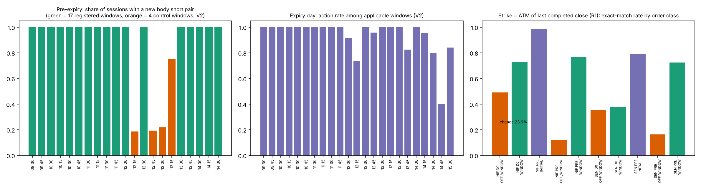

# TP-03 · Phase 1 — Entry reconstruction report

**Scope:** entry only. Phase 2 (exit) has **not** been started. PR #12 stays a draft; nothing merged.
**Configuration:** `tp03/config.yaml` unchanged, frozen sha256 `942e36d8…c2f8`. Test mechanics were written down *before* any test was run (`tp03/PHASE1_TEST_SPEC.md`, commit `6e3b1e2c`).
**Honesty labels:** every number below was **executed and observed** (two full runs, 30 output files byte-identical). Nothing is out-of-sample: all 35 cycles were already inspected in earlier stages, so the best any in-sample fitted rule can reach is STRONGLY_SUPPORTED.

---

## 1. Result first

| # | Component | What the data show | Evidence class | Open |
|---|---|---|---|---|
| E1 | **Schedule** | A new same-strike CE+PE body short pair appears in **544/544** session-windows at the 17 registered clock windows (selection-conditioned). Over all 21 candidate pre-expiry windows: **587/672 = 87.4 %** (V3: 542/626 = 86.6 %). The 4 control windows act in only 19–22 % (12:15, 12:45, 13:00) and 75 % (13:15). Expiry day: 510/543 = 94 % of applicable windows. | observation **CONFIRMED**; "timer is the trigger" **WEAKLY_SUPPORTED** (literal rubric: windows chosen from this data, E1 has no registered p-value) | why 12:15/12:45/13:00 are skipped is unexplained |
| E2 | **State gating** | No feature survives Holm. 96 testable family tests, 13 nominal p<0.05 (≈4.8 expected by chance), smallest p = 0.003 vs a threshold of 0.000417. Sign agreement of the same feature across pre-expiry and expiry day = 57 % (chance). | **UNRESOLVED** (no gating found at the 25 registered features; exploratory only) | sub-minute decision times and non-registered state not available |
| E3 | **Quantity ladder** | Quantity is window-specific (p ≈ 1e-5 vs shuffled windows; transfers NIFTY↔SENSEX, p ≈ 1e-5) **but** the window mode explains only **64.5 %** of pre-expiry quantities (3 of 21 windows ≥ 80 %) and **40 %** on expiry day → the registered falsifier (< 80 %) is met: **not a fixed template**. | tendency **WEAKLY_SUPPORTED**; "deterministic ladder" **falsified** | what moves quantity off the mode |
| E4 | Capital / margin gate | no margin, SPAN or capital data | **NOT_TESTABLE** | — |
| E5 | **Strike** | Opening: first order = ATM of the 09:15 close in **31/32** cycles; all 190 initial orders 88.4 % (NIFTY 98.9 %, SENSEX 79.2 %, misses ≤ 2 steps). Scheduled-window additions: **63.0 %** exact, 93.2 % within one step (chance 23.6 %). Off-window additions: **34.0 %** exact. SENSEX expiry-day window orders only 37.8 %. | opening **STRONGLY_SUPPORTED** (in-sample fit ceiling); window additions **WEAKLY_SUPPORTED**; off-window **UNRESOLVED** | selector for off-window and SENSEX expiry-day orders |
| E6 | **Wing strike** ("highest OTM premium ≤ 2.5 % of the ATM leg") | exact **35–42 %**, within one step **78–79 %** under three premium references (pre-expiry 44–51 % exact; expiry day 26–40 %). 2.5 % is the best of three budgets (1.5 %: 7–12 %; 4 %: 21–24 %). | **WEAKLY_SUPPORTED** (a fitted budget, not reproduced exactly) | exact selector |
| E7 | **Wing quantity** | Per window and right, wing units / body units = **1.00 in 79.7 %** of 2,163 window-rights (median 1.0; ≥ 1 in 92.7 %); p ≈ 1e-5. Parent-pair level is uninformative (both mostly 1 unit; p = 1.0). | **STRONGLY_SUPPORTED** (window level, both underlyings, 97 % of cycles, in-sample) | what the 7 % under-hedged and 13 % over-hedged windows are |
| E8 | **Re-entry after closure** | 52.4 % of body-short openings follow a short-cover within 10 min vs 50.1 % under the time-shift null (excess 2.3 pp, p = 0.012, fails Holm and the 10 pp threshold). | **WEAKLY_SUPPORTED** (no usable trigger found) | the expiry-day 80 % figure is base rate (dense closes) |
| B6 | **D-1 vs D0 accounting** | Identity gap = 0 on all 2,491 contract-days; totals reproduce TP-01 (opened 1,414,545 / closed 1,377,065 / remaining 37,480). D0 trades 3.9× the gross units of the pre-expiry day but **net-reduces** the book. | observation **CONFIRMED** | — |

---

## 2. Corrections and deviations (read these)

1. **Phase 0 expiry-day counts were wrong in 6 windows; corrected here.** Phase 0 took "last row per contract" in an unstable order; SENSEX 10 Sep after the 13:37 full liquidation read as 1,160 open short units. Inventory is now the order-independent signed sum (test added). Expiry-day window table: NOT_APPLICABLE 205 → **211**, NO_ACTION_ACTIVE 40 → **33**, NO_ACTION_UNCERTAIN 4 → **0**. The final inventory reproduces TP-01's 37,480 exactly. Gates still pass (D0 minority 33 pooled ≥ 30; 16 / 17 per underlying ≥ 10), but pooled passes by only 3.
2. **`ACTION_OTHER_CLASS` exists** (1 pre-expiry, 5 expiry-day windows: a hedge/other opening without a body short). Phase 0 said none occur; that check had looked at shorts only. They are excluded from E2 binary outcomes.
3. **`minutes_to_expiry` is not constant in pre-expiry windows** (calendar gaps between sessions); constant on expiry day → NOT_TESTABLE there. `net_units_CE` (D0) and `net_units_PE` (pre-expiry) have no usable window → NOT_TESTABLE. 12 of 400 E2 test variants.
4. Quantity statistic = rank-Pearson (ranks computed once per window), exact Spearman when no cell is missing.
5. E5 tilt at R3 is NOT_TESTABLE (no preceding 15-minute return at the open). E3 was operationalised as three tests (E3a pre-expiry, E3b expiry day, E3c cross-underlying). E1 occupies a family slot without a p-value (family size 120 kept).
6. E6: neighbour-strike premiums always come from 1-minute bars, even under the "quote" and "fill" references (mixed convention); chain is checkable for 57 % of wing orders.
7. The 20 % line in `p1_e6_cycle_consistency.csv` is a descriptive column, not a criterion.

## 3. Windows and views (E1 detail)

| Group | Windows | ACTION V2 | NO_ACTION_ACTIVE | AMBIGUOUS (V3 only) | Action rate V2 (Wilson 95 %) |
|---|---:|---:|---:|---:|---|
| Pre-expiry registered 17 | 544 | 544 | 0 | 45 | 100 % (99.3–100) |
| Pre-expiry control 4 | 128 | 43 | 84 | 0 | 33.9 % (26.2–42.5) |
| Pre-expiry all 21 | 672 | 587 | 84 (+1 other-class) | 45 | 87.5 % (84.8–89.8) |
| Expiry day, 23 windows | 759 | 510 | 33 (+5 other-class, 211 N/A) | 9 | 93.9 % of applicable |

V1 (fill time) ≡ V2 (submission, incl. boundary-ambiguous) on every window; V3 removes 45 pre-expiry and 9 expiry-day windows whose only attributed order was entered in the boundary minute. No body order was submitted before the window it filled in. All 84 + 33 no-action windows are listed in `p1_e1_non_action_windows.csv`: pre-expiry skips are 26 / 25 / 25 / 8 at 12:15 / 12:45 / 13:00 / 13:15 (control windows only); expiry-day skips cluster at 14:45 (12 of 33), 12:15 (6), 13:45 (4) and 14:30 (4).

## 4. E2 — state gating (exploratory, never confirmation)

* Design: 25 features × {action, quantity} × {pre-expiry 21 windows, expiry day}, cycle-block permutation, sequential p (seed `[20261114, crc32(test_id)]`). The 17 registered windows alone are degenerate (all act) and are descriptive.
* **Holm (family 120): 0 of 96 pass.** Smallest p: D0 quantity vs previous-window return 0.0030 and vs 15-minute return 0.0038 (both negative: larger recent rise → smaller addition; also negative on pre-expiry, p = 0.026 / 0.029; both underlyings; holds in V3 and S1 and within-window shuffle). Next: D0 action vs ATM PE premium 0.0044.
* Chance check: probability of at least one p ≤ 0.003 in 96 tests ≈ 25 %. The negative recent-return → quantity association is **a candidate to falsify, not a finding**; the four control windows were selected from earlier behaviour so pre-expiry associations cannot confirm a general rule.
* Evidence ceiling applied: no feature passes Holm in both designs → none above WEAKLY_SUPPORTED; none reaches even that.
* The only structure that explains skips is the **clock** (E1: 12:15–13:15 pre-expiry, 14:45 expiry day), not any registered state variable.

## 5. E3 — ladder (quantity = CE + PE base units)

* Mode share pre-expiry registered windows: **64.5 %** (NIFTY 65.5 %, SENSEX 63.7 %); V3 61.5 %. Windows with mode share ≥ 80 %: 09:45 (6, 90.6 %), 10:00 (2, 87.5 %), 10:45 (4, 87.5 %). Others 17–78 %.
* Expiry day: 40.2 % (V3 39.3 %); modal values vary 2–25.
* All three permutation p-values 9.99999e-06 (0 exceedances in 100,000 draws): the window matters, but it does not determine the quantity. Per-window gross opening vs net change is in `p1_e3_ladder_by_window.csv` (e.g. 12:45 control window: 6.5 opened, 9.0 covered).

## 6. E5 — strike (ATM = step·floor(S/step + 0.5))

| Class | NIFTY exact / within 1 | SENSEX exact / within 1 |
|---|---|---|
| Initial entry (R3) | 98.9 % / 98.9 % | 79.2 % / 99.0 % |
| Window, pre-expiry (R1) | 76.6 % / 99.1 % | 72.5 % / 95.6 % |
| Window, expiry day (R1) | 72.9 % / 95.7 % | **37.8 %** / 85.4 % |
| Off-window, pre-expiry (R1) | 11.9 % / 86.5 % | 16.4 % / 84.2 % |
| Off-window, expiry day (R1) | 49.0 % / 89.0 % | 35.1 % / 80.6 % |

* Overall exact: R1 48.9 %, R2 49.3 % vs chance 23.6 % (random-session-minute reference); sequential p ≈ 1e-5 (all five runnable tests significant).
* STK-01 reproduced at the first initial order (31/32 cycles; the exception is NIFTY 5 Oct 09:21). The *whole* initial set is exact in only 26/35 cycles (SENSEX 9/17): the later initial orders sit one step away, consistent with a fresher price. Post-hoc diagnostic (outside the family): using the open or close of the fill-minute bar does **not** raise the match rate (≈ 48 %), so "a fresher index price" is not shown either.
* Tilt: 72 % of non-exact offsets share the sign of the previous 15-minute move (p ≈ 1e-5). This cannot separate "selector tilts toward the move" from "price kept moving after the reference bar".
* Alternative-availability coverage: both neighbour strikes have bars for 95 % of window orders, 85 % off-window, 75 % initial.

## 7. E6 / E7 — wings

* 8,399 wing parents (3,146 pre-expiry, 5,253 expiry day); 87 % pair with a body short in the same minute and right; 4,769–4,780 have a verifiable chain.
* E6 exact by underlying × day type (bar-close reference): NIFTY 50.9 % pre / 35.6 % D0; SENSEX 47.2 % / 40.2 %. Every one of the 35 cycles has an exact rate ≥ 27.8 % (median 43 %).
* E7 C1: share at ratio exactly 1: NIFTY 90.0 % pre / 70.3 % D0; SENSEX 88.1 % / 67.2 %; 97 % of cycles (34/35) have a majority of windows at 1:1. C2 (cycle-day total per right): median 0.93, so wings are slightly under 1:1 in total.

## 8. Off-window additions (ENT-04) and E8

* 6,866 body-short parents lie outside all candidate windows (1,737 pre-expiry, 5,129 expiry day) plus 190 initial-entry orders. Median distance to the nearest window 6 min; 80 % of expiry-day off-window orders start within 10 min of a short-cover, but the time-shift null is already 50 % (closes are dense), so this is not evidence of a re-entry rule. No trigger identified → UNRESOLVED.

## 9. B6 accounting

| Day type | Sessions | Parents | Opened | Closed | Net book change | Gross traded |
|---|---:|---:|---:|---:|---:|---:|
| Pre-expiry | 32 | 9,915 | 460,860 | 110,275 | **+350,585** | 571,135 |
| Expiry day | 33 | 29,959 | 953,685 | 1,266,790 | **−313,105** | 2,220,475 |
| Total | 65 | 39,874 | 1,414,545 | 1,377,065 | +37,480 | 2,791,610 |

Expiry day opens 2.1× per session and closes 1.33× what it opens: the extra gross volume is churn plus liquidation of the carried book, not net build-up.

## 10. Why this could still be fake

* E1: the 100 % is selection-conditioned; the three clock gaps may reflect a second timer set we have not modelled.
* E2: power is limited (32 pre-expiry cycles, 33 minority windows on expiry day); "no feature passes Holm" is **not** "no gating". Decision times are minute-precision; only 25 registered features; no Greeks, IV or margin.
* E5/E6: strike and budget rules were fitted on these same 65 sessions; chain coverage is partial; mixed premium conventions.
* E7: the 1:1 ratio can arise mechanically if both leg types are sized in the same base multiples.
* Tilt, ladder deviations and skips could all be explained by data-recording gaps we cannot see.

## 11. Reproducibility and tests

* Seeds, draws, exceedances, stopping reason and extension flag for all 408 sequential tests: `analysis/p1_permutation_log_e2.csv`, `p1_permutation_log_structure.csv`. E2: 369 stopped at 100 exceedances, 13 ended at 10,000 draws, 6 extended to 100,000; structure tests: 18 of 20 extended (1.81 M draws).
* Two complete chain runs (`tp03/scripts/run_phase1.sh`) → all 30 `p1_*.csv` identical and the parquet frame equal.
* Tests: 30 in `tp03/tests` (Phase 0: 21, Phase 1: 9) — attribution classes, no-look-ahead (sources truncated at the snapshot reproduce features exactly), order-independent inventory incl. the SENSEX regression, three-view consistency, B6 identity, permutation type-I error ≤ 10 % and power ≥ 90 %, cycle-block preserves window alignment, seed reproducibility.
* Lineage: TP-01 ledger/roles/positions, raw 1-minute index and option bars, `config.yaml`; outputs in `tp03/analysis/p1_*.csv`, `tp03/data/p1_window_dataset.parquet`.

## 12. Decisions for you (non-blocking)

1. E1 grade: literal rubric gives WEAKLY_SUPPORTED as a trigger because E1 has no p-value. OK to keep, or register a p-value?
2. Is the negative recent-return → quantity association worth one pre-registered confirmatory test in Phase 3, or leave it exploratory?

**Stopping here. Phase 2 (exit) waits for your approval of this report.**
